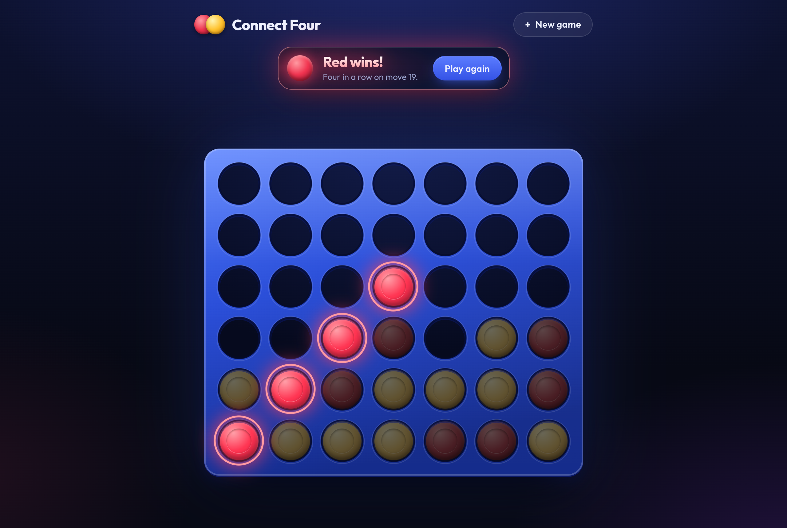

# connect-four

Two-player Connect Four with a server-authoritative Spring Boot API, MySQL, and a React UI, runnable with Docker Compose or on Kubernetes.



Design plan, trade-offs, and how the work was verified: [DECISIONS.md](DECISIONS.md).

## Quickstart

Prerequisites: Docker.

```sh
docker compose up --build
```

Open http://localhost:3000. Each game gets its own URL (`/games/{id}`), so a refresh resumes it. Click a column or press 1–7 to play.

Stop and remove everything, including the database volume, with `docker compose down -v`.

## Running on Kubernetes

Prerequisites: Docker, [kind](https://kind.sigs.k8s.io/), and kubectl.

```sh
kind create cluster --name connect-four

docker build -t connect-four-backend:dev backend
docker build -t connect-four-frontend:dev frontend
kind load docker-image connect-four-backend:dev connect-four-frontend:dev --name connect-four

kubectl apply -f k8s/
kubectl wait --for=condition=Ready pods --all --timeout=300s
kubectl port-forward svc/frontend 3000:80
```

Open http://localhost:3000. Clean up with `kind delete cluster --name connect-four`.

## Architecture

```
React (Vite) ──> nginx ──/api──> Spring Boot ──> MySQL
  frontend/      serves the UI     backend/        Flyway schema
                 and proxies /api
```

- **The server owns all rules and state.** The UI only renders the game state the API returns and sends move requests.
- **Game rules are plain Java** ([`game`](backend/src/main/java/com/nicholasbelous/connectfour/game) package) with no Spring or JPA dependencies, so they're unit-tested in isolation.
- **Moves are an append-only log.** Every read and every move rebuilds the game by replaying its moves through the rules. Every move carries the move number the client expects next, so stale or duplicate requests are rejected with 409.

## API

All errors share one JSON shape: `{"status": 409, "error": "Conflict", "message": "..."}`.

| Endpoint | Success | Errors |
|---|---|---|
| `POST /api/games` | `201` new game | |
| `GET /api/games/{id}` | `200` game state | `404` unknown game |
| `POST /api/games/{id}/moves`<br>body `{"column": 0-6, "moveNumber": n}` | `200` updated state | `400` malformed or invalid body<br>`404` unknown game<br>`409` `moveNumber` is stale or out of order<br>`422` illegal move: column full, column out of range, or game over |

Game state: `id`, `board` (rows top to bottom; `"RED"`, `"YELLOW"`, or `null`), `currentPlayer` (`null` once the game ends), `status` (`IN_PROGRESS`, `RED_WON`, `YELLOW_WON`, `DRAW`), `moves` (columns in order), `nextMoveNumber`, `winningCells`.

## Testing

```sh
cd backend && ./mvnw test                      # 53 tests, no database needed
cd frontend && npm ci && npm run lint && npm run build
```

- **Game rules (33 tests):** wins in all four directions and at every board edge, winning cells (including a gap filled to make five in a row), illegal moves, a full-board draw, a full-board win, and replaying a move log.
- **API (17 tests, `@WebMvcTest`):** every success and error status, and the error format.
- **Service (3 tests):** stale and out-of-order move numbers are rejected without saving anything.

CI runs both on every push and pull request ([.github/workflows/ci.yml](.github/workflows/ci.yml)).

## Time breakdown

| Area | Time |
|---|---|
| Planning and design | |
| Game rules and tests | |
| Persistence and API | |
| Frontend | |
| Docker, Kubernetes, and CI | |
| Documentation | |
| **Total** | |

## AI usage

_To be completed._ I used an AI coding assistant during this project; the full transcripts are in [ai-transcripts/](ai-transcripts/).
