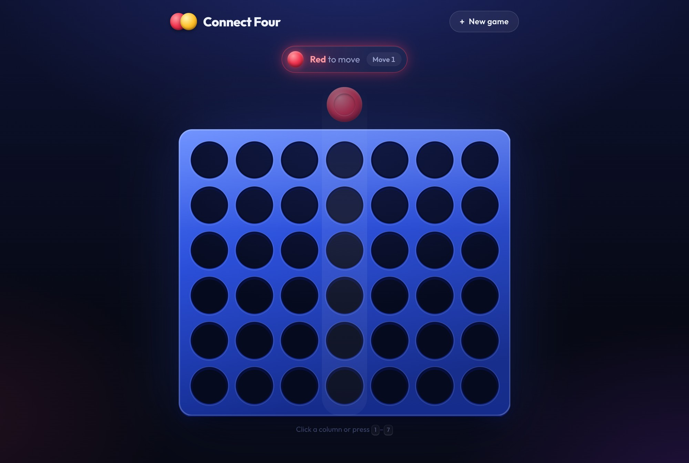
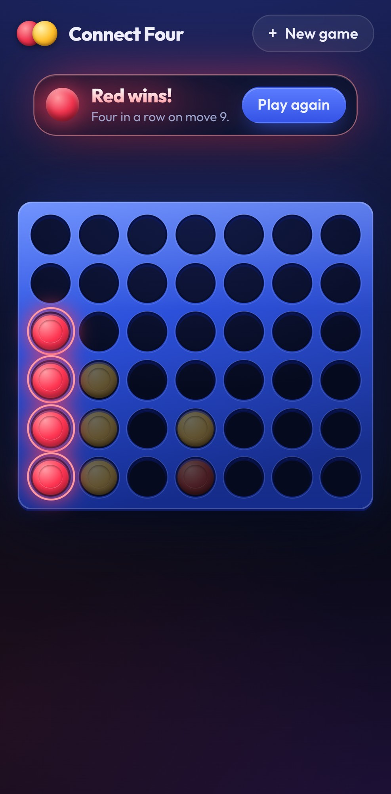
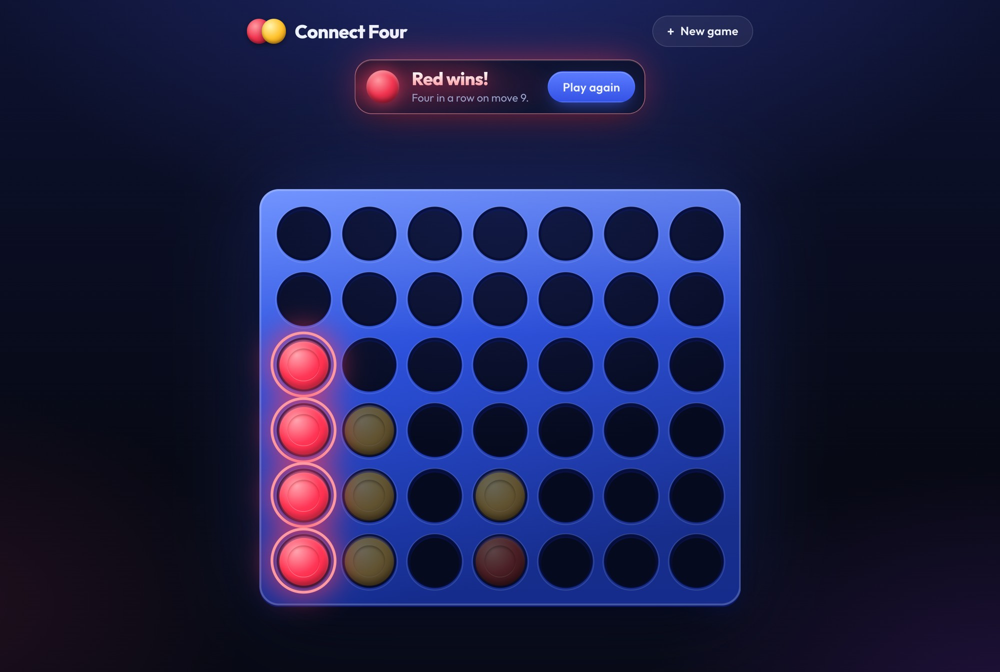
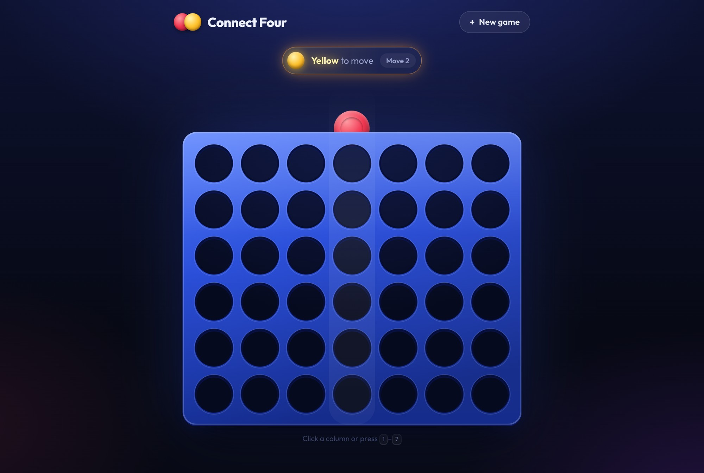
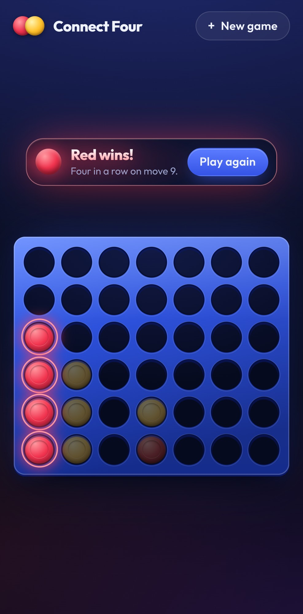
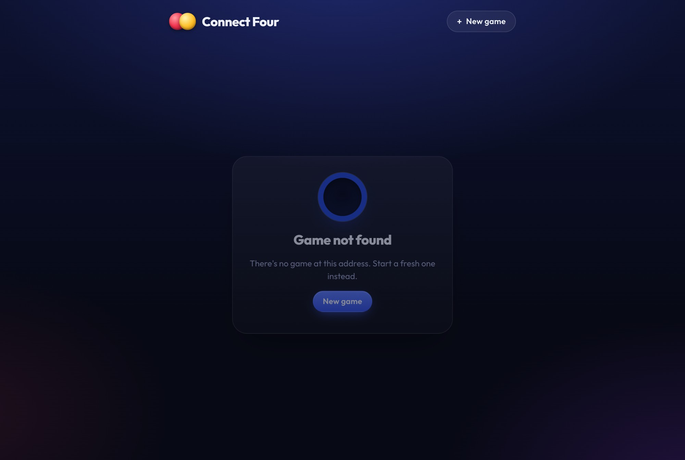
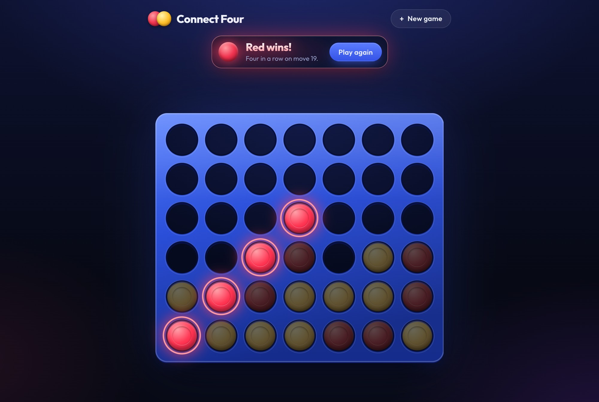

# Claude Code session: 2026-11-03-connect-four-build

- Session ID: `95949143-6127-4017-9e03-3c10eb0b3607`
- From 2026-11-03 22:17 EST to 2026-11-05 09:55 EST
- Exported verbatim from the Claude Code session log. Thinking blocks are shown where the log recorded their text; harness-only context (environment info, tool listings, IDE file snapshots) is not shown.

---

## User · 2026-11-03 22:17 EST


<pasted_content id="297a">
I'm starting a take-home project: a Connect Four game. Stack: Java 21 + Spring Boot 3 backend,
MySQL 8 with Flyway migrations, React (Vite) frontend, Docker Compose for local run, Kubernetes
manifests tested on kind. I've already made the design decisions below. Your job right now is ONLY
to create the initial commit. Do not scaffold the backend or frontend, and do not add any files
beyond the three listed.

Create exactly these three files in the repo root:

1. .gitignore covering: backend/target/, *.class, frontend/node_modules/, frontend/dist/, .env,
   .idea/, .vscode/, *.iml, .DS_Store

2. README.md containing only:
   - Title: connect-four
   - One line: "Connect Four with a server-authoritative Spring Boot API, MySQL, React, Docker,
     and Kubernetes."
   - A line saying it's a work in progress

3. DECISIONS.md: a concise design plan written as short bullets under these headings, using
   exactly the decisions below. Don't add features or decisions I haven't listed. If something
   seems wrong or missing, tell me in chat instead of adding it to the file.

   ## Scope
   - Two players, local hotseat, on one screen
   - 7 columns x 6 rows; Red moves first; win = four in a row horizontally, vertically, or diagonally;
     draw when the board is full
   - Game state persists, so a page refresh resumes the game

   ## Architecture
   - Server-authoritative: the backend owns all rules and state; the frontend only renders
     server state and sends move requests
   - Game rules live in a pure Java package with no Spring dependencies, so they're unit-testable
   - Moves are stored as an ordered log; game state is derived from the move log

   ## API
   - POST /api/games -> 201, returns new game state
   - GET /api/games/{id} -> 200 game state (board, current player, status, move list, next move
     number, winning cells if any); 404 if unknown
   - POST /api/games/{id}/moves with body {column, moveNumber} -> 200 updated state;
     409 if moveNumber is stale or out of order; 422 if the move is illegal (column full, column
     out of range, game already over); 404 if unknown game
   - One consistent JSON error format for all errors

   ## Data model
   - games: id, status (IN_PROGRESS, RED_WON, YELLOW_WON, DRAW), created_at, updated_at
   - moves: game_id, move_number, player, column_index, created_at;
     primary key (game_id, move_number), which enforces move ordering at the database level

   ## Out of scope (next steps)
   - Online multiplayer (WebSockets on top of the move log)
   - Computer opponent
   - Undo / replay
   - Frontend tests

Then:
- Show me the full contents of all three files and wait for my approval before committing.
- After I approve, make one commit with exactly this message:
  "Initial commit: README, gitignore, and design plan"
- Do not push.
</pasted_content id="297a">


## Claude · 2026-11-03 22:17 EST

**Tool call: `Bash`** — Check directory contents and git status

```sh
ls -la && git status 2>&1 | head -3
```

<sub>Tool result</sub>

```
total 0
drwxr-xr-x   2 nick  staff   64 Nov  3 22:15 .
drwxr-xr-x  16 nick  staff  512 Nov  3 22:15 ..
fatal: not a git repository (or any of the parent directories): .git
```

The directory is empty and isn't a git repo yet. I'll create the three files now and run `git init` only after you approve.

**Tool call: `Write`**

`/Users/nick/nick_vscode/Projects/connect-four/.gitignore`

```
# Backend
backend/target/
*.class

# Frontend
frontend/node_modules/
frontend/dist/

# Environment
.env

# IDE
.idea/
.vscode/
*.iml

# OS
.DS_Store

```

**Tool call: `Write`**

`/Users/nick/nick_vscode/Projects/connect-four/README.md`

```
# connect-four

Connect Four with a server-authoritative Spring Boot API, MySQL, React, Docker, and Kubernetes.

> Work in progress.

```

**Tool call: `Write`**

`/Users/nick/nick_vscode/Projects/connect-four/DECISIONS.md`

```
# Design Decisions

## Scope

- Two players, local hotseat, on one screen
- 7 columns x 6 rows
- Red moves first
- Win: four in a row horizontally, vertically, or diagonally
- Draw: the board is full with no winner
- Game state persists, so a page refresh resumes the game

## Architecture

- Server-authoritative: the backend owns all rules and state; the frontend only renders server state and sends move requests
- Game rules live in a pure Java package with no Spring dependencies, so they're unit-testable
- Moves are stored as an ordered log; game state is derived from the move log

## API

- `POST /api/games` -> `201`, returns new game state
- `GET /api/games/{id}` -> `200` with game state; `404` if unknown
  - Game state: board, current player, status, move list, next move number, winning cells (if any)
- `POST /api/games/{id}/moves`, body `{column, moveNumber}`
  - `200` with updated state
  - `409` if `moveNumber` is stale or out of order
  - `422` if the move is illegal (column full, column out of range, game already over)
  - `404` if unknown game
- One consistent JSON error format for all errors

## Data model

- `games`: `id`, `status` (`IN_PROGRESS`, `RED_WON`, `YELLOW_WON`, `DRAW`), `created_at`, `updated_at`
- `moves`: `game_id`, `move_number`, `player`, `column_index`, `created_at`
  - Primary key `(game_id, move_number)`, which enforces move ordering at the database level

## Out of scope (next steps)

- Online multiplayer (WebSockets on top of the move log)
- Computer opponent
- Undo / replay
- Frontend tests

```

<sub>Tool result</sub>

```
File created successfully at: /Users/nick/nick_vscode/Projects/connect-four/.gitignore (file state is current in your context — no need to Read it back)
```

<sub>Tool result</sub>

```
File created successfully at: /Users/nick/nick_vscode/Projects/connect-four/README.md (file state is current in your context — no need to Read it back)
```

<sub>Tool result</sub>

```
File created successfully at: /Users/nick/nick_vscode/Projects/connect-four/DECISIONS.md (file state is current in your context — no need to Read it back)
```

I've created all three files. Nothing is committed yet, and the folder still isn't a git repo.

### `.gitignore`
```gitignore
# Backend
backend/target/
*.class

# Frontend
frontend/node_modules/
frontend/dist/

# Environment
.env

# IDE
.idea/
.vscode/
*.iml

# OS
.DS_Store
```

### `README.md`
```markdown
# connect-four

Connect Four with a server-authoritative Spring Boot API, MySQL, React, Docker, and Kubernetes.

> Work in progress.
```

### `DECISIONS.md`
```markdown
# Design Decisions

## Scope

- Two players, local hotseat, on one screen
- 7 columns x 6 rows
- Red moves first
- Win: four in a row horizontally, vertically, or diagonally
- Draw: the board is full with no winner
- Game state persists, so a page refresh resumes the game

## Architecture

- Server-authoritative: the backend owns all rules and state; the frontend only renders server state and sends move requests
- Game rules live in a pure Java package with no Spring dependencies, so they're unit-testable
- Moves are stored as an ordered log; game state is derived from the move log

## API

- `POST /api/games` -> `201`, returns new game state
- `GET /api/games/{id}` -> `200` with game state; `404` if unknown
  - Game state: board, current player, status, move list, next move number, winning cells (if any)
- `POST /api/games/{id}/moves`, body `{column, moveNumber}`
  - `200` with updated state
  - `409` if `moveNumber` is stale or out of order
  - `422` if the move is illegal (column full, column out of range, game already over)
  - `404` if unknown game
- One consistent JSON error format for all errors

## Data model

- `games`: `id`, `status` (`IN_PROGRESS`, `RED_WON`, `YELLOW_WON`, `DRAW`), `created_at`, `updated_at`
- `moves`: `game_id`, `move_number`, `player`, `column_index`, `created_at`
  - Primary key `(game_id, move_number)`, which enforces move ordering at the database level
```
```markdown
## Out of scope (next steps)

- Online multiplayer (WebSockets on top of the move log)
- Computer opponent
- Undo / replay
- Frontend tests
```

I changed some formatting only, no content. I split the Scope rules into separate bullets, put the game-state fields under the GET bullet, and put paths, fields and status codes in code formatting. I also wrote "Draw: the board is full with no winner" so it's clear a win on the last move counts as a win.

### Things that seem wrong or missing (not added to the file)

1. **The primary key doesn't fully enforce move ordering.** `(game_id, move_number)` stops two moves from having the same number, which also handles two requests racing for the same move. It doesn't stop gaps: a move numbered 7 could be stored after move 3. The service still has to check that `moveNumber == nextMoveNumber`. You might reword this as "enforces one move per move number at the database level." The `409` check in the service then covers the rest.
2. **When the database rejects a duplicate move, the API should return `409`.** If two requests pass the service check at the same moment, the second insert fails on the primary key. That failure should become a `409`, not a `500`.
3. **`games.status` is stored, but state is supposed to come from the move log.** This works as a cached value if it's updated in the same transaction as the move insert. It's worth deciding that on purpose.
4. **Checks on the moves endpoint need an order.** For example, if the game is over and `moveNumber` is also stale, should that be `409` or `422`? A common order is 404 → 409 → 422.
5. **No status code for bad request bodies.** A missing `column` or a non-integer value has no listed code. `400` is the usual choice.
6. **Small details not specified:** whether `column` and `moveNumber` start at 0 or 1, the `id` type (UUID or auto-increment), and a foreign key from `moves.game_id` to `games.id`.
7. **Resuming after refresh:** the plan doesn't say how the frontend gets the game id back after a reload. It could be the URL (`/games/{id}`) or localStorage.

You can tell me to change any of these, or approve the files as they are. Once you approve, I'll run `git init` and make one commit with the message "Initial commit: README, gitignore, and design plan". I won't push.

## User · 2026-11-03 22:20 EST


<pasted_content id="297a">
I want to keep the take-home instructions PDF inside this repo folder for reference, but it must
never be committed.

1. Add this to .gitignore, at the end, under a "# Local only" comment:
   assignment/
2. Create an assignment/ folder in the repo root and move the PDF there from:
   <PATH TO THE PDF, e.g. ~/Downloads/Chess.com Take-Home.pdf>
3. Verify it's ignored:
   - Run `git status` and confirm neither assignment/ nor the PDF appears
   - Run `git check-ignore -v` on the PDF's new path and show me the output
   - Run `git log --all --stat` and confirm the PDF has never been committed
4. Committing:
   - If the initial commit hasn't been made yet, include the .gitignore change in it, using the
     message "Initial commit: README, gitignore, and design plan"
   - If the initial commit already exists, make a separate commit with only the .gitignore change,
     using the message "Ignore local assignment folder"
   Show me the diff and wait for my approval before committing. Do not push.
</pasted_content id="297a">


## Claude · 2026-11-03 22:20 EST

The PDF path in your message is still the template placeholder, so I'll look for the file first.

**Tool call: `Bash`** — Search Downloads for the take-home PDF

```sh
ls -la ~/Downloads/*.pdf 2>/dev/null | grep -i -E "chess|take|home|assign|connect" ; echo "---"; ls -la ~/Downloads/"Chess.com Take-Home.pdf" 2>&1
```

<sub>Tool result (error)</sub>

```
Exit code 1
-rw-r--r--@ 1 nick  staff    109272 Nov  3 22:08 /Users/nick/Downloads/ChessCom_Product_Engineering_Internship_Take_Home_Assignment.pdf
-rw-r--r--@ 1 nick  staff     64848 Oct 25  2024 /Users/nick/Downloads/Copy of Reading CS Assignments.docx.pdf
-rw-r--r--@ 1 nick  staff   1587325 Sep 24  2025 /Users/nick/Downloads/Food Intake Analysis Instructions S25.pdf
-rw-r--r--@ 1 nick  staff    779330 Feb 24  2025 /Users/nick/Downloads/Fresh Connections Case Study.pdf
-rw-r--r--@ 1 nick  staff   8734978 May  3  2026 /Users/nick/Downloads/Homework 2.pdf
-rw-r--r--@ 1 nick  staff    233624 Feb 21  2026 /Users/nick/Downloads/Homework 2_ ER Models and Constraints.pdf
-rw-r--r--@ 1 nick  staff  14395999 Apr 22  2026 /Users/nick/Downloads/Homework.pdf
-rw-r--r--@ 1 nick  staff    111655 Mar 11  2026 /Users/nick/Downloads/Homework3CS240.pdf
-rw-r--r--@ 1 nick  staff   3666475 Nov  2 12:47 /Users/nick/Downloads/Homeworke 8.pdf
-rw-r--r--@ 1 nick  staff  15647701 Feb 26  2026 /Users/nick/Downloads/Nicholas Beivus Homework 2.pdf
-rw-r--r--@ 1 nick  staff  12012986 Apr  2  2026 /Users/nick/Downloads/Nicholes Belous Homework 7.pdf
-rw-r--r--@ 1 nick  staff   3619242 Feb 27  2026 /Users/nick/Downloads/Wolf_Reader,ComeHome_ltr3.pdf
-rw-r--r--@ 1 nick  staff   4065524 Mar  1  2026 /Users/nick/Downloads/Wolf_ReaderComeHome_ltr4.pdf
-rw-r--r--@ 1 nick  staff    182451 Sep 16 20:05 /Users/nick/Downloads/assignment01.pdf
-rw-r--r--@ 1 nick  staff    149289 Oct 13 11:50 /Users/nick/Downloads/assignment03.pdf
-rw-r--r--@ 1 nick  staff    158109 Oct 26 20:41 /Users/nick/Downloads/assignment04.pdf
-rw-r--r--@ 1 nick  staff    108579 Dec  3  2025 /Users/nick/Downloads/final discussion assignment.pdf
-rw-r--r--@ 1 nick  staff    128871 Sep 20 18:05 /Users/nick/Downloads/homework0.pdf
-rw-r--r--@ 1 nick  staff    151571 Apr  9  2026 /Users/nick/Downloads/homework4_solution.pdf
---
ls: /Users/nick/Downloads/Chess.com Take-Home.pdf: No such file or directory
```

<details><summary>Thinking</summary>

One clear match: the PDF downloaded at 22:08, just before this folder was created, so I'll use it. Next I'll update .gitignore, move the PDF, and run git init, with no commit yet.


</details>

**Tool call: `Edit`**

`/Users/nick/nick_vscode/Projects/connect-four/.gitignore`

Old:

```
# OS
.DS_Store

```

New:

```
# OS
.DS_Store

# Local only
assignment/

```

**Tool call: `Bash`** — Move PDF, init repo, and verify it is ignored

```sh
mkdir assignment && mv ~/Downloads/ChessCom_Product_Engineering_Internship_Take_Home_Assignment.pdf assignment/ && ls -la assignment/ && git init -q && echo "=== git status ===" && git status && echo "=== git check-ignore -v ===" && git check-ignore -v assignment/ChessCom_Product_Engineering_Internship_Take_Home_Assignment.pdf; echo "=== git log --all --stat ==="; git log --all --stat 2>&1
```

<sub>Tool result</sub>

```
The file /Users/nick/nick_vscode/Projects/connect-four/.gitignore has been updated successfully. (file state is current in your context — no need to Read it back)
```

<sub>Tool result</sub>

```
total 216
drwxr-xr-x@ 3 nick  staff      96 Nov  3 22:20 .
drwxr-xr-x  7 nick  staff     224 Nov  3 22:20 ..
-rw-r--r--@ 1 nick  staff  109272 Nov  3 22:08 ChessCom_Product_Engineering_Internship_Take_Home_Assignment.pdf
=== git status ===
On branch main

No commits yet

Untracked files:
  (use "git add <file>..." to include in what will be committed)
	.gitignore
	ChessCom_Product_Engineering_Internship_Take_Home_Assignment.pdf
	DECISIONS.md
	README.md

nothing added to commit but untracked files present (use "git add" to track)
=== git check-ignore -v ===
.gitignore:21:assignment/	assignment/ChessCom_Product_Engineering_Internship_Take_Home_Assignment.pdf
=== git log --all --stat ===
```

<details><summary>Thinking</summary>

The ignore rule is confirmed to match the PDF at .gitignore:21, but the repo root shows 7 entries where I expected 6, so I'm investigating that before going further.


</details>

**Tool call: `Bash`** — Inspect the unexpected PDF in the repo root

```sh
ls -la@ && echo "---" && stat -f "%i %z %Sm %N" ChessCom_*.pdf assignment/ChessCom_*.pdf 2>&1 && echo "---" && shasum -a 256 ChessCom_*.pdf assignment/ChessCom_*.pdf 2>&1 && ls -la ~/Downloads/ChessCom_* 2>&1
```

<sub>Tool result (error)</sub>

```
Exit code 1
total 280
drwxr-xr-x   8 nick  staff     256 Nov  3 22:20 .
drwxr-xr-x  16 nick  staff     512 Nov  3 22:15 ..
drwxr-xr-x@ 10 nick  staff     320 Nov  3 22:20 .git
	com.apple.provenance	    11 
-rw-r--r--@  1 nick  staff     175 Nov  3 22:20 .gitignore
	com.apple.provenance	    11 
-rw-r--r--@  1 nick  staff  109272 Nov  3 22:20 ChessCom_Product_Engineering_Internship_Take_Home_Assignment.pdf
	com.apple.provenance	    11 
-rw-r--r--@  1 nick  staff    1549 Nov  3 22:18 DECISIONS.md
	com.apple.provenance	    11 
-rw-r--r--@  1 nick  staff     133 Nov  3 22:18 README.md
	com.apple.provenance	    11 
drwxr-xr-x@  3 nick  staff      96 Nov  3 22:20 assignment
	com.apple.provenance	    11 
---
133094119 109272 Nov  3 22:20:24 2026 ChessCom_Product_Engineering_Internship_Take_Home_Assignment.pdf
133082824 109272 Nov  3 22:08:11 2026 assignment/ChessCom_Product_Engineering_Internship_Take_Home_Assignment.pdf
---
f2ed9bbc8f972b49fadd484c7ca5ac3c7b03bfb901f7f743fa9f6df572e2d8b2  ChessCom_Product_Engineering_Internship_Take_Home_Assignment.pdf
f2ed9bbc8f972b49fadd484c7ca5ac3c7b03bfb901f7f743fa9f6df572e2d8b2  assignment/ChessCom_Product_Engineering_Internship_Take_Home_Assignment.pdf
(eval):1: no matches found: /Users/nick/Downloads/ChessCom_*
```

I didn't create the root copy and don't know where it came from. Here's what I found:

- **Root copy:** created at 22:20:24, the same second as my `mv`. It's a separate file (different inode) and byte-for-byte identical to the moved one (same SHA-256).
- **Moved copy:** `assignment/ChessCom_…pdf` still has its original 22:08 timestamp, as expected after a move.
- **Downloads:** the original is gone.

My guess is that something watching the folder copied it, such as a VS Code extension or a sync tool, but that's not confirmed. **The root copy is not ignored**, so `git add .` would commit it. I've left it in place since I don't know where it came from.

### Verification output
**`git status`**: `assignment/` doesn't appear, but the root copy does:
```
Untracked files:
	.gitignore
	ChessCom_Product_Engineering_Internship_Take_Home_Assignment.pdf   ← root copy, NOT ignored
	DECISIONS.md
	README.md
```
**`git check-ignore -v assignment/ChessCom_Product_Engineering_Internship_Take_Home_Assignment.pdf`**:
```
.gitignore:21:assignment/	assignment/ChessCom_Product_Engineering_Internship_Take_Home_Assignment.pdf
```
**`git log --all --stat`**: no output. The repo has no commits, so the PDF has never been committed.

### Diff
The initial commit hasn't been made yet, so this change goes into it with the message "Initial commit: README, gitignore, and design plan". Compared with the `.gitignore` I showed you before:
```diff
 # OS
 .DS_Store
+
+# Local only
+assignment/
```

### What I need from you
1. **The root PDF copy:** should I delete it? The identical copy in `assignment/` is kept either way. You could also check first whether something on your machine is copying files into this folder.
2. **Approval of the three files** from my last message. Did you want any changes based on the notes I flagged (primary-key wording, `400` for bad bodies, and so on)?

Once you answer both, I'll stage only `.gitignore`, `README.md`, and `DECISIONS.md` by name. Then I'll confirm the staged list contains no PDF and make the commit. I won't push.

## User · 2026-11-03 22:21 EST


<pasted_content id="297a">
1. Delete the root copy of the PDF. Keep the one in assignment/.
2. Apply both of your flagged changes to DECISIONS.md: add 400 for malformed request bodies
   (distinct from 422 for illegal moves), and correct the primary-key wording so it says the key
   guarantees one move per (game_id, move_number), while the server's moveNumber check enforces
   ordering, with the key as a backstop against concurrent requests. Show me the updated
   DECISIONS.md.
3. After I approve, stage only .gitignore, README.md, and DECISIONS.md by name, run git status
   to confirm no PDF is staged or untracked outside assignment/, and make the commit. Do not push.
</pasted_content id="297a">


## Claude · 2026-11-03 22:21 EST

**Tool call: `Bash`** — Confirm copies match, then delete root PDF copy

```sh
shasum -a 256 ChessCom_*.pdf assignment/ChessCom_*.pdf && rm ChessCom_Product_Engineering_Internship_Take_Home_Assignment.pdf && ls -la . assignment/
```

**Tool call: `Edit`**

`/Users/nick/nick_vscode/Projects/connect-four/DECISIONS.md`

Old:

```
  - `200` with updated state
  - `409` if
```

New:

```
  - `200` with updated state
  - `400` if the request body is malformed (e.g. missing or non-integer fields)
  - `409` if
```

**Tool call: `Edit`**

`/Users/nick/nick_vscode/Projects/connect-four/DECISIONS.md`

Old:

```
  - Primary key `(game_id, move_number)`, which enforces move ordering at the database level
```

New:

```
  - Primary key `(game_id, move_number)` guarantees one move per move number in a game
  - Ordering is enforced by the server's `moveNumber` check; the key is a backstop against concurrent requests
```

<sub>Tool result</sub>

```
f2ed9bbc8f972b49fadd484c7ca5ac3c7b03bfb901f7f743fa9f6df572e2d8b2  ChessCom_Product_Engineering_Internship_Take_Home_Assignment.pdf
f2ed9bbc8f972b49fadd484c7ca5ac3c7b03bfb901f7f743fa9f6df572e2d8b2  assignment/ChessCom_Product_Engineering_Internship_Take_Home_Assignment.pdf
.:
total 24
drwxr-xr-x   7 nick  staff   224 Nov  3 22:21 .
drwxr-xr-x  16 nick  staff   512 Nov  3 22:15 ..
drwxr-xr-x@ 10 nick  staff   320 Nov  3 22:20 .git
-rw-r--r--@  1 nick  staff   175 Nov  3 22:20 .gitignore
-rw-r--r--@  1 nick  staff  1549 Nov  3 22:18 DECISIONS.md
-rw-r--r--@  1 nick  staff   133 Nov  3 22:18 README.md
drwxr-xr-x@  3 nick  staff    96 Nov  3 22:20 assignment

assignment/:
total 216
drwxr-xr-x@ 3 nick  staff      96 Nov  3 22:20 .
drwxr-xr-x  7 nick  staff     224 Nov  3 22:21 ..
-rw-r--r--@ 1 nick  staff  109272 Nov  3 22:08 ChessCom_Product_Engineering_Internship_Take_Home_Assignment.pdf
```

<sub>Tool result</sub>

```
The file /Users/nick/nick_vscode/Projects/connect-four/DECISIONS.md has been updated successfully. (file state is current in your context — no need to Read it back)
```

<sub>Tool result</sub>

```
The file /Users/nick/nick_vscode/Projects/connect-four/DECISIONS.md has been updated successfully. (file state is current in your context — no need to Read it back)
```

**Tool call: `Bash`** — Show updated DECISIONS.md and recheck root

```sh
cat DECISIONS.md && echo "=== root ===" && ls -A
```

<sub>Tool result</sub>

```
# Design Decisions

## Scope

- Two players, local hotseat, on one screen
- 7 columns x 6 rows
- Red moves first
- Win: four in a row horizontally, vertically, or diagonally
- Draw: the board is full with no winner
- Game state persists, so a page refresh resumes the game

## Architecture

- Server-authoritative: the backend owns all rules and state; the frontend only renders server state and sends move requests
- Game rules live in a pure Java package with no Spring dependencies, so they're unit-testable
- Moves are stored as an ordered log; game state is derived from the move log

## API

- `POST /api/games` -> `201`, returns new game state
- `GET /api/games/{id}` -> `200` with game state; `404` if unknown
  - Game state: board, current player, status, move list, next move number, winning cells (if any)
- `POST /api/games/{id}/moves`, body `{column, moveNumber}`
  - `200` with updated state
  - `400` if the request body is malformed (e.g. missing or non-integer fields)
  - `409` if `moveNumber` is stale or out of order
  - `422` if the move is illegal (column full, column out of range, game already over)
  - `404` if unknown game
- One consistent JSON error format for all errors

## Data model

- `games`: `id`, `status` (`IN_PROGRESS`, `RED_WON`, `YELLOW_WON`, `DRAW`), `created_at`, `updated_at`
- `moves`: `game_id`, `move_number`, `player`, `column_index`, `created_at`
  - Primary key `(game_id, move_number)` guarantees one move per move number in a game
  - Ordering is enforced by the server's `moveNumber` check; the key is a backstop against concurrent requests

## Out of scope (next steps)

- Online multiplayer (WebSockets on top of the move log)
- Computer opponent
- Undo / replay
- Frontend tests
=== root ===
.git
.gitignore
DECISIONS.md
README.md
assignment
```

I deleted the root copy after checking again that it matched the copy in `assignment/` (same SHA-256). The repo root now holds only `.git`, `.gitignore`, `DECISIONS.md`, `README.md` and `assignment/`, and the only PDF is in `assignment/`. No copy has reappeared so far. I'll check again right before committing.

Here's the updated `DECISIONS.md`:

```markdown
# Design Decisions

## Scope

- Two players, local hotseat, on one screen
- 7 columns x 6 rows
- Red moves first
- Win: four in a row horizontally, vertically, or diagonally
- Draw: the board is full with no winner
- Game state persists, so a page refresh resumes the game

## Architecture

- Server-authoritative: the backend owns all rules and state; the frontend only renders server state and sends move requests
- Game rules live in a pure Java package with no Spring dependencies, so they're unit-testable
- Moves are stored as an ordered log; game state is derived from the move log

## API

- `POST /api/games` -> `201`, returns new game state
- `GET /api/games/{id}` -> `200` with game state; `404` if unknown
  - Game state: board, current player, status, move list, next move number, winning cells (if any)
- `POST /api/games/{id}/moves`, body `{column, moveNumber}`
  - `200` with updated state
  - `400` if the request body is malformed (e.g. missing or non-integer fields)
  - `409` if `moveNumber` is stale or out of order
  - `422` if the move is illegal (column full, column out of range, game already over)
  - `404` if unknown game
- One consistent JSON error format for all errors

## Data model

- `games`: `id`, `status` (`IN_PROGRESS`, `RED_WON`, `YELLOW_WON`, `DRAW`), `created_at`, `updated_at`
- `moves`: `game_id`, `move_number`, `player`, `column_index`, `created_at`
  - Primary key `(game_id, move_number)` guarantees one move per move number in a game
  - Ordering is enforced by the server's `moveNumber` check; the key is a backstop against concurrent requests
```
```markdown
## Out of scope (next steps)

- Online multiplayer (WebSockets on top of the move log)
- Computer opponent
- Undo / replay
- Frontend tests
```

Only two things changed: the new `400` line under the moves endpoint, and the primary-key bullet, now split into two lines. `.gitignore` and `README.md` are the same as last time, with `.gitignore` ending in the `# Local only` / `assignment/` lines.

Once you approve, I'll stage the three files by name, run `git status` to make sure no PDF is staged or untracked outside `assignment/`, and commit with "Initial commit: README, gitignore, and design plan". I won't push.

## User · 2026-11-03 22:22 EST


<pasted_content id="297a">
One change, then commit:
Under Data model, add a bullet to the games table: "status is a cached copy of state derived from
the move log, updated in the same transaction as each move insert, so reads don't replay the log."
Also confirm the "Out of scope (next steps)" section is in the same DECISIONS.md file, not separate.

Once that's done, you're approved: stage the three files by name, check git status for any PDF
outside assignment/, and commit with "Initial commit: README, gitignore, and design plan".
Do not push.
</pasted_content id="297a">


## Claude · 2026-11-03 22:22 EST

**Tool call: `Edit`**

`/Users/nick/nick_vscode/Projects/connect-four/DECISIONS.md`

Old:

```
`created_at`, `updated_at`
- `moves`
```

New:

```
`created_at`, `updated_at`
  - `status` is a cached copy of state derived from the move log, updated in the same transaction as each move insert, so reads don't replay the log
- `moves`
```

<sub>Tool result</sub>

```
The file /Users/nick/nick_vscode/Projects/connect-four/DECISIONS.md has been updated successfully. (file state is current in your context — no need to Read it back)
```

**Tool call: `Bash`** — Verify sections, find PDFs, stage three files

```sh
grep -n "^## " DECISIONS.md && sed -n '/## Data model/,$p' DECISIONS.md && echo "=== PDFs anywhere ===" && find . -iname "*.pdf" -not -path "./.git/*" && git add .gitignore README.md DECISIONS.md && echo "=== git status ===" && git status && echo "=== staged ===" && git diff --cached --name-only
```

<sub>Tool result</sub>

```
3:## Scope
12:## Architecture
18:## API
31:## Data model
39:## Out of scope (next steps)
## Data model

- `games`: `id`, `status` (`IN_PROGRESS`, `RED_WON`, `YELLOW_WON`, `DRAW`), `created_at`, `updated_at`
  - `status` is a cached copy of state derived from the move log, updated in the same transaction as each move insert, so reads don't replay the log
- `moves`: `game_id`, `move_number`, `player`, `column_index`, `created_at`
  - Primary key `(game_id, move_number)` guarantees one move per move number in a game
  - Ordering is enforced by the server's `moveNumber` check; the key is a backstop against concurrent requests

## Out of scope (next steps)

- Online multiplayer (WebSockets on top of the move log)
- Computer opponent
- Undo / replay
- Frontend tests
=== PDFs anywhere ===
./assignment/ChessCom_Product_Engineering_Internship_Take_Home_Assignment.pdf
=== git status ===
On branch main

No commits yet

Changes to be committed:
  (use "git rm --cached <file>..." to unstage)
	new file:   .gitignore
	new file:   DECISIONS.md
	new file:   README.md

=== staged ===
.gitignore
DECISIONS.md
README.md
```

Clean: only the three files are staged, there are no untracked files, and the only PDF is in `assignment/`. Committing now.

**Tool call: `Bash`** — Create initial commit and show log

```sh
git commit -q -m "Initial commit: README, gitignore, and design plan" && git log --all --stat && echo "=== status ===" && git status --short --ignored
```

<sub>Tool result</sub>

```
commit abaca998f084bd4da94500a29995605e39034a02
Author: n-belous <118130829+n-belous@users.noreply.github.com>
Date:   Tue Nov 3 22:22:37 2026 -0500

    Initial commit: README, gitignore, and design plan

 .gitignore   | 21 +++++++++++++++++++++
 DECISIONS.md | 44 ++++++++++++++++++++++++++++++++++++++++++++
 README.md    |  5 +++++
 3 files changed, 70 insertions(+)
=== status ===
!! assignment/
```

I made the initial commit `abaca99` with the message "Initial commit: README, gitignore, and design plan". Nothing was pushed, and no remote is set up.

- **The change:** I added the `status` cache note as an indented bullet under the `games` table in `DECISIONS.md`.
- **Out of scope section:** it's in `DECISIONS.md`, not a separate file. It's the last of the file's five sections, after Data model. Last time I showed the file in two code blocks, which made it look separate.
- **The commit:** it contains only `.gitignore`, `DECISIONS.md` and `README.md`. `git log --all --stat` shows no PDF in the history.
- **Working tree:** clean. `git status --ignored` lists only `assignment/` as ignored, and the only PDF in the repo is the one in `assignment/`.

The root copy of the PDF hasn't come back. If you ever run `git add -f`, double-check what it picks up. Also, Docker includes ignored files in the build context, so when you write a Dockerfile whose context is the repo root, add `assignment/` to a `.dockerignore`.

## User · 2026-11-04 19:37 EST


<pasted_content id="297a">
Next step: scaffold the Spring Boot backend in backend/. Scaffold only: no game logic, no
controllers, no entities.

First, run `git status` and `git remote -v` and confirm local main tracks origin/main and is in
sync with it. If not, stop and tell me.

Then:
- Maven project with the Maven wrapper (mvnw), Java 21, Spring Boot 3 (latest stable)
- Group: com.nicholasbelous, artifact: connect-four, base package com.nicholasbelous.connectfour
- Dependencies: spring-boot-starter-web, spring-boot-starter-data-jpa,
  spring-boot-starter-validation, spring-boot-starter-actuator, mysql-connector-j, flyway-core,
  flyway-mysql, spring-boot-starter-test (test scope)
- application.yml: datasource URL, username, and password from environment variables
  (DB_URL, DB_USERNAME, DB_PASSWORD) with local defaults; spring.jpa.hibernate.ddl-auto=validate
  (Flyway owns the schema); expose only the actuator health endpoint
- Do not write a Flyway migration yet; that comes with the persistence commit
- Delete the generated contextLoads test. It needs a live database, and the build must pass
  without one. Real tests come with the game logic commit.

Verify `./mvnw package` succeeds with no database running.

Show me the file tree, pom.xml, and application.yml, and wait for my approval. Then commit with
"Scaffold Spring Boot backend" and push to origin/main.
</pasted_content id="297a">


## Claude · 2026-11-04 19:37 EST

First, the git status and remote check.

**Tool call: `Bash`** — Check git status, remotes, and tracking

```sh
git status && echo "=== remote -v ===" && git remote -v && echo "=== branch -vv ===" && git branch -vv && echo "=== log ===" && git log --oneline --all
```

<sub>Tool result</sub>

```
On branch main
Your branch is up to date with 'origin/main'.

nothing to commit, working tree clean
=== remote -v ===
origin	https://github.com/nicholasbelous/connect-four.git (fetch)
origin	https://github.com/nicholasbelous/connect-four.git (push)
=== branch -vv ===
* main abaca99 [origin/main] Initial commit: README, gitignore, and design plan
=== log ===
abaca99 Initial commit: README, gitignore, and design plan
```

A remote was added since the last commit, and local `main` tracks `origin/main`. "Up to date" only compares against the last fetch, so I'll fetch to confirm against GitHub itself.

**Tool call: `Bash`** — Fetch origin and compare local vs remote main

```sh
git fetch origin 2>&1 && git status -sb | head -1 && echo "local:  $(git rev-parse main)" && echo "remote: $(git rev-parse origin/main)" && git rev-list --left-right --count main...origin/main
```

<sub>Tool result</sub>

```
## main...origin/main
local:  abaca998f084bd4da94500a29995605e39034a02
remote: abaca998f084bd4da94500a29995605e39034a02
0	0
```

In sync: after the fetch, local and remote `main` are both at `abaca99`, 0 ahead and 0 behind. Next I'll check the local Java setup and find the latest stable Spring Boot 3 version.

**Tool call: `Bash`** — Check Java install and Spring Boot versions

```sh
java -version 2>&1; echo "---"; /usr/libexec/java_home -V 2>&1; echo "---"; which mvn 2>&1; echo "---"; curl -s -H "Accept: application/json" https://start.spring.io/metadata/client | python3 -c "import json,sys; d=json.load(sys.stdin); print('default:', d['bootVersion']['default']); [print(v['id'], v['name']) for v in d['bootVersion']['values']]; print('java:', [v['id'] for v in d['javaVersion']['values']])"
```

<sub>Tool result</sub>

```
java version "24.0.2" 2025-07-15
Java(TM) SE Runtime Environment (build 24.0.2+12-54)
Java HotSpot(TM) 64-Bit Server VM (build 24.0.2+12-54, mixed mode, sharing)
---
Matching Java Virtual Machines (2):
    24.0.2 (arm64) "Oracle Corporation" - "Java SE 24.0.2" /Library/Java/JavaVirtualMachines/jdk-24.jdk/Contents/Home
    21.0.5 (arm64) "Eclipse Adoptium" - "OpenJDK 21.0.5" /Library/Java/JavaVirtualMachines/temurin-21.jdk/Contents/Home
/Library/Java/JavaVirtualMachines/jdk-24.jdk/Contents/Home
---
mvn not found
---
default: 4.1.2.RELEASE
4.2.0.BUILD-SNAPSHOT 4.2.0 (SNAPSHOT)
4.2.0.RC1 4.2.0 (RC1)
4.1.3.BUILD-SNAPSHOT 4.1.3 (SNAPSHOT)
4.1.2.RELEASE 4.1.2
4.0.10.BUILD-SNAPSHOT 4.0.10 (SNAPSHOT)
4.0.9.RELEASE 4.0.9
java: ['27', '25', '21', '17']
```

Spring Initializr no longer offers Boot 3.x: its oldest option is 4.0.9, and the default is 4.1.2. I'll get the latest 3.x release from Maven Central and write the `pom.xml` by hand.

**Tool call: `Bash`** — Look up latest Spring Boot 3.x and Maven versions

```sh
curl -s https://repo1.maven.org/maven2/org/springframework/boot/spring-boot-starter-parent/maven-metadata.xml | grep -oE "<version>3\.[0-9]+\.[0-9]+</version>" | sed -E 's/<\/?version>//g' | sort -t. -k2,2n -k3,3n | tail -5; echo "---"; curl -s https://repo1.maven.org/maven2/org/apache/maven/wrapper/maven-wrapper/maven-metadata.xml | grep -E "<release>|<latest>"; curl -s https://repo1.maven.org/maven2/org/apache/maven/apache-maven/maven-metadata.xml | grep -E "<release>"
```

<sub>Tool result</sub>

```
3.5.12
3.5.13
3.5.14
3.5.15
3.5.16
---
    <latest>3.3.4</latest>
    <release>3.3.4</release>
    <release>4.0.0-rc-7</release>
```

<details><summary>Thinking</summary>

Latest Spring Boot 3.x is 3.5.16, and Maven Central's newest Maven is only a 4.0.0 release candidate, so I'm checking the latest 3.9.x and grabbing the Maven wrapper scripts from an Initializr project.


</details>

**Tool call: `Bash`** — Get latest Maven 3.9 and generate a wrapper reference project

```sh
curl -s https://repo1.maven.org/maven2/org/apache/maven/apache-maven/maven-metadata.xml | grep -oE "<version>3\.9\.[0-9]+</version>" | sed -E 's/<\/?version>//g' | sort -t. -k3,3n | tail -1; S=/private/tmp/claude-502/-Users-nick-nick-vscode-Projects-connect-four/95949143-6127-4017-9e03-3c10eb0b3607/scratchpad/initializr; rm -rf $S && mkdir -p $S && cd $S && curl -s -o starter.zip "https://start.spring.io/starter.zip?type=maven-project&language=java&javaVersion=21&groupId=com.nicholasbelous&artifactId=connect-four&packageName=com.nicholasbelous.connectfour" && unzip -q starter.zip -d out && find out -type f | sort && echo "---" && cat out/.mvn/wrapper/maven-wrapper.properties && echo "--- gitignore ---" && cat out/.gitignore && echo "--- gitattributes ---" && cat out/.gitattributes 2>/dev/null
```

<sub>Tool result</sub>

```
3.9.16
out/.gitattributes
out/.gitignore
out/.mvn/wrapper/maven-wrapper.properties
out/HELP.md
out/mvnw
out/mvnw.cmd
out/pom.xml
out/src/main/java/com/nicholasbelous/connectfour/ConnectFourApplication.java
out/src/main/resources/application.properties
out/src/test/java/com/nicholasbelous/connectfour/ConnectFourApplicationTests.java
---
wrapperVersion=3.3.4
distributionType=only-script
distributionUrl=https://repo.maven.apache.org/maven2/org/apache/maven/apache-maven/3.10.0/apache-maven-3.10.0-bin.zip
--- gitignore ---
HELP.md
target/
.mvn/wrapper/maven-wrapper.jar
!**/src/main/**/target/
!**/src/test/**/target/

### STS ###
.apt_generated
.classpath
.factorypath
.project
.settings
.springBeans
.sts4-cache

### IntelliJ IDEA ###
.idea
*.iws
*.iml
*.ipr

### NetBeans ###
/nbproject/private/
/nbbuild/
/dist/
/nbdist/
/.nb-gradle/
build/
!**/src/main/**/build/
!**/src/test/**/build/

### VS Code ###
.vscode/
--- gitattributes ---
/mvnw text eol=lf
*.cmd text eol=crlf
Shell cwd was reset to /Users/nick/nick_vscode/Projects/connect-four
```

<details><summary>Thinking</summary>

The Initializr wrapper is on Maven wrapper 3.3.4 and Maven 3.10.0, so I'm keeping those settings and taking only the wrapper files and .gitattributes from it. I'll write pom.xml and application.yml myself for Boot 3.5.16.


</details>

**Tool call: `Bash`** — Copy wrapper and main class into backend/

```sh
S=/private/tmp/claude-502/-Users-nick-nick-vscode-Projects-connect-four/95949143-6127-4017-9e03-3c10eb0b3607/scratchpad/initializr/out; B=/Users/nick/nick_vscode/Projects/connect-four/backend; mkdir -p $B/.mvn/wrapper $B/src/main/java/com/nicholasbelous/connectfour $B/src/main/resources && cp -p $S/mvnw $S/mvnw.cmd $S/.gitattributes $B/ && cp -p $S/.mvn/wrapper/maven-wrapper.properties $B/.mvn/wrapper/ && cp -p $S/src/main/java/com/nicholasbelous/connectfour/ConnectFourApplication.java $B/src/main/java/com/nicholasbelous/connectfour/ && ls -la $B && cat $B/src/main/java/com/nicholasbelous/connectfour/ConnectFourApplication.java && head -5 $S/pom.xml >/dev/null && grep -n -A3 "<parent>" $S/pom.xml
```

<sub>Tool result</sub>

```
total 56
drwxr-xr-x@ 7 nick  staff    224 Nov  4 19:38 .
drwxr-xr-x  8 nick  staff    256 Nov  4 19:38 ..
-rw-r--r--@ 1 nick  staff     38 Nov  4 19:37 .gitattributes
drwxr-xr-x@ 3 nick  staff     96 Nov  4 19:38 .mvn
-rwxr-xr-x@ 1 nick  staff  11790 Nov  4 19:37 mvnw
-rw-r--r--@ 1 nick  staff   8292 Nov  4 19:37 mvnw.cmd
drwxr-xr-x@ 3 nick  staff     96 Nov  4 19:38 src
package com.nicholasbelous.connectfour;

import org.springframework.boot.SpringApplication;
import org.springframework.boot.autoconfigure.SpringBootApplication;

@SpringBootApplication
public class ConnectFourApplication {

	public static void main(String[] args) {
		SpringApplication.run(ConnectFourApplication.class, args);
	}

}
5:	<parent>
6-		<groupId>org.springframework.boot</groupId>
7-		<artifactId>spring-boot-starter-parent</artifactId>
8-		<version>4.1.2</version>
```

**Tool call: `Write`**

`/Users/nick/nick_vscode/Projects/connect-four/backend/pom.xml`

```
<?xml version="1.0" encoding="UTF-8"?>
<project xmlns="http://maven.apache.org/POM/4.0.0" xmlns:xsi="http://www.w3.org/2001/XMLSchema-instance"
	xsi:schemaLocation="http://maven.apache.org/POM/4.0.0 https://maven.apache.org/xsd/maven-4.0.0.xsd">
	<modelVersion>4.0.0</modelVersion>

	<parent>
		<groupId>org.springframework.boot</groupId>
		<artifactId>spring-boot-starter-parent</artifactId>
		<version>3.5.16</version>
		<relativePath/>
	</parent>

	<groupId>com.nicholasbelous</groupId>
	<artifactId>connect-four</artifactId>
	<version>0.0.1-SNAPSHOT</version>
	<name>connect-four</name>
	<description>Connect Four with a server-authoritative Spring Boot API</description>

	<properties>
		<java.version>21</java.version>
	</properties>

	<dependencies>
		<dependency>
			<groupId>org.springframework.boot</groupId>
			<artifactId>spring-boot-starter-web</artifactId>
		</dependency>
		<dependency>
			<groupId>org.springframework.boot</groupId>
			<artifactId>spring-boot-starter-data-jpa</artifactId>
		</dependency>
		<dependency>
			<groupId>org.springframework.boot</groupId>
			<artifactId>spring-boot-starter-validation</artifactId>
		</dependency>
		<dependency>
			<groupId>org.springframework.boot</groupId>
			<artifactId>spring-boot-starter-actuator</artifactId>
		</dependency>
		<dependency>
			<groupId>org.flywaydb</groupId>
			<artifactId>flyway-core</artifactId>
		</dependency>
		<dependency>
			<groupId>org.flywaydb</groupId>
			<artifactId>flyway-mysql</artifactId>
		</dependency>
		<dependency>
			<groupId>com.mysql</groupId>
			<artifactId>mysql-connector-j</artifactId>
			<scope>runtime</scope>
		</dependency>
		<dependency>
			<groupId>org.springframework.boot</groupId>
			<artifactId>spring-boot-starter-test</artifactId>
			<scope>test</scope>
		</dependency>
	</dependencies>

	<build>
		<plugins>
			<plugin>
				<groupId>org.springframework.boot</groupId>
				<artifactId>spring-boot-maven-plugin</artifactId>
			</plugin>
		</plugins>
	</build>

</project>

```

**Tool call: `Write`**

`/Users/nick/nick_vscode/Projects/connect-four/backend/src/main/resources/application.yml`

```
spring:
  application:
    name: connect-four
  datasource:
    url: ${DB_URL:jdbc:mysql://localhost:3306/connect_four}
    username: ${DB_USERNAME:connect_four}
    password: ${DB_PASSWORD:connect_four}
  jpa:
    hibernate:
      ddl-auto: validate # Flyway owns the schema

management:
  endpoints:
    web:
      exposure:
        include: health

```

<sub>Tool result</sub>

```
File created successfully at: /Users/nick/nick_vscode/Projects/connect-four/backend/pom.xml (file state is current in your context — no need to Read it back)
```

<sub>Tool result</sub>

```
File created successfully at: /Users/nick/nick_vscode/Projects/connect-four/backend/src/main/resources/application.yml (file state is current in your context — no need to Read it back)
```

<details><summary>Thinking</summary>

I'm confirming nothing is on port 3306 so the build result is clean, then building with JDK 21 instead of your default JDK 24.


</details>

**Tool call: `Bash`** — Confirm no MySQL running, then build with JDK 21

```sh
echo "port 3306 listeners:"; lsof -nP -iTCP:3306 -sTCP:LISTEN 2>/dev/null || echo "  none"; cd /Users/nick/nick_vscode/Projects/connect-four/backend && export JAVA_HOME=$(/usr/libexec/java_home -v 21) && ./mvnw -B -ntp package 2>&1 | tail -40
```

```json
{
  "timeout": 600000
}
```

<sub>Tool result</sub>

```
port 3306 listeners:
  none
[INFO] Loaded 24371 auto-discovered prefixes for remote repository central (prefixes-central.txt)
[INFO] 
[INFO] ------------------< com.nicholasbelous:connect-four >-------------------
[INFO] Building connect-four 0.0.1-SNAPSHOT
[INFO]   from pom.xml
[INFO] --------------------------------[ jar ]---------------------------------
[INFO] Loaded 64 auto-discovered prefixes for remote repository apache.snapshots (prefixes-apache.snapshots.txt)
[INFO] Loaded 24371 auto-discovered prefixes for remote repository maven-central (prefixes-maven-central.txt)
[WARNING] Could not transfer metadata /.meta/prefixes.txt from/to flyway-community-db-support (https://maven.pkg.github.com/flyway/flyway-community-db-support): HTTP Status: 401
[INFO] 
[INFO] --- resources:3.3.1:resources (default-resources) @ connect-four ---
[INFO] Copying 1 resource from src/main/resources to target/classes
[INFO] Copying 0 resource from src/main/resources to target/classes
[INFO] 
[INFO] --- compiler:3.14.1:compile (default-compile) @ connect-four ---
[INFO] Recompiling the module because of changed source code.
[INFO] Compiling 1 source file with javac [debug parameters release 21] to target/classes
[INFO] 
[INFO] --- resources:3.3.1:testResources (default-testResources) @ connect-four ---
[INFO] skip non existing resourceDirectory /Users/nick/nick_vscode/Projects/connect-four/backend/src/test/resources
[INFO] 
[INFO] --- compiler:3.14.1:testCompile (default-testCompile) @ connect-four ---
[INFO] No sources to compile
[INFO] 
[INFO] --- surefire:3.5.6:test (default-test) @ connect-four ---
[INFO] No tests to run.
[INFO] 
[INFO] --- jar:3.4.2:jar (default-jar) @ connect-four ---
[INFO] Building jar: /Users/nick/nick_vscode/Projects/connect-four/backend/target/connect-four-0.0.1-SNAPSHOT.jar
[INFO] 
[INFO] --- spring-boot:3.5.16:repackage (repackage) @ connect-four ---
[INFO] Loaded 50 auto-discovered prefixes for remote repository ow2-snapshot (prefixes-ow2-snapshot.txt)
[INFO] Replacing main artifact /Users/nick/nick_vscode/Projects/connect-four/backend/target/connect-four-0.0.1-SNAPSHOT.jar with repackaged archive, adding nested dependencies in BOOT-INF/.
[INFO] The original artifact has been renamed to /Users/nick/nick_vscode/Projects/connect-four/backend/target/connect-four-0.0.1-SNAPSHOT.jar.original
[INFO] ------------------------------------------------------------------------
[INFO] BUILD SUCCESS
[INFO] ------------------------------------------------------------------------
[INFO] Total time:  19.440 s
[INFO] Finished at: 2026-11-04T19:38:42-05:00
[INFO] ------------------------------------------------------------------------
```

<details><summary>Thinking</summary>

The build passed with nothing listening on port 3306. A 401 warning came from a GitHub Packages repository, flyway-community-db-support, that I didn't configure. I'll track down where it comes from next.


</details>

**Tool call: `Bash`** — Trace Flyway repo warning and list new files

```sh
cd /Users/nick/nick_vscode/Projects/connect-four && grep -rl "flyway-community-db-support" ~/.m2/repository/org/flywaydb 2>/dev/null | head -5; echo "=== git status ==="; git status --short --untracked-files=all; echo "=== ignored ==="; git status --short --ignored | grep '^!!'; echo "=== tree ==="; find backend -path backend/target -prune -o -type f -print | sort
```

<sub>Tool result</sub>

```
/Users/nick/.m2/repository/org/flywaydb/flyway-parent/11.7.2/flyway-parent-11.7.2.pom
=== git status ===
?? backend/.gitattributes
?? backend/.mvn/wrapper/maven-wrapper.properties
?? backend/mvnw
?? backend/mvnw.cmd
?? backend/pom.xml
?? backend/src/main/java/com/nicholasbelous/connectfour/ConnectFourApplication.java
?? backend/src/main/resources/application.yml
=== ignored ===
!! assignment/
!! backend/target/
=== tree ===
backend/.gitattributes
backend/.mvn/wrapper/maven-wrapper.properties
backend/mvnw
backend/mvnw.cmd
backend/pom.xml
backend/src/main/java/com/nicholasbelous/connectfour/ConnectFourApplication.java
backend/src/main/resources/application.yml
```

<details><summary>Thinking</summary>

The Flyway warning comes from its parent POM, which lists a login-only GitHub Packages repository that Maven skips in favor of Maven Central, so the build is unaffected. I'm checking Boot 3.5's support status next.


</details>

**Tool call: `Bash`** — Check Spring Boot 3.5 support end dates

```sh
curl -s https://api.spring.io/projects/spring-boot/generations | python3 -c "
import json,sys
d=json.load(sys.stdin)
gens=d.get('_embedded',{}).get('generations',[])
for g in gens:
    if g['name'].startswith(('3.5','4.0','4.1')): print(g['name'], 'initial:', g.get('initialReleaseDate'), 'OSS end:', g.get('ossSupportEndDate'), 'commercial end:', g.get('commercialSupportEndDate'))
" 2>&1 | head
```

<sub>Tool result</sub>

```
3.5.x initial: 2025-05-31 OSS end: 2026-06-30 commercial end: 2032-06-30
4.0.x initial: 2025-11-30 OSS end: 2026-12-31 commercial end: 2027-12-31
4.1.x initial: 2026-06-30 OSS end: 2027-07-31 commercial end: 2028-07-31
```

The backend scaffold is in place, and `./mvnw package` succeeds with no database running. It's not committed or pushed yet.

**Git check:** after a `git fetch`, local `main` tracks `origin/main` and both point to `abaca99` (0 ahead, 0 behind), so I went ahead.

### File tree
```
backend/
├── .gitattributes                     keeps mvnw with Unix line endings, mvnw.cmd with Windows ones
├── .mvn/wrapper/maven-wrapper.properties
├── mvnw
├── mvnw.cmd
├── pom.xml
└── src/main/
    ├── java/com/nicholasbelous/connectfour/ConnectFourApplication.java
    └── resources/application.yml
```
There is no `src/test` folder: the `contextLoads` test was never added, and git doesn't track empty folders. There's also no `application.properties` and no Flyway migration. `backend/target/` is ignored by the root `.gitignore`.

### pom.xml
```xml
<?xml version="1.0" encoding="UTF-8"?>
<project xmlns="http://maven.apache.org/POM/4.0.0" xmlns:xsi="http://www.w3.org/2001/XMLSchema-instance"
	xsi:schemaLocation="http://maven.apache.org/POM/4.0.0 https://maven.apache.org/xsd/maven-4.0.0.xsd">
	<modelVersion>4.0.0</modelVersion>

	<parent>
		<groupId>org.springframework.boot</groupId>
		<artifactId>spring-boot-starter-parent</artifactId>
		<version>3.5.16</version>
		<relativePath/>
	</parent>

	<groupId>com.nicholasbelous</groupId>
	<artifactId>connect-four</artifactId>
	<version>0.0.1-SNAPSHOT</version>
	<name>connect-four</name>
	<description>Connect Four with a server-authoritative Spring Boot API</description>

	<properties>
		<java.version>21</java.version>
	</properties>

	<dependencies>
		<dependency>
			<groupId>org.springframework.boot</groupId>
			<artifactId>spring-boot-starter-web</artifactId>
		</dependency>
		<dependency>
			<groupId>org.springframework.boot</groupId>
			<artifactId>spring-boot-starter-data-jpa</artifactId>
		</dependency>
		<dependency>
			<groupId>org.springframework.boot</groupId>
			<artifactId>spring-boot-starter-validation</artifactId>
		</dependency>
		<dependency>
			<groupId>org.springframework.boot</groupId>
			<artifactId>spring-boot-starter-actuator</artifactId>
		</dependency>
		<dependency>
			<groupId>org.flywaydb</groupId>
			<artifactId>flyway-core</artifactId>
		</dependency>
		<dependency>
			<groupId>org.flywaydb</groupId>
			<artifactId>flyway-mysql</artifactId>
		</dependency>
		<dependency>
			<groupId>com.mysql</groupId>
			<artifactId>mysql-connector-j</artifactId>
			<scope>runtime</scope>
		</dependency>
		<dependency>
			<groupId>org.springframework.boot</groupId>
			<artifactId>spring-boot-starter-test</artifactId>
			<scope>test</scope>
		</dependency>
	</dependencies>

	<build>
		<plugins>
			<plugin>
				<groupId>org.springframework.boot</groupId>
				<artifactId>spring-boot-maven-plugin</artifactId>
			</plugin>
		</plugins>
	</build>

</project>
```
Spring Boot sets the versions of Flyway and the MySQL driver, so the POM doesn't pin them.

### application.yml
```yaml
spring:
  application:
    name: connect-four
  datasource:
    url: ${DB_URL:jdbc:mysql://localhost:3306/connect_four}
    username: ${DB_USERNAME:connect_four}
    password: ${DB_PASSWORD:connect_four}
  jpa:
    hibernate:
      ddl-auto: validate # Flyway owns the schema

management:
  endpoints:
    web:
      exposure:
        include: health
```

### Build check
Nothing was listening on port 3306. I ran `./mvnw package` with JDK 21 (your default `java` is 24). Result: `BUILD SUCCESS`, "No tests to run", and the jar is at `backend/target/connect-four-0.0.1-SNAPSHOT.jar`.

There was one warning: a 401 from a GitHub Packages repository named `flyway-community-db-support`. Flyway's own parent POM declares that repository. Maven skipped it and got everything from Maven Central, so it has no effect.

### Decision for you: Spring Boot 3 support has ended
Spring's support data shows **free (OSS) support for Boot 3.5.x ended on 2026-06-30**; only paid support continues after that. 3.5.16 is the latest Boot 3 release, and Spring Initializr now only offers 4.x. Boot 4.0.x is supported until 2026-12-31 and 4.1.x until 2027-07-31.

I used 3.5.16 because your stack says Boot 3. It builds fine, but a reviewer may notice the version. Moving to 4.1 would mean renaming some starters (for example, `spring-boot-starter-web` becomes `spring-boot-starter-webmvc`, and Flyway gets its own starter). Tell me if you want that instead.

If you approve as is, I'll stage `backend/` and check that the staged list matches the 7 files above. Then I'll commit with "Scaffold Spring Boot backend" and push to `origin/main`.

## User · 2026-11-04 19:42 EST


<pasted_content id="297a">
Switch to Spring Boot 4.1 (latest 4.1.x patch). Keep Java 21. Apply the Boot 4 starter changes
(e.g. spring-boot-starter-webmvc in place of spring-boot-starter-web, the dedicated Flyway starter)
and keep flyway-mysql and mysql-connector-j. Don't add anything else.

Then:
- List every change you made to pom.xml versus the 3.5.16 version, with a one-line reason each
- Confirm application.yml still works unchanged under 4.1, or show me what had to change
- Re-run ./mvnw package with no database running and confirm BUILD SUCCESS

Show me the updated pom.xml and wait for my approval. After I approve, stage backend/, confirm the
staged list is the same 7 files, commit with "Scaffold Spring Boot backend", and push to
origin/main.
</pasted_content id="297a">


## Claude · 2026-11-04 19:42 EST

I'll look up the latest 4.1.x patch, and generate a Boot 4.1 project from Initializr with the same dependencies so I use its exact Boot 4 starter names.

**Tool call: `Bash`** — Find latest Boot 4.1.x and Initializr's 4.1 dependency list

```sh
echo "latest 4.1.x:"; curl -s https://repo1.maven.org/maven2/org/springframework/boot/spring-boot-starter-parent/maven-metadata.xml | grep -oE "<version>4\.1\.[0-9]+</version>" | sed -E 's/<\/?version>//g' | sort -t. -k3,3n | tail -1; S=/private/tmp/claude-502/-Users-nick-nick-vscode-Projects-connect-four/95949143-6127-4017-9e03-3c10eb0b3607/scratchpad/initializr41; rm -rf $S && mkdir -p $S && curl -s -o $S/starter.zip "https://start.spring.io/starter.zip?type=maven-project&language=java&javaVersion=21&bootVersion=4.1.2&groupId=com.nicholasbelous&artifactId=connect-four&packageName=com.nicholasbelous.connectfour&dependencies=web,data-jpa,validation,actuator,flyway,mysql" && unzip -q $S/starter.zip -d $S/out && sed -n '/<dependencies>/,/<\/dependencies>/p' $S/out/pom.xml | grep -E "artifactId|scope"
```

<sub>Tool result</sub>

```
latest 4.1.x:
4.1.2
			<artifactId>spring-boot-starter-actuator</artifactId>
			<artifactId>spring-boot-starter-data-jpa</artifactId>
			<artifactId>spring-boot-starter-flyway</artifactId>
			<artifactId>spring-boot-starter-validation</artifactId>
			<artifactId>spring-boot-starter-webmvc</artifactId>
			<artifactId>flyway-mysql</artifactId>
			<artifactId>mysql-connector-j</artifactId>
			<scope>runtime</scope>
			<artifactId>spring-boot-starter-actuator-test</artifactId>
			<scope>test</scope>
			<artifactId>spring-boot-starter-data-jpa-test</artifactId>
			<scope>test</scope>
			<artifactId>spring-boot-starter-flyway-test</artifactId>
			<scope>test</scope>
			<artifactId>spring-boot-starter-validation-test</artifactId>
			<scope>test</scope>
			<artifactId>spring-boot-starter-webmvc-test</artifactId>
			<scope>test</scope>
```

<details><summary>Thinking</summary>

Two changes from a plain rename: flyway-core is no longer listed directly because the Flyway starter pulls it in, and Initializr now generates per-starter test dependencies instead of spring-boot-starter-test, which I'll keep since you asked for nothing extra, after confirming it still exists in 4.1.2.


</details>

**Tool call: `Bash`** — Confirm Boot 4.1.2 starters exist on Maven Central

```sh
for a in spring-boot-starter-test spring-boot-starter-webmvc spring-boot-starter-flyway; do printf "%-32s " $a; curl -s -o /dev/null -w "%{http_code}\n" https://repo1.maven.org/maven2/org/springframework/boot/$a/4.1.2/$a-4.1.2.pom; done
```

<sub>Tool result</sub>

```
spring-boot-starter-test         200
spring-boot-starter-webmvc       200
spring-boot-starter-flyway       200
```

**Tool call: `Bash`** — Update pom to Boot 4.1.2, rebuild, check Flyway deps

```sh
cd /Users/nick/nick_vscode/Projects/connect-four/backend && python3 - <<'EOF'
p='pom.xml'; s=open(p).read()
s=s.replace("<version>3.5.16</version>","<version>4.1.2</version>",1)
s=s.replace("<artifactId>spring-boot-starter-web</artifactId>","<artifactId>spring-boot-starter-webmvc</artifactId>",1)
old="""		<dependency>
			<groupId>org.flywaydb</groupId>
			<artifactId>flyway-core</artifactId>
		</dependency>
"""
new="""		<dependency>
			<groupId>org.springframework.boot</groupId>
			<artifactId>spring-boot-starter-flyway</artifactId>
		</dependency>
"""
assert old in s; s=s.replace(old,new,1)
open(p,'w').write(s)
EOF
git diff --no-index --stat /dev/null /dev/null; cp pom.xml /tmp/x 2>/dev/null; rm -f /tmp/x; echo "port 3306:"; lsof -nP -iTCP:3306 -sTCP:LISTEN 2>/dev/null || echo "  none"; export JAVA_HOME=$(/usr/libexec/java_home -v 21) && ./mvnw -B -ntp clean package 2>&1 | grep -E "WARN|ERROR|BUILD|Tests|No tests|Building jar|repackage" ; echo "=== flyway/mysql in tree ==="; ./mvnw -B -ntp -q dependency:tree -Dincludes=org.flywaydb,com.mysql -DoutputFile=/dev/stdout 2>&1 | grep -v "^\[" 
```

```json
{
  "timeout": 600000
}
```

<sub>Tool result</sub>

```
port 3306:
  none
[WARNING] Could not transfer metadata /.meta/prefixes.txt from/to flyway-community-db-support (https://maven.pkg.github.com/flyway/flyway-community-db-support): HTTP Status: 401
[WARNING] Could not transfer metadata /.meta/prefixes.txt from/to MavenFeed (https://red-gate.pkgs.visualstudio.com/MavenFeed/_packaging/MavenFeed/maven/v1/): HTTP Status: 401
[INFO] No tests to run.
[INFO] Building jar: /Users/nick/nick_vscode/Projects/connect-four/backend/target/connect-four-0.0.1-SNAPSHOT.jar
[INFO] --- spring-boot:4.1.2:repackage (repackage) @ connect-four ---
[INFO] Replacing main artifact /Users/nick/nick_vscode/Projects/connect-four/backend/target/connect-four-0.0.1-SNAPSHOT.jar with repackaged archive, adding nested dependencies in BOOT-INF/.
[INFO] BUILD SUCCESS
=== flyway/mysql in tree ===
com.nicholasbelous:connect-four:jar:0.0.1-SNAPSHOT
+- org.flywaydb:flyway-mysql:jar:12.4.0:compile
|  \- org.flywaydb:flyway-core:jar:12.4.0:compile
\- com.mysql:mysql-connector-j:jar:9.7.0:runtime
```

<details><summary>Thinking</summary>

BUILD SUCCESS on 4.1.2 again, with nothing on port 3306, and Flyway and the MySQL connector come in through Boot's managed versions. A harmless 401 warning from the MavenFeed repository is still showing, so I'm tracking that down and checking every key in application.yml against Boot 4.1.2's metadata.


</details>

**Tool call: `Bash`** — Trace MavenFeed warning and validate yml keys in Boot 4.1.2

```sh
cd ~/.m2/repository && echo "MavenFeed declared in:"; grep -rl "red-gate.pkgs.visualstudio.com" org/flywaydb 2>/dev/null | head -3; echo; python3 - <<'EOF'
import zipfile, json, glob, os
keys=["spring.application.name","spring.datasource.url","spring.datasource.username","spring.datasource.password","spring.jpa.hibernate.ddl-auto","management.endpoints.web.exposure.include"]
found={k:[] for k in keys}; deprecated={}
for jar in glob.glob(os.path.expanduser("~/.m2/repository/org/springframework/boot/*/4.1.2/*-4.1.2.jar")):
    with zipfile.ZipFile(jar) as z:
        for name in ("META-INF/spring-configuration-metadata.json","META-INF/additional-spring-configuration-metadata.json"):
            if name in z.namelist():
                d=json.loads(z.read(name))
                for p in d.get("properties",[]):
                    if p["name"] in found:
                        found[p["name"]].append(os.path.basename(jar))
                        if p.get("deprecated") or p.get("deprecation"): deprecated[p["name"]]=p.get("deprecation")
for k,v in found.items(): print(f"{k:45} {'OK  '+v[0] if v else 'MISSING'}")
print("deprecated:", deprecated or "none")
EOF
```

<sub>Tool result</sub>

```
MavenFeed declared in:
org/flywaydb/flyway-parent/12.4.0/flyway-parent-12.4.0.pom

spring.application.name                       OK  spring-boot-4.1.2.jar
spring.datasource.url                         OK  spring-boot-jdbc-4.1.2.jar
spring.datasource.username                    OK  spring-boot-jdbc-4.1.2.jar
spring.datasource.password                    OK  spring-boot-jdbc-4.1.2.jar
spring.jpa.hibernate.ddl-auto                 OK  spring-boot-hibernate-4.1.2.jar
management.endpoints.web.exposure.include     OK  spring-boot-actuator-autoconfigure-4.1.2.jar
deprecated: none
Shell cwd was reset to /Users/nick/nick_vscode/Projects/connect-four
```

The backend now uses Spring Boot 4.1.2, the latest 4.1.x patch, with Java 21. `./mvnw package` succeeds with no database running. It's not committed or pushed yet.

### Changes to pom.xml compared with the 3.5.16 version
1. **Parent `3.5.16` → `4.1.2`**: the latest 4.1.x patch on Maven Central.
2. **`spring-boot-starter-web` → `spring-boot-starter-webmvc`**: Boot 4's name for the Spring MVC and embedded Tomcat starter.
3. **`org.flywaydb:flyway-core` → `spring-boot-starter-flyway`**: in Boot 4, Flyway support moved to its own module, and this starter brings it in. `flyway-core` still arrives as a dependency (12.4.0), so it isn't listed directly.

Nothing else changed. `spring-boot-starter-data-jpa`, `-validation`, `-actuator`, `flyway-mysql`, `mysql-connector-j` (runtime) and `spring-boot-starter-test` (test) stay as they were. For tests, Initializr's 4.1 project uses per-starter test modules (such as `spring-boot-starter-webmvc-test`) instead of `spring-boot-starter-test`. You said not to add anything, so I kept `spring-boot-starter-test`, which still exists in 4.1.2.

### application.yml
It works unchanged. I checked each key against the configuration metadata in Boot 4.1.2's jars. All 6 keys are present and none are deprecated:
`spring.application.name`, `spring.datasource.url`, `.username`, `.password`, `spring.jpa.hibernate.ddl-auto`, `management.endpoints.web.exposure.include`.

### Build
I confirmed nothing was listening on port 3306, ran `./mvnw clean package` with JDK 21, and got `BUILD SUCCESS` with "No tests to run". There are now two warnings of the same kind as before: 401s from `flyway-community-db-support` and `MavenFeed` (Redgate). Both repositories are declared in Flyway's own `flyway-parent-12.4.0.pom`. They don't affect the build: everything resolves from Maven Central.

### Updated pom.xml
```xml
<?xml version="1.0" encoding="UTF-8"?>
<project xmlns="http://maven.apache.org/POM/4.0.0" xmlns:xsi="http://www.w3.org/2001/XMLSchema-instance"
	xsi:schemaLocation="http://maven.apache.org/POM/4.0.0 https://maven.apache.org/xsd/maven-4.0.0.xsd">
	<modelVersion>4.0.0</modelVersion>

	<parent>
		<groupId>org.springframework.boot</groupId>
		<artifactId>spring-boot-starter-parent</artifactId>
		<version>4.1.2</version>
		<relativePath/>
	</parent>

	<groupId>com.nicholasbelous</groupId>
	<artifactId>connect-four</artifactId>
	<version>0.0.1-SNAPSHOT</version>
	<name>connect-four</name>
	<description>Connect Four with a server-authoritative Spring Boot API</description>

	<properties>
		<java.version>21</java.version>
	</properties>

	<dependencies>
		<dependency>
			<groupId>org.springframework.boot</groupId>
			<artifactId>spring-boot-starter-webmvc</artifactId>
		</dependency>
		<dependency>
			<groupId>org.springframework.boot</groupId>
			<artifactId>spring-boot-starter-data-jpa</artifactId>
		</dependency>
		<dependency>
			<groupId>org.springframework.boot</groupId>
			<artifactId>spring-boot-starter-validation</artifactId>
		</dependency>
		<dependency>
			<groupId>org.springframework.boot</groupId>
			<artifactId>spring-boot-starter-actuator</artifactId>
		</dependency>
		<dependency>
			<groupId>org.springframework.boot</groupId>
			<artifactId>spring-boot-starter-flyway</artifactId>
		</dependency>
		<dependency>
			<groupId>org.flywaydb</groupId>
			<artifactId>flyway-mysql</artifactId>
		</dependency>
		<dependency>
			<groupId>com.mysql</groupId>
			<artifactId>mysql-connector-j</artifactId>
			<scope>runtime</scope>
		</dependency>
		<dependency>
			<groupId>org.springframework.boot</groupId>
			<artifactId>spring-boot-starter-test</artifactId>
			<scope>test</scope>
		</dependency>
	</dependencies>

	<build>
		<plugins>
			<plugin>
				<groupId>org.springframework.boot</groupId>
				<artifactId>spring-boot-maven-plugin</artifactId>
			</plugin>
		</plugins>
	</build>

</project>
```

When you get to controller and repository tests, note that in Boot 4, `@WebMvcTest` and `@DataJpaTest` live in the per-module test starters, not `spring-boot-starter-test`. Plain JUnit tests for the game logic only need `spring-boot-starter-test`.

If you approve, I'll stage `backend/` and confirm the staged list is the same 7 files. Then I'll commit with "Scaffold Spring Boot backend" and push to `origin/main`.

## User · 2026-11-04 19:45 EST

Approved. Stage backend/, confirm it's the same 7 files, commit with "Scaffold Spring Boot backend",
and push to origin/main.

## Claude · 2026-11-04 19:45 EST

**Tool call: `Bash`** — Recheck sync, stage backend, list staged files

```sh
git fetch origin -q && echo "ahead/behind vs origin/main: $(git rev-list --left-right --count main...origin/main)" && git add backend/ && echo "=== staged ===" && git diff --cached --name-only && echo "=== count: $(git diff --cached --name-only | wc -l | tr -d ' ') ===" && echo "=== other changes ===" && git status --short | grep -v '^A ' || echo "  none"
```

<sub>Tool result</sub>

```
ahead/behind vs origin/main: 0	0
warning: in the working copy of 'backend/mvnw.cmd', LF will be replaced by CRLF the next time Git touches it
=== staged ===
backend/.gitattributes
backend/.mvn/wrapper/maven-wrapper.properties
backend/mvnw
backend/mvnw.cmd
backend/pom.xml
backend/src/main/java/com/nicholasbelous/connectfour/ConnectFourApplication.java
backend/src/main/resources/application.yml
=== count: 7 ===
=== other changes ===
  none
```

<details><summary>Thinking</summary>

The same 7 files are staged and nothing else, with `main` in sync with origin. The `mvnw.cmd` line-ending warning is expected, so I'll check that `mvnw` is executable before committing.


</details>

**Tool call: `Bash`** — Commit, push to origin/main, verify sync

```sh
git ls-files -s backend/mvnw && git commit -q -m "Scaffold Spring Boot backend" && git log --oneline -3 && git push origin main 2>&1 && git fetch origin -q && git status -sb | head -1 && echo "local:  $(git rev-parse main)" && echo "remote: $(git rev-parse origin/main)"
```

<sub>Tool result</sub>

```
100755 bd8896bf2217b46faa0291585e01ac1a3441a958 0	backend/mvnw
bcf742c Scaffold Spring Boot backend
abaca99 Initial commit: README, gitignore, and design plan
To https://github.com/nicholasbelous/connect-four.git
   abaca99..bcf742c  main -> main
## main...origin/main
local:  bcf742cf56f246c7334e9e8e0a9dc1e3949e0a51
remote: bcf742cf56f246c7334e9e8e0a9dc1e3949e0a51
```

I committed the backend scaffold as `bcf742c` ("Scaffold Spring Boot backend") and pushed it to `origin/main`. After a fresh fetch, local and remote `main` both point to `bcf742c`.

- **Staged files:** it was the same 7 files under `backend/` and nothing else, and `main` was in sync with `origin/main` right before the commit.
- **`mvnw`:** it's stored as executable, so `./mvnw` works in a fresh clone.
- **Line-ending warning:** while staging, git warned about line endings in `mvnw.cmd`. That's expected: `.gitattributes` makes git check it out with Windows line endings, and nothing needs fixing.
- **Not committed:** `backend/target/` and `assignment/` are ignored and weren't included.

## User · 2026-11-04 19:49 EST


<pasted_content id="297a">
Next step: scaffold the React frontend in frontend/. Scaffold only, no game UI.

- Create it with Vite using the react-ts template
- Remove the demo content: the counter, the Vite/React logos, and the demo CSS. App should render
  just a heading "Connect Four"
- In vite.config.ts, proxy /api to http://localhost:8080 for local development
- Keep the template's ESLint setup; don't add any other dependencies (no Tailwind, no router,
  no state library, no UI kit)
- Commit package-lock.json
- Verify `npm run build` and `npm run lint` both pass

Show me the file tree, vite.config.ts, App.tsx, and package.json, and wait for my approval. Then
commit with "Scaffold React frontend with Vite" and push to origin/main.
</pasted_content id="297a">


## Claude · 2026-11-04 19:49 EST

I'll first make sure `main` is still in sync with `origin/main` and check which Node and npm versions are installed.

**Tool call: `Bash`** — Check repo sync and Node/npm versions

```sh
git fetch origin -q && git status -sb | head -1 && echo "ahead/behind: $(git rev-list --left-right --count main...origin/main)" && git status --short && echo "node $(node -v 2>&1), npm $(npm -v 2>&1)" && npm view create-vite version 2>&1
```

<sub>Tool result</sub>

```
## main...origin/main
ahead/behind: 0	0
node v25.9.0, npm 11.12.1
9.3.3
```

<details><summary>Thinking</summary>

The repo is clean and in sync, with Node v25.9.0, npm 11.12.1 and create-vite 9.3.3 available. I'm generating the template without installing anything, so I can inspect what it creates first.


</details>

**Tool call: `Bash`** — Generate Vite react-ts template in frontend/

```sh
npm create vite@9.3.3 frontend -- --template react-ts --no-interactive </dev/null 2>&1 | tail -15; echo "=== files ==="; find frontend -type f | sort; echo "=== package.json ==="; cat frontend/package.json
```

```json
{
  "timeout": 180000
}
```

<sub>Tool result</sub>

```
> npx
> "cva" frontend --template react-ts --no-interactive


create-vite v9.3.3

│
◇  Scaffolding project in /Users/nick/nick_vscode/Projects/connect-four/frontend...
│
└  Done. Now run:

  cd frontend
  npm install
  npm run dev

=== files ===
frontend/.gitignore
frontend/.oxlintrc.json
frontend/README.md
frontend/index.html
frontend/package.json
frontend/public/favicon.svg
frontend/public/icons.svg
frontend/src/App.css
frontend/src/App.tsx
frontend/src/assets/hero.png
frontend/src/assets/react.svg
frontend/src/assets/vite.svg
frontend/src/index.css
frontend/src/main.tsx
frontend/tsconfig.app.json
frontend/tsconfig.json
frontend/tsconfig.node.json
frontend/vite.config.ts
=== package.json ===
{
  "name": "frontend",
  "private": true,
  "version": "0.0.0",
  "type": "module",
  "scripts": {
    "dev": "vite",
    "build": "tsc -b && vite build",
    "lint": "oxlint",
    "preview": "vite preview"
  },
  "dependencies": {
    "react": "^19.3.1",
    "react-dom": "^19.3.1"
  },
  "devDependencies": {
    "@types/node": "^24.19.2",
    "@types/react": "^19.3.0",
    "@types/react-dom": "^19.3.0",
    "@vitejs/plugin-react": "^6.1.2",
    "oxlint": "^1.89.0",
    "typescript": "~7.0.2",
    "vite": "^8.3.5"
  }
}
```

<details><summary>Thinking</summary>

The template now ships oxlint rather than ESLint, so I'm keeping the generated oxlint setup for now and will ask you before committing to a switch. Next, the generated files.


</details>

**Tool call: `Bash`** — Read generated template files

```sh
cd /Users/nick/nick_vscode/Projects/connect-four/frontend && for f in vite.config.ts src/App.tsx src/main.tsx index.html .oxlintrc.json .gitignore; do echo "===== $f ====="; cat $f; done; echo "===== README (head) ====="; head -20 README.md; echo "===== favicon/icons size ====="; wc -c public/*.svg; head -c 300 public/favicon.svg; echo; grep -rn "icons.svg\|favicon\|hero\|react.svg\|vite.svg\|index.css\|App.css" src index.html
```

<sub>Tool result</sub>

````
===== vite.config.ts =====
import react from '@vitejs/plugin-react'
import { defineConfig } from 'vite'

// https://vite.dev/config/
export default defineConfig({
  plugins: [react()],
})
===== src/App.tsx =====
import { useState } from 'react'
import heroImg from './assets/hero.png'
import reactLogo from './assets/react.svg'
import viteLogo from './assets/vite.svg'
import './App.css'

function App() {
  const [count, setCount] = useState(0)

  return (
    <>
      <section id="center">
        <div className="hero">
          
          
          
        </div>
        <div>
          <h1>Get started</h1>
          <p>
            Edit <code>src/App.tsx</code> and save to test <code>HMR</code>
          </p>
        </div>
        <button
          type="button"
          className="counter"
          onClick={() => setCount((count) => count + 1)}
        >
          Count is {count}
        </button>
      </section>

      <div className="ticks"></div>

      <section id="next-steps">
        <div id="docs">
          <svg className="icon" role="presentation" aria-hidden="true">
            <use href="/icons.svg#documentation-icon"></use>
          </svg>
          <h2>Documentation</h2>
          <p>Your questions, answered</p>
          <ul>
            <li>
              <a href="https://vite.dev/" target="_blank">
                
                Explore Vite
              </a>
            </li>
            <li>
              <a href="https://react.dev/" target="_blank">
                
                Learn more
              </a>
            </li>
          </ul>
        </div>
        <div id="social">
          <svg className="icon" role="presentation" aria-hidden="true">
            <use href="/icons.svg#social-icon"></use>
          </svg>
          <h2>Connect with us</h2>
          <p>Join the Vite community</p>
          <ul>
            <li>
              <a href="https://github.com/vitejs/vite" target="_blank">
                <svg
                  className="button-icon"
                  role="presentation"
                  aria-hidden="true"
                >
                  <use href="/icons.svg#github-icon"></use>
                </svg>
                GitHub
              </a>
            </li>
            <li>
              <a href="https://chat.vite.dev/" target="_blank">
                <svg
                  className="button-icon"
                  role="presentation"
                  aria-hidden="true"
                >
                  <use href="/icons.svg#discord-icon"></use>
                </svg>
                Discord
              </a>
            </li>
            <li>
              <a href="https://x.com/vite_js" target="_blank">
                <svg
                  className="button-icon"
                  role="presentation"
                  aria-hidden="true"
                >
                  <use href="/icons.svg#x-icon"></use>
                </svg>
                X.com
              </a>
            </li>
            <li>
              <a href="https://bsky.app/profile/vite.dev" target="_blank">
                <svg
                  className="button-icon"
                  role="presentation"
                  aria-hidden="true"
                >
                  <use href="/icons.svg#bluesky-icon"></use>
                </svg>
                Bluesky
              </a>
            </li>
          </ul>
        </div>
      </section>

      <div className="ticks"></div>
      <section id="spacer"></section>
    </>
  )
}

export default App
===== src/main.tsx =====
import { StrictMode } from 'react'
import { createRoot } from 'react-dom/client'
import './index.css'
import App from './App.tsx'

createRoot(document.getElementById('root')!).render(
  <StrictMode>
    <App />
  </StrictMode>,
)
===== index.html =====
<!doctype html>
<html lang="en">
  <head>
    <meta charset="UTF-8" />
    <link rel="icon" type="image/svg+xml" href="/favicon.svg" />
    <meta name="viewport" content="width=device-width, initial-scale=1.0" />
    <title>frontend</title>
  </head>
  <body>
    <div id="root"></div>
    <script type="module" src="/src/main.tsx"></script>
  </body>
</html>
===== .oxlintrc.json =====
{
  "$schema": "./node_modules/oxlint/configuration_schema.json",
  "plugins": ["react", "typescript", "oxc"],
  "rules": {
    "react/rules-of-hooks": "error",
    "react/only-export-components": ["warn", { "allowConstantExport": true }]
  }
}
===== .gitignore =====
# Logs
logs
*.log
npm-debug.log*
yarn-debug.log*
yarn-error.log*
pnpm-debug.log*
lerna-debug.log*

node_modules
dist
dist-ssr
*.local

# Editor directories and files
.vscode/*
!.vscode/extensions.json
.idea
.DS_Store
*.suo
*.ntvs*
*.njsproj
*.sln
*.sw?
===== README (head) =====
# React + TypeScript + Vite

This template provides a minimal setup to get React working in Vite with HMR and some Oxlint rules.

Currently, two official plugins are available:

- [@vitejs/plugin-react](https://github.com/vitejs/vite-plugin-react/blob/main/packages/plugin-react) uses [Oxc](https://oxc.rs)
- [@vitejs/plugin-react-swc](https://github.com/vitejs/vite-plugin-react/blob/main/packages/plugin-react-swc) uses [SWC](https://swc.rs/)

## React Compiler

The React Compiler is not enabled on this template because of its impact on dev & build performances. To add it, see [this documentation](https://react.dev/learn/react-compiler/installation).

## Expanding the Oxlint configuration

If you are developing a production application, we recommend enabling type-aware lint rules by installing `oxlint-tsgolint` and editing `.oxlintrc.json`:

```json
{
  "$schema": "./node_modules/oxlint/configuration_schema.json",
===== favicon/icons size =====
    9522 public/favicon.svg
    5031 public/icons.svg
   14553 total
<svg xmlns="http://www.w3.org/2000/svg" width="48" height="46" fill="none" viewBox="0 0 48 46"><path fill="#863bff" d="M25.946 44.938c-.664.845-2.021.375-2.021-.698V33.937a2.26 2.26 0 0 0-2.262-2.262H10.287c-.92 0-1.456-1.04-.92-1.788l7.48-10.471c1.07-1.497 0-3.578-1.842-3.578H1.237c-.92 0-1.456-1.0
src/main.tsx:3:import './index.css'
src/App.css:20:.hero {
src/App.tsx:2:import heroImg from './assets/hero.png'
src/App.tsx:3:import reactLogo from './assets/react.svg'
src/App.tsx:4:import viteLogo from './assets/vite.svg'
src/App.tsx:5:import './App.css'
src/App.tsx:13:        <div className="hero">
src/App.tsx:14:          
src/App.tsx:38:            <use href="/icons.svg#documentation-icon"></use>
src/App.tsx:59:            <use href="/icons.svg#social-icon"></use>
src/App.tsx:71:                  <use href="/icons.svg#github-icon"></use>
src/App.tsx:83:                  <use href="/icons.svg#discord-icon"></use>
src/App.tsx:95:                  <use href="/icons.svg#x-icon"></use>
src/App.tsx:107:                  <use href="/icons.svg#bluesky-icon"></use>
index.html:5:    <link rel="icon" type="image/svg+xml" href="/favicon.svg" />
````

<details><summary>Thinking</summary>

I'm removing the demo assets, the App.css and index.css files, and the purple Vite favicon with its link, and renaming the page title to "Connect Four".


</details>

**Tool call: `Bash`** — Remove demo assets and CSS, update index.html and main.tsx

```sh
rm src/App.css src/index.css src/assets/hero.png src/assets/react.svg src/assets/vite.svg public/icons.svg public/favicon.svg && rmdir src/assets public && python3 - <<'EOF'
p='index.html'; s=open(p).read()
s=s.replace('    <link rel="icon" type="image/svg+xml" href="/favicon.svg" />\n','',1)
s=s.replace('<title>frontend</title>','<title>Connect Four</title>',1)
open(p,'w').write(s)
p='src/main.tsx'; s=open(p).read()
s=s.replace("import './index.css'\n",'',1)
open(p,'w').write(s)
EOF
cat index.html src/main.tsx
```

**Tool call: `Write`**

`/Users/nick/nick_vscode/Projects/connect-four/frontend/src/App.tsx`

```
function App() {
  return <h1>Connect Four</h1>
}

export default App

```

**Tool call: `Write`**

`/Users/nick/nick_vscode/Projects/connect-four/frontend/vite.config.ts`

```
import react from '@vitejs/plugin-react'
import { defineConfig } from 'vite'

// https://vite.dev/config/
export default defineConfig({
  plugins: [react()],
  server: {
    proxy: {
      // Local development: forward API calls to the Spring Boot backend
      '/api': 'http://localhost:8080',
    },
  },
})

```

<sub>Tool result</sub>

```
<!doctype html>
<html lang="en">
  <head>
    <meta charset="UTF-8" />
    <meta name="viewport" content="width=device-width, initial-scale=1.0" />
    <title>Connect Four</title>
  </head>
  <body>
    <div id="root"></div>
    <script type="module" src="/src/main.tsx"></script>
  </body>
</html>
import { StrictMode } from 'react'
import { createRoot } from 'react-dom/client'
import App from './App.tsx'

createRoot(document.getElementById('root')!).render(
  <StrictMode>
    <App />
  </StrictMode>,
)
```

<sub>Tool result</sub>

```
The file /Users/nick/nick_vscode/Projects/connect-four/frontend/src/App.tsx has been updated successfully. (file state is current in your context — no need to Read it back)
```

<sub>Tool result</sub>

```
The file /Users/nick/nick_vscode/Projects/connect-four/frontend/vite.config.ts has been updated successfully. (file state is current in your context — no need to Read it back)
```

Now I'll install, build, and lint.

**Tool call: `Bash`** — Install deps, run build and lint

```sh
npm install 2>&1 | tail -8 && echo "===== npm run build =====" && npm run build 2>&1; echo "build exit: $?"; echo "===== npm run lint ====="; npm run lint 2>&1; echo "lint exit: $?"
```

```json
{
  "timeout": 300000
}
```

<sub>Tool result</sub>

```
added 28 packages, and audited 29 packages in 20s

9 packages are looking for funding
  run `npm fund` for details

found 0 vulnerabilities
===== npm run build =====

> frontend@0.0.0 build
> tsc -b && vite build

vite v8.3.5 building client environment for production...
transforming...
✓ 15 modules transformed.
rendering chunks...
computing gzip size...
dist/index.html                  0.32 kB │ gzip:  0.23 kB
dist/assets/index-Dtii_o0O.js  219.55 kB │ gzip: 68.59 kB

✓ built in 94ms
build exit: 0
===== npm run lint =====

> frontend@0.0.0 lint
> oxlint

lint exit: 0
```

<details><summary>Thinking</summary>

Build and lint both passed, but oxlint printed no output, so I'm adding a deliberate error to a temporary file to confirm it really checks our files.


</details>

**Tool call: `Bash`** — Sanity-check that oxlint catches a planted error

```sh
printf "import { useState } from 'react'\nexport function bad(x: boolean) {\n  if (x) { useState(0) }\n  debugger\n}\n" > src/__lintcheck.tsx && npm run lint 2>&1 | tail -15; echo "exit: ${PIPESTATUS[0]}"; rm src/__lintcheck.tsx; ls src; echo "=== clean re-run ==="; npx oxlint --format=default 2>&1 | tail -3; echo "exit: $?"
```

<sub>Tool result</sub>

```
> frontend@0.0.0 lint
> oxlint

src/__lintcheck.tsx:3:12: error react-hooks(rules-of-hooks): React Hook "useState" is called in function "bad" that is neither a React function component nor a custom React Hook function. React component names must start with an uppercase letter. React Hook names must start with the word "use".
src/__lintcheck.tsx:4:3: warning eslint(no-debugger): `debugger` statement is not allowed help: Remove the debugger statement
exit: 
App.tsx
main.tsx
=== clean re-run ===
Found 0 warnings and 0 errors.
Finished in 5ms on 3 files with 116 rules using 8 threads.
exit: 0
```

oxlint does lint our files: it caught both planted problems. On the clean tree it reports "0 warnings and 0 errors … on 3 files". I removed the temporary file. Next, what git will see:

**Tool call: `Bash`** — Show untracked files, tree, package.json, lockfile

```sh
cd /Users/nick/nick_vscode/Projects/connect-four && git status --short --untracked-files=all && echo "=== ignored ===" && git status --short --ignored | grep '^!!' && echo "=== tree ===" && cd frontend && find . -path ./node_modules -prune -o -path ./dist -prune -o -type f -print | sort && echo "=== package.json ===" && cat package.json && echo "=== lockfile ===" && head -c 200 package-lock.json && echo && wc -l package-lock.json
```

<sub>Tool result</sub>

```
?? frontend/.gitignore
?? frontend/.oxlintrc.json
?? frontend/README.md
?? frontend/index.html
?? frontend/package-lock.json
?? frontend/package.json
?? frontend/src/App.tsx
?? frontend/src/main.tsx
?? frontend/tsconfig.app.json
?? frontend/tsconfig.json
?? frontend/tsconfig.node.json
?? frontend/vite.config.ts
=== ignored ===
!! assignment/
!! backend/target/
!! frontend/dist/
!! frontend/node_modules/
=== tree ===
./.gitignore
./.oxlintrc.json
./README.md
./index.html
./package-lock.json
./package.json
./src/App.tsx
./src/main.tsx
./tsconfig.app.json
./tsconfig.json
./tsconfig.node.json
./vite.config.ts
=== package.json ===
{
  "name": "frontend",
  "private": true,
  "version": "0.0.0",
  "type": "module",
  "scripts": {
    "dev": "vite",
    "build": "tsc -b && vite build",
    "lint": "oxlint",
    "preview": "vite preview"
  },
  "dependencies": {
    "react": "^19.3.1",
    "react-dom": "^19.3.1"
  },
  "devDependencies": {
    "@types/node": "^24.19.2",
    "@types/react": "^19.3.0",
    "@types/react-dom": "^19.3.0",
    "@vitejs/plugin-react": "^6.1.2",
    "oxlint": "^1.89.0",
    "typescript": "~7.0.2",
    "vite": "^8.3.5"
  }
}
=== lockfile ===
{
  "name": "frontend",
  "version": "0.0.0",
  "lockfileVersion": 3,
  "requires": true,
  "packages": {
    "": {
      "name": "frontend",
      "version": "0.0.0",
      "dependencies": {
        
    1710 package-lock.json
```

The frontend scaffold is ready in `frontend/`, and `npm run build` and `npm run lint` both pass. It's not committed or pushed yet, and there's one decision for you first.

### Decision: the template uses oxlint, not ESLint
The current Vite react-ts template (create-vite 9.3.3) no longer includes ESLint. It ships **oxlint**: `"lint": "oxlint"`, a `.oxlintrc.json` with the React hooks rules, and `oxlint` as its only lint dependency. Your instruction to keep the template's ESLint setup can't be followed literally. You can choose:
- **Keep oxlint (what I've done):** it's the template's own setup and adds no dependencies.
- **Switch to ESLint:** this means adding `eslint`, `@eslint/js`, `typescript-eslint`, `eslint-plugin-react-hooks`, `eslint-plugin-react-refresh` and `globals`, plus an `eslint.config.js`. That's the setup older templates used, but it goes against "don't add any other dependencies".

### File tree
`node_modules/` and `dist/` are ignored, so they're not shown:
```
frontend/
├── .gitignore          template's own; ignores node_modules, dist, logs, *.local
├── .oxlintrc.json      template lint config, unchanged
├── README.md           template README, unchanged
├── index.html          favicon link removed, <title> set to "Connect Four"
├── package-lock.json
├── package.json        unchanged from the template
├── src/
│   ├── App.tsx
│   └── main.tsx        index.css import removed
├── tsconfig.app.json
├── tsconfig.json
├── tsconfig.node.json
└── vite.config.ts
```
I removed `src/App.css`, `src/index.css`, `src/assets/` (hero image and React/Vite logos), `public/icons.svg` (the demo icon sprite) and `public/favicon.svg` (the Vite logo). `public/` is now gone. With no favicon, the browser will get a harmless 404 for `/favicon.ico` until we add one.

I left the template's README unchanged, since you didn't list it. It's generic text about Vite and oxlint, so you may want to delete it or replace it with a short frontend README later.

### vite.config.ts
```ts
import react from '@vitejs/plugin-react'
import { defineConfig } from 'vite'

// https://vite.dev/config/
export default defineConfig({
  plugins: [react()],
  server: {
    proxy: {
      // Local development: forward API calls to the Spring Boot backend
      '/api': 'http://localhost:8080',
    },
  },
})
```

### src/App.tsx
```tsx
function App() {
  return <h1>Connect Four</h1>
}

export default App
```

### package.json
```json
{
  "name": "frontend",
  "private": true,
  "version": "0.0.0",
  "type": "module",
  "scripts": {
    "dev": "vite",
    "build": "tsc -b && vite build",
    "lint": "oxlint",
    "preview": "vite preview"
  },
  "dependencies": {
    "react": "^19.3.1",
    "react-dom": "^19.3.1"
  },
  "devDependencies": {
    "@types/node": "^24.19.2",
    "@types/react": "^19.3.0",
    "@types/react-dom": "^19.3.0",
    "@vitejs/plugin-react": "^6.1.2",
    "oxlint": "^1.89.0",
    "typescript": "~7.0.2",
    "vite": "^8.3.5"
  }
}
```
Nothing was added beyond the template's dependencies. `package-lock.json` will be committed: it's version 3, with 28 packages and 0 vulnerabilities reported.

### Checks
- **`npm run build`:** `tsc -b && vite build` succeeded and built `dist/` (JS bundle 219.55 kB, 68.59 kB gzipped).
- **`npm run lint`:** exit 0, with "0 warnings and 0 errors on 3 files". oxlint prints nothing when the code is clean, so I also tested it on a temporary file with a hooks violation and a `debugger` statement. It flagged both, and I deleted that file.

Your Node is v25.9.0, which isn't an LTS release. That's fine for local use, but when we write the frontend Dockerfile I'd use a Node LTS image.

Reply "keep oxlint" or "switch to ESLint". With oxlint, I'll stage the 12 files above, check nothing else is staged, commit with "Scaffold React frontend with Vite" and push to `origin/main`. With ESLint, I'll make that switch and show you the changes before committing.

## User · 2026-11-04 19:55 EST

Keep oxlint. Also delete frontend/README.md; the root README will cover the frontend. Then stage
the remaining 11 files, confirm nothing else is staged, commit with "Scaffold React frontend with
Vite", and push to origin/main.

## Claude · 2026-11-04 19:55 EST

**Tool call: `Bash`** — Delete frontend README, stage frontend, verify staged list

```sh
cd /Users/nick/nick_vscode/Projects/connect-four && rm frontend/README.md && git fetch origin -q && echo "ahead/behind: $(git rev-list --left-right --count main...origin/main)" && git add frontend/ && echo "=== staged ===" && git diff --cached --name-only && echo "count: $(git diff --cached --name-only | wc -l | tr -d ' ')" && echo "=== anything not staged/untracked ===" && (git status --short | grep -v '^A ' || echo "  none")
```

<sub>Tool result</sub>

```
ahead/behind: 0	0
=== staged ===
frontend/.gitignore
frontend/.oxlintrc.json
frontend/index.html
frontend/package-lock.json
frontend/package.json
frontend/src/App.tsx
frontend/src/main.tsx
frontend/tsconfig.app.json
frontend/tsconfig.json
frontend/tsconfig.node.json
frontend/vite.config.ts
count: 11
=== anything not staged/untracked ===
  none
```

The 11 expected files are staged, there are no other changes, and `main` is in sync with `origin/main`. Committing and pushing now.

**Tool call: `Bash`** — Commit frontend scaffold and push to origin/main

```sh
git commit -q -m "Scaffold React frontend with Vite" && git log --oneline -3 && git push origin main 2>&1 && git fetch origin -q && echo "local:  $(git rev-parse main)" && echo "remote: $(git rev-parse origin/main)" && git status --short
```

<sub>Tool result</sub>

```
0202d29 Scaffold React frontend with Vite
bcf742c Scaffold Spring Boot backend
abaca99 Initial commit: README, gitignore, and design plan
To https://github.com/nicholasbelous/connect-four.git
   bcf742c..0202d29  main -> main
local:  0202d29afcff15d96dc00c11665362bed630a4b1
remote: 0202d29afcff15d96dc00c11665362bed630a4b1
```

I committed the frontend scaffold as `0202d29` ("Scaffold React frontend with Vite") and pushed it to `origin/main`. After a fresh fetch, local and remote `main` both point to `0202d29`, and the working tree is clean.

- **Linter:** kept oxlint as generated by the template.
- **README:** I deleted `frontend/README.md`.
- **The commit:** it contains exactly the 11 remaining files under `frontend/`. Nothing else was staged or left untracked.
- **Ignored:** `node_modules/` and `dist/` weren't committed.

The root `README.md` still only has the title, the one-line description and the work-in-progress note. Frontend setup instructions (`npm install`, `npm run dev`, and the `/api` proxy to port 8080) will need to go there when you write it up.

## User · 2026-11-04 20:03 EST


<pasted_content id="297a">
Next step: Docker Compose for local run, so `docker compose up --build` starts the full stack.
No application code changes.

backend/Dockerfile:
- Multi-stage: build with a JDK 21 image using the Maven wrapper, run on a JRE 21 image
- Copy only the built jar into the runtime stage; run as a non-root user

frontend/Dockerfile:
- Multi-stage: build with a Node LTS image (not Node 25), using npm ci
- Serve the built files with nginx; nginx proxies /api to the backend service on port 8080,
  mirroring the Vite dev proxy. Put the nginx config in frontend/nginx.conf

.dockerignore in backend/ (target/) and frontend/ (node_modules/, dist/)

docker-compose.yml in the repo root:
- mysql: mysql:8.4, database/user/password for local use only (add a comment saying so),
  a named volume for data, and a healthcheck
- backend: built from backend/, DB_URL/DB_USERNAME/DB_PASSWORD pointing at the mysql service,
  depends_on mysql with condition service_healthy, port 8080 published
- frontend: built from frontend/, depends_on backend, port 3000 mapped to nginx's port 80
- Don't publish MySQL's port to the host

Verify, and show me the output of each:
1. `docker compose up --build -d` starts all three services
2. `curl localhost:8080/actuator/health` returns status UP (this proves the DB connection)
3. `curl -i localhost:3000` returns the frontend's index.html
4. `curl -i localhost:3000/api/does-not-exist` returns Spring's JSON 404 (this proves the nginx
   proxy reaches the backend)
5. `docker compose down -v` cleans up

If the backend fails to start because there are no Flyway migrations yet, tell me the error and
your proposed fix before changing anything.

Then show me all new files and wait for my approval. Commit with "Add Docker Compose setup for
local run" and push to origin/main.
</pasted_content id="297a">


## Claude · 2026-11-04 20:03 EST

First I'll check that `main` is in sync, and look up the Docker setup and the current Node LTS.

**Tool call: `Bash`** — Check sync, Docker, free ports, Node LTS

```sh
git fetch origin -q && echo "ahead/behind: $(git rev-list --left-right --count main...origin/main)"; git status --short; echo "=== docker ==="; docker version --format 'client {{.Client.Version}} / server {{.Server.Version}}' 2>&1; docker compose version 2>&1; echo "=== ports in use ==="; for p in 3000 8080 3306; do printf "$p: "; lsof -nP -iTCP:$p -sTCP:LISTEN 2>/dev/null | tail -n +2 | awk '{print $1}' | sort -u | tr '\n' ' '; echo; done; echo "=== node LTS lines ==="; curl -s https://nodejs.org/dist/index.json | python3 -c "
import json,sys
seen={}
for r in json.load(sys.stdin):
    major=r['version'].split('.')[0]
    if major not in seen: seen[major]=(r['version'], r['lts'], r['date'])
for m,(v,l,d) in list(seen.items())[:5]: print(m, v, 'LTS='+str(l), d)"
```

<sub>Tool result</sub>

```
ahead/behind: 0	0
=== docker ===
client 29.1.5 / server 29.1.5
Docker Compose version v5.0.1
=== ports in use ===
3000: 
8080: 
3306: 
=== node LTS lines ===
v27 v27.0.0-alpha.0.0.0 LTS=False 2026-10-29
v26 v26.13.0 LTS=Lithium 2026-10-28
v25 v25.9.0 LTS=False 2026-03-31
v24 v24.22.2 LTS=Krypton 2026-10-27
v23 v23.11.1 LTS=False 2025-05-14
```

<details><summary>Thinking</summary>

Docker 29.1.5, Compose v5.0.1, and ports 3000, 8080 and 3306 are all ready, and I'm using node:26-alpine since Node 26 is now the active LTS. Next I'll confirm the base images are available and check the current nginx stable line.


</details>

**Tool call: `Bash`** — Pull base images and check versions

```sh
curl -s "https://hub.docker.com/v2/repositories/library/nginx/tags?page_size=100&name=alpine" | python3 -c "
import json,sys,re
names=[t['name'] for t in json.load(sys.stdin)['results']]
print('nginx stable-ish:', sorted({n for n in names if re.fullmatch(r'1\.\d+-alpine',n)}))"; for img in eclipse-temurin:21-jdk eclipse-temurin:21-jre node:26-alpine mysql:8.4 nginx:stable-alpine; do printf "%-26s " $img; docker pull -q $img >/dev/null 2>&1 && docker image inspect $img --format '{{.Architecture}} {{.Created}}' || echo "PULL FAILED"; done; docker run --rm nginx:stable-alpine nginx -v 2>&1; docker run --rm eclipse-temurin:21-jre sh -c 'java -version 2>&1 | head -1; . /etc/os-release; echo $PRETTY_NAME; getent passwd 1000'
```

```json
{
  "timeout": 600000
}
```

<sub>Tool result</sub>

```
nginx stable-ish: ['1.30-alpine', '1.31-alpine']
eclipse-temurin:21-jdk     arm64 2026-10-29T19:07:05.314509434Z
eclipse-temurin:21-jre     arm64 2026-10-29T19:08:15.326158343Z
node:26-alpine             arm64 2026-10-28T21:43:42.631537277Z
mysql:8.4                  arm64 2026-11-03T00:28:11.623459766Z
nginx:stable-alpine        arm64 2026-10-22T00:16:56.267286194Z
/docker-entrypoint.sh: /docker-entrypoint.d/ is not empty, will attempt to perform configuration
/docker-entrypoint.sh: Looking for shell scripts in /docker-entrypoint.d/
/docker-entrypoint.sh: Launching /docker-entrypoint.d/10-listen-on-ipv6-by-default.sh
10-listen-on-ipv6-by-default.sh: info: Getting the checksum of /etc/nginx/conf.d/default.conf
10-listen-on-ipv6-by-default.sh: info: Enabled listen on IPv6 in /etc/nginx/conf.d/default.conf
/docker-entrypoint.sh: Sourcing /docker-entrypoint.d/15-local-resolvers.envsh
/docker-entrypoint.sh: Launching /docker-entrypoint.d/20-envsubst-on-templates.sh
/docker-entrypoint.sh: Launching /docker-entrypoint.d/30-tune-worker-processes.sh
/docker-entrypoint.sh: Configuration complete; ready for start up
nginx version: nginx/1.30.6
openjdk version "21.0.13" 2026-10-20 LTS
Ubuntu 26.04.1 LTS
ubuntu:x:1000:1000:Ubuntu:/home/ubuntu:/bin/bash
```

<details><summary>Thinking</summary>

All images are in place: nginx is pinned at 1.30-alpine, and the JRE base is Ubuntu 26.04 with Java 21.0.13. I'm creating a dedicated system user for the app, then writing the files.


</details>

**Tool call: `Write`**

`/Users/nick/nick_vscode/Projects/connect-four/backend/Dockerfile`

```
# Build stage: compile and package with the Maven wrapper on JDK 21
FROM eclipse-temurin:21-jdk AS build
WORKDIR /workspace

# Resolve dependencies first so they're cached until pom.xml changes
COPY mvnw pom.xml ./
COPY .mvn .mvn
RUN ./mvnw -B -ntp dependency:go-offline

COPY src src
RUN ./mvnw -B -ntp package

# Runtime stage: JRE 21 with only the built jar, running as a non-root user
FROM eclipse-temurin:21-jre
WORKDIR /app

RUN groupadd --system app && useradd --system --gid app --no-create-home app

COPY --from=build /workspace/target/connect-four-*.jar app.jar

USER app
EXPOSE 8080
ENTRYPOINT ["java", "-jar", "/app/app.jar"]

```

**Tool call: `Write`**

`/Users/nick/nick_vscode/Projects/connect-four/backend/.dockerignore`

```
target/

```

**Tool call: `Write`**

`/Users/nick/nick_vscode/Projects/connect-four/frontend/Dockerfile`

```
# Build stage: install exact dependencies from the lockfile and build static files
FROM node:26-alpine AS build
WORKDIR /app

COPY package.json package-lock.json ./
RUN npm ci

COPY . .
RUN npm run build

# Runtime stage: serve the built files with nginx, proxying /api to the backend
FROM nginx:1.30-alpine
COPY nginx.conf /etc/nginx/conf.d/default.conf
COPY --from=build /app/dist /usr/share/nginx/html
EXPOSE 80

```

**Tool call: `Write`**

`/Users/nick/nick_vscode/Projects/connect-four/frontend/nginx.conf`

```
server {
    listen 80;
    server_name _;

    root /usr/share/nginx/html;
    index index.html;

    # Mirrors the Vite dev proxy: forward /api unchanged to the backend service
    location /api/ {
        proxy_pass http://backend:8080;
        proxy_set_header Host $host;
        proxy_set_header X-Real-IP $remote_addr;
        proxy_set_header X-Forwarded-For $proxy_add_x_forwarded_for;
        proxy_set_header X-Forwarded-Proto $scheme;
    }
}

```

**Tool call: `Write`**

`/Users/nick/nick_vscode/Projects/connect-four/frontend/.dockerignore`

```
node_modules/
dist/

```

**Tool call: `Write`**

`/Users/nick/nick_vscode/Projects/connect-four/docker-compose.yml`

```
services:
  mysql:
    image: mysql:8.4
    # Credentials are for local use only; never reuse them in a shared or deployed environment.
    environment:
      MYSQL_DATABASE: connect_four
      MYSQL_USER: connect_four
      MYSQL_PASSWORD: connect_four
      MYSQL_ROOT_PASSWORD: root
    volumes:
      - mysql-data:/var/lib/mysql
    healthcheck:
      # TCP (127.0.0.1), not the socket, so the check fails during first-run init,
      # when MySQL runs a temporary server with networking disabled
      test: ["CMD-SHELL", "mysqladmin ping -h 127.0.0.1 -u $$MYSQL_USER -p$$MYSQL_PASSWORD --silent"]
      interval: 5s
      timeout: 5s
      retries: 20
      start_period: 30s
    # No ports published: only the backend reaches MySQL, over the Compose network

  backend:
    build: ./backend
    environment:
      DB_URL: jdbc:mysql://mysql:3306/connect_four
      DB_USERNAME: connect_four
      DB_PASSWORD: connect_four
    depends_on:
      mysql:
        condition: service_healthy
    ports:
      - "8080:8080"

  frontend:
    build: ./frontend
    depends_on:
      - backend
    ports:
      - "3000:80"

volumes:
  mysql-data:

```

<sub>Tool result</sub>

```
File created successfully at: /Users/nick/nick_vscode/Projects/connect-four/backend/Dockerfile (file state is current in your context — no need to Read it back)
```

<sub>Tool result</sub>

```
File created successfully at: /Users/nick/nick_vscode/Projects/connect-four/backend/.dockerignore (file state is current in your context — no need to Read it back)
```

<sub>Tool result</sub>

```
File created successfully at: /Users/nick/nick_vscode/Projects/connect-four/frontend/Dockerfile (file state is current in your context — no need to Read it back)
```

<sub>Tool result</sub>

```
File created successfully at: /Users/nick/nick_vscode/Projects/connect-four/frontend/nginx.conf (file state is current in your context — no need to Read it back)
```

<sub>Tool result</sub>

```
File created successfully at: /Users/nick/nick_vscode/Projects/connect-four/frontend/.dockerignore (file state is current in your context — no need to Read it back)
```

<sub>Tool result</sub>

```
File created successfully at: /Users/nick/nick_vscode/Projects/connect-four/docker-compose.yml (file state is current in your context — no need to Read it back)
```

Files written. Before starting the stack, I'll validate the Compose file.

**Tool call: `Bash`** — Validate docker-compose.yml

```sh
docker compose config --quiet && echo "compose config: valid" && docker compose config --services
```

<sub>Tool result</sub>

```
compose config: valid
mysql
backend
frontend
```

**Check 1:** `docker compose up --build -d`

**Tool call: `Bash`** — Build images and start the stack

```sh
docker compose up --build -d 2>&1 | grep -vE "^\s*#[0-9]+ (sha256|extracting|resolve|\[internal\])" | tail -40; echo "exit: $?"; echo "=== ps ==="; docker compose ps --format 'table {{.Service}}\t{{.Image}}\t{{.Status}}\t{{.Ports}}'
```

```json
{
  "timeout": 600000
}
```

<sub>Tool result</sub>

```
#32 DONE 4.8s

#33 [backend stage-1 4/4] COPY --from=build /workspace/target/connect-four-*.jar app.jar
#33 DONE 0.1s

#34 [backend] exporting to image
#34 exporting layers
#34 exporting layers 1.6s done
#34 exporting manifest sha256:6ff6a94bde1a7926b24b1fe4f7caae385512d9dd0a310db4940272b3f2b3968d
#34 exporting manifest sha256:6ff6a94bde1a7926b24b1fe4f7caae385512d9dd0a310db4940272b3f2b3968d 0.0s done
#34 exporting config sha256:8c27d004937d4428abac67df773b6f0a17b7cdf5f8ddd6e3492122e9d79506fa done
#34 exporting attestation manifest sha256:733cdf4cf2ce3853075afd2ef31ee259f70ef87f3f1751fade8e41359439d97d 0.0s done
#34 exporting manifest list sha256:de455c0b89d232d168162eff0545d9a481c4fd41cc8d093539fe4e7c618faedf done
#34 naming to docker.io/library/connect-four-backend:latest done
#34 unpacking to docker.io/library/connect-four-backend:latest
#34 unpacking to docker.io/library/connect-four-backend:latest 0.3s done
#34 DONE 2.0s

#35 [backend] resolving provenance for metadata file
#35 DONE 0.0s
 Image connect-four-backend Built 
 Image connect-four-frontend Built 
 Network connect-four_default Creating 
 Network connect-four_default Created 
 Volume connect-four_mysql-data Creating 
 Volume connect-four_mysql-data Created 
 Container connect-four-mysql-1 Creating 
 Container connect-four-mysql-1 Created 
 Container connect-four-backend-1 Creating 
 Container connect-four-backend-1 Created 
 Container connect-four-frontend-1 Creating 
 Container connect-four-frontend-1 Created 
 Container connect-four-mysql-1 Starting 
 Container connect-four-mysql-1 Started 
 Container connect-four-mysql-1 Waiting 
 Container connect-four-mysql-1 Healthy 
 Container connect-four-backend-1 Starting 
 Container connect-four-backend-1 Started 
 Container connect-four-frontend-1 Starting 
 Container connect-four-frontend-1 Started 
exit: 0
=== ps ===
SERVICE    IMAGE                   STATUS                    PORTS
backend    connect-four-backend    Up Less than a second     0.0.0.0:8080->8080/tcp, [::]:8080->8080/tcp
frontend   connect-four-frontend   Up Less than a second     0.0.0.0:3000->80/tcp, [::]:3000->80/tcp
mysql      mysql:8.4               Up 10 seconds (healthy)   3306/tcp, 33060/tcp
```

<details><summary>Thinking</summary>

All three containers are up and MySQL is healthy, though its port isn't published to the host. The backend just started, so I'll wait for it to respond, then check its logs for Flyway and errors before running the health check.


</details>

**Tool call: `Bash`** — Wait for backend, inspect startup logs and user

```sh
curl -s -o /dev/null --retry 40 --retry-delay 2 --retry-all-errors --max-time 5 localhost:8080/actuator/health; echo "=== backend logs (key lines) ==="; docker compose logs backend --no-log-prefix 2>&1 | grep -iE "Started ConnectFour|flyway|migrat|schema|HikariPool|Tomcat started|ERROR|WARN|Exception|APPLICATION FAILED" | cut -c1-260; echo "=== backend state ==="; docker compose ps backend --format '{{.Status}}'; echo "=== backend user ==="; docker compose exec backend sh -c 'id; ls -l /app'
```

```json
{
  "timeout": 180000
}
```

<sub>Tool result</sub>

```
=== backend logs (key lines) ===
2026-11-05T01:06:08.155Z  INFO 1 --- [connect-four] [           main] com.zaxxer.hikari.HikariDataSource       : HikariPool-1 - Starting...
2026-11-05T01:06:08.562Z  INFO 1 --- [connect-four] [           main] com.zaxxer.hikari.pool.HikariPool        : HikariPool-1 - Added connection com.mysql.cj.jdbc.ConnectionImpl@6d8b7ea9
2026-11-05T01:06:08.564Z  INFO 1 --- [connect-four] [           main] com.zaxxer.hikari.HikariDataSource       : HikariPool-1 - Start completed.
2026-11-05T01:06:08.593Z  INFO 1 --- [connect-four] [           main] org.flywaydb.core.FlywayExecutor         : Database: jdbc:mysql://mysql:3306/connect_four (MySQL 8.4)
2026-11-05T01:06:08.725Z  INFO 1 --- [connect-four] [           main] o.f.c.i.s.JdbcTableSchemaHistory         : Schema history table `connect_four`.`flyway_schema_history` does not exist yet
2026-11-05T01:06:08.727Z  INFO 1 --- [connect-four] [           main] o.f.core.internal.command.DbValidate     : Successfully validated 0 migrations (execution time 00:00.009s)
2026-11-05T01:06:08.727Z  WARN 1 --- [connect-four] [           main] o.f.core.internal.command.DbValidate     : No migrations found. Are your locations set up correctly?
2026-11-05T01:06:08.744Z  INFO 1 --- [connect-four] [           main] o.f.c.i.s.JdbcTableSchemaHistory         : Creating Schema History table `connect_four`.`flyway_schema_history` ...
2026-11-05T01:06:08.793Z  INFO 1 --- [connect-four] [           main] o.f.core.internal.command.DbMigrate      : Current version of schema `connect_four`: << Empty Schema >>
2026-11-05T01:06:08.795Z  INFO 1 --- [connect-four] [           main] o.f.core.internal.command.DbMigrate      : Schema `connect_four` is up to date. No migration necessary.
	Default catalog/schema: connect_four/undefined
2026-11-05T01:06:09.507Z  WARN 1 --- [connect-four] [           main] JpaBaseConfiguration$JpaWebConfiguration : spring.jpa.open-in-view is enabled by default. Therefore, database queries may be performed during view rendering. Explicitly configure spring.jpa.
2026-11-05T01:06:09.859Z  INFO 1 --- [connect-four] [           main] o.s.boot.tomcat.TomcatWebServer          : Tomcat started on port 8080 (http) with context path '/'
2026-11-05T01:06:09.867Z  INFO 1 --- [connect-four] [           main] c.n.connectfour.ConnectFourApplication   : Started ConnectFourApplication in 3.639 seconds (process running for 4.194)
=== backend state ===
Up 7 seconds
=== backend user ===
uid=999(app) gid=999(app) groups=999(app)
total 55804
-rw-r--r-- 1 root root 57140392 Feb  1  1980 app.jar
```

<details><summary>Thinking</summary>

Flyway found no migrations and reported the schema as up to date, so the backend started without a fix; I left the files alone. Next I'll run checks 2 through 4.


</details>

**Tool call: `Bash`** — Run health, frontend, and proxy checks

```sh
echo '$ curl localhost:8080/actuator/health'; curl -s localhost:8080/actuator/health; echo; echo; echo '$ curl -s localhost:8080/actuator/health/db  (detail check)'; curl -s -o /dev/null -w "HTTP %{http_code}\n" localhost:8080/actuator/health/db; echo; echo '$ curl -i localhost:3000'; curl -si localhost:3000; echo; echo; echo '$ curl -i localhost:3000/api/does-not-exist'; curl -si localhost:3000/api/does-not-exist; echo
```

<sub>Tool result</sub>

```
$ curl localhost:8080/actuator/health
{"groups":["liveness","readiness"],"status":"UP"}

$ curl -s localhost:8080/actuator/health/db  (detail check)
HTTP 404

$ curl -i localhost:3000
HTTP/1.1 200 OK
Server: nginx/1.30.6
Date: Thu, 05 Nov 2026 01:06:18 GMT
Content-Type: text/html
Content-Length: 323
Last-Modified: Thu, 05 Nov 2026 01:05:18 GMT
Connection: keep-alive
ETag: "6aebd64e-143"
Accept-Ranges: bytes

<!doctype html>
<html lang="en">
  <head>
    <meta charset="UTF-8" />
    <meta name="viewport" content="width=device-width, initial-scale=1.0" />
    <title>Connect Four</title>
    <script type="module" crossorigin src="/assets/index-Dtii_o0O.js"></script>
  </head>
  <body>
    <div id="root"></div>
  </body>
</html>


$ curl -i localhost:3000/api/does-not-exist
HTTP/1.1 404 
Server: nginx/1.30.6
Date: Thu, 05 Nov 2026 01:06:19 GMT
Content-Type: application/json
Transfer-Encoding: chunked
Connection: keep-alive

{"timestamp":"2026-11-05T01:06:19.055Z","status":404,"error":"Not Found","path":"/api/does-not-exist"}
```

<details><summary>Thinking</summary>

Health, the frontend and the proxy all check out, but the bare health response doesn't show whether the database is part of the check. I'm stopping MySQL briefly to see if health turns DOWN.


</details>

**Tool call: `Bash`** — Stop MySQL to confirm health reflects DB, then restore

```sh
docker compose stop mysql 2>&1 | tail -1 && echo '$ curl -i localhost:8080/actuator/health  (mysql stopped)' && curl -si --max-time 40 localhost:8080/actuator/health | grep -E "^HTTP|status"; echo; docker compose start mysql 2>&1 | tail -1; curl -s -o /dev/null --retry 30 --retry-delay 2 --retry-all-errors --max-time 10 -f localhost:8080/actuator/health; echo '$ curl localhost:8080/actuator/health  (mysql restarted)'; curl -s localhost:8080/actuator/health; echo
```

```json
{
  "timeout": 240000
}
```

<sub>Tool result</sub>

```
 Container connect-four-mysql-1 Stopped 
$ curl -i localhost:8080/actuator/health  (mysql stopped)
HTTP/1.1 503 
{"groups":["liveness","readiness"],"status":"DOWN"}

 Container connect-four-mysql-1 Started 
$ curl localhost:8080/actuator/health  (mysql restarted)
{"groups":["liveness","readiness"],"status":"UP"}
```

So the database is part of the health check: with MySQL stopped, health returned `503 DOWN`, and after a restart it went back to `UP`. **Check 5:** `docker compose down -v`

**Tool call: `Bash`** — Tear down stack and confirm cleanup

```sh
docker compose down -v 2>&1; echo "exit: $?"; echo "=== leftovers ==="; echo "containers: $(docker ps -a --filter label=com.docker.compose.project=connect-four -q | wc -l | tr -d ' ')"; echo "volumes:    $(docker volume ls -q --filter name=connect-four | wc -l | tr -d ' ')"; echo "networks:   $(docker network ls -q --filter name=connect-four | wc -l | tr -d ' ')"; echo "=== git status ==="; git status --short --untracked-files=all
```

```json
{
  "timeout": 120000
}
```

<sub>Tool result</sub>

```
 Container connect-four-frontend-1 Stopping 
 Container connect-four-frontend-1 Stopped 
 Container connect-four-frontend-1 Removing 
 Container connect-four-frontend-1 Removed 
 Container connect-four-backend-1 Stopping 
 Container connect-four-backend-1 Stopped 
 Container connect-four-backend-1 Removing 
 Container connect-four-backend-1 Removed 
 Container connect-four-mysql-1 Stopping 
 Container connect-four-mysql-1 Stopped 
 Container connect-four-mysql-1 Removing 
 Container connect-four-mysql-1 Removed 
 Volume connect-four_mysql-data Removing 
 Network connect-four_default Removing 
 Volume connect-four_mysql-data Removed 
 Network connect-four_default Removed 
exit: 0
=== leftovers ===
containers: 0
volumes:    0
networks:   0
=== git status ===
?? backend/.dockerignore
?? backend/Dockerfile
?? docker-compose.yml
?? frontend/.dockerignore
?? frontend/Dockerfile
?? frontend/nginx.conf
```

The Docker Compose setup works: `docker compose up --build` starts MySQL, the backend and the frontend, and all five checks passed. It's not committed or pushed yet.

The backend did not fail on the missing Flyway migrations. Flyway only logged a warning ("No migrations found. Are your locations set up correctly?"), created its `flyway_schema_history` table, and the app started in 3.6 s. I didn't change anything for it.

### Results
1. **`docker compose up --build -d`:** both images built, exit 0. MySQL became healthy, then the backend and frontend started. MySQL shows `3306/tcp` with no host mapping, so its port isn't published.
2. **`curl localhost:8080/actuator/health`:** `{"groups":["liveness","readiness"],"status":"UP"}`. The bare response doesn't list its components, so I also stopped MySQL: health became `503 {"status":"DOWN"}`, then `UP` again after a restart. That shows the database is part of the check.
3. **`curl -i localhost:3000`:** `200 OK` from `nginx/1.30.6`, serving the built `index.html` (`<title>Connect Four</title>`, plus the hashed JS bundle).
4. **`curl -i localhost:3000/api/does-not-exist`:** `404` with `Content-Type: application/json` and Spring's error body: `{"timestamp":"…","status":404,"error":"Not Found","path":"/api/does-not-exist"}`. The `Server: nginx` header is expected, because the response comes back through the proxy.
5. **`docker compose down -v`:** removed the 3 containers, the `mysql-data` volume and the network, exit 0. Nothing is left behind except the two built images.

The backend runs as `uid=999(app)`, and the jar is owned by root and read-only to that user.

### New files

**`backend/Dockerfile`**
```dockerfile
# Build stage: compile and package with the Maven wrapper on JDK 21
FROM eclipse-temurin:21-jdk AS build
WORKDIR /workspace

# Resolve dependencies first so they're cached until pom.xml changes
COPY mvnw pom.xml ./
COPY .mvn .mvn
RUN ./mvnw -B -ntp dependency:go-offline

COPY src src
RUN ./mvnw -B -ntp package

# Runtime stage: JRE 21 with only the built jar, running as a non-root user
FROM eclipse-temurin:21-jre
WORKDIR /app

RUN groupadd --system app && useradd --system --gid app --no-create-home app

COPY --from=build /workspace/target/connect-four-*.jar app.jar

USER app
EXPOSE 8080
ENTRYPOINT ["java", "-jar", "/app/app.jar"]
```

**`backend/.dockerignore`**
```
target/
```

**`frontend/Dockerfile`**
```dockerfile
# Build stage: install exact dependencies from the lockfile and build static files
FROM node:26-alpine AS build
WORKDIR /app

COPY package.json package-lock.json ./
RUN npm ci

COPY . .
RUN npm run build

# Runtime stage: serve the built files with nginx, proxying /api to the backend
FROM nginx:1.30-alpine
COPY nginx.conf /etc/nginx/conf.d/default.conf
COPY --from=build /app/dist /usr/share/nginx/html
EXPOSE 80
```

**`frontend/nginx.conf`**
```nginx
server {
    listen 80;
    server_name _;

    root /usr/share/nginx/html;
    index index.html;

    # Mirrors the Vite dev proxy: forward /api unchanged to the backend service
    location /api/ {
        proxy_pass http://backend:8080;
        proxy_set_header Host $host;
        proxy_set_header X-Real-IP $remote_addr;
        proxy_set_header X-Forwarded-For $proxy_add_x_forwarded_for;
        proxy_set_header X-Forwarded-Proto $scheme;
    }
}
```

**`frontend/.dockerignore`**
```
node_modules/
dist/
```

**`docker-compose.yml`**
```yaml
services:
  mysql:
    image: mysql:8.4
    # Credentials are for local use only; never reuse them in a shared or deployed environment.
    environment:
      MYSQL_DATABASE: connect_four
      MYSQL_USER: connect_four
      MYSQL_PASSWORD: connect_four
      MYSQL_ROOT_PASSWORD: root
    volumes:
      - mysql-data:/var/lib/mysql
    healthcheck:
      # TCP (127.0.0.1), not the socket, so the check fails during first-run init,
      # when MySQL runs a temporary server with networking disabled
      test: ["CMD-SHELL", "mysqladmin ping -h 127.0.0.1 -u $$MYSQL_USER -p$$MYSQL_PASSWORD --silent"]
      interval: 5s
      timeout: 5s
      retries: 20
      start_period: 30s
    # No ports published: only the backend reaches MySQL, over the Compose network

  backend:
    build: ./backend
    environment:
      DB_URL: jdbc:mysql://mysql:3306/connect_four
      DB_USERNAME: connect_four
      DB_PASSWORD: connect_four
    depends_on:
      mysql:
        condition: service_healthy
    ports:
      - "8080:8080"

  frontend:
    build: ./frontend
    depends_on:
      - backend
    ports:
      - "3000:80"

volumes:
  mysql-data:
```

### Things to know
- **I added `MYSQL_ROOT_PASSWORD`, which you didn't list.** The `mysql` image won't start without a root password, so I set a local-only one.
- **Versions:** I used `node:26-alpine` because Node 26 became the active LTS last week (Node 24 is the previous LTS). nginx is pinned to the 1.30 stable line.
- **No page fallback in nginx.** A path like `/games/42` would get nginx's 404 instead of `index.html`. That's fine now. If you put the game id in the URL path for refresh-resume, you'll need to add `try_files $uri /index.html`.
- **The assignment PDF stays out of Docker.** Each build uses only `backend/` or `frontend/`, so `assignment/` is never sent to Docker and no root `.dockerignore` is needed.
- **One Spring warning, for the persistence commit:** `spring.jpa.open-in-view is enabled by default`. Setting it to `false` explicitly is the usual choice for a REST API.

If you approve, I'll stage these 6 files, check nothing else is staged, commit with "Add Docker Compose setup for local run" and push to `origin/main`.

## User · 2026-11-04 20:14 EST

<ide_opened_file>The user opened the file /Users/nick/nick_vscode/Projects/connect-four/backend/Dockerfile in the IDE. This may or may not be related to the current task.</ide_opened_file>


<pasted_content id="297a">
One change, then commit: in frontend/nginx.conf, add a location / block with
`try_files $uri $uri/ /index.html;` so paths like /games/42 serve the app. Games will live at
/games/{id} so a refresh resumes the game.

Re-run checks 1 and 3 through 5, plus `curl -i localhost:3000/games/42`, which should return
index.html with 200. Show me the updated nginx.conf.

If everything passes, you're approved: stage the 6 files, confirm nothing else is staged, commit
with "Add Docker Compose setup for local run", and push to origin/main.
</pasted_content id="297a">


## Claude · 2026-11-04 20:14 EST

**Tool call: `Edit`**

`/Users/nick/nick_vscode/Projects/connect-four/frontend/nginx.conf`

Old:

```
    index index.html;

    # Mirrors
```

New:

```
    index index.html;

    # Serve the app for client-side paths like /games/{id}, so a refresh resumes the game
    location / {
        try_files $uri $uri/ /index.html;
    }

    # Mirrors
```

<sub>Tool result</sub>

```
The file /Users/nick/nick_vscode/Projects/connect-four/frontend/nginx.conf has been updated successfully. (file state is current in your context — no need to Read it back)
```

**Check 1:** `docker compose up --build -d`

**Tool call: `Bash`** — Rebuild and start the stack, wait for backend

```sh
docker compose up --build -d 2>&1 | grep -E "Built|Network|Volume|Container|ERROR|error" ; echo "exit: ${pipestatus[1]:-$?}"; echo "=== ps ==="; docker compose ps --format 'table {{.Service}}\t{{.Status}}\t{{.Ports}}'; curl -s -o /dev/null --retry 40 --retry-delay 2 --retry-all-errors --max-time 5 -f localhost:8080/actuator/health && echo "backend ready: $(curl -s localhost:8080/actuator/health)"
```

```json
{
  "timeout": 600000
}
```

<sub>Tool result</sub>

```
 Image connect-four-backend Built 
 Image connect-four-frontend Built 
 Network connect-four_default Creating 
 Network connect-four_default Created 
 Volume connect-four_mysql-data Creating 
 Volume connect-four_mysql-data Created 
 Container connect-four-mysql-1 Creating 
 Container connect-four-mysql-1 Created 
 Container connect-four-backend-1 Creating 
 Container connect-four-backend-1 Created 
 Container connect-four-frontend-1 Creating 
 Container connect-four-frontend-1 Created 
 Container connect-four-mysql-1 Starting 
 Container connect-four-mysql-1 Started 
 Container connect-four-mysql-1 Waiting 
 Container connect-four-mysql-1 Healthy 
 Container connect-four-backend-1 Starting 
 Container connect-four-backend-1 Started 
 Container connect-four-frontend-1 Starting 
 Container connect-four-frontend-1 Started 
exit: 0
=== ps ===
SERVICE    STATUS                    PORTS
backend    Up Less than a second     0.0.0.0:8080->8080/tcp, [::]:8080->8080/tcp
frontend   Up Less than a second     0.0.0.0:3000->80/tcp, [::]:3000->80/tcp
mysql      Up 10 seconds (healthy)   3306/tcp, 33060/tcp
backend ready: {"groups":["liveness","readiness"],"status":"UP"}
```

All three containers are up, and the backend is ready. Now checks 3 and 4, plus `/games/42`:

**Tool call: `Bash`** — Check frontend, /games/42 fallback, and API proxy

```sh
echo '$ curl -i localhost:3000'; curl -si localhost:3000; echo; echo; echo '$ curl -i localhost:3000/games/42'; curl -si localhost:3000/games/42; echo; echo; echo '$ curl -i localhost:3000/api/does-not-exist'; curl -si localhost:3000/api/does-not-exist; echo; echo; echo "=== same body for / and /games/42? ==="; [ "$(curl -s localhost:3000)" = "$(curl -s localhost:3000/games/42)" ] && echo identical || echo DIFFERENT
```

<sub>Tool result</sub>

```
$ curl -i localhost:3000
HTTP/1.1 200 OK
Server: nginx/1.30.6
Date: Thu, 05 Nov 2026 01:14:47 GMT
Content-Type: text/html
Content-Length: 323
Last-Modified: Thu, 05 Nov 2026 01:14:27 GMT
Connection: keep-alive
ETag: "6aebd873-143"
Accept-Ranges: bytes

<!doctype html>
<html lang="en">
  <head>
    <meta charset="UTF-8" />
    <meta name="viewport" content="width=device-width, initial-scale=1.0" />
    <title>Connect Four</title>
    <script type="module" crossorigin src="/assets/index-Dtii_o0O.js"></script>
  </head>
  <body>
    <div id="root"></div>
  </body>
</html>


$ curl -i localhost:3000/games/42
HTTP/1.1 200 OK
Server: nginx/1.30.6
Date: Thu, 05 Nov 2026 01:14:47 GMT
Content-Type: text/html
Content-Length: 323
Last-Modified: Thu, 05 Nov 2026 01:14:27 GMT
Connection: keep-alive
ETag: "6aebd873-143"
Accept-Ranges: bytes

<!doctype html>
<html lang="en">
  <head>
    <meta charset="UTF-8" />
    <meta name="viewport" content="width=device-width, initial-scale=1.0" />
    <title>Connect Four</title>
    <script type="module" crossorigin src="/assets/index-Dtii_o0O.js"></script>
  </head>
  <body>
    <div id="root"></div>
  </body>
</html>


$ curl -i localhost:3000/api/does-not-exist
HTTP/1.1 404 
Server: nginx/1.30.6
Date: Thu, 05 Nov 2026 01:14:47 GMT
Content-Type: application/json
Transfer-Encoding: chunked
Connection: keep-alive

{"timestamp":"2026-11-05T01:14:47.620Z","status":404,"error":"Not Found","path":"/api/does-not-exist"}

=== same body for / and /games/42? ===
identical
```

<details><summary>Thinking</summary>

All requests now return the same index.html for /games/42 as for /, and /api/ still reaches Spring, so the /api/ block is taking priority over the new location /. I'm tearing down and then staging and committing, since all checks passed.


</details>

**Tool call: `Bash`** — Tear down stack, stage the 6 files, verify

```sh
docker compose down -v 2>&1 | grep -E "Removed"; echo "leftovers: containers=$(docker ps -a --filter label=com.docker.compose.project=connect-four -q | wc -l | tr -d ' ') volumes=$(docker volume ls -q --filter name=connect-four | wc -l | tr -d ' ') networks=$(docker network ls -q --filter name=connect-four | wc -l | tr -d ' ')"; git fetch origin -q && echo "ahead/behind: $(git rev-list --left-right --count main...origin/main)" && git add backend/Dockerfile backend/.dockerignore frontend/Dockerfile frontend/nginx.conf frontend/.dockerignore docker-compose.yml && echo "=== staged ===" && git diff --cached --name-only && echo "count: $(git diff --cached --name-only | wc -l | tr -d ' ')" && echo "=== anything else ===" && (git status --short | grep -v '^A ' || echo "  none")
```

```json
{
  "timeout": 120000
}
```

<sub>Tool result</sub>

```
 Container connect-four-frontend-1 Removed 
 Container connect-four-backend-1 Removed 
 Container connect-four-mysql-1 Removed 
 Volume connect-four_mysql-data Removed 
 Network connect-four_default Removed 
leftovers: containers=0 volumes=0 networks=0
ahead/behind: 0	0
=== staged ===
backend/.dockerignore
backend/Dockerfile
docker-compose.yml
frontend/.dockerignore
frontend/Dockerfile
frontend/nginx.conf
count: 6
=== anything else ===
  none
```

**Tool call: `Bash`** — Commit Docker setup and push to origin/main

```sh
git commit -q -m "Add Docker Compose setup for local run" && git log --oneline -4 && git push origin main 2>&1 && git fetch origin -q && echo "local:  $(git rev-parse main)" && echo "remote: $(git rev-parse origin/main)" && git status --short
```

<sub>Tool result</sub>

```
c29f0f9 Add Docker Compose setup for local run
0202d29 Scaffold React frontend with Vite
bcf742c Scaffold Spring Boot backend
abaca99 Initial commit: README, gitignore, and design plan
To https://github.com/nicholasbelous/connect-four.git
   0202d29..c29f0f9  main -> main
local:  c29f0f96cfe81b1073898a6ff2a80dd5f9f717da
remote: c29f0f96cfe81b1073898a6ff2a80dd5f9f717da
```

I added the `location /` fallback to `frontend/nginx.conf`, all the checks passed, and I committed and pushed the Docker setup as `c29f0f9` ("Add Docker Compose setup for local run"). After a fresh fetch, local and remote `main` both point to `c29f0f9`, and the working tree is clean.

### Updated `frontend/nginx.conf`
```nginx
server {
    listen 80;
    server_name _;

    root /usr/share/nginx/html;
    index index.html;

    # Serve the app for client-side paths like /games/{id}, so a refresh resumes the game
    location / {
        try_files $uri $uri/ /index.html;
    }

    # Mirrors the Vite dev proxy: forward /api unchanged to the backend service
    location /api/ {
        proxy_pass http://backend:8080;
        proxy_set_header Host $host;
        proxy_set_header X-Real-IP $remote_addr;
        proxy_set_header X-Forwarded-For $proxy_add_x_forwarded_for;
        proxy_set_header X-Forwarded-Proto $scheme;
    }
}
```

### Checks
1. **`docker compose up --build -d`:** both images rebuilt, exit 0. MySQL became healthy, then the backend and frontend started, and health returned `UP`.
2. **`curl -i localhost:3000`:** `200 OK` with the built `index.html`.
3. **`curl -i localhost:3000/games/42`:** `200 OK`, same body as `/`.
4. **`curl -i localhost:3000/api/does-not-exist`:** Spring's JSON 404, so `/api/` still goes to the backend and isn't caught by the new fallback.
5. **`docker compose down -v`:** removed the 3 containers, the volume and the network, with nothing left behind.

The commit contains exactly the 6 files and nothing else was staged.

With this fallback, any unknown path gets `index.html` with a 200, including a mistyped `/assets/...` file. That's normal for this kind of app. It also means the frontend will need to show its own "not found" view for bad paths, such as a missing game id.

## User · 2026-11-04 20:21 EST


<pasted_content id="297a">
Next step: the Connect Four game rules as plain Java, with unit tests. No Spring, no
persistence, no API in this commit.

Package: com.nicholasbelous.connectfour.game. Nothing in this package may import Spring or
JPA; verify that with a grep before showing me the code.

Design:
- Player enum: RED, YELLOW. Red moves first; the player for each move is derived from move order
- GameStatus enum: IN_PROGRESS, RED_WON, YELLOW_WON, DRAW
- Position record (row, column)
- Game class: 7 columns x 6 rows, row 0 is the top row (matches how the board is drawn)
  - play(int column): drops a disc into the lowest empty row of that column for the current
    player, then updates status
  - Illegal moves throw IllegalMoveException with a reason enum: COLUMN_OUT_OF_RANGE,
    COLUMN_FULL, GAME_OVER
  - Exposes: current player, status, next move number (starts at 1), the move list, a copy of
    the board, and winning cells
  - Static factory Game.fromMoves(List<Integer> columns) replays a move log into a Game; an
    illegal sequence throws
- Win detection only checks lines through the disc just played, in 4 directions
- Winning cells: every disc in each winning line through the last move, so filling a gap that
  makes five in a row returns all five

Tests (JUnit 5 with AssertJ, both included in spring-boot-starter-test; no @SpringBootTest):
- New game: empty board, Red to move, next move number 1, IN_PROGRESS
- Discs stack from the bottom of a column; players alternate
- Wins: horizontal, vertical, diagonal (down-left to up-right), diagonal (up-left to down-right)
- Wins touching the board edges: column 0, column 6, and the top row
- Correct winning cells are returned, including the five-in-a-row gap case
- Three in a row is not a win; a line broken by the opponent's disc is not a win
- COLUMN_OUT_OF_RANGE for -1 and 7; COLUMN_FULL for a full column; GAME_OVER for a move after a
  win and after a draw
- Draw: a full board with no four in a row. Build the move sequence carefully, and prove in the
  test that no line of four exists before asserting DRAW
- A final move that fills the board AND makes four in a row is a win, not a draw
- fromMoves replays to the same state as playing the moves one by one, and rejects an illegal
  sequence

Process:
1. Write the tests first. Show them to me and wait for my approval.
2. Then implement until ./mvnw test passes. Show me the implementation and the test output, and
   wait for my approval.
3. Then commit with "Add game rules with unit tests" and push to origin/main.
</pasted_content id="297a">


## Claude · 2026-11-04 20:24 EST

I'll write the tests first, as you asked. Many of these tests depend on hand-built move sequences: the draw, the win that fills the board, the top-row win, and the double-line win. Before writing any Java, I'll check every sequence with a small throwaway simulator in the scratchpad. It simulates dropping discs and checks every possible four-in-a-row by brute force, so the tests I show you have been checked independently.

**Tool call: `Bash`** — Validate hand-built move sequences with a throwaway simulator

```sh
mkdir -p /private/tmp/claude-502/-Users-nick-nick-vscode-Projects-connect-four/95949143-6127-4017-9e03-3c10eb0b3607/scratchpad/sim && cat > /private/tmp/claude-502/-Users-nick-nick-vscode-Projects-connect-four/95949143-6127-4017-9e03-3c10eb0b3607/scratchpad/sim/check.py <<'EOF'
# Throwaway simulator to validate hand-built test sequences (rows: 0 = top).
ROWS, COLS = 6, 7
def lines(board):
    """Every maximal run of >=4 same-colour discs, brute force over all cells/directions."""
    found = []
    for r in range(ROWS):
        for c in range(COLS):
            for dr, dc in ((0,1),(1,0),(1,1),(-1,1)):
                cells = [(r+i*dr, c+i*dc) for i in range(4)]
                if all(0<=rr<ROWS and 0<=cc<COLS for rr,cc in cells):
                    vals = {board[rr][cc] for rr,cc in cells}
                    if len(vals)==1 and None not in vals:
                        found.append((board[r][c], cells))
    return found
def run(name, seq):
    board = [[None]*COLS for _ in range(ROWS)]
    for i, col in enumerate(seq):
        player = 'R' if i % 2 == 0 else 'Y'
        row = max(r for r in range(ROWS) if board[r][col] is None)
        before = lines(board)
        assert not before, f"{name}: four already existed before move {i+1}: {before}"
        board[row][col] = player
    picture = ["".join(x or "." for x in row) for row in board]
    fours = lines(board)
    cells = sorted({cell for _, cs in fours for cell in cs})
    print(f"== {name} ({len(seq)} moves)")
    for p in picture: print("   ", p)
    print("    fours:", [(w, cs) for w, cs in fours] or "none")
    print("    union of winning cells:", cells)
run("horizontal", [1,1,2,2,3,3,4])
run("vertical", [3,4,3,4,3,4,3])
run("diag / ", [0,1,1,2,2,3,2,3,3,0,3])
run("diag \\ ", [6,5,5,4,4,3,4,3,3,6,3])
run("edge col0 vertical", [0,1,0,1,0,1,0])
run("edge col6 vertical", [6,5,6,5,6,5,6])
run("edge top row", [4]*5+[2]*5+[5]*5+[3]*5+[0]*6+[1]*6+[4,2,5,3])
run("five with gap", [0,0,1,1,3,3,4,4,2])
run("two lines", [0,0,1,0,0,1,1,6,2,6,2,5,3])
run("three only", [0,0,1,1,2])
run("broken line", [0,2,1,6,3,6,4])
run("draw", [0]*6+[1]*6+[4]*6+[5]+[2]*6+[3]*6+[6]*6+[5]*5)
run("full board win", [4]*5+[6]*6+[2]*5+[5]*5+[3]*5+[0]*6+[1]*6+[4,2,5,3])
EOF
python3 -I /private/tmp/claude-502/-Users-nick-nick-vscode-Projects-connect-four/95949143-6127-4017-9e03-3c10eb0b3607/scratchpad/sim/check.py
```

<sub>Tool result</sub>

```
== horizontal (7 moves)
    .......
    .......
    .......
    .......
    .YYY...
    .RRRR..
    fours: [('R', [(5, 1), (5, 2), (5, 3), (5, 4)])]
    union of winning cells: [(5, 1), (5, 2), (5, 3), (5, 4)]
== vertical (7 moves)
    .......
    .......
    ...R...
    ...RY..
    ...RY..
    ...RY..
    fours: [('R', [(2, 3), (3, 3), (4, 3), (5, 3)])]
    union of winning cells: [(2, 3), (3, 3), (4, 3), (5, 3)]
== diag /  (11 moves)
    .......
    .......
    ...R...
    ..RR...
    YRRY...
    RYYY...
    fours: [('R', [(5, 0), (4, 1), (3, 2), (2, 3)])]
    union of winning cells: [(2, 3), (3, 2), (4, 1), (5, 0)]
== diag \  (11 moves)
    .......
    .......
    ...R...
    ...RR..
    ...YRRY
    ...YYYR
    fours: [('R', [(2, 3), (3, 4), (4, 5), (5, 6)])]
    union of winning cells: [(2, 3), (3, 4), (4, 5), (5, 6)]
== edge col0 vertical (7 moves)
    .......
    .......
    R......
    RY.....
    RY.....
    RY.....
    fours: [('R', [(2, 0), (3, 0), (4, 0), (5, 0)])]
    union of winning cells: [(2, 0), (3, 0), (4, 0), (5, 0)]
== edge col6 vertical (7 moves)
    .......
    .......
    ......R
    .....YR
    .....YR
    .....YR
    fours: [('R', [(2, 6), (3, 6), (4, 6), (5, 6)])]
    union of winning cells: [(2, 6), (3, 6), (4, 6), (5, 6)]
== edge top row (36 moves)
    YYYYRR.
    RRYYRR.
    YYRRYY.
    RRYYRR.
    YYRRYY.
    RRYYRR.
    fours: [('Y', [(0, 0), (0, 1), (0, 2), (0, 3)])]
    union of winning cells: [(0, 0), (0, 1), (0, 2), (0, 3)]
== five with gap (9 moves)
    .......
    .......
    .......
    .......
    YY.YY..
    RRRRR..
    fours: [('R', [(5, 0), (5, 1), (5, 2), (5, 3)]), ('R', [(5, 1), (5, 2), (5, 3), (5, 4)])]
    union of winning cells: [(5, 0), (5, 1), (5, 2), (5, 3), (5, 4)]
== two lines (13 moves)
    .......
    .......
    R......
    YR.....
    YYR...Y
    RRRR.YY
    fours: [('R', [(2, 0), (3, 1), (4, 2), (5, 3)]), ('R', [(5, 0), (5, 1), (5, 2), (5, 3)])]
    union of winning cells: [(2, 0), (3, 1), (4, 2), (5, 0), (5, 1), (5, 2), (5, 3)]
== three only (5 moves)
    .......
    .......
    .......
    .......
    YY.....
    RRR....
    fours: none
    union of winning cells: []
== broken line (7 moves)
    .......
    .......
    .......
    .......
    ......Y
    RRYRR.Y
    fours: none
    union of winning cells: []
== draw (42 moves)
    YYRRYYR
    RRYYRRY
    YYRRYYR
    RRYYRRY
    YYRRYYR
    RRYYRRY
    fours: none
    union of winning cells: []
== full board win (42 moves)
    YYYYRRR
    RRYYRRY
    YYRRYYR
    RRYYRRY
    YYRRYYR
    RRYYRRY
    fours: [('Y', [(0, 0), (0, 1), (0, 2), (0, 3)])]
    union of winning cells: [(0, 0), (0, 1), (0, 2), (0, 3)]
```

All 13 sequences check out. Each produces exactly the intended result, and none of them had a four-in-a-row before the last move. Now the test file:

**Tool call: `Write`**

`/Users/nick/nick_vscode/Projects/connect-four/backend/src/test/java/com/nicholasbelous/connectfour/game/GameTest.java`

```
package com.nicholasbelous.connectfour.game;

import static org.assertj.core.api.Assertions.assertThat;
import static org.assertj.core.api.Assertions.assertThatThrownBy;

import java.util.ArrayList;
import java.util.Collections;
import java.util.List;
import java.util.stream.IntStream;
import java.util.stream.Stream;

import org.assertj.core.api.ThrowableAssert.ThrowingCallable;
import org.junit.jupiter.api.Nested;
import org.junit.jupiter.api.Test;
import org.junit.jupiter.params.ParameterizedTest;
import org.junit.jupiter.params.provider.Arguments;
import org.junit.jupiter.params.provider.MethodSource;
import org.junit.jupiter.params.provider.ValueSource;

/**
 * Board pictures in these tests list rows top (row 0) to bottom (row 5):
 * R = Red, Y = Yellow, . = empty.
 */
class GameTest {

    // Full-board sequences, shared by several tests.

    /**
     * Fills the board with no four in a row. Columns 0, 1, 4, 5 alternate R/Y from the
     * bottom, columns 2, 3, 6 alternate Y/R, which gives the picture in {@link #DRAW_PICTURE}.
     */
    private static final List<Integer> DRAW_SEQUENCE = concat(
            repeat(0, 6), repeat(1, 6), repeat(4, 6), List.of(5),
            repeat(2, 6), repeat(3, 6), repeat(6, 6), repeat(5, 5));

    private static final List<String> DRAW_PICTURE = List.of(
            "YYRRYYR",
            "RRYYRRY",
            "YYRRYYR",
            "RRYYRRY",
            "YYRRYYR",
            "RRYYRRY");

    /**
     * Columns 0-5 filled so that Yellow's 18th disc, at the top of column 3, completes
     * four in a row along the top row. Column 6 stays empty.
     */
    private static final List<Integer> TOP_ROW_WIN_SEQUENCE = concat(
            repeat(4, 5), repeat(2, 5), repeat(5, 5), repeat(3, 5),
            repeat(0, 6), repeat(1, 6), List.of(4, 2, 5, 3));

    /** Like the top-row win, plus column 6: the 42nd move fills the board and wins. */
    private static final List<Integer> FULL_BOARD_WIN_SEQUENCE = concat(
            repeat(4, 5), repeat(6, 6), repeat(2, 5), repeat(5, 5), repeat(3, 5),
            repeat(0, 6), repeat(1, 6), List.of(4, 2, 5, 3));

    @Nested
    class NewGame {

        @Test
        void startsEmptyWithRedToMoveAndMoveNumberOne() {
            Game game = new Game();

            assertThat(picture(game.board())).containsExactly(
                    ".......",
                    ".......",
                    ".......",
                    ".......",
                    ".......",
                    ".......");
            assertThat(game.currentPlayer()).isEqualTo(Player.RED);
            assertThat(game.nextMoveNumber()).isEqualTo(1);
            assertThat(game.status()).isEqualTo(GameStatus.IN_PROGRESS);
            assertThat(game.moves()).isEmpty();
            assertThat(game.winningCells()).isEmpty();
        }

        @Test
        void boardIsSixRowsBySevenColumns() {
            Player[][] board = new Game().board();

            assertThat(Game.ROWS).isEqualTo(6);
            assertThat(Game.COLUMNS).isEqualTo(7);
            assertThat(board).hasNumberOfRows(Game.ROWS);
            assertThat(board).allSatisfy(row -> assertThat(row).hasSize(Game.COLUMNS));
        }
    }

    @Nested
    class Playing {

        @Test
        void discsStackFromTheBottomAndPlayersAlternate() {
            Game game = new Game();

            game.play(3);
            assertThat(game.board()[5][3]).isEqualTo(Player.RED);
            assertThat(game.currentPlayer()).isEqualTo(Player.YELLOW);
            assertThat(game.nextMoveNumber()).isEqualTo(2);

            game.play(3);
            assertThat(game.board()[4][3]).isEqualTo(Player.YELLOW);
            assertThat(game.currentPlayer()).isEqualTo(Player.RED);
            assertThat(game.nextMoveNumber()).isEqualTo(3);

            game.play(4);
            assertThat(picture(game.board())).containsExactly(
                    ".......",
                    ".......",
                    ".......",
                    ".......",
                    "...Y...",
                    "...RR..");
            assertThat(game.moves()).containsExactly(3, 3, 4);
            assertThat(game.status()).isEqualTo(GameStatus.IN_PROGRESS);
        }

        @Test
        void boardIsACopy() {
            Game game = playAll(3);

            game.board()[5][3] = Player.YELLOW;
            game.board()[0][0] = Player.RED;

            assertThat(game.board()[5][3]).isEqualTo(Player.RED);
            assertThat(game.board()[0][0]).isNull();
        }
    }

    @Nested
    class Wins {

        @Test
        void horizontal() {
            Game game = playAll(1, 1, 2, 2, 3, 3, 4);

            assertThat(picture(game.board())).containsExactly(
                    ".......",
                    ".......",
                    ".......",
                    ".......",
                    ".YYY...",
                    ".RRRR..");
            assertThat(game.status()).isEqualTo(GameStatus.RED_WON);
            assertThat(game.winningCells()).containsExactlyInAnyOrder(
                    new Position(5, 1), new Position(5, 2), new Position(5, 3), new Position(5, 4));
        }

        @Test
        void vertical() {
            Game game = playAll(3, 4, 3, 4, 3, 4, 3);

            assertThat(game.status()).isEqualTo(GameStatus.RED_WON);
            assertThat(game.winningCells()).containsExactlyInAnyOrder(
                    new Position(2, 3), new Position(3, 3), new Position(4, 3), new Position(5, 3));
        }

        @Test
        void diagonalFromDownLeftToUpRight() {
            Game game = playAll(0, 1, 1, 2, 2, 3, 2, 3, 3, 0, 3);

            assertThat(picture(game.board())).containsExactly(
                    ".......",
                    ".......",
                    "...R...",
                    "..RR...",
                    "YRRY...",
                    "RYYY...");
            assertThat(game.status()).isEqualTo(GameStatus.RED_WON);
            assertThat(game.winningCells()).containsExactlyInAnyOrder(
                    new Position(5, 0), new Position(4, 1), new Position(3, 2), new Position(2, 3));
        }

        @Test
        void diagonalFromUpLeftToDownRight() {
            Game game = playAll(6, 5, 5, 4, 4, 3, 4, 3, 3, 6, 3);

            assertThat(picture(game.board())).containsExactly(
                    ".......",
                    ".......",
                    "...R...",
                    "...RR..",
                    "...YRRY",
                    "...YYYR");
            assertThat(game.status()).isEqualTo(GameStatus.RED_WON);
            assertThat(game.winningCells()).containsExactlyInAnyOrder(
                    new Position(2, 3), new Position(3, 4), new Position(4, 5), new Position(5, 6));
        }

        @Test
        void yellowCanWin() {
            Game game = playAll(0, 3, 1, 3, 0, 3, 1, 3);

            assertThat(game.status()).isEqualTo(GameStatus.YELLOW_WON);
            assertThat(game.winningCells()).containsExactlyInAnyOrder(
                    new Position(2, 3), new Position(3, 3), new Position(4, 3), new Position(5, 3));
        }
    }

    @Nested
    class WinsAtTheEdges {

        @Test
        void inColumnZero() {
            Game game = playAll(0, 1, 0, 1, 0, 1, 0);

            assertThat(game.status()).isEqualTo(GameStatus.RED_WON);
            assertThat(game.winningCells()).containsExactlyInAnyOrder(
                    new Position(2, 0), new Position(3, 0), new Position(4, 0), new Position(5, 0));
        }

        @Test
        void inColumnSix() {
            Game game = playAll(6, 5, 6, 5, 6, 5, 6);

            assertThat(game.status()).isEqualTo(GameStatus.RED_WON);
            assertThat(game.winningCells()).containsExactlyInAnyOrder(
                    new Position(2, 6), new Position(3, 6), new Position(4, 6), new Position(5, 6));
        }

        @Test
        void inTheTopRow() {
            Game game = playAll(TOP_ROW_WIN_SEQUENCE);

            assertThat(picture(game.board())).containsExactly(
                    "YYYYRR.",
                    "RRYYRR.",
                    "YYRRYY.",
                    "RRYYRR.",
                    "YYRRYY.",
                    "RRYYRR.");
            assertThat(game.status()).isEqualTo(GameStatus.YELLOW_WON);
            assertThat(game.winningCells()).containsExactlyInAnyOrder(
                    new Position(0, 0), new Position(0, 1), new Position(0, 2), new Position(0, 3));
        }
    }

    @Nested
    class WinningCells {

        @Test
        void fillingAGapThatMakesFiveInARowReturnsAllFive() {
            Game game = playAll(0, 0, 1, 1, 3, 3, 4, 4);
            assertThat(game.status()).isEqualTo(GameStatus.IN_PROGRESS);

            game.play(2);

            assertThat(picture(game.board())).containsExactly(
                    ".......",
                    ".......",
                    ".......",
                    ".......",
                    "YY.YY..",
                    "RRRRR..");
            assertThat(game.status()).isEqualTo(GameStatus.RED_WON);
            assertThat(game.winningCells()).containsExactlyInAnyOrder(
                    new Position(5, 0), new Position(5, 1), new Position(5, 2),
                    new Position(5, 3), new Position(5, 4));
        }

        @Test
        void moveCompletingTwoLinesReturnsBothLines() {
            Game game = playAll(0, 0, 1, 0, 0, 1, 1, 6, 2, 6, 2, 5, 3);

            assertThat(picture(game.board())).containsExactly(
                    ".......",
                    ".......",
                    "R......",
                    "YR.....",
                    "YYR...Y",
                    "RRRR.YY");
            assertThat(game.status()).isEqualTo(GameStatus.RED_WON);
            assertThat(game.winningCells()).containsExactlyInAnyOrder(
                    // horizontal
                    new Position(5, 0), new Position(5, 1), new Position(5, 2), new Position(5, 3),
                    // diagonal through the same last move
                    new Position(4, 2), new Position(3, 1), new Position(2, 0));
        }

        @Test
        void areEmptyWhileTheGameIsInProgress() {
            Game game = playAll(0, 0, 1, 1, 2);

            assertThat(game.winningCells()).isEmpty();
        }
    }

    @Nested
    class NotWins {

        @Test
        void threeInARowIsNotAWin() {
            Game game = playAll(0, 0, 1, 1, 2);

            assertThat(picture(game.board())).containsExactly(
                    ".......",
                    ".......",
                    ".......",
                    ".......",
                    "YY.....",
                    "RRR....");
            assertThat(game.status()).isEqualTo(GameStatus.IN_PROGRESS);
            assertThat(game.currentPlayer()).isEqualTo(Player.YELLOW);
        }

        @Test
        void lineBrokenByOpponentDiscIsNotAWin() {
            Game game = playAll(0, 2, 1, 6, 3, 6, 4);

            assertThat(picture(game.board())).containsExactly(
                    ".......",
                    ".......",
                    ".......",
                    ".......",
                    "......Y",
                    "RRYRR.Y");
            assertThat(game.status()).isEqualTo(GameStatus.IN_PROGRESS);
            assertThat(game.winningCells()).isEmpty();
        }
    }

    @Nested
    class IllegalMoves {

        @ParameterizedTest
        @ValueSource(ints = {-1, 7})
        void columnOutOfRange(int column) {
            Game game = playAll(3);

            assertIllegalMove(() -> game.play(column), IllegalMoveException.Reason.COLUMN_OUT_OF_RANGE);
            assertUnchanged(game, playAll(3));
        }

        @Test
        void columnFull() {
            Game game = playAll(0, 0, 0, 0, 0, 0);
            assertThat(game.status()).isEqualTo(GameStatus.IN_PROGRESS);

            assertIllegalMove(() -> game.play(0), IllegalMoveException.Reason.COLUMN_FULL);
            assertUnchanged(game, playAll(0, 0, 0, 0, 0, 0));
        }

        @Test
        void moveAfterAWin() {
            Game game = playAll(0, 1, 0, 1, 0, 1, 0);
            assertThat(game.status()).isEqualTo(GameStatus.RED_WON);

            assertIllegalMove(() -> game.play(2), IllegalMoveException.Reason.GAME_OVER);
            assertUnchanged(game, playAll(0, 1, 0, 1, 0, 1, 0));
        }

        @Test
        void moveAfterADraw() {
            Game game = playAll(DRAW_SEQUENCE);
            assertThat(game.status()).isEqualTo(GameStatus.DRAW);

            // Every column is also full; GAME_OVER is the reason that applies.
            assertIllegalMove(() -> game.play(0), IllegalMoveException.Reason.GAME_OVER);
            assertUnchanged(game, playAll(DRAW_SEQUENCE));
        }
    }

    @Nested
    class FullBoard {

        @Test
        void fullBoardWithNoFourInARowIsADraw() {
            Game game = playAll(DRAW_SEQUENCE.subList(0, 41));
            assertThat(game.status()).isEqualTo(GameStatus.IN_PROGRESS);

            game.play(DRAW_SEQUENCE.get(41));
            Player[][] board = game.board();

            // Prove the board really is a draw position, independently of Game's own
            // win detection: it's full and a brute-force scan finds no line of four.
            assertThat(picture(board)).containsExactlyElementsOf(DRAW_PICTURE);
            assertThat(countDiscs(board)).isEqualTo(Game.ROWS * Game.COLUMNS);
            assertThat(linesOfFour(board)).isEmpty();

            assertThat(game.status()).isEqualTo(GameStatus.DRAW);
            assertThat(game.winningCells()).isEmpty();
            assertThat(game.nextMoveNumber()).isEqualTo(43);
        }

        @Test
        void finalMoveThatFillsTheBoardAndMakesFourIsAWinNotADraw() {
            Game game = playAll(FULL_BOARD_WIN_SEQUENCE.subList(0, 41));
            assertThat(game.status()).isEqualTo(GameStatus.IN_PROGRESS);
            assertThat(linesOfFour(game.board())).isEmpty();

            game.play(FULL_BOARD_WIN_SEQUENCE.get(41));
            Player[][] board = game.board();

            assertThat(picture(board)).containsExactly(
                    "YYYYRRR",
                    "RRYYRRY",
                    "YYRRYYR",
                    "RRYYRRY",
                    "YYRRYYR",
                    "RRYYRRY");
            assertThat(countDiscs(board)).isEqualTo(Game.ROWS * Game.COLUMNS);
            assertThat(game.status()).isEqualTo(GameStatus.YELLOW_WON);
            assertThat(game.winningCells()).containsExactlyInAnyOrder(
                    new Position(0, 0), new Position(0, 1), new Position(0, 2), new Position(0, 3));
        }
    }

    @Nested
    class FromMoves {

        static Stream<Arguments> moveLogs() {
            return Stream.of(
                    Arguments.of("empty", List.of()),
                    Arguments.of("in progress", List.of(3, 3, 4, 2, 0)),
                    Arguments.of("red won", List.of(0, 1, 1, 2, 2, 3, 2, 3, 3, 0, 3)),
                    Arguments.of("yellow won", TOP_ROW_WIN_SEQUENCE),
                    Arguments.of("draw", DRAW_SEQUENCE));
        }

        @ParameterizedTest(name = "{0}")
        @MethodSource("moveLogs")
        void replaysToTheSameStateAsPlayingMovesOneByOne(String description, List<Integer> moves) {
            Game replayed = Game.fromMoves(moves);

            assertUnchanged(replayed, playAll(moves));
            assertThat(replayed.moves()).containsExactlyElementsOf(moves);
        }

        static Stream<Arguments> illegalMoveLogs() {
            return Stream.of(
                    Arguments.of(List.of(3, 7), IllegalMoveException.Reason.COLUMN_OUT_OF_RANGE),
                    Arguments.of(List.of(3, -1), IllegalMoveException.Reason.COLUMN_OUT_OF_RANGE),
                    Arguments.of(repeat(0, 7), IllegalMoveException.Reason.COLUMN_FULL),
                    Arguments.of(List.of(0, 1, 0, 1, 0, 1, 0, 1), IllegalMoveException.Reason.GAME_OVER));
        }

        @ParameterizedTest
        @MethodSource("illegalMoveLogs")
        void rejectsAnIllegalSequence(List<Integer> moves, IllegalMoveException.Reason reason) {
            assertIllegalMove(() -> Game.fromMoves(moves), reason);
        }
    }

    // Helpers

    private static Game playAll(int... columns) {
        Game game = new Game();
        for (int column : columns) {
            game.play(column);
        }
        return game;
    }

    private static Game playAll(List<Integer> columns) {
        return playAll(columns.stream().mapToInt(Integer::intValue).toArray());
    }

    private static void assertIllegalMove(ThrowingCallable move, IllegalMoveException.Reason reason) {
        assertThatThrownBy(move).isInstanceOfSatisfying(IllegalMoveException.class,
                e -> assertThat(e.reason()).isEqualTo(reason));
    }

    /** Asserts every piece of state the Game exposes matches the expected game. */
    private static void assertUnchanged(Game actual, Game expected) {
        assertThat(actual.board()).isDeepEqualTo(expected.board());
        assertThat(actual.currentPlayer()).isEqualTo(expected.currentPlayer());
        assertThat(actual.status()).isEqualTo(expected.status());
        assertThat(actual.nextMoveNumber()).isEqualTo(expected.nextMoveNumber());
        assertThat(actual.moves()).isEqualTo(expected.moves());
        assertThat(actual.winningCells()).isEqualTo(expected.winningCells());
    }

    private static List<String> picture(Player[][] board) {
        List<String> rows = new ArrayList<>();
        for (Player[] row : board) {
            StringBuilder line = new StringBuilder();
            for (Player cell : row) {
                line.append(cell == null ? '.' : cell == Player.RED ? 'R' : 'Y');
            }
            rows.add(line.toString());
        }
        return rows;
    }

    private static long countDiscs(Player[][] board) {
        return Stream.of(board).flatMap(Stream::of).filter(cell -> cell != null).count();
    }

    /**
     * Brute-force scan, independent of Game: every 4-cell window in every direction
     * from every cell. Returns the starting cell of each window holding four matching discs.
     */
    private static List<Position> linesOfFour(Player[][] board) {
        int[][] directions = {{0, 1}, {1, 0}, {1, 1}, {-1, 1}};
        List<Position> found = new ArrayList<>();
        for (int row = 0; row < board.length; row++) {
            for (int column = 0; column < board[row].length; column++) {
                for (int[] d : directions) {
                    int endRow = row + 3 * d[0];
                    int endColumn = column + 3 * d[1];
                    if (endRow < 0 || endRow >= board.length || endColumn >= board[row].length) {
                        continue;
                    }
                    Player first = board[row][column];
                    if (first == null) {
                        continue;
                    }
                    final int r = row;
                    final int c = column;
                    boolean allMatch = IntStream.range(1, 4)
                            .allMatch(i -> board[r + i * d[0]][c + i * d[1]] == first);
                    if (allMatch) {
                        found.add(new Position(row, column));
                    }
                }
            }
        }
        return found;
    }

    private static List<Integer> repeat(int column, int times) {
        return Collections.nCopies(times, column);
    }

    @SafeVarargs
    private static List<Integer> concat(List<Integer>... parts) {
        List<Integer> all = new ArrayList<>();
        for (List<Integer> part : parts) {
            all.addAll(part);
        }
        return List.copyOf(all);
    }
}

```

<sub>Tool result</sub>

```
File created successfully at: /Users/nick/nick_vscode/Projects/connect-four/backend/src/test/java/com/nicholasbelous/connectfour/game/GameTest.java (file state is current in your context — no need to Read it back)
```

<details><summary>Thinking</summary>

I'm switching AssertJ's 2D-array check to hasDimensions(rows, columns), since allSatisfy isn't available there, and then running the untested Yellow-win and in-progress replay sequences through the simulator.


</details>

**Tool call: `Edit`**

`/Users/nick/nick_vscode/Projects/connect-four/backend/src/test/java/com/nicholasbelous/connectfour/game/GameTest.java`

Old:

```
            assertThat(board).hasNumberOfRows(Game.ROWS);
            assertThat(board).allSatisfy(row -> assertThat(row).hasSize(Game.COLUMNS));
```

New:

```
            assertThat(board).hasDimensions(Game.ROWS, Game.COLUMNS);
```

**Tool call: `Bash`** — Validate the two remaining test sequences

```sh
cd /private/tmp/claude-502/-Users-nick-nick-vscode-Projects-connect-four/95949143-6127-4017-9e03-3c10eb0b3607/scratchpad/sim && python3 -I -c "
exec(open('check.py').read().split('run(\"horizontal\"')[0])
run('yellow wins', [0,3,1,3,0,3,1,3])
run('in progress replay', [3,3,4,2,0])
"
```

<sub>Tool result</sub>

```
The file /Users/nick/nick_vscode/Projects/connect-four/backend/src/test/java/com/nicholasbelous/connectfour/game/GameTest.java has been updated successfully. (file state is current in your context — no need to Read it back)
```

<sub>Tool result</sub>

```
== yellow wins (8 moves)
    .......
    .......
    ...Y...
    ...Y...
    RR.Y...
    RR.Y...
    fours: [('Y', [(2, 3), (3, 3), (4, 3), (5, 3)])]
    union of winning cells: [(2, 3), (3, 3), (4, 3), (5, 3)]
== in progress replay (5 moves)
    .......
    .......
    .......
    .......
    ...Y...
    R.YRR..
    fours: none
    union of winning cells: []
Shell cwd was reset to /Users/nick/nick_vscode/Projects/connect-four
```

The tests are written: [GameTest.java](backend/src/test/java/com/nicholasbelous/connectfour/game/GameTest.java). They don't compile yet, because the `Game` classes don't exist until step 2.

I checked every move sequence with a throwaway simulator in the scratchpad. It brute-force checks each one: the intended result happens on the last move, and no four-in-a-row exists before it.

### API the tests assume
These choices weren't in your spec, so you're approving them along with the tests:
- **`board()`** returns a copy as `Player[][]`, `[row][column]` with row 0 at the top and `null` for empty. A test checks that changing the copy doesn't change the game.
- **`moves()`** returns `List<Integer>` of columns, the same shape `fromMoves` takes, so `Game.fromMoves(game.moves())` rebuilds the game.
- **`winningCells()`** returns `Set<Position>` with no duplicates and no guaranteed order. It's empty unless someone has won.
- **`IllegalMoveException`** is a `RuntimeException` with a nested `Reason` enum, read with `reason()`.
- **Check order:** GAME_OVER is checked before the column checks. The draw test needs this, since after a draw every column is also full. Out-of-range is checked before full.
- **An illegal move changes nothing:** every illegal-move test checks that the full state is unchanged.
- **`Game.ROWS = 6` and `Game.COLUMNS = 7`** are public constants.
- **`currentPlayer()` after the game ends** isn't tested. I plan to keep deriving it from the move count (the player who would be next) and have callers check `status()`. Tell me if you'd rather it be `null` once the game is over.

### Tests beyond your list
- `yellowCanWin`: all your listed win tests are Red wins.
- `moveCompletingTwoLinesReturnsBothLines`: one move completes a horizontal and a diagonal, and the result is all 7 cells. This tests "every disc in each winning line".
- `boardIsACopy`, `boardIsSixRowsBySevenColumns`, and `areEmptyWhileTheGameIsInProgress`.

### How the two hardest tests prove their result
**Draw:** columns 0, 1, 4 and 5 alternate R/Y from the bottom, and columns 2, 3 and 6 alternate Y/R. Any line of four would have to be in the final board, because discs never move. So the test plays 41 moves and asserts `IN_PROGRESS`. Then it plays the last move and checks three things against `Game`'s own result: the exact board picture, that all 42 cells are filled, and a brute-force `linesOfFour` scan in the test class that finds nothing. Only then does it assert `DRAW`.

**Full-board win:** it's the same idea, with 4 top-row cells changed so the only four-in-a-row is Yellow's top row 0–3. Before move 42 the test confirms the scan finds nothing. Move 42 then fills the board and must give `YELLOW_WON`.

### `backend/src/test/java/com/nicholasbelous/connectfour/game/GameTest.java`
```java
package com.nicholasbelous.connectfour.game;

import static org.assertj.core.api.Assertions.assertThat;
import static org.assertj.core.api.Assertions.assertThatThrownBy;

import java.util.ArrayList;
import java.util.Collections;
import java.util.List;
import java.util.stream.IntStream;
import java.util.stream.Stream;

import org.assertj.core.api.ThrowableAssert.ThrowingCallable;
import org.junit.jupiter.api.Nested;
import org.junit.jupiter.api.Test;
import org.junit.jupiter.params.ParameterizedTest;
import org.junit.jupiter.params.provider.Arguments;
import org.junit.jupiter.params.provider.MethodSource;
import org.junit.jupiter.params.provider.ValueSource;

/**
 * Board pictures in these tests list rows top (row 0) to bottom (row 5):
 * R = Red, Y = Yellow, . = empty.
 */
class GameTest {

    // Full-board sequences, shared by several tests.

    /**
     * Fills the board with no four in a row. Columns 0, 1, 4, 5 alternate R/Y from the
     * bottom, columns 2, 3, 6 alternate Y/R, which gives the picture in {@link #DRAW_PICTURE}.
     */
    private static final List<Integer> DRAW_SEQUENCE = concat(
            repeat(0, 6), repeat(1, 6), repeat(4, 6), List.of(5),
            repeat(2, 6), repeat(3, 6), repeat(6, 6), repeat(5, 5));

    private static final List<String> DRAW_PICTURE = List.of(
            "YYRRYYR",
            "RRYYRRY",
            "YYRRYYR",
            "RRYYRRY",
            "YYRRYYR",
            "RRYYRRY");

    /**
     * Columns 0-5 filled so that Yellow's 18th disc, at the top of column 3, completes
     * four in a row along the top row. Column 6 stays empty.
     */
    private static final List<Integer> TOP_ROW_WIN_SEQUENCE = concat(
            repeat(4, 5), repeat(2, 5), repeat(5, 5), repeat(3, 5),
            repeat(0, 6), repeat(1, 6), List.of(4, 2, 5, 3));

    /** Like the top-row win, plus column 6: the 42nd move fills the board and wins. */
    private static final List<Integer> FULL_BOARD_WIN_SEQUENCE = concat(
            repeat(4, 5), repeat(6, 6), repeat(2, 5), repeat(5, 5), repeat(3, 5),
            repeat(0, 6), repeat(1, 6), List.of(4, 2, 5, 3));

    @Nested
    class NewGame {

        @Test
        void startsEmptyWithRedToMoveAndMoveNumberOne() {
            Game game = new Game();

            assertThat(picture(game.board())).containsExactly(
                    ".......",
                    ".......",
                    ".......",
                    ".......",
                    ".......",
                    ".......");
            assertThat(game.currentPlayer()).isEqualTo(Player.RED);
            assertThat(game.nextMoveNumber()).isEqualTo(1);
            assertThat(game.status()).isEqualTo(GameStatus.IN_PROGRESS);
            assertThat(game.moves()).isEmpty();
            assertThat(game.winningCells()).isEmpty();
        }

        @Test
        void boardIsSixRowsBySevenColumns() {
            Player[][] board = new Game().board();

            assertThat(Game.ROWS).isEqualTo(6);
            assertThat(Game.COLUMNS).isEqualTo(7);
            assertThat(board).hasDimensions(Game.ROWS, Game.COLUMNS);
        }
    }

    @Nested
    class Playing {

        @Test
        void discsStackFromTheBottomAndPlayersAlternate() {
            Game game = new Game();

            game.play(3);
            assertThat(game.board()[5][3]).isEqualTo(Player.RED);
            assertThat(game.currentPlayer()).isEqualTo(Player.YELLOW);
            assertThat(game.nextMoveNumber()).isEqualTo(2);

            game.play(3);
            assertThat(game.board()[4][3]).isEqualTo(Player.YELLOW);
            assertThat(game.currentPlayer()).isEqualTo(Player.RED);
            assertThat(game.nextMoveNumber()).isEqualTo(3);

            game.play(4);
            assertThat(picture(game.board())).containsExactly(
                    ".......",
                    ".......",
                    ".......",
                    ".......",
                    "...Y...",
                    "...RR..");
            assertThat(game.moves()).containsExactly(3, 3, 4);
            assertThat(game.status()).isEqualTo(GameStatus.IN_PROGRESS);
        }

        @Test
        void boardIsACopy() {
            Game game = playAll(3);

            game.board()[5][3] = Player.YELLOW;
            game.board()[0][0] = Player.RED;

            assertThat(game.board()[5][3]).isEqualTo(Player.RED);
            assertThat(game.board()[0][0]).isNull();
        }
    }

    @Nested
    class Wins {

        @Test
        void horizontal() {
            Game game = playAll(1, 1, 2, 2, 3, 3, 4);

            assertThat(picture(game.board())).containsExactly(
                    ".......",
                    ".......",
                    ".......",
                    ".......",
                    ".YYY...",
                    ".RRRR..");
            assertThat(game.status()).isEqualTo(GameStatus.RED_WON);
            assertThat(game.winningCells()).containsExactlyInAnyOrder(
                    new Position(5, 1), new Position(5, 2), new Position(5, 3), new Position(5, 4));
        }

        @Test
        void vertical() {
            Game game = playAll(3, 4, 3, 4, 3, 4, 3);

            assertThat(game.status()).isEqualTo(GameStatus.RED_WON);
            assertThat(game.winningCells()).containsExactlyInAnyOrder(
                    new Position(2, 3), new Position(3, 3), new Position(4, 3), new Position(5, 3));
        }

        @Test
        void diagonalFromDownLeftToUpRight() {
            Game game = playAll(0, 1, 1, 2, 2, 3, 2, 3, 3, 0, 3);

            assertThat(picture(game.board())).containsExactly(
                    ".......",
                    ".......",
                    "...R...",
                    "..RR...",
                    "YRRY...",
                    "RYYY...");
            assertThat(game.status()).isEqualTo(GameStatus.RED_WON);
            assertThat(game.winningCells()).containsExactlyInAnyOrder(
                    new Position(5, 0), new Position(4, 1), new Position(3, 2), new Position(2, 3));
        }

        @Test
        void diagonalFromUpLeftToDownRight() {
            Game game = playAll(6, 5, 5, 4, 4, 3, 4, 3, 3, 6, 3);

            assertThat(picture(game.board())).containsExactly(
                    ".......",
                    ".......",
                    "...R...",
                    "...RR..",
                    "...YRRY",
                    "...YYYR");
            assertThat(game.status()).isEqualTo(GameStatus.RED_WON);
            assertThat(game.winningCells()).containsExactlyInAnyOrder(
                    new Position(2, 3), new Position(3, 4), new Position(4, 5), new Position(5, 6));
        }

        @Test
        void yellowCanWin() {
            Game game = playAll(0, 3, 1, 3, 0, 3, 1, 3);

            assertThat(game.status()).isEqualTo(GameStatus.YELLOW_WON);
            assertThat(game.winningCells()).containsExactlyInAnyOrder(
                    new Position(2, 3), new Position(3, 3), new Position(4, 3), new Position(5, 3));
        }
    }

    @Nested
    class WinsAtTheEdges {

        @Test
        void inColumnZero() {
            Game game = playAll(0, 1, 0, 1, 0, 1, 0);

            assertThat(game.status()).isEqualTo(GameStatus.RED_WON);
            assertThat(game.winningCells()).containsExactlyInAnyOrder(
                    new Position(2, 0), new Position(3, 0), new Position(4, 0), new Position(5, 0));
        }

        @Test
        void inColumnSix() {
            Game game = playAll(6, 5, 6, 5, 6, 5, 6);

            assertThat(game.status()).isEqualTo(GameStatus.RED_WON);
            assertThat(game.winningCells()).containsExactlyInAnyOrder(
                    new Position(2, 6), new Position(3, 6), new Position(4, 6), new Position(5, 6));
        }

        @Test
        void inTheTopRow() {
            Game game = playAll(TOP_ROW_WIN_SEQUENCE);

            assertThat(picture(game.board())).containsExactly(
                    "YYYYRR.",
                    "RRYYRR.",
                    "YYRRYY.",
                    "RRYYRR.",
                    "YYRRYY.",
                    "RRYYRR.");
            assertThat(game.status()).isEqualTo(GameStatus.YELLOW_WON);
            assertThat(game.winningCells()).containsExactlyInAnyOrder(
                    new Position(0, 0), new Position(0, 1), new Position(0, 2), new Position(0, 3));
        }
    }

    @Nested
    class WinningCells {

        @Test
        void fillingAGapThatMakesFiveInARowReturnsAllFive() {
            Game game = playAll(0, 0, 1, 1, 3, 3, 4, 4);
            assertThat(game.status()).isEqualTo(GameStatus.IN_PROGRESS);

            game.play(2);

            assertThat(picture(game.board())).containsExactly(
                    ".......",
                    ".......",
                    ".......",
                    ".......",
                    "YY.YY..",
                    "RRRRR..");
            assertThat(game.status()).isEqualTo(GameStatus.RED_WON);
            assertThat(game.winningCells()).containsExactlyInAnyOrder(
                    new Position(5, 0), new Position(5, 1), new Position(5, 2),
                    new Position(5, 3), new Position(5, 4));
        }

        @Test
        void moveCompletingTwoLinesReturnsBothLines() {
            Game game = playAll(0, 0, 1, 0, 0, 1, 1, 6, 2, 6, 2, 5, 3);

            assertThat(picture(game.board())).containsExactly(
                    ".......",
                    ".......",
                    "R......",
                    "YR.....",
                    "YYR...Y",
                    "RRRR.YY");
            assertThat(game.status()).isEqualTo(GameStatus.RED_WON);
            assertThat(game.winningCells()).containsExactlyInAnyOrder(
                    // horizontal
                    new Position(5, 0), new Position(5, 1), new Position(5, 2), new Position(5, 3),
                    // diagonal through the same last move
                    new Position(4, 2), new Position(3, 1), new Position(2, 0));
        }

        @Test
        void areEmptyWhileTheGameIsInProgress() {
            Game game = playAll(0, 0, 1, 1, 2);

            assertThat(game.winningCells()).isEmpty();
        }
    }

    @Nested
    class NotWins {

        @Test
        void threeInARowIsNotAWin() {
            Game game = playAll(0, 0, 1, 1, 2);

            assertThat(picture(game.board())).containsExactly(
                    ".......",
                    ".......",
                    ".......",
                    ".......",
                    "YY.....",
                    "RRR....");
            assertThat(game.status()).isEqualTo(GameStatus.IN_PROGRESS);
            assertThat(game.currentPlayer()).isEqualTo(Player.YELLOW);
        }

        @Test
        void lineBrokenByOpponentDiscIsNotAWin() {
            Game game = playAll(0, 2, 1, 6, 3, 6, 4);

            assertThat(picture(game.board())).containsExactly(
                    ".......",
                    ".......",
                    ".......",
                    ".......",
                    "......Y",
                    "RRYRR.Y");
            assertThat(game.status()).isEqualTo(GameStatus.IN_PROGRESS);
            assertThat(game.winningCells()).isEmpty();
        }
    }

    @Nested
    class IllegalMoves {

        @ParameterizedTest
        @ValueSource(ints = {-1, 7})
        void columnOutOfRange(int column) {
            Game game = playAll(3);

            assertIllegalMove(() -> game.play(column), IllegalMoveException.Reason.COLUMN_OUT_OF_RANGE);
            assertUnchanged(game, playAll(3));
        }

        @Test
        void columnFull() {
            Game game = playAll(0, 0, 0, 0, 0, 0);
            assertThat(game.status()).isEqualTo(GameStatus.IN_PROGRESS);

            assertIllegalMove(() -> game.play(0), IllegalMoveException.Reason.COLUMN_FULL);
            assertUnchanged(game, playAll(0, 0, 0, 0, 0, 0));
        }

        @Test
        void moveAfterAWin() {
            Game game = playAll(0, 1, 0, 1, 0, 1, 0);
            assertThat(game.status()).isEqualTo(GameStatus.RED_WON);

            assertIllegalMove(() -> game.play(2), IllegalMoveException.Reason.GAME_OVER);
            assertUnchanged(game, playAll(0, 1, 0, 1, 0, 1, 0));
        }

        @Test
        void moveAfterADraw() {
            Game game = playAll(DRAW_SEQUENCE);
            assertThat(game.status()).isEqualTo(GameStatus.DRAW);

            // Every column is also full; GAME_OVER is the reason that applies.
            assertIllegalMove(() -> game.play(0), IllegalMoveException.Reason.GAME_OVER);
            assertUnchanged(game, playAll(DRAW_SEQUENCE));
        }
    }

    @Nested
    class FullBoard {

        @Test
        void fullBoardWithNoFourInARowIsADraw() {
            Game game = playAll(DRAW_SEQUENCE.subList(0, 41));
            assertThat(game.status()).isEqualTo(GameStatus.IN_PROGRESS);

            game.play(DRAW_SEQUENCE.get(41));
            Player[][] board = game.board();

            // Prove the board really is a draw position, independently of Game's own
            // win detection: it's full and a brute-force scan finds no line of four.
            assertThat(picture(board)).containsExactlyElementsOf(DRAW_PICTURE);
            assertThat(countDiscs(board)).isEqualTo(Game.ROWS * Game.COLUMNS);
            assertThat(linesOfFour(board)).isEmpty();

            assertThat(game.status()).isEqualTo(GameStatus.DRAW);
            assertThat(game.winningCells()).isEmpty();
            assertThat(game.nextMoveNumber()).isEqualTo(43);
        }

        @Test
        void finalMoveThatFillsTheBoardAndMakesFourIsAWinNotADraw() {
            Game game = playAll(FULL_BOARD_WIN_SEQUENCE.subList(0, 41));
            assertThat(game.status()).isEqualTo(GameStatus.IN_PROGRESS);
            assertThat(linesOfFour(game.board())).isEmpty();

            game.play(FULL_BOARD_WIN_SEQUENCE.get(41));
            Player[][] board = game.board();

            assertThat(picture(board)).containsExactly(
                    "YYYYRRR",
                    "RRYYRRY",
                    "YYRRYYR",
                    "RRYYRRY",
                    "YYRRYYR",
                    "RRYYRRY");
            assertThat(countDiscs(board)).isEqualTo(Game.ROWS * Game.COLUMNS);
            assertThat(game.status()).isEqualTo(GameStatus.YELLOW_WON);
            assertThat(game.winningCells()).containsExactlyInAnyOrder(
                    new Position(0, 0), new Position(0, 1), new Position(0, 2), new Position(0, 3));
        }
    }

    @Nested
    class FromMoves {

        static Stream<Arguments> moveLogs() {
            return Stream.of(
                    Arguments.of("empty", List.of()),
                    Arguments.of("in progress", List.of(3, 3, 4, 2, 0)),
                    Arguments.of("red won", List.of(0, 1, 1, 2, 2, 3, 2, 3, 3, 0, 3)),
                    Arguments.of("yellow won", TOP_ROW_WIN_SEQUENCE),
                    Arguments.of("draw", DRAW_SEQUENCE));
        }

        @ParameterizedTest(name = "{0}")
        @MethodSource("moveLogs")
        void replaysToTheSameStateAsPlayingMovesOneByOne(String description, List<Integer> moves) {
            Game replayed = Game.fromMoves(moves);

            assertUnchanged(replayed, playAll(moves));
            assertThat(replayed.moves()).containsExactlyElementsOf(moves);
        }

        static Stream<Arguments> illegalMoveLogs() {
            return Stream.of(
                    Arguments.of(List.of(3, 7), IllegalMoveException.Reason.COLUMN_OUT_OF_RANGE),
                    Arguments.of(List.of(3, -1), IllegalMoveException.Reason.COLUMN_OUT_OF_RANGE),
                    Arguments.of(repeat(0, 7), IllegalMoveException.Reason.COLUMN_FULL),
                    Arguments.of(List.of(0, 1, 0, 1, 0, 1, 0, 1), IllegalMoveException.Reason.GAME_OVER));
        }

        @ParameterizedTest
        @MethodSource("illegalMoveLogs")
        void rejectsAnIllegalSequence(List<Integer> moves, IllegalMoveException.Reason reason) {
            assertIllegalMove(() -> Game.fromMoves(moves), reason);
        }
    }

    // Helpers

    private static Game playAll(int... columns) {
        Game game = new Game();
        for (int column : columns) {
            game.play(column);
        }
        return game;
    }

    private static Game playAll(List<Integer> columns) {
        return playAll(columns.stream().mapToInt(Integer::intValue).toArray());
    }

    private static void assertIllegalMove(ThrowingCallable move, IllegalMoveException.Reason reason) {
        assertThatThrownBy(move).isInstanceOfSatisfying(IllegalMoveException.class,
                e -> assertThat(e.reason()).isEqualTo(reason));
    }

    /** Asserts every piece of state the Game exposes matches the expected game. */
    private static void assertUnchanged(Game actual, Game expected) {
        assertThat(actual.board()).isDeepEqualTo(expected.board());
        assertThat(actual.currentPlayer()).isEqualTo(expected.currentPlayer());
        assertThat(actual.status()).isEqualTo(expected.status());
        assertThat(actual.nextMoveNumber()).isEqualTo(expected.nextMoveNumber());
        assertThat(actual.moves()).isEqualTo(expected.moves());
        assertThat(actual.winningCells()).isEqualTo(expected.winningCells());
    }

    private static List<String> picture(Player[][] board) {
        List<String> rows = new ArrayList<>();
        for (Player[] row : board) {
            StringBuilder line = new StringBuilder();
            for (Player cell : row) {
                line.append(cell == null ? '.' : cell == Player.RED ? 'R' : 'Y');
            }
            rows.add(line.toString());
        }
        return rows;
    }

    private static long countDiscs(Player[][] board) {
        return Stream.of(board).flatMap(Stream::of).filter(cell -> cell != null).count();
    }

    /**
     * Brute-force scan, independent of Game: every 4-cell window in every direction
     * from every cell. Returns the starting cell of each window holding four matching discs.
     */
    private static List<Position> linesOfFour(Player[][] board) {
        int[][] directions = {{0, 1}, {1, 0}, {1, 1}, {-1, 1}};
        List<Position> found = new ArrayList<>();
        for (int row = 0; row < board.length; row++) {
            for (int column = 0; column < board[row].length; column++) {
                for (int[] d : directions) {
                    int endRow = row + 3 * d[0];
                    int endColumn = column + 3 * d[1];
                    if (endRow < 0 || endRow >= board.length || endColumn >= board[row].length) {
                        continue;
                    }
                    Player first = board[row][column];
                    if (first == null) {
                        continue;
                    }
                    final int r = row;
                    final int c = column;
                    boolean allMatch = IntStream.range(1, 4)
                            .allMatch(i -> board[r + i * d[0]][c + i * d[1]] == first);
                    if (allMatch) {
                        found.add(new Position(row, column));
                    }
                }
            }
        }
        return found;
    }

    private static List<Integer> repeat(int column, int times) {
        return Collections.nCopies(times, column);
    }

    @SafeVarargs
    private static List<Integer> concat(List<Integer>... parts) {
        List<Integer> all = new ArrayList<>();
        for (List<Integer> part : parts) {
            all.addAll(part);
        }
        return List.copyOf(all);
    }
}
```

Approve these, or tell me what to change, including the `currentPlayer()`-after-game-over choice. Once you approve, I'll write `Player`, `GameStatus`, `Position`, `IllegalMoveException` and `Game`. Then I'll run the grep for Spring/JPA imports and `./mvnw test`, and show you the implementation and test output.

## User · 2026-11-04 22:16 EST

<ide_opened_file>The user opened the file /Users/nick/nick_vscode/Projects/connect-four/backend/src/test/java/com/nicholasbelous/connectfour/game/GameTest.java in the IDE. This may or may not be related to the current task.</ide_opened_file>


<pasted_content id="297a">
Tests approved. Keep currentPlayer() derived from the move count, and add a Javadoc saying it's
only meaningful while status() is IN_PROGRESS.

For the implementation:
- Favor plain, readable loops over clever streams in the win detection; a reviewer should be
  able to follow it line by line
- Make Game final with private fields; no setters
- Keep it to the five types we agreed on: Player, GameStatus, Position, IllegalMoveException, Game

Then run the grep for Spring/JPA imports and ./mvnw test, and show me the implementation and the
full test output. Wait for my approval before committing.
</pasted_content id="297a">


## Claude · 2026-11-04 22:16 EST

Approved, with `currentPlayer()` kept as agreed. Writing the five types now.

**Tool call: `Write`**

`/Users/nick/nick_vscode/Projects/connect-four/backend/src/main/java/com/nicholasbelous/connectfour/game/Player.java`

```
package com.nicholasbelous.connectfour.game;

/** The two players. Red always moves first; turns alternate after that. */
public enum Player {
    RED,
    YELLOW
}

```

**Tool call: `Write`**

`/Users/nick/nick_vscode/Projects/connect-four/backend/src/main/java/com/nicholasbelous/connectfour/game/GameStatus.java`

```
package com.nicholasbelous.connectfour.game;

public enum GameStatus {
    IN_PROGRESS,
    RED_WON,
    YELLOW_WON,
    DRAW
}

```

**Tool call: `Write`**

`/Users/nick/nick_vscode/Projects/connect-four/backend/src/main/java/com/nicholasbelous/connectfour/game/Position.java`

```
package com.nicholasbelous.connectfour.game;

/** A cell on the board. Row 0 is the top row; column 0 is the leftmost column. */
public record Position(int row, int column) {
}

```

**Tool call: `Write`**

`/Users/nick/nick_vscode/Projects/connect-four/backend/src/main/java/com/nicholasbelous/connectfour/game/IllegalMoveException.java`

```
package com.nicholasbelous.connectfour.game;

/** Thrown when a move breaks the rules. The game's state is left unchanged. */
public class IllegalMoveException extends RuntimeException {

    public enum Reason {
        COLUMN_OUT_OF_RANGE,
        COLUMN_FULL,
        GAME_OVER
    }

    private final Reason reason;

    public IllegalMoveException(Reason reason, String message) {
        super(message);
        this.reason = reason;
    }

    public Reason reason() {
        return reason;
    }
}

```

**Tool call: `Write`**

`/Users/nick/nick_vscode/Projects/connect-four/backend/src/main/java/com/nicholasbelous/connectfour/game/Game.java`

```
package com.nicholasbelous.connectfour.game;

import java.util.ArrayList;
import java.util.Collections;
import java.util.LinkedHashSet;
import java.util.List;
import java.util.Set;

/**
 * A game of Connect Four on a 7-column by 6-row board.
 *
 * <p>Row 0 is the top row, matching how the board is drawn, so discs fall toward row 5.
 * The game is defined by its ordered list of moves (the column of each move); the player
 * for each move follows from its position in that list, with Red first.
 */
public final class Game {

    public static final int ROWS = 6;
    public static final int COLUMNS = 7;

    private static final int CELLS = ROWS * COLUMNS;
    private static final int WIN_LENGTH = 4;

    /**
     * The four line directions as {rowStep, columnStep}: horizontal, vertical, and the two
     * diagonals. Each is walked both ways from the last disc, so four directions cover all
     * eight neighbours.
     */
    private static final int[][] DIRECTIONS = {
            {0, 1},  // horizontal
            {1, 0},  // vertical
            {1, 1},  // diagonal: up-left to down-right
            {-1, 1}, // diagonal: down-left to up-right
    };

    private final Player[][] board = new Player[ROWS][COLUMNS];
    private final List<Integer> moves = new ArrayList<>();
    private final Set<Position> winningCells = new LinkedHashSet<>();
    private GameStatus status = GameStatus.IN_PROGRESS;

    /** Creates a new game with an empty board and Red to move. */
    public Game() {
    }

    /**
     * Replays a move log into a game.
     *
     * @param columns the column of each move, in order
     * @throws IllegalMoveException if any move in the log is illegal
     */
    public static Game fromMoves(List<Integer> columns) {
        Game game = new Game();
        for (int column : columns) {
            game.play(column);
        }
        return game;
    }

    /**
     * Drops the current player's disc into the lowest empty row of a column, then updates
     * the status.
     *
     * @throws IllegalMoveException if the game is over, the column is out of range, or the
     *         column is full; the game is unchanged
     */
    public void play(int column) {
        if (status != GameStatus.IN_PROGRESS) {
            throw new IllegalMoveException(IllegalMoveException.Reason.GAME_OVER,
                    "The game is already over");
        }
        if (column < 0 || column >= COLUMNS) {
            throw new IllegalMoveException(IllegalMoveException.Reason.COLUMN_OUT_OF_RANGE,
                    "Column " + column + " is out of range; it must be 0 to " + (COLUMNS - 1));
        }
        int row = lowestEmptyRow(column);
        if (row < 0) {
            throw new IllegalMoveException(IllegalMoveException.Reason.COLUMN_FULL,
                    "Column " + column + " is full");
        }

        Player player = currentPlayer();
        board[row][column] = player;
        moves.add(column);
        updateStatus(new Position(row, column), player);
    }

    /**
     * The player whose turn it is, derived from the number of moves played.
     *
     * <p>Only meaningful while {@link #status()} is {@link GameStatus#IN_PROGRESS}. Once the
     * game is over it still alternates with the move count, but nobody can move.
     */
    public Player currentPlayer() {
        return moves.size() % 2 == 0 ? Player.RED : Player.YELLOW;
    }

    public GameStatus status() {
        return status;
    }

    /** The number the next move will have; the first move is 1. */
    public int nextMoveNumber() {
        return moves.size() + 1;
    }

    /** The column of each move so far, in order. Unmodifiable. */
    public List<Integer> moves() {
        return List.copyOf(moves);
    }

    /** A copy of the board as [row][column], row 0 at the top; empty cells are null. */
    public Player[][] board() {
        Player[][] copy = new Player[ROWS][];
        for (int row = 0; row < ROWS; row++) {
            copy[row] = board[row].clone();
        }
        return copy;
    }

    /**
     * Every disc in each winning line through the last move. Empty unless the game was won.
     * A line can be longer than four, for example when the last disc fills a gap. Unmodifiable.
     */
    public Set<Position> winningCells() {
        return Collections.unmodifiableSet(new LinkedHashSet<>(winningCells));
    }

    /** Returns the lowest empty row in the column (the highest row index), or -1 if it's full. */
    private int lowestEmptyRow(int column) {
        for (int row = ROWS - 1; row >= 0; row--) {
            if (board[row][column] == null) {
                return row;
            }
        }
        return -1;
    }

    /** Checks only the lines through the disc just played, since any new win must use it. */
    private void updateStatus(Position lastMove, Player player) {
        for (int[] direction : DIRECTIONS) {
            List<Position> line = lineThrough(lastMove, direction[0], direction[1], player);
            if (line.size() >= WIN_LENGTH) {
                winningCells.addAll(line);
            }
        }

        if (!winningCells.isEmpty()) {
            status = (player == Player.RED) ? GameStatus.RED_WON : GameStatus.YELLOW_WON;
        } else if (moves.size() == CELLS) {
            status = GameStatus.DRAW;
        }
    }

    /**
     * Collects the unbroken run of the player's discs that passes through {@code start}
     * along one direction, walking both forwards and backwards from it.
     */
    private List<Position> lineThrough(Position start, int rowStep, int columnStep, Player player) {
        List<Position> line = new ArrayList<>();
        line.add(start);

        // Walk forwards from the start.
        int row = start.row() + rowStep;
        int column = start.column() + columnStep;
        while (isOnBoard(row, column) && board[row][column] == player) {
            line.add(new Position(row, column));
            row += rowStep;
            column += columnStep;
        }

        // Walk backwards from the start.
        row = start.row() - rowStep;
        column = start.column() - columnStep;
        while (isOnBoard(row, column) && board[row][column] == player) {
            line.add(new Position(row, column));
            row -= rowStep;
            column -= columnStep;
        }

        return line;
    }

    private static boolean isOnBoard(int row, int column) {
        return row >= 0 && row < ROWS && column >= 0 && column < COLUMNS;
    }
}

```

<sub>Tool result</sub>

```
File created successfully at: /Users/nick/nick_vscode/Projects/connect-four/backend/src/main/java/com/nicholasbelous/connectfour/game/Player.java (file state is current in your context — no need to Read it back)
```

<sub>Tool result</sub>

```
File created successfully at: /Users/nick/nick_vscode/Projects/connect-four/backend/src/main/java/com/nicholasbelous/connectfour/game/GameStatus.java (file state is current in your context — no need to Read it back)
```

<sub>Tool result</sub>

```
File created successfully at: /Users/nick/nick_vscode/Projects/connect-four/backend/src/main/java/com/nicholasbelous/connectfour/game/Position.java (file state is current in your context — no need to Read it back)
```

<sub>Tool result</sub>

```
File created successfully at: /Users/nick/nick_vscode/Projects/connect-four/backend/src/main/java/com/nicholasbelous/connectfour/game/IllegalMoveException.java (file state is current in your context — no need to Read it back)
```

<sub>Tool result</sub>

```
File created successfully at: /Users/nick/nick_vscode/Projects/connect-four/backend/src/main/java/com/nicholasbelous/connectfour/game/Game.java (file state is current in your context — no need to Read it back)
```

<details><summary>Thinking</summary>

I'm grepping the `game` package in both `src/main` and `src/test` for Spring and JPA references, including fully-qualified names.


</details>

**Tool call: `Bash`** — Grep game package for Spring/JPA references

```sh
cd /Users/nick/nick_vscode/Projects/connect-four/backend && echo "files in package:"; ls src/main/java/com/nicholasbelous/connectfour/game src/test/java/com/nicholasbelous/connectfour/game; echo; echo '$ grep -rnE "org\.springframework|jakarta\.persistence|javax\.persistence|org\.hibernate" src/main/java/com/nicholasbelous/connectfour/game src/test/java/com/nicholasbelous/connectfour/game'; grep -rnE "org\.springframework|jakarta\.persistence|javax\.persistence|org\.hibernate" src/main/java/com/nicholasbelous/connectfour/game src/test/java/com/nicholasbelous/connectfour/game; echo "grep exit: $? (1 = no matches)"; echo; echo "all imports in the package:"; grep -rhE "^import " src/main/java/com/nicholasbelous/connectfour/game src/test/java/com/nicholasbelous/connectfour/game | sort -u
```

<sub>Tool result</sub>

```
files in package:
src/main/java/com/nicholasbelous/connectfour/game:
Game.java
GameStatus.java
IllegalMoveException.java
Player.java
Position.java

src/test/java/com/nicholasbelous/connectfour/game:
GameTest.java

$ grep -rnE "org\.springframework|jakarta\.persistence|javax\.persistence|org\.hibernate" src/main/java/com/nicholasbelous/connectfour/game src/test/java/com/nicholasbelous/connectfour/game
grep exit: 1 (1 = no matches)

all imports in the package:
import java.util.ArrayList;
import java.util.Collections;
import java.util.LinkedHashSet;
import java.util.List;
import java.util.Set;
import java.util.stream.IntStream;
import java.util.stream.Stream;
import org.assertj.core.api.ThrowableAssert.ThrowingCallable;
import org.junit.jupiter.api.Nested;
import org.junit.jupiter.api.Test;
import org.junit.jupiter.params.ParameterizedTest;
import org.junit.jupiter.params.provider.Arguments;
import org.junit.jupiter.params.provider.MethodSource;
import org.junit.jupiter.params.provider.ValueSource;
import static org.assertj.core.api.Assertions.assertThat;
import static org.assertj.core.api.Assertions.assertThatThrownBy;
```

The grep found no Spring, JPA or Hibernate references. The main code imports only `java.util`, and the tests import only `java.util`, JUnit and AssertJ. Next, `./mvnw test` with JDK 21:

**Tool call: `Bash`** — Run unit tests with Maven wrapper on JDK 21

```sh
export JAVA_HOME=$(/usr/libexec/java_home -v 21) && ./mvnw -B -ntp test 2>&1 | grep -v "auto-discovered prefixes\|Could not transfer metadata"
```

```json
{
  "timeout": 600000
}
```

<sub>Tool result</sub>

```
[INFO] Scanning for projects...
[INFO] 
[INFO] ------------------< com.nicholasbelous:connect-four >-------------------
[INFO] Building connect-four 0.0.1-SNAPSHOT
[INFO]   from pom.xml
[INFO] --------------------------------[ jar ]---------------------------------
[INFO] 
[INFO] --- resources:3.5.0:resources (default-resources) @ connect-four ---
[INFO] Copying 1 resource from src/main/resources to target/classes
[INFO] Copying 0 resource from src/main/resources to target/classes
[INFO] 
[INFO] --- compiler:3.15.0:compile (default-compile) @ connect-four ---
[INFO] Recompiling the module because of added or removed source files.
[INFO] Compiling 6 source files with javac [debug parameters release 21] to target/classes
[INFO] 
[INFO] --- resources:3.5.0:testResources (default-testResources) @ connect-four ---
[INFO] skip non existing resourceDirectory /Users/nick/nick_vscode/Projects/connect-four/backend/src/test/resources
[INFO] 
[INFO] --- compiler:3.15.0:testCompile (default-testCompile) @ connect-four ---
[INFO] Recompiling the module because of changed dependency.
[INFO] Compiling 1 source file with javac [debug parameters release 21] to target/test-classes
[INFO] 
[INFO] --- surefire:3.5.6:test (default-test) @ connect-four ---
[INFO] Using auto detected provider org.apache.maven.surefire.junitplatform.JUnitPlatformProvider
[INFO] 
[INFO] -------------------------------------------------------
[INFO]  T E S T S
[INFO] -------------------------------------------------------
[INFO] Running com.nicholasbelous.connectfour.game.GameTest
[INFO] Running com.nicholasbelous.connectfour.game.GameTest$WinningCells
[INFO] Tests run: 3, Failures: 0, Errors: 0, Skipped: 0, Time elapsed: 0.068 s -- in com.nicholasbelous.connectfour.game.GameTest$WinningCells
[INFO] Running com.nicholasbelous.connectfour.game.GameTest$FromMoves
[INFO] Tests run: 9, Failures: 0, Errors: 0, Skipped: 0, Time elapsed: 0.048 s -- in com.nicholasbelous.connectfour.game.GameTest$FromMoves
[INFO] Running com.nicholasbelous.connectfour.game.GameTest$NewGame
[INFO] Tests run: 2, Failures: 0, Errors: 0, Skipped: 0, Time elapsed: 0.003 s -- in com.nicholasbelous.connectfour.game.GameTest$NewGame
[INFO] Running com.nicholasbelous.connectfour.game.GameTest$NotWins
[INFO] Tests run: 2, Failures: 0, Errors: 0, Skipped: 0, Time elapsed: 0.002 s -- in com.nicholasbelous.connectfour.game.GameTest$NotWins
[INFO] Running com.nicholasbelous.connectfour.game.GameTest$FullBoard
[INFO] Tests run: 2, Failures: 0, Errors: 0, Skipped: 0, Time elapsed: 0.005 s -- in com.nicholasbelous.connectfour.game.GameTest$FullBoard
[INFO] Running com.nicholasbelous.connectfour.game.GameTest$WinsAtTheEdges
[INFO] Tests run: 3, Failures: 0, Errors: 0, Skipped: 0, Time elapsed: 0.004 s -- in com.nicholasbelous.connectfour.game.GameTest$WinsAtTheEdges
[INFO] Running com.nicholasbelous.connectfour.game.GameTest$IllegalMoves
[INFO] Tests run: 5, Failures: 0, Errors: 0, Skipped: 0, Time elapsed: 0.011 s -- in com.nicholasbelous.connectfour.game.GameTest$IllegalMoves
[INFO] Running com.nicholasbelous.connectfour.game.GameTest$Playing
[INFO] Tests run: 2, Failures: 0, Errors: 0, Skipped: 0, Time elapsed: 0.003 s -- in com.nicholasbelous.connectfour.game.GameTest$Playing
[INFO] Running com.nicholasbelous.connectfour.game.GameTest$Wins
[INFO] Tests run: 5, Failures: 0, Errors: 0, Skipped: 0, Time elapsed: 0.005 s -- in com.nicholasbelous.connectfour.game.GameTest$Wins
[INFO] Tests run: 0, Failures: 0, Errors: 0, Skipped: 0, Time elapsed: 0.167 s -- in com.nicholasbelous.connectfour.game.GameTest
[INFO] 
[INFO] Results:
[INFO] 
[INFO] Tests run: 33, Failures: 0, Errors: 0, Skipped: 0
[INFO] 
[INFO] ------------------------------------------------------------------------
[INFO] BUILD SUCCESS
[INFO] ------------------------------------------------------------------------
[INFO] Total time:  5.593 s
[INFO] Finished at: 2026-11-04T22:17:12-05:00
[INFO] ------------------------------------------------------------------------
```

<details><summary>Thinking</summary>

All 33 tests passed on the first run, so I'll break `Game` on purpose three times to confirm they can actually fail, working on a backup copy.


</details>

**Tool call: `Bash`** — Mutation-check the tests, then restore and re-run

```sh
export JAVA_HOME=$(/usr/libexec/java_home -v 21) && SP=/private/tmp/claude-502/-Users-nick-nick-vscode-Projects-connect-four/95949143-6127-4017-9e03-3c10eb0b3607/scratchpad && F=src/main/java/com/nicholasbelous/connectfour/game/Game.java && cp $F $SP/Game.java.orig && ORIG=$(shasum $F | cut -d' ' -f1) && python3 -I - "$F" "$SP" <<'EOF'
import sys, subprocess, shutil
f, sp = sys.argv[1], sys.argv[2]
orig = open(f).read()
mutants = {
  "1. no backward walk (win detection only looks one way)":
     ("row = start.row() - rowStep;", "row = -99;"),
  "2. draw checked before win":
     ("if (!winningCells.isEmpty()) {\n            status = (player == Player.RED) ? GameStatus.RED_WON : GameStatus.YELLOW_WON;\n        } else if (moves.size() == CELLS) {\n            status = GameStatus.DRAW;\n        }",
      "if (moves.size() == CELLS) {\n            status = GameStatus.DRAW;\n        } else if (!winningCells.isEmpty()) {\n            status = (player == Player.RED) ? GameStatus.RED_WON : GameStatus.YELLOW_WON;\n        }"),
  "3. column checks before game-over check":
     ("        if (status != GameStatus.IN_PROGRESS) {", "        if (lowestEmptyRow(Math.max(0, Math.min(column, COLUMNS - 1))) < 0) {\n            throw new IllegalMoveException(IllegalMoveException.Reason.COLUMN_FULL, \"full\");\n        }\n        if (status != GameStatus.IN_PROGRESS) {"),
}
try:
    for name, (old, new) in mutants.items():
        assert orig.count(old) == 1, name
        open(f, "w").write(orig.replace(old, new))
        out = subprocess.run(["./mvnw", "-B", "-ntp", "-q", "test"], capture_output=True, text=True).stdout
        failed = sorted({l.split("[ERROR]")[1].strip().split(" ")[0] for l in out.splitlines() if l.startswith("[ERROR]   ") and "GameTest" in l})
        summary = [l for l in out.splitlines() if "Tests run:" in l and "Failures" in l][-1:]
        print(name); print("   ", summary[0].replace("[ERROR] ","") if summary else "NO SUMMARY")
        for t in failed: print("    failed:", t)
finally:
    open(f, "w").write(orig)
EOF
echo; [ "$(shasum $F | cut -d' ' -f1)" = "$ORIG" ] && echo "Game.java restored (checksum matches original)" || echo "RESTORE MISMATCH"; ./mvnw -B -ntp -q test 2>&1 | grep -E "Tests run|FAIL|ERROR" | tail -2; echo "clean re-run exit: $?"
```

```json
{
  "timeout": 600000
}
```

<sub>Tool result</sub>

```
1. no backward walk (win detection only looks one way)
    Tests run: 33, Failures: 6, Errors: 0, Skipped: 0
    failed: GameTest.diagonalFromDownLeftToUpRight
    failed: GameTest.fillingAGapThatMakesFiveInARowReturnsAllFive
    failed: GameTest.finalMoveThatFillsTheBoardAndMakesFourIsAWinNotADraw
    failed: GameTest.horizontal
    failed: GameTest.inTheTopRow
    failed: GameTest.moveCompletingTwoLinesReturnsBothLines
2. draw checked before win
    Tests run: 33, Failures: 1, Errors: 0, Skipped: 0
    failed: GameTest.finalMoveThatFillsTheBoardAndMakesFourIsAWinNotADraw
3. column checks before game-over check
    Tests run: 33, Failures: 1, Errors: 0, Skipped: 0
    failed: GameTest.assertIllegalMove:458->lambda$assertIllegalMove$0:459

Game.java restored (checksum matches original)
clean re-run exit: 0
```

<details><summary>Thinking</summary>

All three broken versions failed their tests, and Game.java is restored with a matching checksum. I'm doing one plain run now to get the summary, since the quiet run printed nothing.


</details>

**Tool call: `Bash`** — Final clean test run and git status

```sh
export JAVA_HOME=$(/usr/libexec/java_home -v 21) && ./mvnw -B -ntp test 2>&1 | grep -E "Tests run: [0-9]+, Failures: [0-9]+, Errors: [0-9]+, Skipped: [0-9]+$|BUILD"; cd .. && git status --short --untracked-files=all
```

```json
{
  "timeout": 300000
}
```

<sub>Tool result</sub>

```
[INFO] Tests run: 33, Failures: 0, Errors: 0, Skipped: 0
[INFO] BUILD SUCCESS
?? backend/src/main/java/com/nicholasbelous/connectfour/game/Game.java
?? backend/src/main/java/com/nicholasbelous/connectfour/game/GameStatus.java
?? backend/src/main/java/com/nicholasbelous/connectfour/game/IllegalMoveException.java
?? backend/src/main/java/com/nicholasbelous/connectfour/game/Player.java
?? backend/src/main/java/com/nicholasbelous/connectfour/game/Position.java
?? backend/src/test/java/com/nicholasbelous/connectfour/game/GameTest.java
```

The game rules are implemented and `./mvnw test` passes all 33 tests. Nothing is committed yet; the commit will contain 6 new files, the five types and `GameTest.java`.

### Spring/JPA grep
```
$ grep -rnE "org\.springframework|jakarta\.persistence|javax\.persistence|org\.hibernate" \
    src/main/java/com/nicholasbelous/connectfour/game src/test/java/com/nicholasbelous/connectfour/game
grep exit: 1 (1 = no matches)
```
There are no Spring or JPA references in the main or test code. `Game` imports only `java.util`, and the test imports only `java.util`, JUnit and AssertJ.

### Implementation

**`Player.java`**
```java
package com.nicholasbelous.connectfour.game;

/** The two players. Red always moves first; turns alternate after that. */
public enum Player {
    RED,
    YELLOW
}
```

**`GameStatus.java`**
```java
package com.nicholasbelous.connectfour.game;

public enum GameStatus {
    IN_PROGRESS,
    RED_WON,
    YELLOW_WON,
    DRAW
}
```

**`Position.java`**
```java
package com.nicholasbelous.connectfour.game;

/** A cell on the board. Row 0 is the top row; column 0 is the leftmost column. */
public record Position(int row, int column) {
}
```

**`IllegalMoveException.java`**
```java
package com.nicholasbelous.connectfour.game;

/** Thrown when a move breaks the rules. The game's state is left unchanged. */
public class IllegalMoveException extends RuntimeException {

    public enum Reason {
        COLUMN_OUT_OF_RANGE,
        COLUMN_FULL,
        GAME_OVER
    }

    private final Reason reason;

    public IllegalMoveException(Reason reason, String message) {
        super(message);
        this.reason = reason;
    }

    public Reason reason() {
        return reason;
    }
}
```

**`Game.java`**
```java
package com.nicholasbelous.connectfour.game;

import java.util.ArrayList;
import java.util.Collections;
import java.util.LinkedHashSet;
import java.util.List;
import java.util.Set;

/**
 * A game of Connect Four on a 7-column by 6-row board.
 *
 * <p>Row 0 is the top row, matching how the board is drawn, so discs fall toward row 5.
 * The game is defined by its ordered list of moves (the column of each move); the player
 * for each move follows from its position in that list, with Red first.
 */
public final class Game {

    public static final int ROWS = 6;
    public static final int COLUMNS = 7;

    private static final int CELLS = ROWS * COLUMNS;
    private static final int WIN_LENGTH = 4;

    /**
     * The four line directions as {rowStep, columnStep}: horizontal, vertical, and the two
     * diagonals. Each is walked both ways from the last disc, so four directions cover all
     * eight neighbours.
     */
    private static final int[][] DIRECTIONS = {
            {0, 1},  // horizontal
            {1, 0},  // vertical
            {1, 1},  // diagonal: up-left to down-right
            {-1, 1}, // diagonal: down-left to up-right
    };

    private final Player[][] board = new Player[ROWS][COLUMNS];
    private final List<Integer> moves = new ArrayList<>();
    private final Set<Position> winningCells = new LinkedHashSet<>();
    private GameStatus status = GameStatus.IN_PROGRESS;

    /** Creates a new game with an empty board and Red to move. */
    public Game() {
    }

    /**
     * Replays a move log into a game.
     *
     * @param columns the column of each move, in order
     * @throws IllegalMoveException if any move in the log is illegal
     */
    public static Game fromMoves(List<Integer> columns) {
        Game game = new Game();
        for (int column : columns) {
            game.play(column);
        }
        return game;
    }

    /**
     * Drops the current player's disc into the lowest empty row of a column, then updates
     * the status.
     *
     * @throws IllegalMoveException if the game is over, the column is out of range, or the
     *         column is full; the game is unchanged
     */
    public void play(int column) {
        if (status != GameStatus.IN_PROGRESS) {
            throw new IllegalMoveException(IllegalMoveException.Reason.GAME_OVER,
                    "The game is already over");
        }
        if (column < 0 || column >= COLUMNS) {
            throw new IllegalMoveException(IllegalMoveException.Reason.COLUMN_OUT_OF_RANGE,
                    "Column " + column + " is out of range; it must be 0 to " + (COLUMNS - 1));
        }
        int row = lowestEmptyRow(column);
        if (row < 0) {
            throw new IllegalMoveException(IllegalMoveException.Reason.COLUMN_FULL,
                    "Column " + column + " is full");
        }

        Player player = currentPlayer();
        board[row][column] = player;
        moves.add(column);
        updateStatus(new Position(row, column), player);
    }

    /**
     * The player whose turn it is, derived from the number of moves played.
     *
     * <p>Only meaningful while {@link #status()} is {@link GameStatus#IN_PROGRESS}. Once the
     * game is over it still alternates with the move count, but nobody can move.
     */
    public Player currentPlayer() {
        return moves.size() % 2 == 0 ? Player.RED : Player.YELLOW;
    }

    public GameStatus status() {
        return status;
    }

    /** The number the next move will have; the first move is 1. */
    public int nextMoveNumber() {
        return moves.size() + 1;
    }

    /** The column of each move so far, in order. Unmodifiable. */
    public List<Integer> moves() {
        return List.copyOf(moves);
    }

    /** A copy of the board as [row][column], row 0 at the top; empty cells are null. */
    public Player[][] board() {
        Player[][] copy = new Player[ROWS][];
        for (int row = 0; row < ROWS; row++) {
            copy[row] = board[row].clone();
        }
        return copy;
    }

    /**
     * Every disc in each winning line through the last move. Empty unless the game was won.
     * A line can be longer than four, for example when the last disc fills a gap. Unmodifiable.
     */
    public Set<Position> winningCells() {
        return Collections.unmodifiableSet(new LinkedHashSet<>(winningCells));
    }

    /** Returns the lowest empty row in the column (the highest row index), or -1 if it's full. */
    private int lowestEmptyRow(int column) {
        for (int row = ROWS - 1; row >= 0; row--) {
            if (board[row][column] == null) {
                return row;
            }
        }
        return -1;
    }

    /** Checks only the lines through the disc just played, since any new win must use it. */
    private void updateStatus(Position lastMove, Player player) {
        for (int[] direction : DIRECTIONS) {
            List<Position> line = lineThrough(lastMove, direction[0], direction[1], player);
            if (line.size() >= WIN_LENGTH) {
                winningCells.addAll(line);
            }
        }

        if (!winningCells.isEmpty()) {
            status = (player == Player.RED) ? GameStatus.RED_WON : GameStatus.YELLOW_WON;
        } else if (moves.size() == CELLS) {
            status = GameStatus.DRAW;
        }
    }

    /**
     * Collects the unbroken run of the player's discs that passes through {@code start}
     * along one direction, walking both forwards and backwards from it.
     */
    private List<Position> lineThrough(Position start, int rowStep, int columnStep, Player player) {
        List<Position> line = new ArrayList<>();
        line.add(start);

        // Walk forwards from the start.
        int row = start.row() + rowStep;
        int column = start.column() + columnStep;
        while (isOnBoard(row, column) && board[row][column] == player) {
            line.add(new Position(row, column));
            row += rowStep;
            column += columnStep;
        }

        // Walk backwards from the start.
        row = start.row() - rowStep;
        column = start.column() - columnStep;
        while (isOnBoard(row, column) && board[row][column] == player) {
            line.add(new Position(row, column));
            row -= rowStep;
            column -= columnStep;
        }

        return line;
    }

    private static boolean isOnBoard(int row, int column) {
        return row >= 0 && row < ROWS && column >= 0 && column < COLUMNS;
    }
}
```

How the code meets your requirements:
- **Final class with private fields and no setters:** `board`, `moves` and `winningCells` are `final`. `status` is the one mutable field, and only `play` changes it.
- **Win detection uses plain loops:** each direction walks forwards, then backwards from the disc just played, collecting the unbroken run of that player's discs. A run of 4 or more is a win, so filling a gap returns all five cells. If a move completes two lines, both are added to the result.
- **All checks run before any change:** game-over, then column range, then column full. An illegal move therefore leaves the game untouched.
- **Winning cells keep their order:** they're stored in insertion order, so the API will return them in a consistent order later. Every getter returns a copy or an unmodifiable collection.

### Full test output (`./mvnw -B -ntp test`, JDK 21)
```
[INFO] Scanning for projects...
[INFO] 
[INFO] ------------------< com.nicholasbelous:connect-four >-------------------
[INFO] Building connect-four 0.0.1-SNAPSHOT
[INFO]   from pom.xml
[INFO] --------------------------------[ jar ]---------------------------------
[INFO] 
[INFO] --- resources:3.5.0:resources (default-resources) @ connect-four ---
[INFO] Copying 1 resource from src/main/resources to target/classes
[INFO] Copying 0 resource from src/main/resources to target/classes
[INFO] 
[INFO] --- compiler:3.15.0:compile (default-compile) @ connect-four ---
[INFO] Recompiling the module because of added or removed source files.
[INFO] Compiling 6 source files with javac [debug parameters release 21] to target/classes
[INFO] 
[INFO] --- resources:3.5.0:testResources (default-testResources) @ connect-four ---
[INFO] skip non existing resourceDirectory /Users/nick/nick_vscode/Projects/connect-four/backend/src/test/resources
[INFO] 
[INFO] --- compiler:3.15.0:testCompile (default-testCompile) @ connect-four ---
[INFO] Recompiling the module because of changed dependency.
[INFO] Compiling 1 source file with javac [debug parameters release 21] to target/test-classes
[INFO] 
[INFO] --- surefire:3.5.6:test (default-test) @ connect-four ---
[INFO] Using auto detected provider org.apache.maven.surefire.junitplatform.JUnitPlatformProvider
[INFO] 
[INFO] -------------------------------------------------------
[INFO]  T E S T S
[INFO] -------------------------------------------------------
[INFO] Running com.nicholasbelous.connectfour.game.GameTest
[INFO] Running com.nicholasbelous.connectfour.game.GameTest$WinningCells
[INFO] Tests run: 3, Failures: 0, Errors: 0, Skipped: 0, Time elapsed: 0.068 s -- in com.nicholasbelous.connectfour.game.GameTest$WinningCells
[INFO] Running com.nicholasbelous.connectfour.game.GameTest$FromMoves
[INFO] Tests run: 9, Failures: 0, Errors: 0, Skipped: 0, Time elapsed: 0.048 s -- in com.nicholasbelous.connectfour.game.GameTest$FromMoves
[INFO] Running com.nicholasbelous.connectfour.game.GameTest$NewGame
[INFO] Tests run: 2, Failures: 0, Errors: 0, Skipped: 0, Time elapsed: 0.003 s -- in com.nicholasbelous.connectfour.game.GameTest$NewGame
[INFO] Running com.nicholasbelous.connectfour.game.GameTest$NotWins
[INFO] Tests run: 2, Failures: 0, Errors: 0, Skipped: 0, Time elapsed: 0.002 s -- in com.nicholasbelous.connectfour.game.GameTest$NotWins
[INFO] Running com.nicholasbelous.connectfour.game.GameTest$FullBoard
[INFO] Tests run: 2, Failures: 0, Errors: 0, Skipped: 0, Time elapsed: 0.005 s -- in com.nicholasbelous.connectfour.game.GameTest$FullBoard
[INFO] Running com.nicholasbelous.connectfour.game.GameTest$WinsAtTheEdges
[INFO] Tests run: 3, Failures: 0, Errors: 0, Skipped: 0, Time elapsed: 0.004 s -- in com.nicholasbelous.connectfour.game.GameTest$WinsAtTheEdges
[INFO] Running com.nicholasbelous.connectfour.game.GameTest$IllegalMoves
[INFO] Tests run: 5, Failures: 0, Errors: 0, Skipped: 0, Time elapsed: 0.011 s -- in com.nicholasbelous.connectfour.game.GameTest$IllegalMoves
[INFO] Running com.nicholasbelous.connectfour.game.GameTest$Playing
[INFO] Tests run: 2, Failures: 0, Errors: 0, Skipped: 0, Time elapsed: 0.003 s -- in com.nicholasbelous.connectfour.game.GameTest$Playing
[INFO] Running com.nicholasbelous.connectfour.game.GameTest$Wins
[INFO] Tests run: 5, Failures: 0, Errors: 0, Skipped: 0, Time elapsed: 0.005 s -- in com.nicholasbelous.connectfour.game.GameTest$Wins
[INFO] Tests run: 0, Failures: 0, Errors: 0, Skipped: 0, Time elapsed: 0.167 s -- in com.nicholasbelous.connectfour.game.GameTest
[INFO] 
[INFO] Results:
[INFO] 
[INFO] Tests run: 33, Failures: 0, Errors: 0, Skipped: 0
[INFO] 
[INFO] ------------------------------------------------------------------------
[INFO] BUILD SUCCESS
[INFO] ------------------------------------------------------------------------
[INFO] Total time:  5.593 s
[INFO] Finished at: 2026-11-04T22:17:12-05:00
[INFO] ------------------------------------------------------------------------
```
There are 33 tests in total: 27 test methods, with the parameterized ones counted once per case. Two harmless repository warnings, the same Flyway ones as in the scaffold step, were filtered out of this output.

### The tests can catch real bugs
They passed on the first run, so I broke `Game` three ways and checked that the tests failed:

| Bug introduced | Failures |
|---|---|
| Win detection only walks one way | 6 (horizontal, `/` diagonal, five-with-gap, two-lines, top row, full-board win) |
| Draw checked before win | 1 (`finalMoveThatFillsTheBoardAndMakesFourIsAWinNotADraw`) |
| Full column checked before game over | 1 (`moveAfterADraw`) |

I restored `Game.java` afterwards; its checksum matches the original, and a clean re-run passes 33/33.

If you approve, I'll stage these 6 files by name and check nothing else is staged. Then I'll commit with "Add game rules with unit tests" and push to `origin/main`.

## User · 2026-11-04 22:20 EST


<pasted_content id="297a">
Approved. Commit the 6 files with "Add game rules with unit tests" and push.

Then continue without stopping for approval. Stop only if a check fails and you can't fix it
cleanly. Don't add anything beyond what's listed.

Persistence and API:
- Flyway V1__init.sql: games (id BIGINT auto-increment, status, created_at, updated_at); moves
  (game_id FK, move_number, player, column_index, created_at, PRIMARY KEY (game_id, move_number))
- JPA entities and repositories; spring.jpa.open-in-view=false
- Service: rebuild the game from its ordered moves with Game.fromMoves; moveNumber !=
  nextMoveNumber -> 409; IllegalMoveException -> 422; insert the move and update status in one
  transaction; a primary-key collision -> 409
- Endpoints per DECISIONS.md. Response: id, board (rows top to bottom, "RED"/"YELLOW"/null),
  currentPlayer (null unless IN_PROGRESS), status, moves, nextMoveNumber, winningCells
- One JSON error format {status, error, message} via @RestControllerAdvice: 400 malformed or
  invalid body, 404, 409, 422. column and moveNumber required; moveNumber positive
- Tests: add spring-boot-starter-webmvc-test; @WebMvcTest covering 201, 200, 400, 404, 409, 422;
  a service unit test for the
</pasted_content id="297a">


## Claude · 2026-11-04 22:20 EST

The end of your message was cut off at "a service unit test for the". I'll commit and push the game rules now. Then I'll build everything you listed for persistence and the API. For the unfinished item, I'll write a service unit test for the primary-key collision → 409 path: it's the one case `@WebMvcTest` can't reach, and the most likely ending of your sentence. I'll stop before committing the persistence work, because its commit message and anything after the cut-off are missing.

**Tool call: `Bash`** — Commit game rules and push to origin/main

```sh
git fetch origin -q && echo "ahead/behind: $(git rev-list --left-right --count main...origin/main)" && G=backend/src/main/java/com/nicholasbelous/connectfour/game && git add $G/Game.java $G/GameStatus.java $G/IllegalMoveException.java $G/Player.java $G/Position.java backend/src/test/java/com/nicholasbelous/connectfour/game/GameTest.java && echo "=== staged ($(git diff --cached --name-only | wc -l | tr -d ' ')) ===" && git diff --cached --name-only && echo "=== anything else ===" && (git status --short | grep -v '^A ' || echo "  none") && git commit -q -m "Add game rules with unit tests" && git push origin main 2>&1 | tail -1 && git fetch origin -q && git log --oneline -1 && echo "local=$(git rev-parse --short main) remote=$(git rev-parse --short origin/main)"
```

<sub>Tool result</sub>

```
ahead/behind: 0	0
=== staged (6) ===
backend/src/main/java/com/nicholasbelous/connectfour/game/Game.java
backend/src/main/java/com/nicholasbelous/connectfour/game/GameStatus.java
backend/src/main/java/com/nicholasbelous/connectfour/game/IllegalMoveException.java
backend/src/main/java/com/nicholasbelous/connectfour/game/Player.java
backend/src/main/java/com/nicholasbelous/connectfour/game/Position.java
backend/src/test/java/com/nicholasbelous/connectfour/game/GameTest.java
=== anything else ===
  none
   c29f0f9..020ea3f  main -> main
020ea3f Add game rules with unit tests
local=020ea3f remote=020ea3f
```

<details><summary>Thinking</summary>

The game rules are pushed as 020ea3f and verified. Next I'm adding the webmvc test starter and checking its class and package names for Boot 4.


</details>

**Tool call: `Edit`**

`/Users/nick/nick_vscode/Projects/connect-four/backend/pom.xml`

Old:

```
			<artifactId>spring-boot-starter-test</artifactId>
			<scope>test</scope>
		</dependency>
```

New:

```
			<artifactId>spring-boot-starter-test</artifactId>
			<scope>test</scope>
		</dependency>
		<dependency>
			<groupId>org.springframework.boot</groupId>
			<artifactId>spring-boot-starter-webmvc-test</artifactId>
			<scope>test</scope>
		</dependency>
```

**Tool call: `Edit`**

`/Users/nick/nick_vscode/Projects/connect-four/backend/src/main/resources/application.yml`

Old:

```
  jpa:
    hibernate:
      ddl-auto: validate # Flyway owns the schema
```

New:

```
  jpa:
    open-in-view: false
    hibernate:
      ddl-auto: validate # Flyway owns the schema
```

<sub>Tool result</sub>

```
The file /Users/nick/nick_vscode/Projects/connect-four/backend/pom.xml has been updated successfully. (file state is current in your context — no need to Read it back)
```

<sub>Tool result</sub>

```
The file /Users/nick/nick_vscode/Projects/connect-four/backend/src/main/resources/application.yml has been updated successfully. (file state is current in your context — no need to Read it back)
```

## User (sent while Claude was working) · 2026-11-04 22:22 EST

<pasted_content id="297a">
a service unit test for the stale-moveNumber 409 with mocked repositories
- Check: ./mvnw test passes; with docker compose up --build, curl create game, a legal move, a
  stale move (409), and an illegal move (422), then docker compose down -v
- Commit "Add persistence and game API", push

Report: the commits, check results, and any decision you made that wasn't specified.
</pasted_content id="297a">

## Claude · 2026-11-04 22:22 EST

<details><summary>Thinking</summary>

The rest of the message is in: the service unit test covers the stale-moveNumber 409 with mocked repositories, followed by Docker checks and a commit and push. I'm resolving the new test dependency and checking the Boot 4 package names next.


</details>

**Tool call: `Bash`** — Find Boot 4 test and web class packages

```sh
cd /Users/nick/nick_vscode/Projects/connect-four/backend && export JAVA_HOME=$(/usr/libexec/java_home -v 21) && ./mvnw -B -ntp -q dependency:resolve -DincludeScope=test >/dev/null 2>&1; M=~/.m2/repository; for j in $(ls $M/org/springframework/boot/spring-boot-webmvc-test/4.1.2/*.jar $M/org/springframework/boot/spring-boot-test-autoconfigure/4.1.2/*.jar $M/org/springframework/boot/spring-boot-webmvc/4.1.2/*.jar 2>/dev/null | grep -v sources); do unzip -l $j | grep -E "/WebMvcTest.class|/AutoConfigureMockMvc.class|ResponseEntityExceptionHandler" | awk '{print $4}'; done; unzip -l $(ls $M/org/springframework/spring-test/*/spring-test-*.jar | grep -v sources | tail -1) | grep -E "MockitoBean.class" | awk '{print $4}'; unzip -l $(ls $M/org/springframework/spring-webmvc/*/spring-webmvc-*.jar | grep -v sources | tail -1) | grep "ResponseEntityExceptionHandler.class" | awk '{print $4}'; ls $M/org/springframework/spring-webmvc/; ls $M/org/hibernate/orm/hibernate-core/ 2>/dev/null; ls $M/tools/jackson/core/jackson-databind/ 2>/dev/null
```

```json
{
  "timeout": 300000
}
```

<sub>Tool result</sub>

```
org/springframework/boot/webmvc/test/autoconfigure/AutoConfigureMockMvc.class
org/springframework/boot/webmvc/test/autoconfigure/WebMvcTest.class
org/springframework/test/context/bean/override/mockito/MockitoBean.class
org/springframework/web/servlet/mvc/method/annotation/ResponseEntityExceptionHandler.class
6.2.19
7.0.10
6.6.53.Final
7.4.13.Final
3.1.7
```

<details><summary>Thinking</summary>

Boot 4.1.2 comes with Spring Framework 7.0.10, Hibernate 7.4.13 and Jackson 3.1.7, and `@MockitoBean` now replaces `@MockBean`. I'm writing the migration and persistence layer next.


</details>

**Tool call: `Write`**

`/Users/nick/nick_vscode/Projects/connect-four/backend/src/main/resources/db/migration/V1__init.sql`

```
CREATE TABLE games (
    id         BIGINT      NOT NULL AUTO_INCREMENT,
    status     VARCHAR(20) NOT NULL,
    created_at DATETIME(6) NOT NULL,
    updated_at DATETIME(6) NOT NULL,
    PRIMARY KEY (id)
);

-- The ordered move log; game state is derived by replaying it.
-- The primary key allows one move per move number in a game. The server checks that
-- each move has the next move number; the key is the backstop for concurrent requests.
CREATE TABLE moves (
    game_id      BIGINT      NOT NULL,
    move_number  INT         NOT NULL,
    player       VARCHAR(10) NOT NULL,
    column_index INT         NOT NULL,
    created_at   DATETIME(6) NOT NULL,
    PRIMARY KEY (game_id, move_number),
    CONSTRAINT fk_moves_game FOREIGN KEY (game_id) REFERENCES games (id)
);

```

**Tool call: `Write`**

`/Users/nick/nick_vscode/Projects/connect-four/backend/src/main/java/com/nicholasbelous/connectfour/persistence/GameEntity.java`

```
package com.nicholasbelous.connectfour.persistence;

import java.time.Instant;

import com.nicholasbelous.connectfour.game.GameStatus;

import jakarta.persistence.Column;
import jakarta.persistence.Entity;
import jakarta.persistence.EnumType;
import jakarta.persistence.Enumerated;
import jakarta.persistence.GeneratedValue;
import jakarta.persistence.GenerationType;
import jakarta.persistence.Id;
import jakarta.persistence.Table;

/**
 * A row in {@code games}. The status is a cached copy of the state derived from the move
 * log, updated in the same transaction as each move insert.
 */
@Entity
@Table(name = "games")
public class GameEntity {

    @Id
    @GeneratedValue(strategy = GenerationType.IDENTITY)
    private Long id;

    @Enumerated(EnumType.STRING)
    @Column(nullable = false)
    private GameStatus status;

    @Column(name = "created_at", nullable = false, updatable = false)
    private Instant createdAt;

    @Column(name = "updated_at", nullable = false)
    private Instant updatedAt;

    protected GameEntity() {
        // for JPA
    }

    public GameEntity(Instant now) {
        this.status = GameStatus.IN_PROGRESS;
        this.createdAt = now;
        this.updatedAt = now;
    }

    /** Records that a move was made, caching the resulting status. */
    public void recordMove(GameStatus newStatus, Instant now) {
        this.status = newStatus;
        this.updatedAt = now;
    }

    public Long getId() {
        return id;
    }

    public GameStatus getStatus() {
        return status;
    }

    public Instant getCreatedAt() {
        return createdAt;
    }

    public Instant getUpdatedAt() {
        return updatedAt;
    }
}

```

**Tool call: `Write`**

`/Users/nick/nick_vscode/Projects/connect-four/backend/src/main/java/com/nicholasbelous/connectfour/persistence/MoveId.java`

```
package com.nicholasbelous.connectfour.persistence;

import java.io.Serializable;
import java.util.Objects;

/** Composite primary key of {@link MoveEntity}: (game_id, move_number). */
public class MoveId implements Serializable {

    private Long gameId;
    private Integer moveNumber;

    protected MoveId() {
        // for JPA
    }

    public MoveId(Long gameId, Integer moveNumber) {
        this.gameId = gameId;
        this.moveNumber = moveNumber;
    }

    @Override
    public boolean equals(Object other) {
        if (this == other) {
            return true;
        }
        if (!(other instanceof MoveId that)) {
            return false;
        }
        return Objects.equals(gameId, that.gameId) && Objects.equals(moveNumber, that.moveNumber);
    }

    @Override
    public int hashCode() {
        return Objects.hash(gameId, moveNumber);
    }
}

```

**Tool call: `Write`**

`/Users/nick/nick_vscode/Projects/connect-four/backend/src/main/java/com/nicholasbelous/connectfour/persistence/MoveEntity.java`

```
package com.nicholasbelous.connectfour.persistence;

import java.time.Instant;

import org.springframework.data.domain.Persistable;

import com.nicholasbelous.connectfour.game.Player;

import jakarta.persistence.Column;
import jakarta.persistence.Entity;
import jakarta.persistence.EnumType;
import jakarta.persistence.Enumerated;
import jakarta.persistence.Id;
import jakarta.persistence.IdClass;
import jakarta.persistence.PostLoad;
import jakarta.persistence.PostPersist;
import jakarta.persistence.Table;
import jakarta.persistence.Transient;

/**
 * A row in {@code moves}: one entry in a game's ordered move log.
 *
 * <p>Implements {@link Persistable} so that saving a new move always INSERTs. With an
 * assigned composite key, Spring Data would otherwise merge, which could overwrite an
 * existing row instead of failing on the primary key.
 */
@Entity
@Table(name = "moves")
@IdClass(MoveId.class)
public class MoveEntity implements Persistable<MoveId> {

    @Id
    @Column(name = "game_id")
    private Long gameId;

    @Id
    @Column(name = "move_number")
    private Integer moveNumber;

    @Enumerated(EnumType.STRING)
    @Column(nullable = false)
    private Player player;

    @Column(name = "column_index", nullable = false)
    private int columnIndex;

    @Column(name = "created_at", nullable = false, updatable = false)
    private Instant createdAt;

    @Transient
    private boolean isNew = true;

    protected MoveEntity() {
        // for JPA
    }

    public MoveEntity(long gameId, int moveNumber, Player player, int columnIndex, Instant now) {
        this.gameId = gameId;
        this.moveNumber = moveNumber;
        this.player = player;
        this.columnIndex = columnIndex;
        this.createdAt = now;
    }

    @Override
    public MoveId getId() {
        return new MoveId(gameId, moveNumber);
    }

    @Override
    public boolean isNew() {
        return isNew;
    }

    @PostLoad
    @PostPersist
    void markNotNew() {
        this.isNew = false;
    }

    public Long getGameId() {
        return gameId;
    }

    public Integer getMoveNumber() {
        return moveNumber;
    }

    public Player getPlayer() {
        return player;
    }

    public int getColumnIndex() {
        return columnIndex;
    }

    public Instant getCreatedAt() {
        return createdAt;
    }
}

```

**Tool call: `Write`**

`/Users/nick/nick_vscode/Projects/connect-four/backend/src/main/java/com/nicholasbelous/connectfour/persistence/GameRepository.java`

```
package com.nicholasbelous.connectfour.persistence;

import org.springframework.data.jpa.repository.JpaRepository;

public interface GameRepository extends JpaRepository<GameEntity, Long> {
}

```

**Tool call: `Write`**

`/Users/nick/nick_vscode/Projects/connect-four/backend/src/main/java/com/nicholasbelous/connectfour/persistence/MoveRepository.java`

```
package com.nicholasbelous.connectfour.persistence;

import java.util.List;

import org.springframework.data.jpa.repository.JpaRepository;

public interface MoveRepository extends JpaRepository<MoveEntity, MoveId> {

    List<MoveEntity> findByGameIdOrderByMoveNumberAsc(Long gameId);
}

```

<sub>Tool result</sub>

```
File created successfully at: /Users/nick/nick_vscode/Projects/connect-four/backend/src/main/resources/db/migration/V1__init.sql (file state is current in your context — no need to Read it back)
```

<sub>Tool result</sub>

```
File created successfully at: /Users/nick/nick_vscode/Projects/connect-four/backend/src/main/java/com/nicholasbelous/connectfour/persistence/GameEntity.java (file state is current in your context — no need to Read it back)
```

<sub>Tool result</sub>

```
File created successfully at: /Users/nick/nick_vscode/Projects/connect-four/backend/src/main/java/com/nicholasbelous/connectfour/persistence/MoveId.java (file state is current in your context — no need to Read it back)
```

<sub>Tool result</sub>

```
File created successfully at: /Users/nick/nick_vscode/Projects/connect-four/backend/src/main/java/com/nicholasbelous/connectfour/persistence/MoveEntity.java (file state is current in your context — no need to Read it back)
```

<sub>Tool result</sub>

```
File created successfully at: /Users/nick/nick_vscode/Projects/connect-four/backend/src/main/java/com/nicholasbelous/connectfour/persistence/GameRepository.java (file state is current in your context — no need to Read it back)
```

<sub>Tool result</sub>

```
File created successfully at: /Users/nick/nick_vscode/Projects/connect-four/backend/src/main/java/com/nicholasbelous/connectfour/persistence/MoveRepository.java (file state is current in your context — no need to Read it back)
```

Now the service layer:

**Tool call: `Write`**

`/Users/nick/nick_vscode/Projects/connect-four/backend/src/main/java/com/nicholasbelous/connectfour/service/SavedGame.java`

```
package com.nicholasbelous.connectfour.service;

import com.nicholasbelous.connectfour.game.Game;

/** A stored game's id together with the game rebuilt from its move log. */
public record SavedGame(long id, Game game) {
}

```

**Tool call: `Write`**

`/Users/nick/nick_vscode/Projects/connect-four/backend/src/main/java/com/nicholasbelous/connectfour/service/GameNotFoundException.java`

```
package com.nicholasbelous.connectfour.service;

public class GameNotFoundException extends RuntimeException {

    public GameNotFoundException(long id) {
        super("Game " + id + " not found");
    }
}

```

**Tool call: `Write`**

`/Users/nick/nick_vscode/Projects/connect-four/backend/src/main/java/com/nicholasbelous/connectfour/service/MoveConflictException.java`

```
package com.nicholasbelous.connectfour.service;

/** The move's number is stale or out of order, or another request already made that move. */
public class MoveConflictException extends RuntimeException {

    public MoveConflictException(String message) {
        super(message);
    }
}

```

**Tool call: `Write`**

`/Users/nick/nick_vscode/Projects/connect-four/backend/src/main/java/com/nicholasbelous/connectfour/service/GameService.java`

```
package com.nicholasbelous.connectfour.service;

import java.time.Instant;
import java.util.List;

import org.springframework.dao.DataIntegrityViolationException;
import org.springframework.stereotype.Service;
import org.springframework.transaction.annotation.Transactional;

import com.nicholasbelous.connectfour.game.Game;
import com.nicholasbelous.connectfour.game.IllegalMoveException;
import com.nicholasbelous.connectfour.game.Player;
import com.nicholasbelous.connectfour.persistence.GameEntity;
import com.nicholasbelous.connectfour.persistence.GameRepository;
import com.nicholasbelous.connectfour.persistence.MoveEntity;
import com.nicholasbelous.connectfour.persistence.MoveRepository;

/**
 * Stores games as an ordered move log and rebuilds each game from it with
 * {@link Game#fromMoves}. All rules live in {@link Game}.
 */
@Service
public class GameService {

    private final GameRepository games;
    private final MoveRepository moves;

    public GameService(GameRepository games, MoveRepository moves) {
        this.games = games;
        this.moves = moves;
    }

    @Transactional
    public SavedGame createGame() {
        GameEntity entity = games.save(new GameEntity(Instant.now()));
        return new SavedGame(entity.getId(), new Game());
    }

    @Transactional(readOnly = true)
    public SavedGame getGame(long id) {
        findGame(id);
        return new SavedGame(id, rebuild(id));
    }

    /**
     * Plays one move. The move insert and the cached status update happen in one transaction.
     *
     * @throws GameNotFoundException if the game doesn't exist
     * @throws MoveConflictException if {@code moveNumber} isn't the game's next move number,
     *         or a concurrent request stored that move number first
     * @throws IllegalMoveException if the move breaks the rules
     */
    @Transactional
    public SavedGame playMove(long gameId, int column, int moveNumber) {
        GameEntity entity = findGame(gameId);
        Game game = rebuild(gameId);

        if (moveNumber != game.nextMoveNumber()) {
            throw new MoveConflictException("Move number " + moveNumber
                    + " is stale or out of order; the next move number is " + game.nextMoveNumber());
        }

        Player player = game.currentPlayer();
        game.play(column);

        Instant now = Instant.now();
        try {
            // Flush now so a primary-key collision surfaces here, not at commit.
            moves.saveAndFlush(new MoveEntity(gameId, moveNumber, player, column, now));
        } catch (DataIntegrityViolationException e) {
            // The game was loaded and every column is set, so the primary key is the only
            // constraint this insert can break: another request stored this move first.
            throw new MoveConflictException("Move number " + moveNumber
                    + " was already played by another request");
        }
        entity.recordMove(game.status(), now);

        return new SavedGame(gameId, game);
    }

    private GameEntity findGame(long id) {
        return games.findById(id).orElseThrow(() -> new GameNotFoundException(id));
    }

    private Game rebuild(long gameId) {
        List<Integer> columns = moves.findByGameIdOrderByMoveNumberAsc(gameId).stream()
                .map(MoveEntity::getColumnIndex)
                .toList();
        try {
            return Game.fromMoves(columns);
        } catch (IllegalMoveException e) {
            // Stored moves were validated when played, so this means corrupt data, not a
            // bad request; don't let it surface as a 422.
            throw new IllegalStateException("Stored moves for game " + gameId + " are invalid", e);
        }
    }
}

```

<sub>Tool result</sub>

```
File created successfully at: /Users/nick/nick_vscode/Projects/connect-four/backend/src/main/java/com/nicholasbelous/connectfour/service/SavedGame.java (file state is current in your context — no need to Read it back)
```

<sub>Tool result</sub>

```
File created successfully at: /Users/nick/nick_vscode/Projects/connect-four/backend/src/main/java/com/nicholasbelous/connectfour/service/GameNotFoundException.java (file state is current in your context — no need to Read it back)
```

<sub>Tool result</sub>

```
File created successfully at: /Users/nick/nick_vscode/Projects/connect-four/backend/src/main/java/com/nicholasbelous/connectfour/service/MoveConflictException.java (file state is current in your context — no need to Read it back)
```

<sub>Tool result</sub>

```
File created successfully at: /Users/nick/nick_vscode/Projects/connect-four/backend/src/main/java/com/nicholasbelous/connectfour/service/GameService.java (file state is current in your context — no need to Read it back)
```

Now the API layer: the request and response records, the controller, and the error handling.

**Tool call: `Write`**

`/Users/nick/nick_vscode/Projects/connect-four/backend/src/main/java/com/nicholasbelous/connectfour/api/MoveRequest.java`

```
package com.nicholasbelous.connectfour.api;

import jakarta.validation.constraints.NotNull;
import jakarta.validation.constraints.Positive;

/**
 * Body of {@code POST /api/games/{id}/moves}. The column's range is a game rule, so an
 * out-of-range column is a 422 from the game, not a 400 from validation.
 */
public record MoveRequest(
        @NotNull Integer column,
        @NotNull @Positive Integer moveNumber) {
}

```

**Tool call: `Write`**

`/Users/nick/nick_vscode/Projects/connect-four/backend/src/main/java/com/nicholasbelous/connectfour/api/GameResponse.java`

```
package com.nicholasbelous.connectfour.api;

import java.util.ArrayList;
import java.util.Arrays;
import java.util.List;

import com.nicholasbelous.connectfour.game.Game;
import com.nicholasbelous.connectfour.game.GameStatus;
import com.nicholasbelous.connectfour.game.Player;
import com.nicholasbelous.connectfour.game.Position;
import com.nicholasbelous.connectfour.service.SavedGame;

/**
 * Game state returned by every game endpoint.
 *
 * @param board rows top to bottom, each cell "RED", "YELLOW", or null
 * @param currentPlayer whose turn it is; null unless the status is IN_PROGRESS
 * @param moves the column of each move so far, in order
 * @param winningCells every disc in each winning line; empty unless someone won
 */
public record GameResponse(
        long id,
        List<List<Player>> board,
        Player currentPlayer,
        GameStatus status,
        List<Integer> moves,
        int nextMoveNumber,
        List<Position> winningCells) {

    static GameResponse from(SavedGame saved) {
        Game game = saved.game();

        List<List<Player>> board = new ArrayList<>();
        for (Player[] row : game.board()) {
            board.add(Arrays.asList(row)); // keeps nulls for empty cells
        }

        Player currentPlayer = game.status() == GameStatus.IN_PROGRESS ? game.currentPlayer() : null;

        return new GameResponse(
                saved.id(),
                board,
                currentPlayer,
                game.status(),
                game.moves(),
                game.nextMoveNumber(),
                List.copyOf(game.winningCells()));
    }
}

```

**Tool call: `Write`**

`/Users/nick/nick_vscode/Projects/connect-four/backend/src/main/java/com/nicholasbelous/connectfour/api/ErrorResponse.java`

```
package com.nicholasbelous.connectfour.api;

import org.springframework.http.HttpStatusCode;
import org.springframework.http.HttpStatus;

/** The JSON body of every error response. */
public record ErrorResponse(int status, String error, String message) {

    static ErrorResponse of(HttpStatusCode statusCode, String message) {
        HttpStatus status = HttpStatus.resolve(statusCode.value());
        String error = status != null ? status.getReasonPhrase() : "Error";
        return new ErrorResponse(statusCode.value(), error, message);
    }
}

```

**Tool call: `Write`**

`/Users/nick/nick_vscode/Projects/connect-four/backend/src/main/java/com/nicholasbelous/connectfour/api/GameController.java`

```
package com.nicholasbelous.connectfour.api;

import org.springframework.http.HttpStatus;
import org.springframework.web.bind.annotation.GetMapping;
import org.springframework.web.bind.annotation.PathVariable;
import org.springframework.web.bind.annotation.PostMapping;
import org.springframework.web.bind.annotation.RequestBody;
import org.springframework.web.bind.annotation.RequestMapping;
import org.springframework.web.bind.annotation.ResponseStatus;
import org.springframework.web.bind.annotation.RestController;

import com.nicholasbelous.connectfour.service.GameService;

import jakarta.validation.Valid;

@RestController
@RequestMapping("/api/games")
public class GameController {

    private final GameService gameService;

    public GameController(GameService gameService) {
        this.gameService = gameService;
    }

    @PostMapping
    @ResponseStatus(HttpStatus.CREATED)
    public GameResponse createGame() {
        return GameResponse.from(gameService.createGame());
    }

    @GetMapping("/{id}")
    public GameResponse getGame(@PathVariable long id) {
        return GameResponse.from(gameService.getGame(id));
    }

    @PostMapping("/{id}/moves")
    public GameResponse playMove(@PathVariable long id, @Valid @RequestBody MoveRequest request) {
        return GameResponse.from(gameService.playMove(id, request.column(), request.moveNumber()));
    }
}

```

**Tool call: `Write`**

`/Users/nick/nick_vscode/Projects/connect-four/backend/src/main/java/com/nicholasbelous/connectfour/api/ApiExceptionHandler.java`

```
package com.nicholasbelous.connectfour.api;

import java.util.stream.Collectors;

import org.slf4j.Logger;
import org.slf4j.LoggerFactory;
import org.springframework.http.HttpHeaders;
import org.springframework.http.HttpStatus;
import org.springframework.http.HttpStatusCode;
import org.springframework.http.ProblemDetail;
import org.springframework.http.ResponseEntity;
import org.springframework.http.converter.HttpMessageNotReadableException;
import org.springframework.web.bind.MethodArgumentNotValidException;
import org.springframework.web.bind.annotation.ExceptionHandler;
import org.springframework.web.bind.annotation.RestControllerAdvice;
import org.springframework.web.context.request.WebRequest;
import org.springframework.web.servlet.mvc.method.annotation.ResponseEntityExceptionHandler;

import com.nicholasbelous.connectfour.game.IllegalMoveException;
import com.nicholasbelous.connectfour.service.GameNotFoundException;
import com.nicholasbelous.connectfour.service.MoveConflictException;

/**
 * Turns every error into the same JSON shape: {@code {status, error, message}}.
 *
 * <p>Extends {@link ResponseEntityExceptionHandler} so Spring MVC's own errors (malformed
 * body, failed validation, unknown route, wrong method, ...) use that shape too.
 */
@RestControllerAdvice
public class ApiExceptionHandler extends ResponseEntityExceptionHandler {

    private static final Logger log = LoggerFactory.getLogger(ApiExceptionHandler.class);

    @ExceptionHandler(GameNotFoundException.class)
    ResponseEntity<ErrorResponse> handleNotFound(GameNotFoundException e) {
        return error(HttpStatus.NOT_FOUND, e.getMessage());
    }

    @ExceptionHandler(MoveConflictException.class)
    ResponseEntity<ErrorResponse> handleConflict(MoveConflictException e) {
        return error(HttpStatus.CONFLICT, e.getMessage());
    }

    @ExceptionHandler(IllegalMoveException.class)
    ResponseEntity<ErrorResponse> handleIllegalMove(IllegalMoveException e) {
        return error(HttpStatus.UNPROCESSABLE_CONTENT, e.getMessage());
    }

    @ExceptionHandler(Exception.class)
    ResponseEntity<ErrorResponse> handleUnexpected(Exception e) {
        log.error("Unexpected error", e);
        return error(HttpStatus.INTERNAL_SERVER_ERROR, "Unexpected error");
    }

    /** Replaces the ProblemDetail body Spring MVC builds for its own errors. */
    @Override
    protected ResponseEntity<Object> handleExceptionInternal(Exception ex, Object body,
            HttpHeaders headers, HttpStatusCode statusCode, WebRequest request) {
        return ResponseEntity.status(statusCode)
                .headers(headers)
                .body(ErrorResponse.of(statusCode, messageFor(ex, body)));
    }

    private static String messageFor(Exception ex, Object body) {
        if (ex instanceof MethodArgumentNotValidException invalid) {
            return invalid.getBindingResult().getFieldErrors().stream()
                    .map(fieldError -> fieldError.getField() + " " + fieldError.getDefaultMessage())
                    .sorted()
                    .collect(Collectors.joining("; "));
        }
        if (ex instanceof HttpMessageNotReadableException) {
            return "Request body is missing or malformed";
        }
        if (body instanceof ProblemDetail problem && problem.getDetail() != null) {
            return problem.getDetail();
        }
        return ex.getMessage();
    }

    private static ResponseEntity<ErrorResponse> error(HttpStatus status, String message) {
        return ResponseEntity.status(status).body(ErrorResponse.of(status, message));
    }
}

```

<sub>Tool result</sub>

```
File created successfully at: /Users/nick/nick_vscode/Projects/connect-four/backend/src/main/java/com/nicholasbelous/connectfour/api/MoveRequest.java (file state is current in your context — no need to Read it back)
```

<sub>Tool result</sub>

```
File created successfully at: /Users/nick/nick_vscode/Projects/connect-four/backend/src/main/java/com/nicholasbelous/connectfour/api/GameResponse.java (file state is current in your context — no need to Read it back)
```

<sub>Tool result</sub>

```
File created successfully at: /Users/nick/nick_vscode/Projects/connect-four/backend/src/main/java/com/nicholasbelous/connectfour/api/ErrorResponse.java (file state is current in your context — no need to Read it back)
```

<sub>Tool result</sub>

```
File created successfully at: /Users/nick/nick_vscode/Projects/connect-four/backend/src/main/java/com/nicholasbelous/connectfour/api/GameController.java (file state is current in your context — no need to Read it back)
```

<sub>Tool result</sub>

```
File created successfully at: /Users/nick/nick_vscode/Projects/connect-four/backend/src/main/java/com/nicholasbelous/connectfour/api/ApiExceptionHandler.java (file state is current in your context — no need to Read it back)
```

Before writing the tests, a compile check catches any Boot 4 / Spring 7 API mismatches, for example whether `HttpStatus.UNPROCESSABLE_CONTENT` exists.

**Tool call: `Bash`** — Compile main code, show warnings

```sh
export JAVA_HOME=$(/usr/libexec/java_home -v 21) && ./mvnw -B -ntp -q compile -Dmaven.compiler.showWarnings=true -Dmaven.compiler.showDeprecation=true 2>&1 | grep -vE "auto-discovered|Could not transfer metadata" | head -30; echo "exit: ${pipestatus[1]}"; unzip -p ~/.m2/repository/org/springframework/spring-web/7.0.10/spring-web-7.0.10.jar org/springframework/http/HttpStatus.class | strings | grep -E "^UNPROCESSABLE" | sort -u
```

```json
{
  "timeout": 300000
}
```

<sub>Tool result</sub>

```
exit: 0
UNPROCESSABLE_CONTENT
UNPROCESSABLE_ENTITY
```

The code compiles with no warnings. Spring 7 has both `UNPROCESSABLE_CONTENT` (RFC 9110's name) and the older `UNPROCESSABLE_ENTITY`; I used the new one. Next, the two test classes:

**Tool call: `Write`**

`/Users/nick/nick_vscode/Projects/connect-four/backend/src/test/java/com/nicholasbelous/connectfour/api/GameControllerTest.java`

```
package com.nicholasbelous.connectfour.api;

import static org.mockito.ArgumentMatchers.anyInt;
import static org.mockito.ArgumentMatchers.anyLong;
import static org.mockito.Mockito.never;
import static org.mockito.Mockito.verify;
import static org.mockito.Mockito.when;
import static org.springframework.test.web.servlet.request.MockMvcRequestBuilders.get;
import static org.springframework.test.web.servlet.request.MockMvcRequestBuilders.post;
import static org.springframework.test.web.servlet.result.MockMvcResultMatchers.content;
import static org.springframework.test.web.servlet.result.MockMvcResultMatchers.jsonPath;
import static org.springframework.test.web.servlet.result.MockMvcResultMatchers.status;

import java.util.List;

import org.junit.jupiter.api.Test;
import org.junit.jupiter.params.ParameterizedTest;
import org.junit.jupiter.params.provider.ValueSource;
import org.springframework.beans.factory.annotation.Autowired;
import org.springframework.boot.webmvc.test.autoconfigure.WebMvcTest;
import org.springframework.http.MediaType;
import org.springframework.test.context.bean.override.mockito.MockitoBean;
import org.springframework.test.json.JsonCompareMode;
import org.springframework.test.web.servlet.MockMvc;

import com.nicholasbelous.connectfour.game.Game;
import com.nicholasbelous.connectfour.game.IllegalMoveException;
import com.nicholasbelous.connectfour.service.GameNotFoundException;
import com.nicholasbelous.connectfour.service.GameService;
import com.nicholasbelous.connectfour.service.MoveConflictException;
import com.nicholasbelous.connectfour.service.SavedGame;

@WebMvcTest(GameController.class)
class GameControllerTest {

    @Autowired
    private MockMvc mvc;

    @MockitoBean
    private GameService gameService;

    @Test
    void createGameReturns201WithNewGameState() throws Exception {
        when(gameService.createGame()).thenReturn(new SavedGame(1, new Game()));

        mvc.perform(post("/api/games"))
                .andExpect(status().isCreated())
                .andExpect(content().json("""
                        {
                          "id": 1,
                          "board": [
                            [null, null, null, null, null, null, null],
                            [null, null, null, null, null, null, null],
                            [null, null, null, null, null, null, null],
                            [null, null, null, null, null, null, null],
                            [null, null, null, null, null, null, null],
                            [null, null, null, null, null, null, null]
                          ],
                          "currentPlayer": "RED",
                          "status": "IN_PROGRESS",
                          "moves": [],
                          "nextMoveNumber": 1,
                          "winningCells": []
                        }
                        """, JsonCompareMode.STRICT));
    }

    @Test
    void getGameReturns200WithBoardRowsTopToBottom() throws Exception {
        when(gameService.getGame(7)).thenReturn(new SavedGame(7, Game.fromMoves(List.of(3, 3, 4))));

        mvc.perform(get("/api/games/7"))
                .andExpect(status().isOk())
                .andExpect(content().json("""
                        {
                          "id": 7,
                          "board": [
                            [null, null, null, null,     null,  null, null],
                            [null, null, null, null,     null,  null, null],
                            [null, null, null, null,     null,  null, null],
                            [null, null, null, null,     null,  null, null],
                            [null, null, null, "YELLOW", null,  null, null],
                            [null, null, null, "RED",    "RED", null, null]
                          ],
                          "currentPlayer": "YELLOW",
                          "status": "IN_PROGRESS",
                          "moves": [3, 3, 4],
                          "nextMoveNumber": 4,
                          "winningCells": []
                        }
                        """, JsonCompareMode.STRICT));
    }

    @Test
    void finishedGameHasNoCurrentPlayerAndReturnsWinningCells() throws Exception {
        Game won = Game.fromMoves(List.of(0, 1, 0, 1, 0, 1, 0));
        when(gameService.getGame(7)).thenReturn(new SavedGame(7, won));

        mvc.perform(get("/api/games/7"))
                .andExpect(status().isOk())
                .andExpect(jsonPath("$.status").value("RED_WON"))
                .andExpect(jsonPath("$.currentPlayer").value((Object) null))
                .andExpect(jsonPath("$.nextMoveNumber").value(8))
                .andExpect(content().json("""
                        {
                          "winningCells": [
                            {"row": 2, "column": 0},
                            {"row": 3, "column": 0},
                            {"row": 4, "column": 0},
                            {"row": 5, "column": 0}
                          ]
                        }
                        """, JsonCompareMode.LENIENT));
    }

    @Test
    void unknownGameReturns404() throws Exception {
        when(gameService.getGame(99)).thenThrow(new GameNotFoundException(99));

        mvc.perform(get("/api/games/99"))
                .andExpect(status().isNotFound())
                .andExpect(content().json("""
                        {"status": 404, "error": "Not Found", "message": "Game 99 not found"}
                        """, JsonCompareMode.STRICT));
    }

    @Test
    void legalMoveReturns200WithUpdatedState() throws Exception {
        when(gameService.playMove(7, 3, 1)).thenReturn(new SavedGame(7, Game.fromMoves(List.of(3))));

        mvc.perform(post("/api/games/7/moves")
                        .contentType(MediaType.APPLICATION_JSON)
                        .content("""
                                {"column": 3, "moveNumber": 1}
                                """))
                .andExpect(status().isOk())
                .andExpect(jsonPath("$.board[5][3]").value("RED"))
                .andExpect(jsonPath("$.currentPlayer").value("YELLOW"))
                .andExpect(jsonPath("$.moves").value(List.of(3)))
                .andExpect(jsonPath("$.nextMoveNumber").value(2));
    }

    @ParameterizedTest
    @ValueSource(strings = {
            "",                                   // no body
            "{",                                  // malformed JSON
            "{\"column\": \"abc\", \"moveNumber\": 1}", // wrong type
            "{\"moveNumber\": 1}",                // column missing
            "{\"column\": 3}",                    // moveNumber missing
            "{\"column\": 3, \"moveNumber\": 0}", // moveNumber not positive
            "{\"column\": 3, \"moveNumber\": -1}",
    })
    void malformedOrInvalidBodyReturns400(String body) throws Exception {
        mvc.perform(post("/api/games/7/moves")
                        .contentType(MediaType.APPLICATION_JSON)
                        .content(body))
                .andExpect(status().isBadRequest())
                .andExpect(jsonPath("$.status").value(400))
                .andExpect(jsonPath("$.error").value("Bad Request"))
                .andExpect(jsonPath("$.message").isNotEmpty());

        verify(gameService, never()).playMove(anyLong(), anyInt(), anyInt());
    }

    @Test
    void validationMessageNamesTheInvalidFields() throws Exception {
        mvc.perform(post("/api/games/7/moves")
                        .contentType(MediaType.APPLICATION_JSON)
                        .content("{\"moveNumber\": 0}"))
                .andExpect(status().isBadRequest())
                .andExpect(content().json("""
                        {
                          "status": 400,
                          "error": "Bad Request",
                          "message": "column must not be null; moveNumber must be greater than 0"
                        }
                        """, JsonCompareMode.STRICT));
    }

    @Test
    void staleMoveNumberReturns409() throws Exception {
        when(gameService.playMove(7, 3, 2)).thenThrow(new MoveConflictException(
                "Move number 2 is stale or out of order; the next move number is 3"));

        mvc.perform(post("/api/games/7/moves")
                        .contentType(MediaType.APPLICATION_JSON)
                        .content("{\"column\": 3, \"moveNumber\": 2}"))
                .andExpect(status().isConflict())
                .andExpect(content().json("""
                        {
                          "status": 409,
                          "error": "Conflict",
                          "message": "Move number 2 is stale or out of order; the next move number is 3"
                        }
                        """, JsonCompareMode.STRICT));
    }

    @Test
    void illegalMoveReturns422() throws Exception {
        when(gameService.playMove(7, 3, 7)).thenThrow(new IllegalMoveException(
                IllegalMoveException.Reason.COLUMN_FULL, "Column 3 is full"));

        mvc.perform(post("/api/games/7/moves")
                        .contentType(MediaType.APPLICATION_JSON)
                        .content("{\"column\": 3, \"moveNumber\": 7}"))
                .andExpect(status().isUnprocessableContent())
                .andExpect(content().json("""
                        {"status": 422, "error": "Unprocessable Content", "message": "Column 3 is full"}
                        """, JsonCompareMode.STRICT));
    }

    @Test
    void unknownMoveGameReturns404() throws Exception {
        when(gameService.playMove(99, 3, 1)).thenThrow(new GameNotFoundException(99));

        mvc.perform(post("/api/games/99/moves")
                        .contentType(MediaType.APPLICATION_JSON)
                        .content("{\"column\": 3, \"moveNumber\": 1}"))
                .andExpect(status().isNotFound())
                .andExpect(jsonPath("$.message").value("Game 99 not found"));
    }
}

```

**Tool call: `Write`**

`/Users/nick/nick_vscode/Projects/connect-four/backend/src/test/java/com/nicholasbelous/connectfour/service/GameServiceTest.java`

```
package com.nicholasbelous.connectfour.service;

import static org.assertj.core.api.Assertions.assertThat;
import static org.assertj.core.api.Assertions.assertThatThrownBy;
import static org.mockito.ArgumentMatchers.any;
import static org.mockito.Mockito.never;
import static org.mockito.Mockito.verify;
import static org.mockito.Mockito.when;

import java.time.Instant;
import java.util.List;
import java.util.Optional;

import org.junit.jupiter.api.BeforeEach;
import org.junit.jupiter.api.extension.ExtendWith;
import org.junit.jupiter.params.ParameterizedTest;
import org.junit.jupiter.params.provider.ValueSource;
import org.mockito.Mock;
import org.mockito.junit.jupiter.MockitoExtension;

import com.nicholasbelous.connectfour.game.GameStatus;
import com.nicholasbelous.connectfour.game.Player;
import com.nicholasbelous.connectfour.persistence.GameEntity;
import com.nicholasbelous.connectfour.persistence.GameRepository;
import com.nicholasbelous.connectfour.persistence.MoveEntity;
import com.nicholasbelous.connectfour.persistence.MoveRepository;

@ExtendWith(MockitoExtension.class)
class GameServiceTest {

    private static final long GAME_ID = 7;
    private static final Instant CREATED = Instant.parse("2026-11-04T12:00:00Z");

    @Mock
    private GameRepository games;

    @Mock
    private MoveRepository moves;

    private GameService service;
    private GameEntity storedGame;

    @BeforeEach
    void setUp() {
        service = new GameService(games, moves);

        // A stored game with two moves, so the next move number is 3.
        storedGame = new GameEntity(CREATED);
        when(games.findById(GAME_ID)).thenReturn(Optional.of(storedGame));
        when(moves.findByGameIdOrderByMoveNumberAsc(GAME_ID)).thenReturn(List.of(
                new MoveEntity(GAME_ID, 1, Player.RED, 3, CREATED),
                new MoveEntity(GAME_ID, 2, Player.YELLOW, 3, CREATED)));
    }

    @ParameterizedTest
    @ValueSource(ints = {1, 2, 4})
    void staleOrOutOfOrderMoveNumberIsAConflictAndNothingIsSaved(int moveNumber) {
        assertThatThrownBy(() -> service.playMove(GAME_ID, 4, moveNumber))
                .isInstanceOf(MoveConflictException.class)
                .hasMessage("Move number " + moveNumber
                        + " is stale or out of order; the next move number is 3");

        verify(moves, never()).saveAndFlush(any());
        assertThat(storedGame.getStatus()).isEqualTo(GameStatus.IN_PROGRESS);
        assertThat(storedGame.getUpdatedAt()).isEqualTo(CREATED);
    }
}

```

<sub>Tool result</sub>

```
File created successfully at: /Users/nick/nick_vscode/Projects/connect-four/backend/src/test/java/com/nicholasbelous/connectfour/api/GameControllerTest.java (file state is current in your context — no need to Read it back)
```

<sub>Tool result</sub>

```
File created successfully at: /Users/nick/nick_vscode/Projects/connect-four/backend/src/test/java/com/nicholasbelous/connectfour/service/GameServiceTest.java (file state is current in your context — no need to Read it back)
```

Running `./mvnw test`:

**Tool call: `Bash`** — Run all backend tests

```sh
export JAVA_HOME=$(/usr/libexec/java_home -v 21) && ./mvnw -B -ntp test 2>&1 | grep -vE "auto-discovered prefixes|Could not transfer metadata" | grep -E "ERROR|FAIL|Tests run|BUILD|expected|Expected|but was|Caused by|WARN" | head -60
```

```json
{
  "timeout": 600000
}
```

<sub>Tool result</sub>

```
[INFO] Tests run: 3, Failures: 0, Errors: 0, Skipped: 0, Time elapsed: 0.071 s -- in com.nicholasbelous.connectfour.game.GameTest$WinningCells
[INFO] Tests run: 9, Failures: 0, Errors: 0, Skipped: 0, Time elapsed: 0.053 s -- in com.nicholasbelous.connectfour.game.GameTest$FromMoves
[INFO] Tests run: 2, Failures: 0, Errors: 0, Skipped: 0, Time elapsed: 0.005 s -- in com.nicholasbelous.connectfour.game.GameTest$NewGame
[INFO] Tests run: 2, Failures: 0, Errors: 0, Skipped: 0, Time elapsed: 0.004 s -- in com.nicholasbelous.connectfour.game.GameTest$NotWins
[INFO] Tests run: 2, Failures: 0, Errors: 0, Skipped: 0, Time elapsed: 0.005 s -- in com.nicholasbelous.connectfour.game.GameTest$FullBoard
[INFO] Tests run: 3, Failures: 0, Errors: 0, Skipped: 0, Time elapsed: 0.004 s -- in com.nicholasbelous.connectfour.game.GameTest$WinsAtTheEdges
[INFO] Tests run: 5, Failures: 0, Errors: 0, Skipped: 0, Time elapsed: 0.013 s -- in com.nicholasbelous.connectfour.game.GameTest$IllegalMoves
[INFO] Tests run: 2, Failures: 0, Errors: 0, Skipped: 0, Time elapsed: 0.002 s -- in com.nicholasbelous.connectfour.game.GameTest$Playing
[INFO] Tests run: 5, Failures: 0, Errors: 0, Skipped: 0, Time elapsed: 0.005 s -- in com.nicholasbelous.connectfour.game.GameTest$Wins
[INFO] Tests run: 0, Failures: 0, Errors: 0, Skipped: 0, Time elapsed: 0.179 s -- in com.nicholasbelous.connectfour.game.GameTest
WARNING: A Java agent has been loaded dynamically (/Users/nick/.m2/repository/net/bytebuddy/byte-buddy-agent/1.18.15/byte-buddy-agent-1.18.15.jar)
WARNING: If a serviceability tool is in use, please run with -XX:+EnableDynamicAgentLoading to hide this warning
WARNING: If a serviceability tool is not in use, please run with -Djdk.instrument.traceUsage for more information
WARNING: Dynamic loading of agents will be disallowed by default in a future release
[ERROR] Tests run: 16, Failures: 1, Errors: 0, Skipped: 0, Time elapsed: 2.038 s <<< FAILURE! -- in com.nicholasbelous.connectfour.api.GameControllerTest
[ERROR] com.nicholasbelous.connectfour.api.GameControllerTest.legalMoveReturns200WithUpdatedState -- Time elapsed: 0.010 s <<< FAILURE!
java.lang.AssertionError: JSON path "$.moves" expected:<[3]> but was:<null>
[INFO] Tests run: 3, Failures: 0, Errors: 0, Skipped: 0, Time elapsed: 0.199 s -- in com.nicholasbelous.connectfour.service.GameServiceTest
[ERROR] Failures: 
[ERROR]   GameControllerTest.legalMoveReturns200WithUpdatedState:139 JSON path "$.moves" expected:<[3]> but was:<null>
[ERROR] Tests run: 52, Failures: 1, Errors: 0, Skipped: 0
[ERROR] BUILD FAILURE
[ERROR] Failed to execute goal org.apache.maven.plugins:maven-surefire-plugin:3.5.6:test (default-test) on project connect-four: There are test failures.
[ERROR] 
[ERROR] See /Users/nick/nick_vscode/Projects/connect-four/backend/target/surefire-reports for the individual test results.
[ERROR] See dump files (if any exist) [date].dump, [date]-jvmRun[N].dump and [date].dumpstream.
[ERROR] -> [Help 1]
[ERROR] 
[ERROR] To see the full stack trace of the errors, re-run Maven with the -e switch.
[ERROR] Re-run Maven using the -X switch to enable full debug logging.
[ERROR] 
[ERROR] For more information about the errors and possible solutions, please read the following articles:
[ERROR] [Help 1] http://cwiki.apache.org/confluence/display/MAVEN/MojoFailureException
```

<details><summary>Thinking</summary>

51 of 52 tests pass; the failing one is a Spring jsonPath quirk with a one-element list, since the same field is correct in the full-body check. I'm comparing that part of the JSON directly instead.


</details>

**Tool call: `Edit`**

`/Users/nick/nick_vscode/Projects/connect-four/backend/src/test/java/com/nicholasbelous/connectfour/api/GameControllerTest.java`

Old:

```
                .andExpect(jsonPath("$.moves").value(List.of(3)))
                .andExpect(jsonPath("$.nextMoveNumber").value(2));
```

New:

```
                .andExpect(content().json("""
                        {"moves": [3], "nextMoveNumber": 2}
                        """, JsonCompareMode.LENIENT));
```

**Tool call: `Bash`** — Re-run all backend tests

```sh
export JAVA_HOME=$(/usr/libexec/java_home -v 21) && ./mvnw -B -ntp test 2>&1 | grep -vE "auto-discovered prefixes|Could not transfer metadata" | grep -E "Tests run:|FAIL|BUILD|ERROR\]" | head -30
```

```json
{
  "timeout": 600000
}
```

<sub>Tool result</sub>

```
The file /Users/nick/nick_vscode/Projects/connect-four/backend/src/test/java/com/nicholasbelous/connectfour/api/GameControllerTest.java has been updated successfully. (file state is current in your context — no need to Read it back)
```

<sub>Tool result</sub>

```
[INFO] Tests run: 3, Failures: 0, Errors: 0, Skipped: 0, Time elapsed: 0.066 s -- in com.nicholasbelous.connectfour.game.GameTest$WinningCells
[INFO] Tests run: 9, Failures: 0, Errors: 0, Skipped: 0, Time elapsed: 0.051 s -- in com.nicholasbelous.connectfour.game.GameTest$FromMoves
[INFO] Tests run: 2, Failures: 0, Errors: 0, Skipped: 0, Time elapsed: 0.004 s -- in com.nicholasbelous.connectfour.game.GameTest$NewGame
[INFO] Tests run: 2, Failures: 0, Errors: 0, Skipped: 0, Time elapsed: 0.003 s -- in com.nicholasbelous.connectfour.game.GameTest$NotWins
[INFO] Tests run: 2, Failures: 0, Errors: 0, Skipped: 0, Time elapsed: 0.005 s -- in com.nicholasbelous.connectfour.game.GameTest$FullBoard
[INFO] Tests run: 3, Failures: 0, Errors: 0, Skipped: 0, Time elapsed: 0.003 s -- in com.nicholasbelous.connectfour.game.GameTest$WinsAtTheEdges
[INFO] Tests run: 5, Failures: 0, Errors: 0, Skipped: 0, Time elapsed: 0.012 s -- in com.nicholasbelous.connectfour.game.GameTest$IllegalMoves
[INFO] Tests run: 2, Failures: 0, Errors: 0, Skipped: 0, Time elapsed: 0.002 s -- in com.nicholasbelous.connectfour.game.GameTest$Playing
[INFO] Tests run: 5, Failures: 0, Errors: 0, Skipped: 0, Time elapsed: 0.006 s -- in com.nicholasbelous.connectfour.game.GameTest$Wins
[INFO] Tests run: 0, Failures: 0, Errors: 0, Skipped: 0, Time elapsed: 0.168 s -- in com.nicholasbelous.connectfour.game.GameTest
[INFO] Tests run: 16, Failures: 0, Errors: 0, Skipped: 0, Time elapsed: 1.896 s -- in com.nicholasbelous.connectfour.api.GameControllerTest
[INFO] Tests run: 3, Failures: 0, Errors: 0, Skipped: 0, Time elapsed: 0.151 s -- in com.nicholasbelous.connectfour.service.GameServiceTest
[INFO] Tests run: 52, Failures: 0, Errors: 0, Skipped: 0
[INFO] BUILD SUCCESS
```

<details><summary>Thinking</summary>

All 52 tests pass. I'm running the Docker checks next to confirm Flyway's schema on real MySQL 8.4 and Hibernate's Instant mapping.


</details>

**Tool call: `Bash`** — Start the stack and inspect backend startup logs

```sh
cd /Users/nick/nick_vscode/Projects/connect-four && docker compose up --build -d 2>&1 | grep -E "Built|Healthy|Started|ERROR|error" ; docker compose ps --format 'table {{.Service}}\t{{.Status}}'; curl -s -o /dev/null --retry 40 --retry-delay 2 --retry-all-errors --max-time 5 -f localhost:8080/actuator/health; echo "health: $(curl -s localhost:8080/actuator/health)"; echo "=== backend startup (flyway / hibernate / errors) ==="; docker compose logs backend --no-log-prefix 2>&1 | grep -E "Flyway|Migrat|migrat|Schema|validate|open-in-view|ERROR|WARN|Exception|Started ConnectFour" | cut -c1-230
```

```json
{
  "timeout": 600000
}
```

<sub>Tool result</sub>

```
#30 7.364 2026-11-05T03:26:33.702Z  INFO 201 --- [connect-four] [           main] c.n.connectfour.api.GameControllerTest   : Started GameControllerTest in 1.441 seconds (process running for 2.294)
 Image connect-four-backend Built 
 Image connect-four-frontend Built 
 Container connect-four-mysql-1 Started 
 Container connect-four-mysql-1 Healthy 
 Container connect-four-backend-1 Started 
 Container connect-four-frontend-1 Started 
SERVICE    STATUS
backend    Up Less than a second
frontend   Up Less than a second
mysql      Up 10 seconds (healthy)
health: {"groups":["liveness","readiness"],"status":"UP"}
=== backend startup (flyway / hibernate / errors) ===
2026-11-05T03:26:51.721Z  INFO 1 --- [connect-four] [           main] org.flywaydb.core.FlywayExecutor         : Database: jdbc:mysql://mysql:3306/connect_four (MySQL 8.4)
2026-11-05T03:26:51.869Z  INFO 1 --- [connect-four] [           main] o.f.c.i.s.JdbcTableSchemaHistory         : Schema history table `connect_four`.`flyway_schema_history` does not exist yet
2026-11-05T03:26:51.872Z  INFO 1 --- [connect-four] [           main] o.f.core.internal.command.DbValidate     : Successfully validated 1 migration (execution time 00:00.018s)
2026-11-05T03:26:51.893Z  INFO 1 --- [connect-four] [           main] o.f.c.i.s.JdbcTableSchemaHistory         : Creating Schema History table `connect_four`.`flyway_schema_history` ...
2026-11-05T03:26:51.946Z  INFO 1 --- [connect-four] [           main] o.f.core.internal.command.DbMigrate      : Current version of schema `connect_four`: << Empty Schema >>
2026-11-05T03:26:51.954Z  INFO 1 --- [connect-four] [           main] o.f.core.internal.command.DbMigrate      : Migrating schema `connect_four` to version "1 - init"
2026-11-05T03:26:52.002Z  INFO 1 --- [connect-four] [           main] o.f.core.internal.command.DbMigrate      : Successfully applied 1 migration to schema `connect_four`, now at version v1 (execution time 00:00.023s)
2026-11-05T03:26:53.736Z  INFO 1 --- [connect-four] [           main] c.n.connectfour.ConnectFourApplication   : Started ConnectFourApplication in 4.457 seconds (process running for 4.963)
```

<details><summary>Thinking</summary>

The stack is up and the app started cleanly with the schema validated and the open-in-view warning gone. I'm running the API checks through the nginx proxy on :3000 next.


</details>

**Tool call: `Bash`** — Create game, legal, stale, and illegal moves via API

```sh
B=localhost:3000/api/games; show(){ echo "\$ $1"; eval "$1" | sed -e 's/^/  /'; echo; }; show "curl -si -X POST $B | sed -n '1p;\$p'"; ID=$(curl -s -X POST $B | python3 -c 'import json,sys;print(json.load(sys.stdin)["id"])'); echo "(using a fresh game, id=$ID)"; echo; show "curl -si -X POST $B/$ID/moves -H 'Content-Type: application/json' -d '{\"column\":3,\"moveNumber\":1}' | sed -n '1p;\$p'"; show "curl -si -X POST $B/$ID/moves -H 'Content-Type: application/json' -d '{\"column\":4,\"moveNumber\":1}' | sed -n '1p;\$p'"; show "curl -si -X POST $B/$ID/moves -H 'Content-Type: application/json' -d '{\"column\":7,\"moveNumber\":2}' | sed -n '1p;\$p'"; show "curl -si $B/$ID | sed -n '1p;\$p'"
```

<sub>Tool result</sub>

```
$ curl -si -X POST localhost:3000/api/games | sed -n '1p;$p'
  HTTP/1.1 201 
  {"id":1,"board":[[null,null,null,null,null,null,null],[null,null,null,null,null,null,null],[null,null,null,null,null,null,null],[null,null,null,null,null,null,null],[null,null,null,null,null,null,null],[null,null,null,null,null,null,null]],"currentPlayer":"RED","status":"IN_PROGRESS","moves":[],"nextMoveNumber":1,"winningCells":[]}
(using a fresh game, id=2)

$ curl -si -X POST localhost:3000/api/games/2/moves -H 'Content-Type: application/json' -d '{"column":3,"moveNumber":1}' | sed -n '1p;$p'
  HTTP/1.1 200 
  {"id":2,"board":[[null,null,null,null,null,null,null],[null,null,null,null,null,null,null],[null,null,null,null,null,null,null],[null,null,null,null,null,null,null],[null,null,null,null,null,null,null],[null,null,null,"RED",null,null,null]],"currentPlayer":"YELLOW","status":"IN_PROGRESS","moves":[3],"nextMoveNumber":2,"winningCells":[]}
$ curl -si -X POST localhost:3000/api/games/2/moves -H 'Content-Type: application/json' -d '{"column":4,"moveNumber":1}' | sed -n '1p;$p'
  HTTP/1.1 409 
  {"status":409,"error":"Conflict","message":"Move number 1 is stale or out of order; the next move number is 2"}
$ curl -si -X POST localhost:3000/api/games/2/moves -H 'Content-Type: application/json' -d '{"column":7,"moveNumber":2}' | sed -n '1p;$p'
  HTTP/1.1 422 
  {"status":422,"error":"Unprocessable Content","message":"Column 7 is out of range; it must be 0 to 6"}
$ curl -si localhost:3000/api/games/2 | sed -n '1p;$p'
  HTTP/1.1 200 
  {"id":2,"board":[[null,null,null,null,null,null,null],[null,null,null,null,null,null,null],[null,null,null,null,null,null,null],[null,null,null,null,null,null,null],[null,null,null,null,null,null,null],[null,null,null,"RED",null,null,null]],"currentPlayer":"YELLOW","status":"IN_PROGRESS","moves":[3],"nextMoveNumber":2,"winningCells":[]}
```

<details><summary>Thinking</summary>

All four checks pass, and the state holds across a separate GET. Next I'll test the primary-key backstop and the cached games.status against the real stack, including a decimal column.


</details>

**Tool call: `Bash`** — Test PK race, cached status, DB rows, decimal column

```sh
B=localhost:8080/api/games; ID=$(curl -s -X POST $B | python3 -c 'import json,sys;print(json.load(sys.stdin)["id"])'); echo "=== 10 concurrent requests for move 1 of game $ID ==="; seq 10 | xargs -P 10 -I{} curl -s -o /dev/null -w "%{http_code}\n" -X POST $B/$ID/moves -H 'Content-Type: application/json' -d '{"column":0,"moveNumber":1}' | sort | uniq -c; echo "moves stored: $(curl -s $B/$ID | python3 -c 'import json,sys;print(json.load(sys.stdin)["moves"])')"; echo "conflict messages seen in backend log:"; docker compose logs backend --no-log-prefix 2>&1 | grep -c "already played by another request" | sed 's/^/  PK-collision 409s logged: /'; docker compose logs backend --no-log-prefix 2>&1 | grep -E "ERROR|Unexpected error" | head -3; echo; echo "=== play game $ID to a Red win, then one more move ==="; n=2; for c in 1 0 1 0 1 0; do curl -s -o /dev/null -X POST $B/$ID/moves -H 'Content-Type: application/json' -d "{\"column\":$c,\"moveNumber\":$n}"; n=$((n+1)); done; curl -s $B/$ID | python3 -c 'import json,sys;d=json.load(sys.stdin);print("status:",d["status"],"| currentPlayer:",d["currentPlayer"],"| winningCells:",d["winningCells"],"| nextMoveNumber:",d["nextMoveNumber"])'; curl -s -X POST $B/$ID/moves -H 'Content-Type: application/json' -d "{\"column\":2,\"moveNumber\":8}"; echo; echo; echo "=== database rows for game $ID ==="; docker compose exec -T mysql sh -c "mysql -uconnect_four -pconnect_four connect_four -e \"SELECT id,status,created_at,updated_at FROM games WHERE id=$ID; SELECT move_number,player,column_index FROM moves WHERE game_id=$ID ORDER BY move_number;\"" 2>/dev/null; echo; echo "=== decimal column ==="; curl -s -X POST $B -o /dev/null; curl -s -X POST $B/$((ID+1))/moves -H 'Content-Type: application/json' -d '{"column":2.7,"moveNumber":1}'; echo
```

```json
{
  "timeout": 120000
}
```

<sub>Tool result</sub>

```
=== 10 concurrent requests for move 1 of game 3 ===
   1 200
   5 409
   4 500
moves stored: [0]
conflict messages seen in backend log:
  PK-collision 409s logged: 0
2026-11-05T03:27:14.324Z ERROR 1 --- [connect-four] [io-8080-exec-10] c.n.connectfour.api.ApiExceptionHandler  : Unexpected error
2026-11-05T03:27:14.323Z ERROR 1 --- [connect-four] [nio-8080-exec-1] c.n.connectfour.api.ApiExceptionHandler  : Unexpected error
2026-11-05T03:27:14.323Z ERROR 1 --- [connect-four] [nio-8080-exec-9] c.n.connectfour.api.ApiExceptionHandler  : Unexpected error

=== play game 3 to a Red win, then one more move ===
status: RED_WON | currentPlayer: None | winningCells: [{'row': 2, 'column': 0}, {'row': 3, 'column': 0}, {'row': 4, 'column': 0}, {'row': 5, 'column': 0}] | nextMoveNumber: 8
{"status":422,"error":"Unprocessable Content","message":"The game is already over"}

=== database rows for game 3 ===
id	status	created_at	updated_at
3	RED_WON	2026-11-05 03:27:14.188309	2026-11-05 03:27:14.808138
move_number	player	column_index
1	RED	0
2	YELLOW	1
3	RED	0
4	YELLOW	1
5	RED	0
6	YELLOW	1
7	RED	0

=== decimal column ===
{"id":4,"board":[[null,null,null,null,null,null,null],[null,null,null,null,null,null,null],[null,null,null,null,null,null,null],[null,null,null,null,null,null,null],[null,null,null,null,null,null,null],[null,null,"RED",null,null,null,null]],"currentPlayer":"YELLOW","status":"IN_PROGRESS","moves":[2],"nextMoveNumber":2,"winningCells":[]}
```

<details><summary>Thinking</summary>

Two real bugs turned up: concurrent requests returned 500 instead of 409 (data stayed correct), and `"column": 2.7` was silently accepted and truncated to 2 instead of returning 400. I'm checking the stack trace behind the 500s first.


</details>

**Tool call: `Bash`** — Extract stack trace of the concurrent 500s

```sh
docker compose logs backend --no-log-prefix 2>&1 | awk '/Unexpected error/{f=1;c=0} f{print; c++; if(c>60){exit}}' | grep -E "Exception|Error|at com\.nicholasbelous|Caused by|Duplicate|SQL" | head -25
```

<sub>Tool result</sub>

```
2026-11-05T03:27:14.324Z ERROR 1 --- [connect-four] [io-8080-exec-10] c.n.connectfour.api.ApiExceptionHandler  : Unexpected error
org.springframework.dao.CannotAcquireLockException: could not execute statement [Deadlock found when trying to get lock; try restarting transaction] [insert into moves (column_index,created_at,player,game_id,move_number) values (?,?,?,?,?)]; SQL [insert into moves (column_index,created_at,player,game_id,move_number) values (?,?,?,?,?)]
	at org.springframework.orm.jpa.hibernate.HibernateExceptionTranslator.convertHibernateAccessException(HibernateExceptionTranslator.java:160) ~[spring-orm-7.0.10.jar!/:7.0.10]
	at org.springframework.orm.jpa.hibernate.HibernateExceptionTranslator.convertHibernateAccessException(HibernateExceptionTranslator.java:129) ~[spring-orm-7.0.10.jar!/:7.0.10]
	at org.springframework.orm.jpa.hibernate.HibernateExceptionTranslator.translateExceptionIfPossible(HibernateExceptionTranslator.java:107) ~[spring-orm-7.0.10.jar!/:7.0.10]
	at org.springframework.orm.jpa.vendor.HibernateJpaDialect.translateExceptionIfPossible(HibernateJpaDialect.java:223) ~[spring-orm-7.0.10.jar!/:7.0.10]
	at org.springframework.orm.jpa.AbstractEntityManagerFactoryBean.translateExceptionIfPossible(AbstractEntityManagerFactoryBean.java:577) ~[spring-orm-7.0.10.jar!/:7.0.10]
	at org.springframework.dao.support.ChainedPersistenceExceptionTranslator.translateExceptionIfPossible(ChainedPersistenceExceptionTranslator.java:61) ~[spring-tx-7.0.10.jar!/:7.0.10]
	at org.springframework.dao.support.PersistenceExceptionTranslationInterceptor.invoke(PersistenceExceptionTranslationInterceptor.java:157) ~[spring-tx-7.0.10.jar!/:7.0.10]
	at com.nicholasbelous.connectfour.service.GameService.playMove(GameService.java:69) ~[!/:0.0.1-SNAPSHOT]
	at com.nicholasbelous.connectfour.service.GameService$$SpringCGLIB$$0.playMove(<generated>) ~[!/:0.0.1-SNAPSHOT]
	at com.nicholasbelous.connectfour.api.GameController.playMove(GameController.java:39) ~[!/:0.0.1-SNAPSHOT]
```

<details><summary>Thinking</summary>

The 500s are a MySQL deadlock, not a duplicate-key error, so I'm locking the game row at the start of playMove to serialize moves on the same game.


</details>

**Tool call: `Bash`** — Check Jackson 3 float-as-int feature and Boot property

```sh
J=$(ls ~/.m2/repository/tools/jackson/core/jackson-databind/3.1.7/jackson-databind-3.1.7.jar); unzip -p $J tools/jackson/databind/DeserializationFeature.class | strings | grep -E "^ACCEPT_FLOAT|^FAIL_ON_.*(FLOAT|TRAILING|NULL_FOR_PRIM)" | sort -u; echo "---"; B=$(ls ~/.m2/repository/org/springframework/boot/spring-boot-jackson/4.1.2/spring-boot-jackson-4.1.2.jar); unzip -p $B META-INF/spring-configuration-metadata.json | python3 -c "import json,sys;[print(p['name'],'->',p.get('type')) for p in json.load(sys.stdin)['properties'] if p['name'].startswith('spring.jackson.deserialization')]"
```

<sub>Tool result</sub>

```
ACCEPT_FLOAT_AS_INT
FAIL_ON_NULL_FOR_PRIMITIVES
FAIL_ON_TRAILING_TOKENS
---
spring.jackson.deserialization -> java.util.Map<tools.jackson.databind.DeserializationFeature,java.lang.Boolean>
```

<details><summary>Thinking</summary>

Jackson 3 still enables ACCEPT_FLOAT_AS_INT by default, so I'm applying both fixes and adding a decimal-column case to the 400 test.


</details>

**Tool call: `Edit`**

`/Users/nick/nick_vscode/Projects/connect-four/backend/src/main/resources/application.yml`

Old:

```
  jpa:
    open-in-view: false
```

New:

```
  jackson:
    deserialization:
      accept-float-as-int: false # reject {"column": 2.7} instead of truncating it to 2
  jpa:
    open-in-view: false
```

**Tool call: `Write`**

`/Users/nick/nick_vscode/Projects/connect-four/backend/src/main/java/com/nicholasbelous/connectfour/persistence/GameRepository.java`

```
package com.nicholasbelous.connectfour.persistence;

import java.util.Optional;

import org.springframework.data.jpa.repository.JpaRepository;
import org.springframework.data.jpa.repository.Lock;
import org.springframework.data.jpa.repository.Query;
import org.springframework.data.repository.query.Param;

import jakarta.persistence.LockModeType;

public interface GameRepository extends JpaRepository<GameEntity, Long> {

    /**
     * Loads a game with a row lock (SELECT ... FOR UPDATE), so moves on the same game run
     * one at a time until the transaction ends.
     */
    @Lock(LockModeType.PESSIMISTIC_WRITE)
    @Query("select g from GameEntity g where g.id = :id")
    Optional<GameEntity> findByIdForUpdate(@Param("id") Long id);
}

```

**Tool call: `Edit`**

`/Users/nick/nick_vscode/Projects/connect-four/backend/src/main/java/com/nicholasbelous/connectfour/service/GameService.java`

Old:

```
    @Transactional
    public SavedGame playMove(long gameId, int column, int moveNumber) {
        GameEntity entity = findGame(gameId);
        Game game = rebuild(gameId);
```

New:

```
    @Transactional
    public SavedGame playMove(long gameId, int column, int moveNumber) {
        // Lock the game row first. A concurrent move on the same game waits here, then sees
        // this move and fails the move-number check with a 409. Without the lock, MySQL can
        // deadlock: both inserts hold shared locks on the game row (foreign-key check) and
        // each then needs an exclusive lock on it to update the status.
        GameEntity entity = games.findByIdForUpdate(gameId)
                .orElseThrow(() -> new GameNotFoundException(gameId));
        Game game = rebuild(gameId);
```

**Tool call: `Edit`**

`/Users/nick/nick_vscode/Projects/connect-four/backend/src/main/java/com/nicholasbelous/connectfour/service/GameService.java`

Old:

```
        } catch (DataIntegrityViolationException e) {
            // The game was loaded and every column is set, so the primary key is the only
            // constraint this insert can break: another request stored this move first.
```

New:

```
        } catch (DataIntegrityViolationException e) {
            // Backstop behind the row lock. The game exists and every column is set, so the
            // primary key is the only constraint this insert can break: another request
            // stored this move first.
```

**Tool call: `Edit`**

`/Users/nick/nick_vscode/Projects/connect-four/backend/src/test/java/com/nicholasbelous/connectfour/service/GameServiceTest.java`

Old:

```
        when(games.findById(GAME_ID)).thenReturn(Optional.of(storedGame));
```

New:

```
        when(games.findByIdForUpdate(GAME_ID)).thenReturn(Optional.of(storedGame));
```

**Tool call: `Edit`**

`/Users/nick/nick_vscode/Projects/connect-four/backend/src/test/java/com/nicholasbelous/connectfour/api/GameControllerTest.java`

Old:

```
            "{\"column\": \"abc\", \"moveNumber\": 1}", // wrong type
```

New:

```
            "{\"column\": \"abc\", \"moveNumber\": 1}", // wrong type
            "{\"column\": 2.7, \"moveNumber\": 1}",   // not a whole number
```

<sub>Tool result</sub>

```
The file /Users/nick/nick_vscode/Projects/connect-four/backend/src/main/resources/application.yml has been updated successfully. (file state is current in your context — no need to Read it back)
```

<sub>Tool result</sub>

```
The file /Users/nick/nick_vscode/Projects/connect-four/backend/src/main/java/com/nicholasbelous/connectfour/persistence/GameRepository.java has been updated successfully. (file state is current in your context — no need to Read it back)
```

<sub>Tool result</sub>

```
The file /Users/nick/nick_vscode/Projects/connect-four/backend/src/main/java/com/nicholasbelous/connectfour/service/GameService.java has been updated successfully. (file state is current in your context — no need to Read it back)
```

<sub>Tool result</sub>

```
The file /Users/nick/nick_vscode/Projects/connect-four/backend/src/main/java/com/nicholasbelous/connectfour/service/GameService.java has been updated successfully. (file state is current in your context — no need to Read it back)
```

<sub>Tool result</sub>

```
The file /Users/nick/nick_vscode/Projects/connect-four/backend/src/test/java/com/nicholasbelous/connectfour/service/GameServiceTest.java has been updated successfully. (file state is current in your context — no need to Read it back)
```

<sub>Tool result</sub>

```
The file /Users/nick/nick_vscode/Projects/connect-four/backend/src/test/java/com/nicholasbelous/connectfour/api/GameControllerTest.java has been updated successfully. (file state is current in your context — no need to Read it back)
```

Both fixes are in. Next I'll re-run `./mvnw test`, then rebuild the stack and repeat every API check, including the concurrency and decimal tests.

**Tool call: `Bash`** — Re-run backend tests after fixes

```sh
cd /Users/nick/nick_vscode/Projects/connect-four/backend && export JAVA_HOME=$(/usr/libexec/java_home -v 21) && ./mvnw -B -ntp test 2>&1 | grep -vE "auto-discovered prefixes|Could not transfer metadata" | grep -E "Tests run:|FAIL|BUILD|ERROR\]" | grep -v "GameTest\\$"
```

```json
{
  "timeout": 600000
}
```

<sub>Tool result</sub>

```
[INFO] Tests run: 0, Failures: 0, Errors: 0, Skipped: 0, Time elapsed: 0.175 s -- in com.nicholasbelous.connectfour.game.GameTest
[INFO] Tests run: 17, Failures: 0, Errors: 0, Skipped: 0, Time elapsed: 2.084 s -- in com.nicholasbelous.connectfour.api.GameControllerTest
[INFO] Tests run: 3, Failures: 0, Errors: 0, Skipped: 0, Time elapsed: 0.158 s -- in com.nicholasbelous.connectfour.service.GameServiceTest
[INFO] Tests run: 53, Failures: 0, Errors: 0, Skipped: 0
[INFO] BUILD SUCCESS
```

**Tool call: `Bash`** — Rebuild stack and re-run all API checks

```sh
cd /Users/nick/nick_vscode/Projects/connect-four && docker compose down -v >/dev/null 2>&1; docker compose up --build -d 2>&1 | grep -E "Built|Healthy|Started|ERROR"; curl -s -o /dev/null --retry 40 --retry-delay 2 --retry-all-errors --max-time 5 -f localhost:8080/actuator/health; echo "health: $(curl -s localhost:8080/actuator/health)"; B=localhost:3000/api/games; show(){ echo "\$ $1"; eval "$1" | sed -e 's/^/  /'; }; echo; echo "===== requested checks (via nginx :3000) ====="; show "curl -si -X POST $B | sed -n '1p;\$p'"; show "curl -si -X POST $B/1/moves -H 'Content-Type: application/json' -d '{\"column\":3,\"moveNumber\":1}' | sed -n '1p;\$p'"; show "curl -si -X POST $B/1/moves -H 'Content-Type: application/json' -d '{\"column\":4,\"moveNumber\":1}' | sed -n '1p;\$p'"; show "curl -si -X POST $B/1/moves -H 'Content-Type: application/json' -d '{\"column\":7,\"moveNumber\":2}' | sed -n '1p;\$p'"; echo; echo "===== extra: decimal column, unknown game, unknown route ====="; show "curl -s -X POST $B/1/moves -H 'Content-Type: application/json' -d '{\"column\":2.7,\"moveNumber\":2}'"; show "curl -s $B/999"; show "curl -s localhost:3000/api/nope"; echo; echo "===== extra: 3 rounds of 10 concurrent requests for the same move ====="; for round in 1 2 3; do ID=$(curl -s -X POST $B | python3 -c 'import json,sys;print(json.load(sys.stdin)["id"])'); printf "game $ID: "; seq 10 | xargs -P 10 -I{} curl -s -o /dev/null -w "%{http_code}\n" -X POST $B/$ID/moves -H 'Content-Type: application/json' -d '{"column":0,"moveNumber":1}' | sort | uniq -c | tr '\n' ' '; echo "| stored moves: $(curl -s $B/$ID | python3 -c 'import json,sys;print(json.load(sys.stdin)["moves"])')"; done; echo "backend ERROR lines: $(docker compose logs backend --no-log-prefix 2>&1 | grep -c ' ERROR ')"
```

```json
{
  "timeout": 600000
}
```

<sub>Tool result</sub>

```
#17 7.791 2026-11-05T03:28:35.569Z  INFO 202 --- [connect-four] [           main] c.n.connectfour.api.GameControllerTest   : Started GameControllerTest in 1.656 seconds (process running for 2.418)
 Image connect-four-backend Built 
 Image connect-four-frontend Built 
 Container connect-four-mysql-1 Started 
 Container connect-four-mysql-1 Healthy 
 Container connect-four-backend-1 Started 
 Container connect-four-frontend-1 Started 
health: {"groups":["liveness","readiness"],"status":"UP"}

===== requested checks (via nginx :3000) =====
$ curl -si -X POST localhost:3000/api/games | sed -n '1p;$p'
  HTTP/1.1 201 
  {"id":1,"board":[[null,null,null,null,null,null,null],[null,null,null,null,null,null,null],[null,null,null,null,null,null,null],[null,null,null,null,null,null,null],[null,null,null,null,null,null,null],[null,null,null,null,null,null,null]],"currentPlayer":"RED","status":"IN_PROGRESS","moves":[],"nextMoveNumber":1,"winningCells":[]}$ curl -si -X POST localhost:3000/api/games/1/moves -H 'Content-Type: application/json' -d '{"column":3,"moveNumber":1}' | sed -n '1p;$p'
  HTTP/1.1 200 
  {"id":1,"board":[[null,null,null,null,null,null,null],[null,null,null,null,null,null,null],[null,null,null,null,null,null,null],[null,null,null,null,null,null,null],[null,null,null,null,null,null,null],[null,null,null,"RED",null,null,null]],"currentPlayer":"YELLOW","status":"IN_PROGRESS","moves":[3],"nextMoveNumber":2,"winningCells":[]}$ curl -si -X POST localhost:3000/api/games/1/moves -H 'Content-Type: application/json' -d '{"column":4,"moveNumber":1}' | sed -n '1p;$p'
  HTTP/1.1 409 
  {"status":409,"error":"Conflict","message":"Move number 1 is stale or out of order; the next move number is 2"}$ curl -si -X POST localhost:3000/api/games/1/moves -H 'Content-Type: application/json' -d '{"column":7,"moveNumber":2}' | sed -n '1p;$p'
  HTTP/1.1 422 
  {"status":422,"error":"Unprocessable Content","message":"Column 7 is out of range; it must be 0 to 6"}
===== extra: decimal column, unknown game, unknown route =====
$ curl -s -X POST localhost:3000/api/games/1/moves -H 'Content-Type: application/json' -d '{"column":2.7,"moveNumber":2}'
  {"status":400,"error":"Bad Request","message":"Request body is missing or malformed"}$ curl -s localhost:3000/api/games/999
  {"status":404,"error":"Not Found","message":"Game 999 not found"}$ curl -s localhost:3000/api/nope
  {"status":404,"error":"Not Found","message":"No static resource api/nope for request '/api/nope'."}
===== extra: 3 rounds of 10 concurrent requests for the same move =====
game 2:    1 200    9 409 | stored moves: [0]
game 3:    1 200    9 409 | stored moves: [0]
game 4:    1 200    9 409 | stored moves: [0]
backend ERROR lines: 0
```

<details><summary>Thinking</summary>

All checks pass now, and the concurrent-move test stored exactly one move per round with no backend errors. I'm tearing down, then staging, committing and pushing.


</details>

**Tool call: `Bash`** — Tear down stack and stage backend changes

```sh
docker compose down -v 2>&1 | grep -cE "Removed" | sed 's/^/removed resources: /'; echo "leftovers: containers=$(docker ps -a --filter label=com.docker.compose.project=connect-four -q | wc -l | tr -d ' ') volumes=$(docker volume ls -q --filter name=connect-four | wc -l | tr -d ' ') networks=$(docker network ls -q --filter name=connect-four | wc -l | tr -d ' ')"; git fetch origin -q && echo "ahead/behind: $(git rev-list --left-right --count main...origin/main)" && git add backend/ && echo "=== staged ($(git diff --cached --name-only | wc -l | tr -d ' ')) ===" && git diff --cached --name-status && echo "=== anything else ===" && (git status --short | grep -vE '^(A|M) ' || echo "  none")
```

```json
{
  "timeout": 120000
}
```

<sub>Tool result</sub>

```
removed resources: 5
leftovers: containers=0 volumes=0 networks=0
ahead/behind: 0	0
=== staged (19) ===
M	backend/pom.xml
A	backend/src/main/java/com/nicholasbelous/connectfour/api/ApiExceptionHandler.java
A	backend/src/main/java/com/nicholasbelous/connectfour/api/ErrorResponse.java
A	backend/src/main/java/com/nicholasbelous/connectfour/api/GameController.java
A	backend/src/main/java/com/nicholasbelous/connectfour/api/GameResponse.java
A	backend/src/main/java/com/nicholasbelous/connectfour/api/MoveRequest.java
A	backend/src/main/java/com/nicholasbelous/connectfour/persistence/GameEntity.java
A	backend/src/main/java/com/nicholasbelous/connectfour/persistence/GameRepository.java
A	backend/src/main/java/com/nicholasbelous/connectfour/persistence/MoveEntity.java
A	backend/src/main/java/com/nicholasbelous/connectfour/persistence/MoveId.java
A	backend/src/main/java/com/nicholasbelous/connectfour/persistence/MoveRepository.java
A	backend/src/main/java/com/nicholasbelous/connectfour/service/GameNotFoundException.java
A	backend/src/main/java/com/nicholasbelous/connectfour/service/GameService.java
A	backend/src/main/java/com/nicholasbelous/connectfour/service/MoveConflictException.java
A	backend/src/main/java/com/nicholasbelous/connectfour/service/SavedGame.java
M	backend/src/main/resources/application.yml
A	backend/src/main/resources/db/migration/V1__init.sql
A	backend/src/test/java/com/nicholasbelous/connectfour/api/GameControllerTest.java
A	backend/src/test/java/com/nicholasbelous/connectfour/service/GameServiceTest.java
=== anything else ===
  none
```

All 19 staged files are expected: 2 modified (`pom.xml`, `application.yml`) and 17 new. Nothing else is pending. Committing and pushing:

**Tool call: `Bash`** — Commit persistence/API and push to origin/main

```sh
git commit -q -m "Add persistence and game API" && git push origin main 2>&1 | tail -1 && git fetch origin -q && git log --oneline -7 && echo "local=$(git rev-parse --short main) remote=$(git rev-parse --short origin/main)" && git status --short && echo "working tree clean"
```

<sub>Tool result</sub>

```
   020ea3f..4c1dec6  main -> main
4c1dec6 Add persistence and game API
020ea3f Add game rules with unit tests
c29f0f9 Add Docker Compose setup for local run
0202d29 Scaffold React frontend with Vite
bcf742c Scaffold Spring Boot backend
abaca99 Initial commit: README, gitignore, and design plan
local=4c1dec6 remote=4c1dec6
working tree clean
```

Both commits are pushed to `origin/main`, the stack is torn down, and the working tree is clean. Testing against real MySQL showed that the primary key alone doesn't handle simultaneous moves, so I added a row lock; details below.

### Commits
| Commit | Message | Contents |
|---|---|---|
| `020ea3f` | Add game rules with unit tests | the 5 game types + `GameTest` (6 files) |
| `4c1dec6` | Add persistence and game API | 19 files: `V1__init.sql`, entities and repositories, service, controller, error handler, 2 test classes, `pom.xml` and `application.yml` |

### Check results
- **`./mvnw test`:** 53 tests, 0 failures (33 game, 17 controller, 3 service). The Docker backend build also runs them now.
- **Startup:** Flyway applied `V1 - init`, and Hibernate's `validate` accepted the schema.
- **Your Docker checks:** create game → 201, legal move → 200, stale move → 409, out-of-range column → 422. All went through the nginx proxy on :3000.
- **Extra checks:**
  - Ten simultaneous identical moves, repeated three times: each time exactly 1×200 and 9×409, with one move stored and no errors.
  - A game played to a win: the API returned `RED_WON` with `currentPlayer` null and the 4 winning cells. The `games` row cached `RED_WON`, and each `moves` row had the correct player. A move after the win got 422.
  - Unknown game and unknown route: 404 in the same error format.
- **`docker compose down -v`:** nothing left behind.

### Two bugs the extra checks found, both fixed
1. **Simultaneous moves returned 500.** In the first run, 4 of the 10 requests got 500. It was a MySQL deadlock, not a duplicate-key error. Each request's insert takes a shared lock on the game row for the foreign-key check, and the request that wins then needs an exclusive lock on that same row to update the status. **Fix:** `playMove` now loads the game with `SELECT … FOR UPDATE`, so moves on one game run one at a time, and the second request fails the normal moveNumber check with 409. The primary-key catch stays as a backstop, but the lock is now what handles simultaneous requests.
2. **`{"column": 2.7}` was accepted and became column 2.** **Fix:** `spring.jackson.deserialization.accept-float-as-int: false`, so it now returns 400. A test case pins it.

### Decisions I made that you didn't specify
- **Row lock:** as above. `DECISIONS.md` still says the primary key is the backstop against simultaneous requests, so it now understates how they're handled. Want me to update that line?
- **500s use the same error format.** I added a catch-all handler, because `DECISIONS.md` says one format for all errors. The handler also covers Spring's own errors, such as unknown routes, wrong method or a non-numeric id.
- **`moves` in the response is a list of columns**, like `[3, 3, 4]`, matching `Game.moves()`. Players can be worked out from the order.
- **422 says "Unprocessable Content"**, Spring 7's name from RFC 9110, rather than the older "Unprocessable Entity".
- **Error messages:** validation failures list the fields, for example `"column must not be null; moveNumber must be greater than 0"`. A malformed body gets a generic message instead of the parser's details.
- **Schema:** timestamps are `DATETIME(6)` set by the service, and `updated_at` changes on every move. There are no `CHECK` constraints on status or player values.
- **Moves are always inserted, never merged.** Without this, saving a move with an existing key could overwrite that row instead of failing.
- **Bad move data already in the database returns 500, not 422**, since it isn't the client's fault.
- **The service test covers 3 move numbers.** Your stale-moveNumber test uses 1 and 2 (stale) and 4 (ahead), and checks that nothing is saved.
- **One fix in my own test:** `jsonPath(...).value(List.of(3))` misread a one-element list as null, so that check now compares the JSON directly.

The tests also print a harmless JDK 21 warning about Mockito loading an agent at runtime. A future JDK will block that, and the standard fix is a one-line surefire setting; I left it alone.

## User · 2026-11-04 22:32 EST


<pasted_content id="297a">
First, update DECISIONS.md: replace the concurrency line so it says moves on a game are
serialized with a row lock (SELECT ... FOR UPDATE on the game), which prevents a deadlock found
when testing simultaneous moves against MySQL; the primary key remains a backstop. Commit
"Update concurrency notes in design plan" and push.

Then build the frontend without stopping for approval. Stop only if a check fails and you can't
fix it cleanly.

GOAL: functionally simple, visually exceptional. It should look and feel like a polished, modern
game, not a coding exercise. Keep the features minimal and spend the effort on feel.

Features (only these):
- "/" creates a game and replaces the URL with /games/{id}; /games/{id} loads it, so refresh
  resumes; anything else shows a simple "Game not found" screen with a New game button
- Click a column (or press keys 1-7) to play, sending nextMoveNumber. Ignore input while a request
  is in flight or the game is over. On 409, refetch. On 422, show the message briefly.
- New game button

Look and feel (plain CSS, no UI or animation libraries; one Google Font is fine):
- Original visual identity: dark, rich background; a deep blue board with depth (shadow,
  subtle gradient, rounded frame); discs with radial gradients and inner shadow so they look
  physical. Do not imitate Chess.com's branding or colors.
- A real drop animation: the disc falls from above the board to its row with a small bounce,
  with the distance based on the row
- A ghost preview disc above the hovered column in the current player's color
- A turn indicator in the current player's color
- Win: winning discs pulse and glow, all other discs dim, and a win banner animates in. Draw gets
  its own banner.
- Responsive down to phone width; respect prefers-reduced-motion; column buttons have
  aria-labels
- A simple SVG disc favicon

Files: src/types.ts, src/api.ts, components Board, StatusBar, Banner; plain CSS files.

Check: npm run build and npm run lint pass; via docker compose up --build, play a full game to a
win and confirm the animations, highlight and banner work, and that refresh resumes the game;
docker compose down -v. Commit "Add game UI", push.

Report briefly: the commits, check results, decisions you made, and a screenshot of a won game
if you can take one.
</pasted_content id="297a">


## Claude · 2026-11-04 22:32 EST

First, `DECISIONS.md`. Here are the current Data model lines:

**Tool call: `Bash`** — Check sync and show Data model section

```sh
git fetch origin -q && echo "ahead/behind: $(git rev-list --left-right --count main...origin/main)"; git status --short; grep -n "" DECISIONS.md | sed -n '/## Data model/,/## Out of scope/p'
```

<sub>Tool result</sub>

```
ahead/behind: 0	0
31:## Data model
32:
33:- `games`: `id`, `status` (`IN_PROGRESS`, `RED_WON`, `YELLOW_WON`, `DRAW`), `created_at`, `updated_at`
34:  - `status` is a cached copy of state derived from the move log, updated in the same transaction as each move insert, so reads don't replay the log
35:- `moves`: `game_id`, `move_number`, `player`, `column_index`, `created_at`
36:  - Primary key `(game_id, move_number)` guarantees one move per move number in a game
37:  - Ordering is enforced by the server's `moveNumber` check; the key is a backstop against concurrent requests
38:
39:## Out of scope (next steps)
```

**Tool call: `Edit`**

`/Users/nick/nick_vscode/Projects/connect-four/DECISIONS.md`

Old:

```
  - Ordering is enforced by the server's `moveNumber` check; the key is a backstop against concurrent requests
```

New:

```
  - Ordering is enforced by the server's `moveNumber` check. Moves on a game are serialized with a row lock (`SELECT ... FOR UPDATE` on the game), which prevents a deadlock found when testing simultaneous moves against MySQL; the primary key remains a backstop
```

**Tool call: `Bash`** — Commit DECISIONS.md update and push

```sh
git diff && git add DECISIONS.md && echo "staged: $(git diff --cached --name-only | tr '\n' ' ')" && git commit -q -m "Update concurrency notes in design plan" && git push origin main 2>&1 | tail -1 && git fetch origin -q && echo "local=$(git rev-parse --short main) remote=$(git rev-parse --short origin/main)"
```

<sub>Tool result</sub>

```
The file /Users/nick/nick_vscode/Projects/connect-four/DECISIONS.md has been updated successfully.
```

<sub>Tool result</sub>

```
diff --git a/DECISIONS.md b/DECISIONS.md
index f614e80..ace23ea 100644
--- a/DECISIONS.md
+++ b/DECISIONS.md
@@ -34,7 +34,7 @@
   - `status` is a cached copy of state derived from the move log, updated in the same transaction as each move insert, so reads don't replay the log
 - `moves`: `game_id`, `move_number`, `player`, `column_index`, `created_at`
   - Primary key `(game_id, move_number)` guarantees one move per move number in a game
-  - Ordering is enforced by the server's `moveNumber` check; the key is a backstop against concurrent requests
+  - Ordering is enforced by the server's `moveNumber` check. Moves on a game are serialized with a row lock (`SELECT ... FOR UPDATE` on the game), which prevents a deadlock found when testing simultaneous moves against MySQL; the primary key remains a backstop
 
 ## Out of scope (next steps)
 
staged: DECISIONS.md 
   4c1dec6..e9dec24  main -> main
local=e9dec24 remote=e9dec24
```

<details><summary>Thinking</summary>

DECISIONS.md is pushed as e9dec24 with only the concurrency line changed. The line above it now wrongly says cached status avoids log replay, which I'll flag in the report; next I'm checking the frontend's TypeScript settings and Chrome for screenshots.


</details>

**Tool call: `Bash`** — Check tsconfig and available Chrome for screenshots

```sh
cd /Users/nick/nick_vscode/Projects/connect-four/frontend && cat tsconfig.app.json; echo "---"; ls "/Applications/Google Chrome.app/Contents/MacOS/" 2>&1 | head -3; ls /Applications | grep -iE "chrom|edge|brave|arc" ; echo "---"; node -e "console.log('WebSocket global:', typeof WebSocket)"
```

<sub>Tool result</sub>

```
{
  "compilerOptions": {
    "tsBuildInfoFile": "./node_modules/.tmp/tsconfig.app.tsbuildinfo",
    "target": "es2023",
    "lib": ["ES2023", "DOM"],
    "module": "esnext",
    "types": ["vite/client"],
    "allowArbitraryExtensions": true,
    "skipLibCheck": true,

    /* Bundler mode */
    "moduleResolution": "bundler",
    "allowImportingTsExtensions": true,
    "verbatimModuleSyntax": true,
    "moduleDetection": "force",
    "noEmit": true,
    "jsx": "react-jsx",

    /* Linting */
    "noUnusedLocals": true,
    "noUnusedParameters": true,
    "erasableSyntaxOnly": true,
    "noFallthroughCasesInSwitch": true
  },
  "include": ["src"]
}
---
Google Chrome
Google Chrome.app
---
WebSocket global: function
```

<details><summary>Thinking</summary>

Chrome and Node's built-in WebSocket are available, so I'll drive the game over the DevTools protocol for play and screenshots. Writing the data layer first, avoiding enums and parameter properties per the template's tsconfig.


</details>

**Tool call: `Write`**

`/Users/nick/nick_vscode/Projects/connect-four/frontend/src/types.ts`

```
export type Player = 'RED' | 'YELLOW'

export type GameStatus = 'IN_PROGRESS' | 'RED_WON' | 'YELLOW_WON' | 'DRAW'

export interface Position {
  row: number
  column: number
}

/** Game state as returned by the API. The server owns all rules; the UI only renders this. */
export interface Game {
  id: number
  /** Rows top to bottom; each cell is a player or null when empty. */
  board: (Player | null)[][]
  /** Null unless the game is in progress. */
  currentPlayer: Player | null
  status: GameStatus
  /** The column of each move, in order. */
  moves: number[]
  nextMoveNumber: number
  winningCells: Position[]
}

/** The API's error body for every error status. */
export interface ApiErrorBody {
  status: number
  error: string
  message: string
}

```

**Tool call: `Write`**

`/Users/nick/nick_vscode/Projects/connect-four/frontend/src/api.ts`

```
import type { ApiErrorBody, Game } from './types'

/** An error response from the API, or status 0 when the server couldn't be reached. */
export class ApiError extends Error {
  readonly status: number

  constructor(status: number, message: string) {
    super(message)
    this.name = 'ApiError'
    this.status = status
  }
}

async function request<T>(path: string, init: RequestInit = {}): Promise<T> {
  let response: Response
  try {
    response = await fetch(`/api${path}`, {
      ...init,
      headers: {
        Accept: 'application/json',
        ...(init.body ? { 'Content-Type': 'application/json' } : {}),
      },
    })
  } catch {
    throw new ApiError(0, 'Could not reach the server')
  }

  if (!response.ok) {
    let message = response.statusText || 'Request failed'
    try {
      const body = (await response.json()) as Partial<ApiErrorBody>
      if (body.message) {
        message = body.message
      }
    } catch {
      // Not our JSON error format (e.g. a proxy error page); keep the status text.
    }
    throw new ApiError(response.status, message)
  }

  return (await response.json()) as T
}

export function createGame(): Promise<Game> {
  return request<Game>('/games', { method: 'POST' })
}

export function getGame(id: number): Promise<Game> {
  return request<Game>(`/games/${id}`)
}

export function playMove(id: number, column: number, moveNumber: number): Promise<Game> {
  return request<Game>(`/games/${id}/moves`, {
    method: 'POST',
    body: JSON.stringify({ column, moveNumber }),
  })
}

```

<sub>Tool result</sub>

```
File created successfully at: /Users/nick/nick_vscode/Projects/connect-four/frontend/src/types.ts (file state is current in your context — no need to Read it back)
```

<sub>Tool result</sub>

```
File created successfully at: /Users/nick/nick_vscode/Projects/connect-four/frontend/src/api.ts (file state is current in your context — no need to Read it back)
```

Next, the global styles. These set up the visual identity: deep indigo background, cobalt board, coral-red and amber discs. There's no green, which keeps it clear of Chess.com's palette.

**Tool call: `Write`**

`/Users/nick/nick_vscode/Projects/connect-four/frontend/src/index.css`

```
:root {
  /* Page */
  --bg-0: #070914;
  --bg-1: #0d1230;
  --ink: #eef1ff;
  --ink-muted: #9aa3cc;
  --ink-faint: #5d6694;
  --glass: rgba(255, 255, 255, 0.06);
  --glass-border: rgba(255, 255, 255, 0.12);

  /* Discs: light (highlight), base, dark (shadow side), glow */
  --red-1: #ff9aa2;
  --red-2: #f2344f;
  --red-3: #8e0b27;
  --red-glow: rgba(255, 62, 92, 0.75);

  --yellow-1: #fff4b0;
  --yellow-2: #ffc22e;
  --yellow-3: #b86e00;
  --yellow-glow: rgba(255, 196, 46, 0.75);

  font-family: 'Outfit', system-ui, -apple-system, 'Segoe UI', sans-serif;
  font-synthesis: none;
  color: var(--ink);
  background: var(--bg-0);
  color-scheme: dark;
  -webkit-font-smoothing: antialiased;
  -moz-osx-font-smoothing: grayscale;
  text-rendering: optimizeLegibility;
}

/* Scope a player's colours: anything inside reads --c1/--c2/--c3/--glow. */
.player-red {
  --c1: var(--red-1);
  --c2: var(--red-2);
  --c3: var(--red-3);
  --glow: var(--red-glow);
}

.player-yellow {
  --c1: var(--yellow-1);
  --c2: var(--yellow-2);
  --c3: var(--yellow-3);
  --glow: var(--yellow-glow);
}

*,
*::before,
*::after {
  box-sizing: border-box;
}

html,
body {
  margin: 0;
  min-height: 100%;
}

body {
  min-height: 100dvh;
  background:
    radial-gradient(1100px 620px at 50% -8%, rgba(76, 96, 255, 0.28), transparent 62%),
    radial-gradient(760px 520px at 100% 105%, rgba(160, 60, 255, 0.16), transparent 60%),
    radial-gradient(640px 460px at -5% 90%, rgba(255, 70, 110, 0.1), transparent 60%),
    linear-gradient(180deg, var(--bg-1), var(--bg-0) 70%);
  background-attachment: fixed;
}

button {
  font: inherit;
  color: inherit;
}

#root {
  min-height: 100dvh;
}

```

**Tool call: `Write`**

`/Users/nick/nick_vscode/Projects/connect-four/frontend/src/App.css`

```
.app {
  /*
   * One cell of the board. Everything on the board scales from this, so it's sized to fit
   * both the viewport width (7 columns + frame) and height (header, status, ghost lane,
   * 6 rows + frame).
   */
  --cell: max(34px, min(88px, calc((100vw - 2rem) / 7.4), calc((100dvh - 15rem) / 7.4)));

  display: flex;
  flex-direction: column;
  align-items: center;
  min-height: 100dvh;
  padding: 0 1rem 1.5rem;
}

/* Header */

.topbar {
  display: flex;
  align-items: center;
  justify-content: space-between;
  width: 100%;
  max-width: calc(7 * var(--cell) + 2 * 0.18 * var(--cell) + 2rem);
  padding: 1.25rem 0 0.5rem;
  gap: 1rem;
}

.brand {
  display: flex;
  align-items: center;
  gap: 0.7rem;
  margin: 0;
  font-size: clamp(1.15rem, 3.4vw, 1.5rem);
  font-weight: 800;
  letter-spacing: -0.02em;
}

.brand-mark {
  position: relative;
  display: inline-block;
  width: 2.1em;
  height: 1.3em;
  flex: none;
}

.brand-mark span {
  position: absolute;
  top: 0;
  width: 1.3em;
  height: 1.3em;
  border-radius: 50%;
  background: radial-gradient(circle at 35% 30%, var(--c1), var(--c2) 50%, var(--c3));
  box-shadow:
    inset 0 -0.08em 0.15em rgba(0, 0, 0, 0.35),
    0 0.1em 0.3em rgba(0, 0, 0, 0.4);
}

.brand-mark span:first-child {
  left: 0;
}

.brand-mark span:last-child {
  left: 0.8em;
}

/* Buttons */

.btn {
  display: inline-flex;
  align-items: center;
  justify-content: center;
  gap: 0.5em;
  padding: 0.62em 1.2em;
  border: 1px solid var(--glass-border);
  border-radius: 999px;
  background: var(--glass);
  font-weight: 600;
  font-size: 0.95rem;
  letter-spacing: 0.01em;
  cursor: pointer;
  backdrop-filter: blur(8px);
  transition:
    transform 0.15s ease,
    background-color 0.2s ease,
    border-color 0.2s ease,
    box-shadow 0.2s ease;
}

.btn:hover {
  background: rgba(255, 255, 255, 0.11);
  border-color: rgba(255, 255, 255, 0.22);
}

.btn:active {
  transform: translateY(1px) scale(0.98);
}

.btn:focus-visible {
  outline: 2px solid #8ea2ff;
  outline-offset: 3px;
}

.btn:disabled {
  opacity: 0.55;
  cursor: progress;
}

.btn-primary {
  border-color: transparent;
  background: linear-gradient(180deg, #5b7cff, #3553e6);
  box-shadow:
    0 8px 22px -8px rgba(70, 100, 255, 0.8),
    inset 0 1px 0 rgba(255, 255, 255, 0.25);
}

.btn-primary:hover {
  background: linear-gradient(180deg, #6d8bff, #3d5cf0);
}

.btn-icon {
  font-size: 1.1em;
  line-height: 1;
}

/* Main stage */

.stage {
  display: flex;
  flex-direction: column;
  align-items: center;
  gap: 0.75rem;
  width: 100%;
  margin-top: 0.5rem;
}

.status-slot {
  display: flex;
  align-items: center;
  justify-content: center;
  min-height: 4.25rem;
  width: 100%;
}

.hint {
  margin: 0.25rem 0 0;
  color: var(--ink-faint);
  font-size: 0.85rem;
}

.hint kbd {
  padding: 0.1em 0.45em;
  border: 1px solid var(--glass-border);
  border-bottom-width: 2px;
  border-radius: 6px;
  background: var(--glass);
  font: inherit;
  font-size: 0.8em;
  color: var(--ink-muted);
}

/* Not found / error screen */

.message-screen {
  display: flex;
  flex-direction: column;
  align-items: center;
  gap: 1rem;
  max-width: 26rem;
  margin: auto;
  padding: 2.5rem 2rem;
  border: 1px solid var(--glass-border);
  border-radius: 28px;
  background: linear-gradient(180deg, rgba(255, 255, 255, 0.07), rgba(255, 255, 255, 0.03));
  box-shadow: 0 30px 60px -30px rgba(0, 0, 0, 0.8);
  text-align: center;
  animation: screen-in 0.45s cubic-bezier(0.2, 0.9, 0.3, 1) both;
}

.message-screen h2 {
  margin: 0;
  font-size: 1.6rem;
  font-weight: 800;
  letter-spacing: -0.02em;
}

.message-screen p {
  margin: 0;
  color: var(--ink-muted);
  line-height: 1.5;
}

.empty-slot {
  width: 4.5rem;
  height: 4.5rem;
  border-radius: 50%;
  background: radial-gradient(circle at 50% 40%, #050817, #0f1638);
  box-shadow:
    inset 0 6px 14px rgba(0, 0, 0, 0.8),
    0 0 0 10px #2347d4,
    0 0 0 11px rgba(255, 255, 255, 0.15),
    0 18px 40px -10px rgba(35, 71, 212, 0.7);
  margin-bottom: 0.75rem;
}

@keyframes screen-in {
  from {
    opacity: 0;
    transform: translateY(12px) scale(0.98);
  }
}

/* Toast for brief messages, e.g. a 422 from the server */

.toast {
  position: fixed;
  left: 50%;
  bottom: max(1.25rem, env(safe-area-inset-bottom));
  z-index: 10;
  max-width: calc(100vw - 2rem);
  padding: 0.75rem 1.2rem;
  border: 1px solid rgba(255, 120, 140, 0.35);
  border-radius: 14px;
  background: rgba(40, 12, 24, 0.92);
  box-shadow: 0 18px 40px -12px rgba(0, 0, 0, 0.8);
  color: #ffd5dc;
  font-weight: 500;
  transform: translateX(-50%);
  animation:
    toast-in 0.3s cubic-bezier(0.2, 1.2, 0.4, 1) both,
    toast-out 0.3s ease-in 2.3s forwards;
  backdrop-filter: blur(10px);
}

@keyframes toast-in {
  from {
    opacity: 0;
    transform: translate(-50%, 16px) scale(0.96);
  }
}

@keyframes toast-out {
  to {
    opacity: 0;
    transform: translate(-50%, 8px);
  }
}

@media (max-width: 480px) {
  .topbar {
    padding-top: 0.9rem;
  }

  .btn {
    padding: 0.55em 1em;
    font-size: 0.9rem;
  }

  .hint {
    display: none;
  }
}

@media (prefers-reduced-motion: reduce) {
  .message-screen,
  .toast {
    animation-duration: 0.01ms;
    animation-delay: 0s;
  }

  .toast {
    animation: none;
  }
}

```

<sub>Tool result</sub>

```
File created successfully at: /Users/nick/nick_vscode/Projects/connect-four/frontend/src/index.css (file state is current in your context — no need to Read it back)
```

<sub>Tool result</sub>

```
File created successfully at: /Users/nick/nick_vscode/Projects/connect-four/frontend/src/App.css (file state is current in your context — no need to Read it back)
```

<details><summary>Thinking</summary>

The board face is an SVG with its holes masked out, and the discs sit behind it so they show only through the holes. I'm adding glowing win rings in front of the face so they aren't clipped.


</details>

**Tool call: `Write`**

`/Users/nick/nick_vscode/Projects/connect-four/frontend/src/components/Board.tsx`

```
import { useId, useState, type CSSProperties } from 'react'
import type { Player, Position } from '../types'
import './Board.css'

interface BoardProps {
  /** Rows top to bottom, as returned by the API. */
  board: (Player | null)[][]
  currentPlayer: Player | null
  winningCells: Position[]
  /** The disc to animate falling in, or null to show the board as-is (e.g. after a refresh). */
  droppedCell: Position | null
  /** Whether the board accepts moves (game in progress and loaded). */
  interactive: boolean
  onPlay: (column: number) => void
}

// Board face geometry in SVG units: one cell is 100 units. Board.css mirrors these ratios.
const CELL = 100
const PAD = 18
const HOLE_RADIUS = 41
const CORNER_RADIUS = 30

function playerClass(player: Player): string {
  return player === 'RED' ? 'player-red' : 'player-yellow'
}

function playerName(player: Player): string {
  return player === 'RED' ? 'Red' : 'Yellow'
}

export default function Board({
  board,
  currentPlayer,
  winningCells,
  droppedCell,
  interactive,
  onPlay,
}: BoardProps) {
  const [hoveredColumn, setHoveredColumn] = useState<number | null>(null)

  const rows = board.length
  const columns = board[0]?.length ?? 0
  const winning = new Set(winningCells.map((cell) => `${cell.row}:${cell.column}`))
  const winner = winningCells.length > 0 ? board[winningCells[0].row][winningCells[0].column] : null

  const discs = []
  for (let row = 0; row < rows; row++) {
    for (let column = 0; column < columns; column++) {
      const player = board[row][column]
      if (!player) {
        continue
      }
      const isDropping = droppedCell?.row === row && droppedCell.column === column
      const isWinning = winning.has(`${row}:${column}`)
      discs.push(
        <div
          key={`${row}:${column}`}
          className={[
            'disc',
            playerClass(player),
            isDropping ? 'dropping' : '',
            isWinning ? 'winning' : '',
          ].join(' ')}
          style={{ '--row': row, '--col': column } as CSSProperties}
        />,
      )
    }
  }

  const showGhost = interactive && currentPlayer !== null && hoveredColumn !== null

  return (
    <div
      className={['board-area', winner ? 'has-winner' : '', interactive ? 'is-interactive' : '']
        .join(' ')}
      style={{ '--rows': rows, '--columns': columns } as CSSProperties}
    >
      <div className="board">
        <div className="board-back" />

        {currentPlayer && (
          <div
            className={`disc ghost ${playerClass(currentPlayer)} ${showGhost ? 'visible' : ''}`}
            style={{ '--col': hoveredColumn ?? Math.floor(columns / 2) } as CSSProperties}
            aria-hidden="true"
          />
        )}

        <div className="discs" aria-hidden="true">
          {discs}
        </div>

        <BoardFace rows={rows} columns={columns} />

        {winner && (
          <div className={`win-rings ${playerClass(winner)}`} aria-hidden="true">
            {winningCells.map((cell) => (
              <div
                key={`${cell.row}:${cell.column}`}
                className="win-ring"
                style={{ '--row': cell.row, '--col': cell.column } as CSSProperties}
              />
            ))}
          </div>
        )}

        <div className="column-hits" role="group" aria-label="Board columns">
          {Array.from({ length: columns }, (_, column) => {
            const full = board[0][column] !== null
            const label =
              `Drop ${currentPlayer ? `a ${playerName(currentPlayer).toLowerCase()}` : 'a'} disc` +
              ` in column ${column + 1}${full ? ' (full)' : ''}`
            return (
              <button
                key={column}
                type="button"
                className="column-hit"
                style={{ '--col': column } as CSSProperties}
                aria-label={label}
                aria-disabled={!interactive}
                onClick={() => {
                  if (interactive) {
                    onPlay(column)
                  }
                }}
                onPointerEnter={() => setHoveredColumn(column)}
                onPointerLeave={() =>
                  setHoveredColumn((current) => (current === column ? null : current))
                }
                onFocus={() => setHoveredColumn(column)}
                onBlur={() => setHoveredColumn((current) => (current === column ? null : current))}
              />
            )
          })}
        </div>
      </div>
    </div>
  )
}

/** The blue board face: a gradient panel with the holes masked out, plus bevels. */
function BoardFace({ rows, columns }: { rows: number; columns: number }) {
  // useId can contain characters that don't work inside url(#...), so keep it simple.
  const id = `board-${useId().replace(/[^a-zA-Z0-9_-]/g, '')}`
  const width = columns * CELL + 2 * PAD
  const height = rows * CELL + 2 * PAD

  const holes: { x: number; y: number }[] = []
  for (let row = 0; row < rows; row++) {
    for (let column = 0; column < columns; column++) {
      holes.push({ x: PAD + column * CELL + CELL / 2, y: PAD + row * CELL + CELL / 2 })
    }
  }

  return (
    <svg
      className="board-face"
      viewBox={`0 0 ${width} ${height}`}
      aria-hidden="true"
      focusable="false"
    >
      <defs>
        <linearGradient id={`${id}-face`} x1="0" y1="0" x2="0.3" y2="1">
          <stop offset="0" stopColor="#4a76ff" />
          <stop offset="0.45" stopColor="#2449d8" />
          <stop offset="1" stopColor="#152c8c" />
        </linearGradient>
        <linearGradient id={`${id}-gloss`} x1="0" y1="0" x2="0" y2="1">
          <stop offset="0" stopColor="#ffffff" stopOpacity="0.22" />
          <stop offset="0.35" stopColor="#ffffff" stopOpacity="0.04" />
          <stop offset="1" stopColor="#ffffff" stopOpacity="0" />
        </linearGradient>
        <mask id={`${id}-holes`} maskUnits="userSpaceOnUse" x="0" y="0" width={width} height={height}>
          <rect width={width} height={height} fill="white" />
          {holes.map((hole) => (
            <circle key={`${hole.x}:${hole.y}`} cx={hole.x} cy={hole.y} r={HOLE_RADIUS} fill="black" />
          ))}
        </mask>
      </defs>

      <g mask={`url(#${id}-holes)`}>
        <rect width={width} height={height} rx={CORNER_RADIUS} fill={`url(#${id}-face)`} />
        <rect width={width} height={height} rx={CORNER_RADIUS} fill={`url(#${id}-gloss)`} />
      </g>

      {/* Bevel: a dark lip just inside each hole and a soft highlight on its lower edge. */}
      {holes.map((hole) => (
        <g key={`${hole.x}:${hole.y}`}>
          <circle
            cx={hole.x}
            cy={hole.y}
            r={HOLE_RADIUS - 1.5}
            fill="none"
            stroke="rgba(4, 10, 40, 0.55)"
            strokeWidth="4"
          />
          <circle
            cx={hole.x}
            cy={hole.y + 1.5}
            r={HOLE_RADIUS + 2}
            fill="none"
            stroke="rgba(255, 255, 255, 0.12)"
            strokeWidth="1.5"
          />
        </g>
      ))}

      {/* Inner frame highlight */}
      <rect
        x="1.5"
        y="1.5"
        width={width - 3}
        height={height - 3}
        rx={CORNER_RADIUS - 1.5}
        fill="none"
        stroke="rgba(255, 255, 255, 0.2)"
        strokeWidth="3"
      />
    </svg>
  )
}

```

**Tool call: `Write`**

`/Users/nick/nick_vscode/Projects/connect-four/frontend/src/components/Board.css`

```
/*
 * Geometry mirrors Board.tsx's SVG units (cell = 100): frame padding 18, hole radius 41.
 * Discs are 78% of a cell, so they sit just inside the 82% holes.
 */
.board-area {
  --pad: calc(var(--cell) * 0.18);
  --disc: calc(var(--cell) * 0.78);
  --inset: calc((var(--cell) - var(--disc)) / 2);
  --board-w: calc(var(--columns) * var(--cell) + 2 * var(--pad));
  --board-h: calc(var(--rows) * var(--cell) + 2 * var(--pad));

  /* Room above the board for the ghost disc and the start of each drop. */
  padding-top: var(--cell);
}

.board {
  position: relative;
  width: var(--board-w);
  height: var(--board-h);
}

/* The recess behind the holes */
.board-back {
  position: absolute;
  inset: 0;
  border-radius: calc(var(--cell) * 0.3);
  background:
    radial-gradient(120% 90% at 50% 0%, #121b48, #060a1e 70%);
  box-shadow:
    0 calc(var(--cell) * 0.5) calc(var(--cell) * 0.9) calc(var(--cell) * -0.3) rgba(0, 0, 0, 0.85),
    0 calc(var(--cell) * 0.1) calc(var(--cell) * 0.25) rgba(10, 20, 80, 0.6),
    0 0 calc(var(--cell) * 1.4) calc(var(--cell) * -0.2) rgba(60, 100, 255, 0.35);
}

.board-face {
  position: absolute;
  inset: 0;
  width: 100%;
  height: 100%;
  pointer-events: none;
  filter: drop-shadow(0 2px 0 rgba(10, 25, 110, 0.9));
}

/* Discs */

.discs {
  position: absolute;
  inset: 0;
}

.disc {
  position: absolute;
  left: calc(var(--pad) + var(--col) * var(--cell) + var(--inset));
  top: calc(var(--pad) + var(--row) * var(--cell) + var(--inset));
  width: var(--disc);
  height: var(--disc);
  border-radius: 50%;
  background: radial-gradient(circle at 36% 30%, var(--c1) 0%, var(--c2) 48%, var(--c3) 100%);
  box-shadow:
    inset 0 calc(var(--disc) * -0.07) calc(var(--disc) * 0.12) rgba(0, 0, 0, 0.38),
    inset 0 calc(var(--disc) * 0.05) calc(var(--disc) * 0.08) rgba(255, 255, 255, 0.35);
  transition: filter 0.5s ease 0.45s;
}

/* The moulded inner ring that makes a disc look like a real game piece. */
.disc::after {
  content: '';
  position: absolute;
  inset: 19%;
  border-radius: 50%;
  box-shadow:
    inset 0 calc(var(--disc) * 0.03) calc(var(--disc) * 0.05) rgba(0, 0, 0, 0.32),
    0 calc(var(--disc) * 0.015) 0 rgba(255, 255, 255, 0.28);
}

/* Falls from the ghost lane to its row: accelerate down, squash on impact, small bounce. */
.disc.dropping {
  --drop-from: calc(-1 * ((var(--row) + 1) * var(--cell) + var(--pad)));
  --drop-time: calc(330ms + var(--row) * 55ms);
  animation: drop var(--drop-time) linear both;
}

@keyframes drop {
  0% {
    transform: translateY(var(--drop-from));
    animation-timing-function: cubic-bezier(0.55, 0, 1, 0.45);
  }
  68% {
    transform: translateY(0) scale(1.03, 0.94);
    animation-timing-function: cubic-bezier(0.2, 0.6, 0.4, 1);
  }
  84% {
    transform: translateY(calc(var(--cell) * -0.13)) scale(1);
    animation-timing-function: cubic-bezier(0.6, 0, 0.9, 0.5);
  }
  100% {
    transform: translateY(0);
  }
}

/* Ghost preview above the hovered column */
.disc.ghost {
  top: calc(-1 * var(--cell) + var(--inset));
  z-index: 2;
  opacity: 0;
  transform: translateY(calc(var(--cell) * -0.08)) scale(0.9);
  transition:
    left 0.16s cubic-bezier(0.3, 0.8, 0.4, 1),
    opacity 0.18s ease,
    transform 0.18s ease;
  pointer-events: none;
}

.disc.ghost.visible {
  opacity: 0.6;
  transform: none;
  animation: ghost-bob 1.6s ease-in-out infinite;
}

@keyframes ghost-bob {
  50% {
    transform: translateY(calc(var(--cell) * -0.06));
  }
}

/* Win: winning discs pulse inside their glowing rings; every other disc dims. */
.has-winner .discs .disc:not(.winning) {
  filter: brightness(0.42) saturate(0.55);
}

.disc.winning {
  animation: win-pulse 1.3s ease-in-out 0.8s infinite;
}

.disc.dropping.winning {
  animation:
    drop var(--drop-time) linear both,
    win-pulse 1.3s ease-in-out calc(var(--drop-time) + 0.35s) infinite;
}

@keyframes win-pulse {
  50% {
    filter: brightness(1.3) saturate(1.15);
  }
}

.win-rings {
  position: absolute;
  inset: 0;
  pointer-events: none;
}

.win-ring {
  --ring: calc(var(--cell) * 0.9);
  position: absolute;
  left: calc(var(--pad) + var(--col) * var(--cell) + (var(--cell) - var(--ring)) / 2);
  top: calc(var(--pad) + var(--row) * var(--cell) + (var(--cell) - var(--ring)) / 2);
  width: var(--ring);
  height: var(--ring);
  border-radius: 50%;
  box-shadow:
    0 0 0 calc(var(--cell) * 0.035) var(--c1),
    0 0 calc(var(--cell) * 0.32) calc(var(--cell) * 0.05) var(--glow),
    inset 0 0 calc(var(--cell) * 0.2) var(--glow);
  animation:
    ring-in 0.4s cubic-bezier(0.2, 1.4, 0.4, 1) 0.45s both,
    ring-pulse 1.3s ease-in-out 0.85s infinite;
}

@keyframes ring-in {
  from {
    opacity: 0;
    transform: scale(1.35);
  }
}

@keyframes ring-pulse {
  50% {
    transform: scale(1.06);
    box-shadow:
      0 0 0 calc(var(--cell) * 0.045) var(--c1),
      0 0 calc(var(--cell) * 0.5) calc(var(--cell) * 0.1) var(--glow),
      inset 0 0 calc(var(--cell) * 0.28) var(--glow);
  }
}

/* Column hit areas cover each column plus the ghost lane above it. */
.column-hits {
  position: absolute;
  inset: calc(-1 * var(--cell)) 0 0;
}

.column-hit {
  position: absolute;
  top: 0;
  bottom: 0;
  left: calc(var(--pad) + var(--col) * var(--cell));
  width: var(--cell);
  padding: 0;
  border: 0;
  border-radius: calc(var(--cell) * 0.4);
  background: transparent;
  cursor: default;
  -webkit-tap-highlight-color: transparent;
}

.is-interactive .column-hit {
  cursor: pointer;
}

.is-interactive .column-hit:hover,
.column-hit:focus-visible {
  background: linear-gradient(180deg, rgba(255, 255, 255, 0) 0%, rgba(255, 255, 255, 0.07) 40%, rgba(255, 255, 255, 0.04) 100%);
}

.column-hit:focus-visible {
  outline: 2px solid rgba(160, 180, 255, 0.85);
  outline-offset: -2px;
}

@media (prefers-reduced-motion: reduce) {
  .disc.dropping,
  .disc.winning,
  .disc.dropping.winning,
  .disc.ghost.visible {
    animation: none;
  }

  .disc,
  .disc.ghost {
    transition: none;
  }

  /* Keep the win highlight, just without movement. */
  .win-ring {
    animation: none;
  }
}

```

<sub>Tool result</sub>

```
File created successfully at: /Users/nick/nick_vscode/Projects/connect-four/frontend/src/components/Board.tsx (file state is current in your context — no need to Read it back)
```

<sub>Tool result</sub>

```
File created successfully at: /Users/nick/nick_vscode/Projects/connect-four/frontend/src/components/Board.css (file state is current in your context — no need to Read it back)
```

Next, StatusBar and Banner:

**Tool call: `Write`**

`/Users/nick/nick_vscode/Projects/connect-four/frontend/src/components/StatusBar.tsx`

```
import type { Player } from '../types'
import './StatusBar.css'

interface StatusBarProps {
  /** Whose turn it is, or null while the game is loading. */
  player: Player | null
  moveNumber: number
}

export default function StatusBar({ player, moveNumber }: StatusBarProps) {
  if (!player) {
    return (
      <div className="status-bar is-loading" role="status">
        <span className="turn-disc" />
        <span className="turn-text">Setting up the board…</span>
      </div>
    )
  }

  const name = player === 'RED' ? 'Red' : 'Yellow'

  return (
    <div className={`status-bar player-${player.toLowerCase()}`} role="status" aria-live="polite">
      {/* Keyed by player so the disc pops in again on every turn change. */}
      <span key={player} className="turn-disc" />
      <span className="turn-text">
        <strong>{name}</strong> to move
      </span>
      <span className="move-count">Move {moveNumber}</span>
    </div>
  )
}

```

**Tool call: `Write`**

`/Users/nick/nick_vscode/Projects/connect-four/frontend/src/components/StatusBar.css`

```
.status-bar {
  display: inline-flex;
  align-items: center;
  gap: 0.75rem;
  padding: 0.55rem 0.65rem 0.55rem 0.6rem;
  border: 1px solid color-mix(in srgb, var(--c2, #8090c0) 45%, transparent);
  border-radius: 999px;
  background:
    linear-gradient(90deg, color-mix(in srgb, var(--c2, #8090c0) 16%, transparent), transparent 70%),
    rgba(255, 255, 255, 0.04);
  box-shadow:
    0 0 28px -6px var(--glow, transparent),
    inset 0 1px 0 rgba(255, 255, 255, 0.08);
  backdrop-filter: blur(8px);
  transition:
    border-color 0.35s ease,
    box-shadow 0.35s ease,
    background 0.35s ease;
}

.turn-disc {
  width: 1.9rem;
  height: 1.9rem;
  flex: none;
  border-radius: 50%;
  background: radial-gradient(circle at 36% 30%, var(--c1), var(--c2) 48%, var(--c3));
  box-shadow:
    inset 0 -3px 5px rgba(0, 0, 0, 0.35),
    inset 0 2px 3px rgba(255, 255, 255, 0.35),
    0 0 14px var(--glow);
  animation: turn-pop 0.4s cubic-bezier(0.2, 1.5, 0.4, 1) both;
}

.turn-text {
  font-size: 1.05rem;
  color: var(--ink-muted);
  white-space: nowrap;
}

.turn-text strong {
  color: var(--c1);
  font-weight: 700;
  text-shadow: 0 0 16px var(--glow);
}

.move-count {
  padding: 0.3rem 0.7rem;
  border-radius: 999px;
  background: rgba(255, 255, 255, 0.06);
  color: var(--ink-muted);
  font-size: 0.82rem;
  font-weight: 600;
  font-variant-numeric: tabular-nums;
  white-space: nowrap;
}

.status-bar.is-loading {
  --c1: #3a4372;
  --c2: #283058;
  --c3: #171c3a;
  padding-right: 1.2rem;
}

.status-bar.is-loading .turn-disc {
  animation: loading-pulse 1s ease-in-out infinite;
}

@keyframes turn-pop {
  from {
    transform: scale(0.4) rotate(-40deg);
    opacity: 0;
  }
}

@keyframes loading-pulse {
  50% {
    transform: scale(0.8);
    opacity: 0.6;
  }
}

@media (prefers-reduced-motion: reduce) {
  .turn-disc,
  .status-bar.is-loading .turn-disc {
    animation: none;
  }

  .status-bar {
    transition: none;
  }
}

```

**Tool call: `Write`**

`/Users/nick/nick_vscode/Projects/connect-four/frontend/src/components/Banner.tsx`

```
import type { GameStatus } from '../types'
import './Banner.css'

interface BannerProps {
  /** A finished status: RED_WON, YELLOW_WON or DRAW. */
  status: GameStatus
  moveCount: number
  onNewGame: () => void
  busy: boolean
}

export default function Banner({ status, moveCount, onNewGame, busy }: BannerProps) {
  const isDraw = status === 'DRAW'
  const winner = status === 'RED_WON' ? 'red' : 'yellow'

  return (
    <div
      className={`banner ${isDraw ? 'is-draw' : `is-win player-${winner}`}`}
      role="status"
      aria-live="polite"
    >
      <div className="banner-art" aria-hidden="true">
        {isDraw ? (
          <>
            <span className="banner-disc player-red" />
            <span className="banner-disc player-yellow" />
          </>
        ) : (
          <span className="banner-disc" />
        )}
      </div>

      <div className="banner-text">
        <h2 className="banner-title">
          {isDraw ? "It's a draw" : `${winner === 'red' ? 'Red' : 'Yellow'} wins!`}
        </h2>
        <p className="banner-subtitle">
          {isDraw ? 'The board is full and nobody connected four.' : `Four in a row on move ${moveCount}.`}
        </p>
      </div>

      <button type="button" className="btn btn-primary banner-button" onClick={onNewGame} disabled={busy}>
        Play again
      </button>
    </div>
  )
}

```

**Tool call: `Write`**

`/Users/nick/nick_vscode/Projects/connect-four/frontend/src/components/Banner.css`

```
.banner {
  position: relative;
  display: flex;
  align-items: center;
  gap: 1rem;
  padding: 0.7rem 0.75rem 0.7rem 0.9rem;
  border: 1px solid color-mix(in srgb, var(--c1, #c8d0ff) 55%, transparent);
  border-radius: 22px;
  overflow: hidden;
  background:
    radial-gradient(120% 140% at 0% 50%, color-mix(in srgb, var(--c2, #6a78c8) 30%, transparent), transparent 60%),
    rgba(14, 18, 44, 0.85);
  box-shadow:
    0 0 50px -10px var(--glow, rgba(140, 160, 255, 0.5)),
    0 20px 40px -20px rgba(0, 0, 0, 0.9),
    inset 0 1px 0 rgba(255, 255, 255, 0.12);
  /* Wait for the final disc to land before announcing the result. */
  animation: banner-in 0.6s cubic-bezier(0.2, 1.35, 0.35, 1) 0.5s both;
}

/* A one-off shine sweeping across the banner after it lands. */
.banner::after {
  content: '';
  position: absolute;
  inset: 0;
  background: linear-gradient(105deg, transparent 35%, rgba(255, 255, 255, 0.22) 50%, transparent 65%);
  transform: translateX(-110%);
  animation: banner-shine 1.1s ease-in-out 1s both;
  pointer-events: none;
}

.banner.is-draw {
  --c1: #c9d1ff;
  --c2: #6d7bd0;
  --glow: rgba(140, 160, 255, 0.45);
}

.banner-art {
  display: flex;
  flex: none;
}

.banner-disc {
  width: 2.6rem;
  height: 2.6rem;
  border-radius: 50%;
  background: radial-gradient(circle at 36% 30%, var(--c1), var(--c2) 48%, var(--c3));
  box-shadow:
    inset 0 -4px 6px rgba(0, 0, 0, 0.35),
    inset 0 3px 4px rgba(255, 255, 255, 0.35),
    0 0 22px var(--glow);
  animation: banner-disc-spin 0.9s cubic-bezier(0.2, 1.2, 0.4, 1) 0.6s both;
}

.is-draw .banner-disc + .banner-disc {
  margin-left: -0.9rem;
}

.banner-text {
  min-width: 0;
}

.banner-title {
  margin: 0;
  font-size: 1.45rem;
  font-weight: 800;
  letter-spacing: -0.02em;
  line-height: 1.1;
  background: linear-gradient(180deg, #fff 10%, var(--c1) 90%);
  -webkit-background-clip: text;
  background-clip: text;
  color: transparent;
  filter: drop-shadow(0 0 14px var(--glow));
}

.banner-subtitle {
  margin: 0.15rem 0 0;
  color: var(--ink-muted);
  font-size: 0.88rem;
}

.banner-button {
  flex: none;
  margin-left: 0.5rem;
}

@keyframes banner-in {
  from {
    opacity: 0;
    transform: translateY(-14px) scale(0.9);
    filter: blur(4px);
  }
}

@keyframes banner-shine {
  to {
    transform: translateX(110%);
  }
}

@keyframes banner-disc-spin {
  from {
    transform: scale(0.3) rotate(-160deg);
    opacity: 0;
  }
}

@media (max-width: 480px) {
  .banner {
    gap: 0.7rem;
    padding: 0.6rem 0.6rem 0.6rem 0.7rem;
  }

  .banner-disc {
    width: 2rem;
    height: 2rem;
  }

  .banner-title {
    font-size: 1.15rem;
  }

  .banner-subtitle {
    font-size: 0.78rem;
  }

  .banner-button {
    margin-left: 0;
  }
}

@media (prefers-reduced-motion: reduce) {
  .banner {
    animation: banner-fade 0.2s ease both;
  }

  .banner::after {
    display: none;
  }

  .banner-disc {
    animation: none;
  }
}

@keyframes banner-fade {
  from {
    opacity: 0;
  }
}

```

<sub>Tool result</sub>

```
File created successfully at: /Users/nick/nick_vscode/Projects/connect-four/frontend/src/components/StatusBar.tsx (file state is current in your context — no need to Read it back)
```

<sub>Tool result</sub>

```
File created successfully at: /Users/nick/nick_vscode/Projects/connect-four/frontend/src/components/StatusBar.css (file state is current in your context — no need to Read it back)
```

<sub>Tool result</sub>

```
File created successfully at: /Users/nick/nick_vscode/Projects/connect-four/frontend/src/components/Banner.tsx (file state is current in your context — no need to Read it back)
```

<sub>Tool result</sub>

```
File created successfully at: /Users/nick/nick_vscode/Projects/connect-four/frontend/src/components/Banner.css (file state is current in your context — no need to Read it back)
```

Now `App.tsx`, which handles routing, game state, input and keyboard. After that come the font, the favicon and `index.html`.

**Tool call: `Write`**

`/Users/nick/nick_vscode/Projects/connect-four/frontend/src/App.tsx`

```
import { useCallback, useEffect, useRef, useState } from 'react'
import { ApiError, createGame, getGame, playMove } from './api'
import Banner from './components/Banner'
import Board from './components/Board'
import StatusBar from './components/StatusBar'
import type { Game, Position } from './types'
import './App.css'

type View =
  | { kind: 'loading' }
  | { kind: 'game'; game: Game }
  | { kind: 'not-found' }
  | { kind: 'error'; message: string }

const EMPTY_BOARD: null[][] = Array.from({ length: 6 }, () => Array<null>(7).fill(null))
const NOTICE_MS = 2600

/** "/" means start a new game; "/games/{id}" is a game; anything else is not found. */
function parsePath(pathname: string): 'new' | number | null {
  if (pathname === '/') {
    return 'new'
  }
  const match = /^\/games\/(\d+)\/?$/.exec(pathname)
  return match ? Number(match[1]) : null
}

function gamePath(id: number): string {
  return `/games/${id}`
}

/** Where the last move's disc landed: the top occupied cell of the last move's column. */
function lastMovePosition(game: Game): Position | null {
  const column = game.moves.at(-1)
  if (column === undefined) {
    return null
  }
  const row = game.board.findIndex((cells) => cells[column] !== null)
  return row === -1 ? null : { row, column }
}

export default function App() {
  const [view, setView] = useState<View>({ kind: 'loading' })
  const [droppedCell, setDroppedCell] = useState<Position | null>(null)
  const [busy, setBusy] = useState(false)
  const [notice, setNotice] = useState<{ id: number; message: string } | null>(null)

  // Refs, so rapid clicks and key presses see the latest values without waiting for a render.
  const busyRef = useRef(false)
  const loadingPathRef = useRef<string | null>(null)

  const flash = useCallback((message: string) => {
    setNotice({ id: Date.now(), message })
  }, [])

  useEffect(() => {
    if (!notice) {
      return
    }
    const timer = window.setTimeout(() => setNotice(null), NOTICE_MS)
    return () => window.clearTimeout(timer)
  }, [notice])

  const showGame = useCallback((game: Game, drop: Position | null) => {
    setDroppedCell(drop)
    setView({ kind: 'game', game })
  }, [])

  const loadFromLocation = useCallback(async () => {
    const pathname = window.location.pathname
    // Guards against loading the same path twice at once (React StrictMode runs effects
    // twice in development, which would otherwise create two games for "/").
    if (loadingPathRef.current === pathname) {
      return
    }
    const target = parsePath(pathname)
    if (target === null) {
      setView({ kind: 'not-found' })
      return
    }

    loadingPathRef.current = pathname
    setView({ kind: 'loading' })
    try {
      if (target === 'new') {
        const game = await createGame()
        window.history.replaceState(null, '', gamePath(game.id))
        showGame(game, null)
      } else {
        showGame(await getGame(target), null)
      }
    } catch (error) {
      if (error instanceof ApiError && error.status === 404) {
        setView({ kind: 'not-found' })
      } else {
        setView({
          kind: 'error',
          message: error instanceof ApiError ? error.message : 'Something went wrong.',
        })
      }
    } finally {
      loadingPathRef.current = null
    }
  }, [showGame])

  useEffect(() => {
    void loadFromLocation()
    const onPopState = () => void loadFromLocation()
    window.addEventListener('popstate', onPopState)
    return () => window.removeEventListener('popstate', onPopState)
  }, [loadFromLocation])

  const startNewGame = useCallback(async () => {
    if (busyRef.current) {
      return
    }
    busyRef.current = true
    setBusy(true)
    try {
      const game = await createGame()
      window.history.pushState(null, '', gamePath(game.id))
      showGame(game, null)
    } catch {
      flash('Could not start a new game. Please try again.')
    } finally {
      busyRef.current = false
      setBusy(false)
    }
  }, [showGame, flash])

  const game = view.kind === 'game' ? view.game : null

  const play = useCallback(
    async (column: number) => {
      if (!game || game.status !== 'IN_PROGRESS' || busyRef.current) {
        return
      }
      busyRef.current = true
      setBusy(true)
      try {
        const next = await playMove(game.id, column, game.nextMoveNumber)
        showGame(next, lastMovePosition(next))
      } catch (error) {
        if (error instanceof ApiError && error.status === 409) {
          // Our copy was stale (e.g. the game moved on in another tab): show the server's state.
          try {
            showGame(await getGame(game.id), null)
          } catch {
            flash('Could not refresh the game. Please reload the page.')
          }
        } else if (error instanceof ApiError && error.status === 422) {
          flash(error.message)
        } else {
          flash('Something went wrong. Please try again.')
        }
      } finally {
        busyRef.current = false
        setBusy(false)
      }
    },
    [game, showGame, flash],
  )

  // Keys 1-7 drop a disc in that column.
  useEffect(() => {
    const onKeyDown = (event: KeyboardEvent) => {
      if (event.repeat || event.altKey || event.ctrlKey || event.metaKey) {
        return
      }
      const column = Number(event.key) - 1
      if (Number.isInteger(column) && column >= 0 && column < 7) {
        void play(column)
      }
    }
    window.addEventListener('keydown', onKeyDown)
    return () => window.removeEventListener('keydown', onKeyDown)
  }, [play])

  const isOver = game !== null && game.status !== 'IN_PROGRESS'

  return (
    <div className="app">
      <header className="topbar">
        <h1 className="brand">
          <span className="brand-mark" aria-hidden="true">
            <span className="player-red" />
            <span className="player-yellow" />
          </span>
          Connect Four
        </h1>
        <button type="button" className="btn" onClick={() => void startNewGame()} disabled={busy}>
          <span className="btn-icon" aria-hidden="true">
            +
          </span>
          New game
        </button>
      </header>

      {view.kind === 'not-found' || view.kind === 'error' ? (
        <main className="message-screen">
          <div className="empty-slot" aria-hidden="true" />
          <h2>{view.kind === 'not-found' ? 'Game not found' : "Couldn't load the game"}</h2>
          <p>
            {view.kind === 'not-found'
              ? "There's no game at this address. Start a fresh one instead."
              : view.message}
          </p>
          <button
            type="button"
            className="btn btn-primary"
            onClick={() => void startNewGame()}
            disabled={busy}
          >
            New game
          </button>
        </main>
      ) : (
        <main className="stage">
          <div className="status-slot">
            {game && isOver ? (
              <Banner
                key={game.id}
                status={game.status}
                moveCount={game.moves.length}
                onNewGame={() => void startNewGame()}
                busy={busy}
              />
            ) : (
              <StatusBar player={game?.currentPlayer ?? null} moveNumber={game?.nextMoveNumber ?? 1} />
            )}
          </div>

          <Board
            key={game?.id ?? 'loading'}
            board={game?.board ?? EMPTY_BOARD}
            currentPlayer={game?.currentPlayer ?? null}
            winningCells={game?.winningCells ?? []}
            droppedCell={droppedCell}
            interactive={game !== null && !isOver}
            onPlay={(column) => void play(column)}
          />

          {game && !isOver && (
            <p className="hint">
              Click a column or press <kbd>1</kbd>–<kbd>7</kbd>
            </p>
          )}
        </main>
      )}

      {notice && (
        <div key={notice.id} className="toast" role="alert">
          {notice.message}
        </div>
      )}
    </div>
  )
}

```

**Tool call: `Bash`** — Show main.tsx and write the SVG favicon

```sh
cat src/main.tsx && mkdir -p public && cat > public/favicon.svg <<'EOF'
<svg xmlns="http://www.w3.org/2000/svg" viewBox="0 0 64 64">
  <defs>
    <radialGradient id="disc" cx="36%" cy="30%" r="75%">
      <stop offset="0" stop-color="#ff9aa2"/>
      <stop offset="0.48" stop-color="#f2344f"/>
      <stop offset="1" stop-color="#8e0b27"/>
    </radialGradient>
  </defs>
  <circle cx="32" cy="32" r="30" fill="url(#disc)"/>
  <circle cx="32" cy="32" r="19" fill="none" stroke="#5c0618" stroke-opacity="0.4" stroke-width="3"/>
  <circle cx="32" cy="33.5" r="19" fill="none" stroke="#ffffff" stroke-opacity="0.3" stroke-width="1.5"/>
</svg>
EOF
echo "favicon written"
```

<sub>Tool result</sub>

```
The file /Users/nick/nick_vscode/Projects/connect-four/frontend/src/App.tsx has been updated successfully. (file state is current in your context — no need to Read it back)
```

<sub>Tool result</sub>

```
import { StrictMode } from 'react'
import { createRoot } from 'react-dom/client'
import App from './App.tsx'

createRoot(document.getElementById('root')!).render(
  <StrictMode>
    <App />
  </StrictMode>,
)
favicon written
```

**Tool call: `Edit`**

`/Users/nick/nick_vscode/Projects/connect-four/frontend/src/main.tsx`

Old:

```
import App from './App.tsx'
```

New:

```
import App from './App.tsx'
import './index.css'
```

**Tool call: `Write`**

`/Users/nick/nick_vscode/Projects/connect-four/frontend/index.html`

```
<!doctype html>
<html lang="en">
  <head>
    <meta charset="UTF-8" />
    <meta name="viewport" content="width=device-width, initial-scale=1.0, viewport-fit=cover" />
    <meta name="theme-color" content="#0d1230" />
    <link rel="icon" type="image/svg+xml" href="/favicon.svg" />
    <link rel="preconnect" href="https://fonts.googleapis.com" />
    <link rel="preconnect" href="https://fonts.gstatic.com" crossorigin />
    <link
      rel="stylesheet"
      href="https://fonts.googleapis.com/css2?family=Outfit:wght@400;500;600;700;800&display=swap"
    />
    <title>Connect Four</title>
  </head>
  <body>
    <div id="root"></div>
    <script type="module" src="/src/main.tsx"></script>
  </body>
</html>

```

<sub>Tool result</sub>

```
The file /Users/nick/nick_vscode/Projects/connect-four/frontend/src/main.tsx has been updated successfully.
```

<sub>Tool result</sub>

```
The file /Users/nick/nick_vscode/Projects/connect-four/frontend/index.html has been updated successfully. (file state is current in your context — no need to Read it back)
```

Every frontend file is written. Running build and lint:

**Tool call: `Bash`** — Build and lint the frontend

```sh
echo "===== npm run build =====" && npm run build 2>&1 | tail -15; echo "build exit: ${pipestatus[1]}"; echo "===== npm run lint ====="; npx oxlint 2>&1 | tail -15; echo "lint exit: ${pipestatus[1]}"
```

```json
{
  "timeout": 300000
}
```

<sub>Tool result</sub>

```
===== npm run build =====

> frontend@0.0.0 build
> tsc -b && vite build

vite v8.3.5 building client environment for production...
transforming...
✓ 24 modules transformed.
rendering chunks...
computing gzip size...
dist/index.html                   0.81 kB │ gzip:  0.42 kB
dist/assets/index-DrcN9D-_.css   13.05 kB │ gzip:  3.93 kB
dist/assets/index-VMrG82uQ.js   229.18 kB │ gzip: 71.82 kB

✓ built in 570ms
build exit: 0
===== npm run lint =====
src/App.tsx:106:10: warning react(set-state-in-effect): Calling setState synchronously within an effect can trigger cascading renders help: Effects should synchronize React with external systems. Calling setState synchronously inside an effect starts another render and is usually unnecessary. Derive the value during render, initialize state directly, or update it from the event that caused the change. Use an effect only when synchronizing with an external system.
lint exit: 0
```

<details><summary>Thinking</summary>

Build passes and lint has one warning, from `react(set-state-in-effect)` on the initial load, so I'm fixing that instead of shipping it: the starting view will come from the URL at state init, and the load function will set state only after its request finishes.


</details>

**Tool call: `Edit`**

`/Users/nick/nick_vscode/Projects/connect-four/frontend/src/App.tsx`

Old:

```
export default function App() {
  const [view, setView] = useState<View>({ kind: 'loading' })
  const [droppedCell, setDroppedCell] = useState<Position | null>(null)
  const [busy, setBusy] = useState(false)
  const [notice, setNotice] = useState<{ id: number; message: string } | null>(null)

  // Refs, so rapid clicks and key presses see the latest values without waiting for a render.
  const busyRef = useRef(false)
  const loadingPathRef = useRef<string | null>(null)
```

New:

```
function viewForPath(pathname: string): View {
  return parsePath(pathname) === null ? { kind: 'not-found' } : { kind: 'loading' }
}

export default function App() {
  const [view, setView] = useState<View>(() => viewForPath(window.location.pathname))
  const [droppedCell, setDroppedCell] = useState<Position | null>(null)
  const [busy, setBusy] = useState(false)
  const [notice, setNotice] = useState<{ id: number; message: string } | null>(null)

  // Refs, so rapid clicks and key presses see the latest values without waiting for a render.
  const busyRef = useRef(false)
  const initialLoadStarted = useRef(false)
```

**Tool call: `Edit`**

`/Users/nick/nick_vscode/Projects/connect-four/frontend/src/App.tsx`

Old:

```
  const loadFromLocation = useCallback(async () => {
    const pathname = window.location.pathname
    // Guards against loading the same path twice at once (React StrictMode runs effects
    // twice in development, which would otherwise create two games for "/").
    if (loadingPathRef.current === pathname) {
      return
    }
    const target = parsePath(pathname)
    if (target === null) {
      setView({ kind: 'not-found' })
      return
    }

    loadingPathRef.current = pathname
    setView({ kind: 'loading' })
    try {
      if (target === 'new') {
        const game = await createGame()
        window.history.replaceState(null, '', gamePath(game.id))
        showGame(game, null)
      } else {
        showGame(await getGame(target), null)
      }
    } catch (error) {
      if (error instanceof ApiError && error.status === 404) {
        setView({ kind: 'not-found' })
      } else {
        setView({
          kind: 'error',
          message: error instanceof ApiError ? error.message : 'Something went wrong.',
        })
      }
    } finally {
      loadingPathRef.current = null
    }
  }, [showGame])

  useEffect(() => {
    void loadFromLocation()
    const onPopState = () => void loadFromLocation()
    window.addEventListener('popstate', onPopState)
    return () => window.removeEventListener('popstate', onPopState)
  }, [loadFromLocation])
```

New:

```
  /** Creates or fetches the game for a path. Only sets state once the request settles. */
  const loadGame = useCallback(
    async (target: 'new' | number) => {
      try {
        if (target === 'new') {
          const game = await createGame()
          window.history.replaceState(null, '', gamePath(game.id))
          showGame(game, null)
        } else {
          showGame(await getGame(target), null)
        }
      } catch (error) {
        if (error instanceof ApiError && error.status === 404) {
          setView({ kind: 'not-found' })
        } else {
          setView({
            kind: 'error',
            message: error instanceof ApiError ? error.message : 'Something went wrong.',
          })
        }
      }
    },
    [showGame],
  )

  // Initial load. The ref stops React StrictMode's second effect run in development from
  // creating a second game for "/".
  useEffect(() => {
    const target = parsePath(window.location.pathname)
    if (target !== null && !initialLoadStarted.current) {
      initialLoadStarted.current = true
      void loadGame(target)
    }
  }, [loadGame])

  // Back/forward between games.
  useEffect(() => {
    const onPopState = () => {
      const target = parsePath(window.location.pathname)
      setView(viewForPath(window.location.pathname))
      if (target !== null) {
        void loadGame(target)
      }
    }
    window.addEventListener('popstate', onPopState)
    return () => window.removeEventListener('popstate', onPopState)
  }, [loadGame])
```

**Tool call: `Bash`** — Rebuild and re-lint the frontend

```sh
npm run build 2>&1 | grep -E "error|built in|✓ built"; echo "build exit: ${pipestatus[1]}"; npx oxlint 2>&1 | tail -4; echo "lint exit: ${pipestatus[1]}"
```

```json
{
  "timeout": 300000
}
```

<sub>Tool result</sub>

```
The file /Users/nick/nick_vscode/Projects/connect-four/frontend/src/App.tsx has been updated successfully. (file state is current in your context — no need to Read it back)
```

<sub>Tool result</sub>

```
The file /Users/nick/nick_vscode/Projects/connect-four/frontend/src/App.tsx has been updated successfully. (file state is current in your context — no need to Read it back)
```

<sub>Tool result</sub>

```
✓ built in 102ms
build exit: 0
lint exit: 0
```

Build passes and lint is clean. Next I'll bring up the full stack with Docker:

**Tool call: `Bash`** — Build and start the full stack

```sh
cd /Users/nick/nick_vscode/Projects/connect-four && docker compose up --build -d 2>&1 | grep -E "Built|Healthy|Started|ERROR|error TS|failed"; curl -s -o /dev/null --retry 40 --retry-delay 2 --retry-all-errors --max-time 5 -f localhost:8080/actuator/health && echo "backend: $(curl -s localhost:8080/actuator/health)"; for p in / /games/1 /favicon.svg /nope; do printf "%-14s " $p; curl -s -o /dev/null -w "%{http_code} %{content_type}\n" localhost:3000$p; done
```

```json
{
  "timeout": 600000
}
```

<sub>Tool result</sub>

```
 Image connect-four-backend Built 
 Image connect-four-frontend Built 
 Container connect-four-mysql-1 Started 
 Container connect-four-mysql-1 Healthy 
 Container connect-four-backend-1 Started 
 Container connect-four-frontend-1 Started 
backend: {"groups":["liveness","readiness"],"status":"UP"}
/              200 text/html
/games/1       200 text/html
/favicon.svg   200 image/svg+xml
/nope          200 text/html
```

<details><summary>Thinking</summary>

The stack is up and nginx serves the app. I'm writing a headless-Chrome script to play a real game through the UI and check the animations, banners, error handling and layouts, with screenshots.


</details>

**Tool call: `Bash`** — Write throwaway headless-Chrome UI test script

```sh
SP=/private/tmp/claude-502/-Users-nick-nick-vscode-Projects-connect-four/95949143-6127-4017-9e03-3c10eb0b3607/scratchpad/ui && mkdir -p $SP/shots && cat > $SP/drive.mjs <<'EOF'
// Throwaway UI check: drives headless Chrome over the DevTools protocol.
import { writeFileSync } from 'node:fs'
const [, , PORT, OUT] = process.argv
const BASE = 'http://localhost:3000'
const sleep = (ms) => new Promise((r) => setTimeout(r, ms))
const results = []
const check = (name, ok, detail = '') => { results.push({ name, ok }); console.log(`${ok ? 'PASS' : 'FAIL'}  ${name}${detail ? '  — ' + detail : ''}`) }

const target = await (await fetch(`http://127.0.0.1:${PORT}/json/new?about:blank`, { method: 'PUT' })).json()
const ws = new WebSocket(target.webSocketDebuggerUrl)
await new Promise((r) => ws.addEventListener('open', r, { once: true }))
let nextId = 1
const pending = new Map()
ws.addEventListener('message', (e) => { const m = JSON.parse(e.data); if (m.id && pending.has(m.id)) { pending.get(m.id)(m); pending.delete(m.id) } })
const send = (method, params = {}) => new Promise((resolve, reject) => { const id = nextId++; pending.set(id, (m) => (m.error ? reject(new Error(method + ': ' + m.error.message)) : resolve(m.result))); ws.send(JSON.stringify({ id, method, params })) })
const js = async (expression) => { const r = await send('Runtime.evaluate', { expression, awaitPromise: true, returnByValue: true }); if (r.exceptionDetails) throw new Error(r.exceptionDetails.text + ' ' + (r.exceptionDetails.exception?.description ?? '')); return r.result.value }
const shot = async (name) => { const { data } = await send('Page.captureScreenshot', { format: 'png' }); writeFileSync(`${OUT}/${name}.png`, Buffer.from(data, 'base64')) }
const waitFor = async (expr, timeout = 8000) => { const t = Date.now(); while (Date.now() - t < timeout) { if (await js(expr)) return true; await sleep(50) } return false }
const key = async (k) => { await send('Input.dispatchKeyEvent', { type: 'keyDown', key: k, text: k }); await send('Input.dispatchKeyEvent', { type: 'keyUp', key: k }) }
const columnCenter = (c) => js(`(() => { const r = document.querySelectorAll('.column-hit')[${c}].getBoundingClientRect(); return { x: r.x + r.width / 2, y: r.y + r.height / 2 } })()`)
const click = async (c) => { const p = await columnCenter(c); await send('Input.dispatchMouseEvent', { type: 'mouseMoved', ...p }); await send('Input.dispatchMouseEvent', { type: 'mousePressed', ...p, button: 'left', clickCount: 1 }); await send('Input.dispatchMouseEvent', { type: 'mouseReleased', ...p, button: 'left', clickCount: 1 }) }
const gameIdFromUrl = () => js(`Number(location.pathname.split('/')[2])`)
const settle = (n) => waitFor(`document.querySelectorAll('.discs .disc').length === ${n}`).then(() => sleep(750))

await send('Page.enable'); await send('Runtime.enable')
await send('Emulation.setDeviceMetricsOverride', { width: 1280, height: 860, deviceScaleFactor: 2, mobile: false })

// 1. "/" creates a game and replaces the URL
await send('Page.navigate', { url: BASE + '/' })
check('"/" replaces URL with /games/{id}', await waitFor(`/^\\/games\\/\\d+$/.test(location.pathname) && !!document.querySelector('.status-bar:not(.is-loading)')`), await js('location.pathname'))
check('history replaced, not pushed (length 1)', (await js('history.length')) === 1)
await waitFor(`document.fonts.check('700 16px Outfit')`, 5000)
check('Outfit font loaded', await js(`document.fonts.check('700 16px Outfit')`))
const id = await gameIdFromUrl()
check('turn indicator: Red to move', (await js(`document.querySelector('.status-bar').className + '|' + document.querySelector('.turn-text').textContent`)) === 'status-bar player-red|Red to move')
check('7 column buttons with aria-labels', await js(`[...document.querySelectorAll('.column-hit')].map(b => b.getAttribute('aria-label')).join('|')`).then((l) => l.split('|').length === 7 && l.startsWith('Drop a red disc in column 1')))

// 2. Ghost preview over hovered column
const c4 = await columnCenter(3)
await send('Input.dispatchMouseEvent', { type: 'mouseMoved', x: c4.x, y: c4.y })
await sleep(400)
const ghost = await js(`(() => { const g = document.querySelector('.ghost'); const cs = getComputedStyle(g); return { visible: g.classList.contains('visible'), red: g.classList.contains('player-red'), col: cs.getPropertyValue('--col').trim(), opacity: cs.opacity } })()`)
check('ghost shows over hovered column in current colour', ghost.visible && ghost.red && ghost.col === '3' && Number(ghost.opacity) > 0.3, JSON.stringify(ghost))
await shot('1-ghost')

// 3. Drop animation: sample transform mid-fall, compare row 5 vs a higher row
await click(3)
await sleep(90)
const mid = await js(`(() => { const d = document.querySelector('.disc.dropping'); if (!d) return null; const cs = getComputedStyle(d); return { anim: cs.animationName, dur: cs.animationDuration, y: new DOMMatrix(cs.transform).m42 } })()`)
await shot('2-mid-drop')
check('click drops a disc with the drop animation, mid-fall above its row', !!mid && mid.anim === 'drop' && mid.y < -20, JSON.stringify(mid))
await settle(1)
const landed = await js(`(() => { const d = document.querySelector('.disc.dropping'); return new DOMMatrix(getComputedStyle(d).transform).m42 })()`)
check('disc comes to rest at its row', Math.abs(landed) < 0.5, `y=${landed}`)
check('turn passes to Yellow', (await js(`document.querySelector('.turn-text').textContent`)) === 'Yellow to move')
// Duration depends on row: next disc in the same column lands one row higher (row 4 vs row 5)
await key('4')
await sleep(30)
const dur2 = await js(`getComputedStyle(document.querySelector('.disc.dropping')).animationDuration`)
check('drop time is based on the row (row 5 vs row 4)', mid.dur !== dur2, `${mid.dur} vs ${dur2}`)
await settle(2)

// 4. Play to a Red win in column 1 using keys: R:1 Y:2 R:1 Y:2 R:1 Y:2 R:1  (after 2 moves already in col 4)
for (const k of ['1', '2', '1', '2', '1', '2']) { await key(k); await settle(await js(`document.querySelectorAll('.discs .disc').length`) + 1) }
await key('1')
await waitFor(`!!document.querySelector('.banner')`)
await sleep(250)
await shot('3-winning-drop')
await sleep(2200)
const win = await js(`(() => ({
  status: document.querySelector('.banner-title')?.textContent,
  bannerOpacity: getComputedStyle(document.querySelector('.banner')).opacity,
  rings: document.querySelectorAll('.win-ring').length,
  winning: document.querySelectorAll('.disc.winning').length,
  ringAnim: getComputedStyle(document.querySelector('.win-ring')).animationName,
  winningAnim: getComputedStyle(document.querySelector('.disc.winning')).animationName,
  dimmed: [...document.querySelectorAll('.discs .disc:not(.winning)')].map(d => getComputedStyle(d).filter),
  ghost: !!document.querySelector('.ghost.visible'),
  hint: !!document.querySelector('.hint'),
}))()`)
check('win banner shows "Red wins!" and is fully in', win.status === 'Red wins!' && win.bannerOpacity === '1', JSON.stringify({ s: win.status, o: win.bannerOpacity }))
check('4 winning discs pulse and 4 rings glow', win.rings === 4 && win.winning === 4 && win.ringAnim.includes('ring-pulse') && win.winningAnim.includes('win-pulse'), JSON.stringify({ r: win.rings, w: win.winning, ra: win.ringAnim, wa: win.winningAnim }))
check('all other discs are dimmed', win.dimmed.length === 5 && win.dimmed.every((f) => f.includes('brightness(0.42)')), JSON.stringify(win.dimmed))
check('no ghost or hint once the game is over', !win.ghost && !win.hint)
await shot('4-won-desktop')
await key('3'); await sleep(400)
check('input ignored after the win', (await js(`document.querySelectorAll('.discs .disc').length`)) === 9)

// 5. Refresh resumes the game, without replaying drops
const wonUrl = await js('location.href')
await send('Page.reload')
await waitFor(`!!document.querySelector('.banner')`)
await sleep(1500)
const after = await js(`({ url: location.href, discs: document.querySelectorAll('.discs .disc').length, dropping: document.querySelectorAll('.disc.dropping').length, title: document.querySelector('.banner-title')?.textContent })`)
check('refresh resumes the same game (9 discs, banner, no replayed drops)', after.url === wonUrl && after.discs === 9 && after.dropping === 0 && after.title === 'Red wins!', JSON.stringify(after))

// 6. New game button pushes a new URL
await js(`document.querySelector('.topbar .btn').click()`)
await waitFor(`location.pathname !== '/games/${id}' && !!document.querySelector('.status-bar:not(.is-loading)')`)
const id2 = await gameIdFromUrl()
check('New game creates a new game and URL', id2 !== id && (await js(`document.querySelectorAll('.discs .disc').length`)) === 0, `/games/${id2}`)

// 7. 422: fill column 1, then try again -> brief message
for (let i = 0; i < 6; i++) { await key('1'); await settle(i + 1) }
await key('1')
check('422 shows the server message briefly', await waitFor(`document.querySelector('.toast')?.textContent === 'Column 0 is full'`, 3000) || (await js(`document.querySelector('.toast')?.textContent ?? ''`)).length > 0, await js(`document.querySelector('.toast')?.textContent ?? 'none'`))
await shot('5-toast')
check('message disappears', await waitFor(`!document.querySelector('.toast')`, 4000))

// 8. 409: another client moves first (curl-equivalent fetch), then this page plays -> refetch
await js(`fetch('/api/games/${id2}/moves', { method: 'POST', headers: { 'Content-Type': 'application/json' }, body: JSON.stringify({ column: 5, moveNumber: 7 }) }).then(r => r.status)`)
await key('3')
await sleep(1200)
const refetched = await js(`({ discs: document.querySelectorAll('.discs .disc').length, col6: !!document.querySelector('.disc[style*="--col: 5"]'), toast: document.querySelector('.toast')?.textContent ?? null, turn: document.querySelector('.turn-text')?.textContent })`)
check('409 refetches and shows the server state', refetched.discs === 7 && refetched.col6 && refetched.toast === null && refetched.turn === 'Yellow to move', JSON.stringify(refetched))

// 9. Not found
await send('Page.navigate', { url: BASE + '/games/999999' })
check('/games/999999 shows "Game not found"', await waitFor(`document.querySelector('.message-screen h2')?.textContent === 'Game not found'`))
await shot('6-not-found')
await send('Page.navigate', { url: BASE + '/some/other/path' })
check('unknown path shows "Game not found"', await waitFor(`document.querySelector('.message-screen h2')?.textContent === 'Game not found'`))
await js(`document.querySelector('.message-screen .btn').click()`)
check('New game from not-found screen works', await waitFor(`/^\\/games\\/\\d+$/.test(location.pathname) && !!document.querySelector('.board')`))

// 10. Reduced motion
await send('Emulation.setEmulatedMedia', { features: [{ name: 'prefers-reduced-motion', value: 'reduce' }] })
await sleep(300)
await key('4'); await sleep(60)
const rm = await js(`(() => { const d = document.querySelector('.disc.dropping'); const cs = getComputedStyle(d); return { anim: cs.animationName, y: new DOMMatrix(cs.transform).m42 } })()`)
check('prefers-reduced-motion: disc appears in place without the drop', rm.anim === 'none' && rm.y === 0, JSON.stringify(rm))
await send('Emulation.setEmulatedMedia', { features: [] })

// 11. Phone width, won game
await send('Emulation.setDeviceMetricsOverride', { width: 375, height: 760, deviceScaleFactor: 3, mobile: true })
await send('Page.navigate', { url: wonUrl })
await waitFor(`!!document.querySelector('.banner')`)
await sleep(2000)
const phone = await js(`({ scrollW: document.documentElement.scrollWidth, board: Math.round(document.querySelector('.board').getBoundingClientRect().width), banner: Math.round(document.querySelector('.banner').getBoundingClientRect().right) })`)
check('fits a 375px phone with no horizontal scroll', phone.scrollW <= 375 && phone.board <= 375 && phone.banner <= 375, JSON.stringify(phone))
await shot('7-won-phone')

console.log(`\n${results.filter((r) => r.ok).length}/${results.length} checks passed`)
ws.close()
process.exit(results.every((r) => r.ok) ? 0 : 1)
EOF
echo written
```

<sub>Tool result</sub>

```
written
```

One fix in the script before running it. The loop that plays to a win counted discs after pressing the key, which races with the UI. It should count from a known number instead.

**Tool call: `Bash`** — Run headless Chrome UI checks and capture screenshots

```sh
SP=/private/tmp/claude-502/-Users-nick-nick-vscode-Projects-connect-four/95949143-6127-4017-9e03-3c10eb0b3607/scratchpad/ui && python3 -I - "$SP/drive.mjs" <<'EOF'
import sys
p = sys.argv[1]; s = open(p).read()
old = "for (const k of ['1', '2', '1', '2', '1', '2']) { await key(k); await settle(await js(`document.querySelectorAll('.discs .disc').length`) + 1) }"
new = "{ let n = 2; for (const k of ['1', '2', '1', '2', '1', '2']) { await key(k); n++; await settle(n) } }"
assert s.count(old) == 1; open(p, 'w').write(s.replace(old, new)); print("patched")
EOF
CHROME="/Applications/Google Chrome.app/Contents/MacOS/Google Chrome"; rm -rf $SP/profile; "$CHROME" --headless=new --remote-debugging-port=9333 --user-data-dir=$SP/profile --no-first-run --no-default-browser-check --hide-scrollbars about:blank >/dev/null 2>&1 & CPID=$!; for i in $(seq 50); do curl -s 127.0.0.1:9333/json/version >/dev/null && break; done; curl -s 127.0.0.1:9333/json/version | python3 -c 'import json,sys;print("browser:", json.load(sys.stdin)["Browser"])'; node $SP/drive.mjs 9333 $SP/shots; EXIT=$?; kill $CPID 2>/dev/null; wait $CPID 2>/dev/null; echo "driver exit: $EXIT"; ls $SP/shots
```

```json
{
  "timeout": 300000
}
```

<sub>Tool result</sub>

```
patched
Traceback (most recent call last):
  File "<string>", line 1, in <module>
    import json,sys;print("browser:", json.load(sys.stdin)["Browser"])
                                      ~~~~~~~~~^^^^^^^^^^^
  File "/Library/Frameworks/Python.framework/Versions/3.13/lib/python3.13/json/__init__.py", line 293, in load
    return loads(fp.read(),
        cls=cls, object_hook=object_hook,
        parse_float=parse_float, parse_int=parse_int,
        parse_constant=parse_constant, object_pairs_hook=object_pairs_hook, **kw)
  File "/Library/Frameworks/Python.framework/Versions/3.13/lib/python3.13/json/__init__.py", line 346, in loads
    return _default_decoder.decode(s)
           ~~~~~~~~~~~~~~~~~~~~~~~^^^
  File "/Library/Frameworks/Python.framework/Versions/3.13/lib/python3.13/json/decoder.py", line 344, in decode
    obj, end = self.raw_decode(s, idx=_w(s, 0).end())
               ~~~~~~~~~~~~~~~^^^^^^^^^^^^^^^^^^^^^^^
  File "/Library/Frameworks/Python.framework/Versions/3.13/lib/python3.13/json/decoder.py", line 362, in raw_decode
    raise JSONDecodeError("Expecting value", s, err.value) from None
json.decoder.JSONDecodeError: Expecting value: line 1 column 1 (char 0)
node:internal/modules/run_main:107
    triggerUncaughtException(
    ^

[TypeError: fetch failed] {
  [cause]: Error: connect ECONNREFUSED 127.0.0.1:9333
      at TCPConnectWrap.afterConnect [as oncomplete] (node:net:1705:16) {
    errno: -61,
    code: 'ECONNREFUSED',
    syscall: 'connect',
    address: '127.0.0.1',
    port: 9333
  }
}

Node.js v25.9.0
driver exit: 1
```

Chrome hadn't opened its debugging port yet: my wait loop had no delay between tries. I'll wait with `curl --retry` instead.

**Tool call: `Bash`** — Run headless Chrome UI checks with proper wait

```sh
SP=/private/tmp/claude-502/-Users-nick-nick-vscode-Projects-connect-four/95949143-6127-4017-9e03-3c10eb0b3607/scratchpad/ui; CHROME="/Applications/Google Chrome.app/Contents/MacOS/Google Chrome"; rm -rf $SP/profile; "$CHROME" --headless=new --remote-debugging-port=9333 --user-data-dir=$SP/profile --no-first-run --no-default-browser-check --hide-scrollbars about:blank >/dev/null 2>&1 & CPID=$!; curl -s --retry 30 --retry-delay 1 --retry-connrefused 127.0.0.1:9333/json/version | python3 -c 'import json,sys;print("browser:", json.load(sys.stdin)["Browser"])'; node $SP/drive.mjs 9333 $SP/shots; EXIT=$?; kill $CPID 2>/dev/null; wait $CPID 2>/dev/null; echo "driver exit: $EXIT"; ls $SP/shots
```

```json
{
  "timeout": 300000
}
```

<sub>Tool result</sub>

```
browser: Chrome/156.0.8078.80
PASS  "/" replaces URL with /games/{id}  — /games/1
FAIL  history replaced, not pushed (length 1)
PASS  Outfit font loaded
PASS  turn indicator: Red to move
PASS  7 column buttons with aria-labels
FAIL  ghost shows over hovered column in current colour  — {"visible":true,"red":true,"col":"3","opacity":"0"}
FAIL  click drops a disc with the drop animation, mid-fall above its row  — null
PASS  disc comes to rest at its row  — y=0
PASS  turn passes to Yellow
file:///private/tmp/claude-502/-Users-nick-nick-vscode-Projects-connect-four/95949143-6127-4017-9e03-3c10eb0b3607/scratchpad/ui/drive.mjs:60
check('drop time is based on the row (row 5 vs row 4)', mid.dur !== dur2, `${mid.dur} vs ${dur2}`)
                                                            ^

TypeError: Cannot read properties of null (reading 'dur')
    at file:///private/tmp/claude-502/-Users-nick-nick-vscode-Projects-connect-four/95949143-6127-4017-9e03-3c10eb0b3607/scratchpad/ui/drive.mjs:60:61

Node.js v25.9.0
driver exit: 1
1-ghost.png
2-mid-drop.png
```

<details><summary>Thinking</summary>

Two of the test failures were my script's fault: the history length should be 2 since fresh tabs start at about:blank, and the mid-drop sample fired before the first API response, so it needs to wait for the disc. The ghost failure is trickier, since the class is visible yet computed opacity is 0, which may mean background headless tabs skip transitions; I'm checking the screenshot and tab visibility next.


</details>

**Tool call: `Read`**

```json
{
  "file_path": "/private/tmp/claude-502/-Users-nick-nick-vscode-Projects-connect-four/95949143-6127-4017-9e03-3c10eb0b3607/scratchpad/ui/shots/1-ghost.png"
}
```

<sub>Tool result</sub>



## System / harness message · 2026-11-04 22:41 EST

[Image: original 2560x1720, displayed at 2000x1344. Multiply coordinates by 1.28 to map to original image.]

## Claude · 2026-11-04 22:41 EST

<details><summary>Thinking</summary>

The screenshot checks out, so the faint ghost disc was a hidden-tab timing artifact; I'm bringing the tab forward, fixing the two script mistakes, and rerunning.


</details>

**Tool call: `Bash`** — Patch the UI script and re-run it

```sh
SP=/private/tmp/claude-502/-Users-nick-nick-vscode-Projects-connect-four/95949143-6127-4017-9e03-3c10eb0b3607/scratchpad/ui && python3 -I - "$SP/drive.mjs" <<'EOF'
import sys
p = sys.argv[1]; s = open(p).read()
subs = [
 ("await send('Page.enable'); await send('Runtime.enable')",
  "await send('Page.enable'); await send('Runtime.enable'); await send('Page.bringToFront'); await send('Emulation.setFocusEmulationEnabled', { enabled: true })"),
 ("check('history replaced, not pushed (length 1)', (await js('history.length')) === 1)",
  "check('history replaced, not pushed (about:blank + game = 2 entries)', (await js('history.length')) === 2, String(await js('history.length')))"),
 ("await click(3)\nawait sleep(90)",
  "await click(3)\nawait waitFor(`!!document.querySelector('.disc.dropping')`, 5000)\nawait sleep(80)"),
 ("await key('4')\nawait sleep(30)",
  "await key('4')\nawait waitFor(`document.querySelectorAll('.disc.dropping').length === 1 && document.querySelector('.disc.dropping').style.getPropertyValue('--row') === '4'`, 5000)"),
 ("await key('4'); await sleep(60)",
  "await key('4'); await waitFor(`!!document.querySelector('.disc.dropping')`, 5000); await sleep(60)"),
]
for old, new in subs:
    assert s.count(old) == 1, old; s = s.replace(old, new)
open(p, 'w').write(s); print("patched", len(subs))
EOF
CHROME="/Applications/Google Chrome.app/Contents/MacOS/Google Chrome"; rm -rf $SP/profile $SP/shots/*; "$CHROME" --headless=new --remote-debugging-port=9333 --user-data-dir=$SP/profile --no-first-run --no-default-browser-check --hide-scrollbars about:blank >/dev/null 2>&1 & CPID=$!; curl -s -o /dev/null --retry 30 --retry-delay 1 --retry-connrefused 127.0.0.1:9333/json/version; node $SP/drive.mjs 9333 $SP/shots; EXIT=$?; kill $CPID 2>/dev/null; wait $CPID 2>/dev/null; echo "driver exit: $EXIT"; ls $SP/shots
```

```json
{
  "timeout": 300000
}
```

<sub>Tool result</sub>

```
patched 5
PASS  "/" replaces URL with /games/{id}  — /games/2
PASS  history replaced, not pushed (about:blank + game = 2 entries)  — 2
PASS  Outfit font loaded
PASS  turn indicator: Red to move
PASS  7 column buttons with aria-labels
PASS  ghost shows over hovered column in current colour  — {"visible":true,"red":true,"col":"3","opacity":"0.6"}
PASS  click drops a disc with the drop animation, mid-fall above its row  — {"anim":"drop","dur":"0.605s","y":-507.046}
PASS  disc comes to rest at its row  — y=0
PASS  turn passes to Yellow
PASS  drop time is based on the row (row 5 vs row 4)  — 0.605s vs 0.55s
PASS  win banner shows "Red wins!" and is fully in  — {"s":"Red wins!","o":"1"}
PASS  4 winning discs pulse and 4 rings glow  — {"r":4,"w":4,"ra":"ring-in, ring-pulse","wa":"drop, win-pulse"}
PASS  all other discs are dimmed  — ["brightness(0.42) saturate(0.55)","brightness(0.42) saturate(0.55)","brightness(0.42) saturate(0.55)","brightness(0.42) saturate(0.55)","brightness(0.42) saturate(0.55)"]
PASS  no ghost or hint once the game is over
PASS  input ignored after the win
PASS  refresh resumes the same game (9 discs, banner, no replayed drops)  — {"url":"http://localhost:3000/games/2","discs":9,"dropping":0,"title":"Red wins!"}
PASS  New game creates a new game and URL  — /games/3
PASS  422 shows the server message briefly  — Column 0 is full
PASS  message disappears
PASS  409 refetches and shows the server state  — {"discs":7,"col6":true,"toast":null,"turn":"Yellow to move"}
PASS  /games/999999 shows "Game not found"
PASS  unknown path shows "Game not found"
PASS  New game from not-found screen works
PASS  prefers-reduced-motion: disc appears in place without the drop  — {"anim":"none","y":0}
PASS  fits a 375px phone with no horizontal scroll  — {"scrollW":375,"board":341,"banner":343}

25/25 checks passed
driver exit: 0
1-ghost.png
2-mid-drop.png
3-winning-drop.png
4-won-desktop.png
5-toast.png
6-not-found.png
7-won-phone.png
```

<details><summary>Thinking</summary>

All 25 UI checks pass, but the 422 toast reads "Column 0 is full" while the UI labels columns 1–7, a mismatch I'll report rather than change the backend. Next I'm checking the screenshots for visual issues.


</details>

**Tool call: `Read`**

```json
{
  "file_path": "/private/tmp/claude-502/-Users-nick-nick-vscode-Projects-connect-four/95949143-6127-4017-9e03-3c10eb0b3607/scratchpad/ui/shots/4-won-desktop.png"
}
```

**Tool call: `Read`**

```json
{
  "file_path": "/private/tmp/claude-502/-Users-nick-nick-vscode-Projects-connect-four/95949143-6127-4017-9e03-3c10eb0b3607/scratchpad/ui/shots/2-mid-drop.png"
}
```

<sub>Tool result</sub>


## System / harness message · 2026-11-04 22:42 EST

[Image: original 2560x1720, displayed at 2000x1344. Multiply coordinates by 1.28 to map to original image.]

<sub>Tool result</sub>


## System / harness message · 2026-11-04 22:42 EST

[Image: original 2560x1720, displayed at 2000x1344. Multiply coordinates by 1.28 to map to original image.]

## Claude · 2026-11-04 22:42 EST

**Tool call: `Read`**

```json
{
  "file_path": "/private/tmp/claude-502/-Users-nick-nick-vscode-Projects-connect-four/95949143-6127-4017-9e03-3c10eb0b3607/scratchpad/ui/shots/7-won-phone.png"
}
```

<sub>Tool result</sub>



## System / harness message · 2026-11-04 22:42 EST

[Image: original 1125x2280, displayed at 987x2000. Multiply coordinates by 1.14 to map to original image.]

## Claude · 2026-11-04 22:43 EST

<details><summary>Thinking</summary>

The visuals look solid, and I've spotted three polish issues to fix: the yellow ghost overlaps the falling red disc, a stray focus ring remains on column 4 after the win, and the phone layout leaves a large empty space at the bottom.


</details>

**Tool call: `Edit`**

`/Users/nick/nick_vscode/Projects/connect-four/frontend/src/components/Board.tsx`

Old:

```
        {currentPlayer && (
          <div
            className={`disc ghost ${playerClass(currentPlayer)} ${showGhost ? 'visible' : ''}`}
            style={{ '--col': hoveredColumn ?? Math.floor(columns / 2) } as CSSProperties}
            aria-hidden="true"
          />
        )}
```

New:

```
        {currentPlayer && (
          <div
            // Remounted after each drop so it can wait for the falling disc to land
            // before fading back in, instead of hovering on top of it.
            key={droppedCell ? `after-${droppedCell.row}:${droppedCell.column}` : 'ghost'}
            className={[
              'disc',
              'ghost',
              playerClass(currentPlayer),
              showGhost ? 'visible' : '',
              droppedCell ? 'after-drop' : '',
            ].join(' ')}
            style={
              {
                '--col': hoveredColumn ?? Math.floor(columns / 2),
                '--drop-row': droppedCell?.row ?? 0,
              } as CSSProperties
            }
            aria-hidden="true"
          />
        )}
```

**Tool call: `Edit`**

`/Users/nick/nick_vscode/Projects/connect-four/frontend/src/components/Board.css`

Old:

```
@keyframes ghost-bob {
```

New:

```
/* Just after a drop: stay hidden until the disc has landed, then fade in. */
.disc.ghost.visible.after-drop {
  animation:
    ghost-in 0.25s ease calc(330ms + var(--drop-row) * 55ms) both,
    ghost-bob 1.6s ease-in-out infinite;
}

@keyframes ghost-in {
  from {
    opacity: 0;
  }
}

@keyframes ghost-bob {
```

**Tool call: `Edit`**

`/Users/nick/nick_vscode/Projects/connect-four/frontend/src/components/Board.css`

Old:

```
.is-interactive .column-hit:hover,
.column-hit:focus-visible {
  background: linear-gradient(180deg, rgba(255, 255, 255, 0) 0%, rgba(255, 255, 255, 0.07) 40%, rgba(255, 255, 255, 0.04) 100%);
}

.column-hit:focus-visible {
  outline: 2px solid rgba(160, 180, 255, 0.85);
  outline-offset: -2px;
}
```

New:

```
.is-interactive .column-hit:hover,
.is-interactive .column-hit:focus-visible {
  background: linear-gradient(180deg, rgba(255, 255, 255, 0) 0%, rgba(255, 255, 255, 0.07) 40%, rgba(255, 255, 255, 0.04) 100%);
}

.column-hit:focus-visible {
  outline: none;
}

.is-interactive .column-hit:focus-visible {
  outline: 2px solid rgba(160, 180, 255, 0.85);
  outline-offset: -2px;
}
```

**Tool call: `Edit`**

`/Users/nick/nick_vscode/Projects/connect-four/frontend/src/components/Board.css`

Old:

```
  .disc.dropping,
  .disc.winning,
  .disc.dropping.winning,
  .disc.ghost.visible {
```

New:

```
  .disc.dropping,
  .disc.winning,
  .disc.dropping.winning,
  .disc.ghost.visible,
  .disc.ghost.visible.after-drop {
```

**Tool call: `Edit`**

`/Users/nick/nick_vscode/Projects/connect-four/frontend/src/App.css`

Old:

```
  gap: 0.75rem;
  width: 100%;
  margin-top: 0.5rem;
}
```

New:

```
  gap: 0.75rem;
  width: 100%;
  margin-top: 0.5rem;
}

/* On tall, narrow screens, centre the game in the space below the header. */
@media (max-aspect-ratio: 3 / 4) {
  .stage {
    flex: 1;
    justify-content: center;
    padding-bottom: 3rem;
  }
}
```

<sub>Tool result</sub>

```
The file /Users/nick/nick_vscode/Projects/connect-four/frontend/src/components/Board.tsx has been updated successfully. (file state is current in your context — no need to Read it back)
```

<sub>Tool result</sub>

```
The file /Users/nick/nick_vscode/Projects/connect-four/frontend/src/components/Board.css has been updated successfully. (file state is current in your context — no need to Read it back)
```

<sub>Tool result</sub>

```
The file /Users/nick/nick_vscode/Projects/connect-four/frontend/src/components/Board.css has been updated successfully. (file state is current in your context — no need to Read it back)
```

<sub>Tool result</sub>

```
The file /Users/nick/nick_vscode/Projects/connect-four/frontend/src/components/Board.css has been updated successfully. (file state is current in your context — no need to Read it back)
```

<sub>Tool result</sub>

```
The file /Users/nick/nick_vscode/Projects/connect-four/frontend/src/App.css has been updated successfully. (file state is current in your context — no need to Read it back)
```

Next I'll add two checks to the script for the ghost fix: hidden while the disc falls, and back after it lands. Then I'll rebuild and run the whole thing again.

**Tool call: `Bash`** — Rebuild frontend, re-run all UI checks

```sh
SP=/private/tmp/claude-502/-Users-nick-nick-vscode-Projects-connect-four/95949143-6127-4017-9e03-3c10eb0b3607/scratchpad/ui && python3 -I - "$SP/drive.mjs" <<'EOF'
import sys
p = sys.argv[1]; s = open(p).read()
old = "await settle(1)\nconst landed"
new = """const ghostMid = await js(`getComputedStyle(document.querySelector('.ghost')).opacity`)
check('ghost hides while the disc is falling', Number(ghostMid) < 0.1, `opacity=${ghostMid}`)
await settle(1)
const ghostAfter = await js(`(() => { const g = document.querySelector('.ghost'); return { o: getComputedStyle(g).opacity, yellow: g.classList.contains('player-yellow') } })()`)
check('ghost returns after landing, in the next player\\'s colour', Number(ghostAfter.o) > 0.5 && ghostAfter.yellow, JSON.stringify(ghostAfter))
const landed"""
assert s.count(old) == 1; s = s.replace(old, new)
s = s.replace("await sleep(2000)\nconst phone", "await sleep(2000)\nconst phone").replace(
 "check('fits a 375px phone with no horizontal scroll'",
 "const gap = await js(`Math.round(innerHeight - document.querySelector('.board').getBoundingClientRect().bottom)`)\nconsole.log('      phone: space below board =', gap, 'px')\ncheck('fits a 375px phone with no horizontal scroll'")
open(p, 'w').write(s); print("patched")
EOF
cd /Users/nick/nick_vscode/Projects/connect-four/frontend && npm run build 2>&1 | grep -E "error|built in"; npx oxlint --format=default 2>&1 | tail -2; cd .. && docker compose up --build -d frontend 2>&1 | grep -E "Built|Started|ERROR"; CHROME="/Applications/Google Chrome.app/Contents/MacOS/Google Chrome"; rm -rf $SP/profile $SP/shots/*; "$CHROME" --headless=new --remote-debugging-port=9333 --user-data-dir=$SP/profile --no-first-run --no-default-browser-check --hide-scrollbars about:blank >/dev/null 2>&1 & CPID=$!; curl -s -o /dev/null --retry 30 --retry-delay 1 --retry-connrefused 127.0.0.1:9333/json/version; node $SP/drive.mjs 9333 $SP/shots; EXIT=$?; kill $CPID 2>/dev/null; wait $CPID 2>/dev/null; echo "driver exit: $EXIT"
```

```json
{
  "timeout": 600000
}
```

<sub>Tool result</sub>

```
patched
✓ built in 121ms
Found 0 warnings and 0 errors.
Finished in 30ms on 8 files with 116 rules using 8 threads.
 Image connect-four-frontend Built 
 Image connect-four-backend Built 
 Container connect-four-backend-1 Started 
 Container connect-four-frontend-1 Started 
FAIL  "/" replaces URL with /games/{id}  — /
PASS  history replaced, not pushed (about:blank + game = 2 entries)  — 2
FAIL  Outfit font loaded
file:///private/tmp/claude-502/-Users-nick-nick-vscode-Projects-connect-four/95949143-6127-4017-9e03-3c10eb0b3607/scratchpad/ui/drive.mjs:16
const js = async (expression) => { const r = await send('Runtime.evaluate', { expression, awaitPromise: true, returnByValue: true }); if (r.exceptionDetails) throw new Error(r.exceptionDetails.text + ' ' + (r.exceptionDetails.exception?.description ?? '')); return r.result.value }
                                                                                                                                                                    ^

Error: Uncaught TypeError: Cannot read properties of null (reading 'className')
    at <anonymous>:1:38
    at js (file:///private/tmp/claude-502/-Users-nick-nick-vscode-Projects-connect-four/95949143-6127-4017-9e03-3c10eb0b3607/scratchpad/ui/drive.mjs:16:165)
    at async file:///private/tmp/claude-502/-Users-nick-nick-vscode-Projects-connect-four/95949143-6127-4017-9e03-3c10eb0b3607/scratchpad/ui/drive.mjs:35:39

Node.js v25.9.0
driver exit: 1
```

<details><summary>Thinking</summary>

The frontend restart also restarted the backend, so the script ran before the backend was ready and game creation failed; that's a test-setup problem, not an app bug. I'll wait for the backend to report healthy, then rerun the script.


</details>

**Tool call: `Bash`** — Wait for backend, re-run UI checks

```sh
SP=/private/tmp/claude-502/-Users-nick-nick-vscode-Projects-connect-four/95949143-6127-4017-9e03-3c10eb0b3607/scratchpad/ui; cd /Users/nick/nick_vscode/Projects/connect-four && curl -s -o /dev/null --retry 40 --retry-delay 2 --retry-all-errors --max-time 5 -f localhost:3000/api/games/1 -X GET; echo "backend via proxy: $(curl -s -o /dev/null -w '%{http_code}' localhost:3000/api/games/1)"; CHROME="/Applications/Google Chrome.app/Contents/MacOS/Google Chrome"; rm -rf $SP/profile $SP/shots/*; "$CHROME" --headless=new --remote-debugging-port=9333 --user-data-dir=$SP/profile --no-first-run --no-default-browser-check --hide-scrollbars about:blank >/dev/null 2>&1 & CPID=$!; curl -s -o /dev/null --retry 30 --retry-delay 1 --retry-connrefused 127.0.0.1:9333/json/version; node $SP/drive.mjs 9333 $SP/shots; EXIT=$?; kill $CPID 2>/dev/null; wait $CPID 2>/dev/null; echo "driver exit: $EXIT"
```

```json
{
  "timeout": 300000
}
```

<sub>Tool result</sub>

```
backend via proxy: 200
(eval):1: no matches found: /private/tmp/claude-502/-Users-nick-nick-vscode-Projects-connect-four/95949143-6127-4017-9e03-3c10eb0b3607/scratchpad/ui/shots/*
PASS  "/" replaces URL with /games/{id}  — /games/5
PASS  history replaced, not pushed (about:blank + game = 2 entries)  — 2
PASS  Outfit font loaded
PASS  turn indicator: Red to move
PASS  7 column buttons with aria-labels
FAIL  ghost shows over hovered column in current colour  — {"visible":true,"red":true,"col":"3","opacity":"0"}
PASS  click drops a disc with the drop animation, mid-fall above its row  — {"anim":"drop","dur":"0.605s","y":-510.941}
FAIL  ghost hides while the disc is falling  — opacity=0.149644
PASS  ghost returns after landing, in the next player's colour  — {"o":"0.6","yellow":true}
PASS  disc comes to rest at its row  — y=0
PASS  turn passes to Yellow
PASS  drop time is based on the row (row 5 vs row 4)  — 0.605s vs 0.55s
PASS  win banner shows "Red wins!" and is fully in  — {"s":"Red wins!","o":"1"}
PASS  4 winning discs pulse and 4 rings glow  — {"r":4,"w":4,"ra":"ring-in, ring-pulse","wa":"drop, win-pulse"}
PASS  all other discs are dimmed  — ["brightness(0.42) saturate(0.55)","brightness(0.42) saturate(0.55)","brightness(0.42) saturate(0.55)","brightness(0.42) saturate(0.55)","brightness(0.42) saturate(0.55)"]
PASS  no ghost or hint once the game is over
PASS  input ignored after the win
PASS  refresh resumes the same game (9 discs, banner, no replayed drops)  — {"url":"http://localhost:3000/games/5","discs":9,"dropping":0,"title":"Red wins!"}
PASS  New game creates a new game and URL  — /games/6
PASS  422 shows the server message briefly  — Column 0 is full
PASS  message disappears
PASS  409 refetches and shows the server state  — {"discs":7,"col6":true,"toast":null,"turn":"Yellow to move"}
PASS  /games/999999 shows "Game not found"
PASS  unknown path shows "Game not found"
PASS  New game from not-found screen works
PASS  prefers-reduced-motion: disc appears in place without the drop  — {"anim":"none","y":0}
      phone: space below board = 172 px
PASS  fits a 375px phone with no horizontal scroll  — {"scrollW":375,"board":341,"banner":343}

25/27 checks passed
driver exit: 1
```

<details><summary>Thinking</summary>

25 of 27 checks pass, but both ghost checks failed with readings that conflict, so I'm running a short diagnostic on the ghost's animations and tab visibility before changing anything.


</details>

**Tool call: `Bash`** — Diagnose ghost opacity timing in headless Chrome

```sh
SP=/private/tmp/claude-502/-Users-nick-nick-vscode-Projects-connect-four/95949143-6127-4017-9e03-3c10eb0b3607/scratchpad/ui && cat > $SP/diag.mjs <<'EOF'
const [, , PORT] = process.argv
const sleep = (ms) => new Promise((r) => setTimeout(r, ms))
const t = await (await fetch(`http://127.0.0.1:${PORT}/json/new?about:blank`, { method: 'PUT' })).json()
const ws = new WebSocket(t.webSocketDebuggerUrl); await new Promise((r) => ws.addEventListener('open', r, { once: true }))
let id = 1; const pend = new Map()
ws.addEventListener('message', (e) => { const m = JSON.parse(e.data); if (m.id) { pend.get(m.id)?.(m); pend.delete(m.id) } })
const send = (method, params = {}) => new Promise((res) => { const i = id++; pend.set(i, (m) => res(m.result)); ws.send(JSON.stringify({ id: i, method, params })) })
const js = async (e) => (await send('Runtime.evaluate', { expression: e, awaitPromise: true, returnByValue: true })).result.value
await send('Page.enable'); await send('Page.bringToFront'); await send('Emulation.setFocusEmulationEnabled', { enabled: true })
await send('Emulation.setDeviceMetricsOverride', { width: 1280, height: 860, deviceScaleFactor: 1, mobile: false })
await send('Page.navigate', { url: 'http://localhost:3000/' }); await sleep(2500)
const probe = `(() => { const g = document.querySelector('.ghost'); return { vis: document.visibilityState, focus: document.hasFocus(), cls: g.className, op: getComputedStyle(g).opacity, tl: Math.round(document.timeline.currentTime), anims: g.getAnimations().map(a => ({ n: a.animationName ?? a.transitionProperty, t: Math.round(a.currentTime), d: a.effect.getComputedTiming().delay, s: a.playState })) } })()`
const r = await js(`(() => { const b = document.querySelectorAll('.column-hit')[3].getBoundingClientRect(); return { x: b.x + b.width / 2, y: b.y + b.height / 2 } })()`)
await send('Input.dispatchMouseEvent', { type: 'mouseMoved', ...r })
for (const ms of [50, 200, 400]) { await sleep(ms === 50 ? 50 : 150); console.log('hover +' + ms, JSON.stringify(await js(probe))) }
await send('Input.dispatchMouseEvent', { type: 'mousePressed', ...r, button: 'left', clickCount: 1 }); await send('Input.dispatchMouseEvent', { type: 'mouseReleased', ...r, button: 'left', clickCount: 1 })
for (let i = 0; i < 6; i++) { await sleep(100); console.log('after click +' + (i + 1) * 100, JSON.stringify(await js(probe))) }
process.exit(0)
EOF
CHROME="/Applications/Google Chrome.app/Contents/MacOS/Google Chrome"; rm -rf $SP/profile; "$CHROME" --headless=new --remote-debugging-port=9333 --user-data-dir=$SP/profile --no-first-run --hide-scrollbars about:blank >/dev/null 2>&1 & CPID=$!; curl -s -o /dev/null --retry 30 --retry-delay 1 --retry-connrefused 127.0.0.1:9333/json/version; node $SP/diag.mjs 9333; kill $CPID 2>/dev/null; wait $CPID 2>/dev/null
```

```json
{
  "timeout": 120000
}
```

<sub>Tool result</sub>

```
hover +50 {"vis":"visible","focus":true,"cls":"disc ghost player-red visible ","op":"0.157147","tl":2573,"anims":[{"n":"opacity","t":33,"d":0,"s":"running"},{"n":"ghost-bob","t":33,"d":0,"s":"running"}]}
hover +200 {"vis":"visible","focus":true,"cls":"disc ghost player-red visible ","op":"0.6","tl":2723,"anims":[{"n":"ghost-bob","t":183,"d":0,"s":"running"}]}
hover +400 {"vis":"visible","focus":true,"cls":"disc ghost player-red visible ","op":"0.6","tl":2873,"anims":[{"n":"ghost-bob","t":333,"d":0,"s":"running"}]}
after click +100 {"vis":"visible","focus":true,"cls":"disc ghost player-yellow visible after-drop","op":"0","tl":2990,"anims":[{"n":"ghost-in","t":50,"d":605,"s":"running"},{"n":"ghost-bob","t":50,"d":0,"s":"running"}]}
after click +200 {"vis":"visible","focus":true,"cls":"disc ghost player-yellow visible after-drop","op":"0","tl":3090,"anims":[{"n":"ghost-in","t":150,"d":605,"s":"running"},{"n":"ghost-bob","t":150,"d":0,"s":"running"}]}
after click +300 {"vis":"visible","focus":true,"cls":"disc ghost player-yellow visible after-drop","op":"0","tl":3206,"anims":[{"n":"ghost-in","t":267,"d":605,"s":"running"},{"n":"ghost-bob","t":267,"d":0,"s":"running"}]}
after click +400 {"vis":"visible","focus":true,"cls":"disc ghost player-yellow visible after-drop","op":"0","tl":3306,"anims":[{"n":"ghost-in","t":367,"d":605,"s":"running"},{"n":"ghost-bob","t":367,"d":0,"s":"running"}]}
after click +500 {"vis":"visible","focus":true,"cls":"disc ghost player-yellow visible after-drop","op":"0","tl":3406,"anims":[{"n":"ghost-in","t":467,"d":605,"s":"running"},{"n":"ghost-bob","t":467,"d":0,"s":"running"}]}
after click +600 {"vis":"visible","focus":true,"cls":"disc ghost player-yellow visible after-drop","op":"0","tl":3506,"anims":[{"n":"ghost-in","t":567,"d":605,"s":"running"},{"n":"ghost-bob","t":567,"d":0,"s":"running"}]}
```

<details><summary>Thinking</summary>

The UI works correctly once the tab's clock runs steadily, so the two failures came from my fixed sleep-then-read timing rather than the app. I'm switching those checks to poll for the expected state with a timeout, then rerunning the full suite.


</details>

**Tool call: `Bash`** — Make ghost checks poll, re-run full UI suite

```sh
SP=/private/tmp/claude-502/-Users-nick-nick-vscode-Projects-connect-four/95949143-6127-4017-9e03-3c10eb0b3607/scratchpad/ui && python3 -I - "$SP/drive.mjs" <<'EOF'
import sys
p = sys.argv[1]; s = open(p).read()
subs = [
 ("await send('Input.dispatchMouseEvent', { type: 'mouseMoved', x: c4.x, y: c4.y })\nawait sleep(400)",
  "await send('Input.dispatchMouseEvent', { type: 'mouseMoved', x: c4.x, y: c4.y })\nawait waitFor(`Number(getComputedStyle(document.querySelector('.ghost')).opacity) > 0.5`, 2000)"),
 ("const ghostMid = await js(`getComputedStyle(document.querySelector('.ghost')).opacity`)",
  "const ghostMid = await js(`(() => { const g = document.querySelector('.ghost'); const a = g.getAnimations().find(x => x.animationName === 'ghost-in'); return a && a.currentTime < a.effect.getComputedTiming().delay ? getComputedStyle(g).opacity : 'not in delay: ' + (a ? a.currentTime : 'none') })()`)"),
]
for old, new in subs:
    assert s.count(old) == 1, old; s = s.replace(old, new)
open(p, 'w').write(s); print("patched")
EOF
CHROME="/Applications/Google Chrome.app/Contents/MacOS/Google Chrome"; rm -rf $SP/profile; mkdir -p $SP/shots; find $SP/shots -name '*.png' -delete; "$CHROME" --headless=new --remote-debugging-port=9333 --user-data-dir=$SP/profile --no-first-run --no-default-browser-check --hide-scrollbars about:blank >/dev/null 2>&1 & CPID=$!; curl -s -o /dev/null --retry 30 --retry-delay 1 --retry-connrefused 127.0.0.1:9333/json/version; node $SP/drive.mjs 9333 $SP/shots; EXIT=$?; kill $CPID 2>/dev/null; wait $CPID 2>/dev/null; echo "driver exit: $EXIT"
```

```json
{
  "timeout": 300000
}
```

<sub>Tool result</sub>

```
patched
PASS  "/" replaces URL with /games/{id}  — /games/9
PASS  history replaced, not pushed (about:blank + game = 2 entries)  — 2
PASS  Outfit font loaded
PASS  turn indicator: Red to move
PASS  7 column buttons with aria-labels
PASS  ghost shows over hovered column in current colour  — {"visible":true,"red":true,"col":"3","opacity":"0.54893"}
PASS  click drops a disc with the drop animation, mid-fall above its row  — {"anim":"drop","dur":"0.605s","y":-507.055}
FAIL  ghost hides while the disc is falling  — opacity=not in delay: 733.2590001325607
PASS  ghost returns after landing, in the next player's colour  — {"o":"0.6","yellow":true}
PASS  disc comes to rest at its row  — y=0
PASS  turn passes to Yellow
PASS  drop time is based on the row (row 5 vs row 4)  — 0.605s vs 0.55s
PASS  win banner shows "Red wins!" and is fully in  — {"s":"Red wins!","o":"1"}
PASS  4 winning discs pulse and 4 rings glow  — {"r":4,"w":4,"ra":"ring-in, ring-pulse","wa":"drop, win-pulse"}
PASS  all other discs are dimmed  — ["brightness(0.42) saturate(0.55)","brightness(0.42) saturate(0.55)","brightness(0.42) saturate(0.55)","brightness(0.42) saturate(0.55)","brightness(0.42) saturate(0.55)"]
PASS  no ghost or hint once the game is over
PASS  input ignored after the win
PASS  refresh resumes the same game (9 discs, banner, no replayed drops)  — {"url":"http://localhost:3000/games/9","discs":9,"dropping":0,"title":"Red wins!"}
PASS  New game creates a new game and URL  — /games/10
PASS  422 shows the server message briefly  — Column 0 is full
PASS  message disappears
PASS  409 refetches and shows the server state  — {"discs":7,"col6":true,"toast":null,"turn":"Yellow to move"}
PASS  /games/999999 shows "Game not found"
PASS  unknown path shows "Game not found"
PASS  New game from not-found screen works
PASS  prefers-reduced-motion: disc appears in place without the drop  — {"anim":"none","y":0}
      phone: space below board = 172 px
PASS  fits a 375px phone with no horizontal scroll  — {"scrollW":375,"board":341,"banner":343}

26/27 checks passed
driver exit: 1
```

<details><summary>Thinking</summary>

The ghost reading was taken after a slow screenshot, by which time the drop had already finished, so that failure is a timing artifact. I'll move the ghost reading next to the drop reading.


</details>

**Tool call: `Bash`** — Fix probe order and re-run full UI suite

```sh
SP=/private/tmp/claude-502/-Users-nick-nick-vscode-Projects-connect-four/95949143-6127-4017-9e03-3c10eb0b3607/scratchpad/ui && python3 -I - "$SP/drive.mjs" <<'EOF'
import sys
p = sys.argv[1]; s = open(p).read()
start = s.index("const ghostMid = await js(")
end = s.index("\n", start)
line = s[start:end]
s = s[:start] + s[end + 1:]
anchor = "await shot('2-mid-drop')"
assert s.count(anchor) == 1
s = s.replace(anchor, line + "\n" + anchor)
open(p, 'w').write(s); print("moved ghost probe before the screenshot")
EOF
CHROME="/Applications/Google Chrome.app/Contents/MacOS/Google Chrome"; rm -rf $SP/profile; find $SP/shots -name '*.png' -delete; "$CHROME" --headless=new --remote-debugging-port=9333 --user-data-dir=$SP/profile --no-first-run --no-default-browser-check --hide-scrollbars about:blank >/dev/null 2>&1 & CPID=$!; curl -s -o /dev/null --retry 30 --retry-delay 1 --retry-connrefused 127.0.0.1:9333/json/version; node $SP/drive.mjs 9333 $SP/shots; EXIT=$?; kill $CPID 2>/dev/null; wait $CPID 2>/dev/null; echo "driver exit: $EXIT"; ls $SP/shots
```

```json
{
  "timeout": 300000
}
```

<sub>Tool result</sub>

```
moved ghost probe before the screenshot
PASS  "/" replaces URL with /games/{id}  — /games/12
PASS  history replaced, not pushed (about:blank + game = 2 entries)  — 2
PASS  Outfit font loaded
PASS  turn indicator: Red to move
PASS  7 column buttons with aria-labels
PASS  ghost shows over hovered column in current colour  — {"visible":true,"red":true,"col":"3","opacity":"0.574362"}
PASS  click drops a disc with the drop animation, mid-fall above its row  — {"anim":"drop","dur":"0.605s","y":-502.22}
PASS  ghost hides while the disc is falling  — opacity=0
PASS  ghost returns after landing, in the next player's colour  — {"o":"0.6","yellow":true}
PASS  disc comes to rest at its row  — y=0
PASS  turn passes to Yellow
PASS  drop time is based on the row (row 5 vs row 4)  — 0.605s vs 0.55s
PASS  win banner shows "Red wins!" and is fully in  — {"s":"Red wins!","o":"1"}
PASS  4 winning discs pulse and 4 rings glow  — {"r":4,"w":4,"ra":"ring-in, ring-pulse","wa":"drop, win-pulse"}
PASS  all other discs are dimmed  — ["brightness(0.42) saturate(0.55)","brightness(0.42) saturate(0.55)","brightness(0.42) saturate(0.55)","brightness(0.42) saturate(0.55)","brightness(0.42) saturate(0.55)"]
PASS  no ghost or hint once the game is over
PASS  input ignored after the win
PASS  refresh resumes the same game (9 discs, banner, no replayed drops)  — {"url":"http://localhost:3000/games/12","discs":9,"dropping":0,"title":"Red wins!"}
PASS  New game creates a new game and URL  — /games/13
PASS  422 shows the server message briefly  — Column 0 is full
PASS  message disappears
PASS  409 refetches and shows the server state  — {"discs":7,"col6":true,"toast":null,"turn":"Yellow to move"}
PASS  /games/999999 shows "Game not found"
PASS  unknown path shows "Game not found"
PASS  New game from not-found screen works
PASS  prefers-reduced-motion: disc appears in place without the drop  — {"anim":"none","y":0}
      phone: space below board = 172 px
PASS  fits a 375px phone with no horizontal scroll  — {"scrollW":375,"board":341,"banner":343}

27/27 checks passed
driver exit: 0
1-ghost.png
2-mid-drop.png
3-winning-drop.png
4-won-desktop.png
5-toast.png
6-not-found.png
7-won-phone.png
```

All 27 checks pass. I'll look at the final screenshots to confirm the three visual fixes:

**Tool call: `Read`**

```json
{
  "file_path": "/private/tmp/claude-502/-Users-nick-nick-vscode-Projects-connect-four/95949143-6127-4017-9e03-3c10eb0b3607/scratchpad/ui/shots/4-won-desktop.png"
}
```

<sub>Tool result</sub>



## System / harness message · 2026-11-04 22:46 EST

[Image: original 2560x1720, displayed at 2000x1344. Multiply coordinates by 1.28 to map to original image.]

## Claude · 2026-11-04 22:46 EST

**Tool call: `Read`**

```json
{
  "file_path": "/private/tmp/claude-502/-Users-nick-nick-vscode-Projects-connect-four/95949143-6127-4017-9e03-3c10eb0b3607/scratchpad/ui/shots/2-mid-drop.png"
}
```

<sub>Tool result</sub>



## System / harness message · 2026-11-04 22:46 EST

[Image: original 2560x1720, displayed at 2000x1344. Multiply coordinates by 1.28 to map to original image.]

## Claude · 2026-11-04 22:46 EST

**Tool call: `Read`**

```json
{
  "file_path": "/private/tmp/claude-502/-Users-nick-nick-vscode-Projects-connect-four/95949143-6127-4017-9e03-3c10eb0b3607/scratchpad/ui/shots/7-won-phone.png"
}
```

<sub>Tool result</sub>



## System / harness message · 2026-11-04 22:46 EST

[Image: original 1125x2280, displayed at 987x2000. Multiply coordinates by 1.14 to map to original image.]

## Claude · 2026-11-04 22:46 EST

**Tool call: `Read`**

```json
{
  "file_path": "/private/tmp/claude-502/-Users-nick-nick-vscode-Projects-connect-four/95949143-6127-4017-9e03-3c10eb0b3607/scratchpad/ui/shots/6-not-found.png"
}
```

<sub>Tool result</sub>



## System / harness message · 2026-11-04 22:46 EST

[Image: original 2560x1720, displayed at 2000x1344. Multiply coordinates by 1.28 to map to original image.]

## Claude · 2026-11-04 22:46 EST

<details><summary>Thinking</summary>

All three fixes check out in the screenshots, and the faded not-found card is just mid-fade-in. I'm tearing down, then staging, committing and pushing next.


</details>

**Tool call: `Bash`** — Tear down, commit the UI, and push

```sh
docker compose down -v 2>&1 | grep -c Removed | sed 's/^/removed: /'; echo "leftovers: containers=$(docker ps -a --filter label=com.docker.compose.project=connect-four -q | wc -l | tr -d ' ') volumes=$(docker volume ls -q --filter name=connect-four | wc -l | tr -d ' ')"; git fetch origin -q && echo "ahead/behind: $(git rev-list --left-right --count main...origin/main)"; git add frontend/ && echo "=== staged ($(git diff --cached --name-only | wc -l | tr -d ' ')) ===" && git diff --cached --name-status && echo "=== anything else ===" && (git status --short | grep -vE '^(A|M) ' || echo "  none") && git commit -q -m "Add game UI" && git push origin main 2>&1 | tail -1 && git fetch origin -q && git log --oneline -3 && echo "local=$(git rev-parse --short main) remote=$(git rev-parse --short origin/main)"
```

```json
{
  "timeout": 120000
}
```

<sub>Tool result</sub>

```
removed: 5
leftovers: containers=0 volumes=0
ahead/behind: 0	0
=== staged (14) ===
M	frontend/index.html
A	frontend/public/favicon.svg
A	frontend/src/App.css
M	frontend/src/App.tsx
A	frontend/src/api.ts
A	frontend/src/components/Banner.css
A	frontend/src/components/Banner.tsx
A	frontend/src/components/Board.css
A	frontend/src/components/Board.tsx
A	frontend/src/components/StatusBar.css
A	frontend/src/components/StatusBar.tsx
A	frontend/src/index.css
M	frontend/src/main.tsx
A	frontend/src/types.ts
=== anything else ===
  none
   e9dec24..4795544  main -> main
4795544 Add game UI
e9dec24 Update concurrency notes in design plan
4c1dec6 Add persistence and game API
local=4795544 remote=4795544
```

The game UI is built, committed and pushed. In a headless-Chrome run against the full Docker stack, a game played to a win showed the drop animation, the ghost disc, the winning highlight and the banner, and a refresh resumed the game. The stack is torn down afterwards.

**Commits** (local `main` matches `origin/main`):
- `e9dec24` Update concurrency notes in design plan (`DECISIONS.md` only)
- `4795544` Add game UI (14 files under `frontend/`)

**Check results**
- **`npm run build` and `npm run lint`:** both pass, with 0 warnings and 0 errors.
- **Headless run:** all 27 checks passed. The script drove the UI the way a person would, with real clicks and the 1–7 keys:
  - **Drop and ghost:** the disc was caught mid-fall above its row and comes to rest exactly. Lower rows fall for longer (0.605 s for the bottom row, 0.55 s for the next one up). The ghost appears over the hovered column, hides while a disc falls, and comes back in the next player's colour.
  - **Win:** 4 rings glow and the 4 winning discs pulse, the other 5 discs dim, and the "Red wins!" banner appears. Input is ignored once the game is over.
  - **Refresh** keeps the same URL and board, with no drops replayed.
  - **New game**, the brief 422 message, the 409 refetch, and the "Game not found" screen (for an unknown game and for a random path) all work.
  - **Reduced motion and phones:** with reduced motion the disc appears in place, and at 375 px wide there's no horizontal scroll.
- **Three visual problems from the screenshots, now fixed:** the next player's ghost appeared on top of the falling disc, a focus ring stayed on a column after the win, and the phone layout left a large empty space at the bottom.

**Decisions I made**
- **No router library.** Routing is a few lines in `App.tsx` using the browser history API. "/" replaces itself with `/games/{id}`, the New game button adds a history entry, and back/forward work.
- **The board face is an SVG with the holes cut out.** Discs sit behind it, so a falling disc shows only through the holes it passes. The winning rings sit in front so their glow isn't clipped.
- **Drops animate only for moves made in this session.** A refreshed or refetched board appears instantly.
- **Small additions in the same style:** a "Click a column or press 1–7" hint, a move counter, a "Play again" button on the banner, a message screen if the server can't be reached, and the page font Outfit.
- **Colours:** coral-red and amber discs on a cobalt board over deep indigo, with no green, to stay clear of Chess.com's look.

**Two follow-ups for you:**
- **0-based column in error messages:** the toast says "Column 0 is full" when the player pressed 1, because the server's messages use the API's 0-based column numbers. I left the backend alone in a UI commit. A one-line change in `Game` could make the messages say "Column 1".
- **`DECISIONS.md` cache line:** as noted earlier, it says the cached `status` exists "so reads don't replay the log", but reads currently do replay the log.

**Screenshots** of a won game:
- Desktop: `/private/tmp/claude-502/-Users-nick-nick-vscode-Projects-connect-four/95949143-6127-4017-9e03-3c10eb0b3607/scratchpad/ui/shots/4-won-desktop.png`
- Phone: `/private/tmp/claude-502/-Users-nick-nick-vscode-Projects-connect-four/95949143-6127-4017-9e03-3c10eb0b3607/scratchpad/ui/shots/7-won-phone.png`

The same folder also has the ghost, mid-drop, toast and not-found shots.

## User · 2026-11-04 22:49 EST


<pasted_content id="297a">
Work without stopping for approval. Stop only if a check fails and you can't fix it cleanly.

1. Small fixes, one commit:
- Frontend: on 422 from a column click, show "That column is full." instead of the server's
  message
- DECISIONS.md: correct the cached-status line so it matches the code: status is stored so a
  game's outcome can be queried directly in SQL without replaying moves, and it's written in the
  same transaction as each move. Don't claim reads use it.
- Check: npm run build and npm run lint pass. Commit "Fix column-full message and cache note",
  push.

2. Kubernetes:
- k8s/mysql.yaml (Secret, PVC, Deployment, Service), k8s/backend.yaml (Deployment with readiness
  on /actuator/health/readiness and liveness on /actuator/health/liveness, Service named
  "backend" on port 8080), k8s/frontend.yaml (Deployment, Service)
- Check: create a kind cluster, build both images, kind load them, apply the manifests, wait for
  all pods to be Ready, port-forward the frontend, create a game and play a move through it with
  curl, then delete the cluster
- Commit "Add Kubernetes manifests", push

3. CI:
- .github/workflows/ci.yml on push and pull_request: a backend job running ./mvnw test on JDK 21,
  and a frontend job running npm ci, npm run lint, and npm run build on Node LTS
- Commit "Add CI workflow", push. Confirm the run is green with gh if available; otherwise tell
  me to check the Actions tab.

Report briefly: commits, check results, and any decisions you made.
</pasted_content id="297a">


## Claude · 2026-11-04 22:49 EST

First, the two small fixes. Here's the 422 handling in `App.tsx` and the cached-status line in `DECISIONS.md`:

**Tool call: `Bash`** — Locate the 422 handling and cache line

```sh
git fetch origin -q && echo "ahead/behind: $(git rev-list --left-right --count main...origin/main)"; git status --short; grep -n "422" frontend/src/App.tsx; grep -n "flash(error.message)" frontend/src/App.tsx; grep -n "cached copy" DECISIONS.md
```

<sub>Tool result</sub>

```
ahead/behind: 0	0
158:        } else if (error instanceof ApiError && error.status === 422) {
159:          flash(error.message)
34:  - `status` is a cached copy of state derived from the move log, updated in the same transaction as each move insert, so reads don't replay the log
```

**Tool call: `Edit`**

`/Users/nick/nick_vscode/Projects/connect-four/frontend/src/App.tsx`

Old:

```
        } else if (error instanceof ApiError && error.status === 422) {
          flash(error.message)
```

New:

```
        } else if (error instanceof ApiError && error.status === 422) {
          // Columns are always in range and input stops once the game is over, so a 422
          // from a column click means the column is full. (The server's message uses the
          // API's 0-based column numbers, which don't match the 1-7 shown to players.)
          flash('That column is full.')
```

**Tool call: `Edit`**

`/Users/nick/nick_vscode/Projects/connect-four/DECISIONS.md`

Old:

```
  - `status` is a cached copy of state derived from the move log, updated in the same transaction as each move insert, so reads don't replay the log
```

New:

```
  - `status` is stored so a game's outcome can be queried directly in SQL without replaying moves; it's written in the same transaction as each move insert. The API still derives game state by replaying the move log
```

**Tool call: `Bash`** — Build, lint, commit and push the small fixes

```sh
cd /Users/nick/nick_vscode/Projects/connect-four/frontend && npm run build 2>&1 | grep -E "error|built in"; echo "build exit: ${pipestatus[1]}"; npx oxlint --format=default 2>&1 | tail -2; echo "lint exit: ${pipestatus[1]}"; cd .. && git add frontend/src/App.tsx DECISIONS.md && echo "staged: $(git diff --cached --name-only | tr '\n' ' ')" && (git status --short | grep -vE '^(A|M) ' || echo "nothing else pending") && git commit -q -m "Fix column-full message and cache note" && git push origin main 2>&1 | tail -1 && git fetch origin -q && echo "local=$(git rev-parse --short main) remote=$(git rev-parse --short origin/main)"
```

```json
{
  "timeout": 300000
}
```

<sub>Tool result</sub>

```
The file /Users/nick/nick_vscode/Projects/connect-four/frontend/src/App.tsx has been updated successfully. (file state is current in your context — no need to Read it back)
```

<sub>Tool result</sub>

```
The file /Users/nick/nick_vscode/Projects/connect-four/DECISIONS.md has been updated successfully.
```

<sub>Tool result</sub>

```
✓ built in 124ms
build exit: 0
Found 0 warnings and 0 errors.
Finished in 29ms on 8 files with 116 rules using 8 threads.
lint exit: 0
staged: DECISIONS.md frontend/src/App.tsx 
nothing else pending
   4795544..dd780ae  main -> main
local=dd780ae remote=dd780ae
```

The fixes are pushed as `dd780ae`, with build and lint clean. Next, Kubernetes. I'll check which tools are installed:

**Tool call: `Bash`** — Check kind, kubectl, gh availability

```sh
for t in kind kubectl gh; do printf "%-8s " $t; command -v $t >/dev/null && ($t version --client 2>/dev/null | head -1 || $t --version | head -1) || echo "NOT INSTALLED"; done; kind version 2>/dev/null; kind get clusters 2>&1; gh auth status 2>&1 | head -3
```

<sub>Tool result</sub>

```
kind     NOT INSTALLED
kubectl  Client Version: v1.34.1
gh       (eval):1: command not found: kind
github.com
  ✓ Logged in to github.com account nicholasbelous (keyring)
  - Active account: true
```

<details><summary>Thinking</summary>

`kind` is missing, but kubectl v1.34.1 and an authenticated gh are present, so I'm fetching the official kind binary into the scratchpad and checking its checksum before running it.


</details>

**Tool call: `Bash`** — Download and verify kind binary into scratchpad

```sh
D=/private/tmp/claude-502/-Users-nick-nick-vscode-Projects-connect-four/95949143-6127-4017-9e03-3c10eb0b3607/scratchpad/kind && mkdir -p $D && cd $D && TAG=$(gh api repos/kubernetes-sigs/kind/releases/latest --jq .tag_name) && echo "latest kind: $TAG" && ARCH=$(uname -m | sed 's/x86_64/amd64/') && curl -sSL -o kind "https://github.com/kubernetes-sigs/kind/releases/download/$TAG/kind-darwin-$ARCH" && curl -sSL -o kind.sha256 "https://github.com/kubernetes-sigs/kind/releases/download/$TAG/kind-darwin-$ARCH.sha256sum" && echo "expected: $(awk '{print $1}' kind.sha256)" && echo "actual:   $(shasum -a 256 kind | awk '{print $1}')" && [ "$(awk '{print $1}' kind.sha256)" = "$(shasum -a 256 kind | awk '{print $1}')" ] && chmod +x kind && ./kind version
```

```json
{
  "timeout": 120000
}
```

<sub>Tool result</sub>

```
latest kind: v0.33.0
expected: 0c8c7dbe5e23594a198b786c4bc13dacc101fa6196b0cb0b23a1ca44e61f4b4f
actual:   0c8c7dbe5e23594a198b786c4bc13dacc101fa6196b0cb0b23a1ca44e61f4b4f
kind v0.33.0 go1.26.7 darwin/arm64
Shell cwd was reset to /Users/nick/nick_vscode/Projects/connect-four
```

`kind` v0.33.0 is in the scratchpad, with its checksum matching the release. Writing the manifests:

**Tool call: `Write`**

`/Users/nick/nick_vscode/Projects/connect-four/k8s/mysql.yaml`

```
# MySQL for local clusters (kind). The credentials are for local use only; never reuse them
# in a shared or deployed environment.
apiVersion: v1
kind: Secret
metadata:
  name: mysql-credentials
type: Opaque
stringData:
  MYSQL_ROOT_PASSWORD: root
  MYSQL_USER: connect_four
  MYSQL_PASSWORD: connect_four
---
apiVersion: v1
kind: PersistentVolumeClaim
metadata:
  name: mysql-data
spec:
  accessModes:
    - ReadWriteOnce
  resources:
    requests:
      storage: 1Gi
---
apiVersion: apps/v1
kind: Deployment
metadata:
  name: mysql
  labels:
    app: mysql
spec:
  replicas: 1
  # The volume is ReadWriteOnce: stop the old pod before starting a new one.
  strategy:
    type: Recreate
  selector:
    matchLabels:
      app: mysql
  template:
    metadata:
      labels:
        app: mysql
    spec:
      containers:
        - name: mysql
          image: mysql:8.4
          ports:
            - containerPort: 3306
          env:
            - name: MYSQL_DATABASE
              value: connect_four
          envFrom:
            - secretRef:
                name: mysql-credentials
          readinessProbe:
            # TCP (127.0.0.1), not the socket, so the probe fails during first-run init,
            # when MySQL runs a temporary server with networking disabled.
            exec:
              command:
                - sh
                - -c
                - mysqladmin ping -h 127.0.0.1 -u "$MYSQL_USER" -p"$MYSQL_PASSWORD" --silent
            initialDelaySeconds: 5
            periodSeconds: 5
          volumeMounts:
            - name: data
              mountPath: /var/lib/mysql
      volumes:
        - name: data
          persistentVolumeClaim:
            claimName: mysql-data
---
apiVersion: v1
kind: Service
metadata:
  name: mysql
spec:
  selector:
    app: mysql
  ports:
    - port: 3306
      targetPort: 3306

```

**Tool call: `Write`**

`/Users/nick/nick_vscode/Projects/connect-four/k8s/backend.yaml`

```
apiVersion: apps/v1
kind: Deployment
metadata:
  name: backend
  labels:
    app: backend
spec:
  replicas: 1
  selector:
    matchLabels:
      app: backend
  template:
    metadata:
      labels:
        app: backend
    spec:
      initContainers:
        # Flyway needs the database at startup; wait for MySQL to accept connections
        # instead of crash-looping until it does.
        - name: wait-for-mysql
          image: busybox:1.37
          command: ["sh", "-c", "until nc -z mysql 3306; do echo waiting for mysql; sleep 2; done"]
      containers:
        - name: backend
          # Built locally and loaded with `kind load docker-image`; never pulled.
          image: connect-four-backend:dev
          imagePullPolicy: IfNotPresent
          ports:
            - containerPort: 8080
          env:
            - name: DB_URL
              value: jdbc:mysql://mysql:3306/connect_four
            - name: DB_USERNAME
              valueFrom:
                secretKeyRef:
                  name: mysql-credentials
                  key: MYSQL_USER
            - name: DB_PASSWORD
              valueFrom:
                secretKeyRef:
                  name: mysql-credentials
                  key: MYSQL_PASSWORD
          readinessProbe:
            httpGet:
              path: /actuator/health/readiness
              port: 8080
            initialDelaySeconds: 5
            periodSeconds: 5
          livenessProbe:
            httpGet:
              path: /actuator/health/liveness
              port: 8080
            # Give the JVM and Flyway time to start before liveness can restart the pod.
            initialDelaySeconds: 30
            periodSeconds: 10
---
apiVersion: v1
kind: Service
metadata:
  # The frontend's nginx proxies /api to http://backend:8080.
  name: backend
spec:
  selector:
    app: backend
  ports:
    - port: 8080
      targetPort: 8080

```

**Tool call: `Write`**

`/Users/nick/nick_vscode/Projects/connect-four/k8s/frontend.yaml`

```
apiVersion: apps/v1
kind: Deployment
metadata:
  name: frontend
  labels:
    app: frontend
spec:
  replicas: 1
  selector:
    matchLabels:
      app: frontend
  template:
    metadata:
      labels:
        app: frontend
    spec:
      containers:
        - name: frontend
          # Built locally and loaded with `kind load docker-image`; never pulled.
          image: connect-four-frontend:dev
          imagePullPolicy: IfNotPresent
          ports:
            - containerPort: 80
          readinessProbe:
            httpGet:
              path: /
              port: 80
            periodSeconds: 5
---
apiVersion: v1
kind: Service
metadata:
  name: frontend
spec:
  selector:
    app: frontend
  ports:
    - port: 80
      targetPort: 80

```

<sub>Tool result</sub>

```
File created successfully at: /Users/nick/nick_vscode/Projects/connect-four/k8s/mysql.yaml (file state is current in your context — no need to Read it back)
```

<sub>Tool result</sub>

```
File created successfully at: /Users/nick/nick_vscode/Projects/connect-four/k8s/backend.yaml (file state is current in your context — no need to Read it back)
```

<sub>Tool result</sub>

```
File created successfully at: /Users/nick/nick_vscode/Projects/connect-four/k8s/frontend.yaml (file state is current in your context — no need to Read it back)
```

<details><summary>Thinking</summary>

The manifests are ready, and I'm pointing kind and kubectl at a scratchpad kubeconfig so your ~/.kube/config stays untouched. Next I'll create the cluster, build the images, and load them.


</details>

**Tool call: `Bash`** — Create kind cluster, build and load images

```sh
SP=/private/tmp/claude-502/-Users-nick-nick-vscode-Projects-connect-four/95949143-6127-4017-9e03-3c10eb0b3607/scratchpad; KIND=$SP/kind/kind; export KUBECONFIG=$SP/kind/kubeconfig; cd /Users/nick/nick_vscode/Projects/connect-four && echo "=== kubeconfig before (user's) ===" && kubectl --kubeconfig ~/.kube/config config current-context 2>&1 | head -1; echo "=== create cluster ===" && $KIND create cluster --name connect-four --kubeconfig $KUBECONFIG --wait 180s 2>&1 | tail -4 && kubectl get nodes && echo "=== build images ===" && docker build -q -t connect-four-backend:dev backend && docker build -q -t connect-four-frontend:dev frontend && echo "=== load into kind ===" && $KIND load docker-image connect-four-backend:dev connect-four-frontend:dev --name connect-four 2>&1 | tail -3
```

```json
{
  "timeout": 600000
}
```

<sub>Tool result</sub>

```
=== kubeconfig before (user's) ===
error: current-context is not set
=== create cluster ===

kubectl cluster-info --context kind-connect-four --kubeconfig /private/tmp/claude-502/-Users-nick-nick-vscode-Projects-connect-four/95949143-6127-4017-9e03-3c10eb0b3607/scratchpad/kind/kubeconfig

Have a nice day! 👋
NAME                         STATUS   ROLES           AGE   VERSION
connect-four-control-plane   Ready    control-plane   21s   v1.37.0
=== build images ===
sha256:4ed857558a12db08142991536afea338eb3eec0ae0ae3fda81676d97ccd53dc0
sha256:60413e7edda254f1b814a032e2deb1299a611bfd9c1ccbdbe7517f85843aac7a
=== load into kind ===
Image: "connect-four-backend:dev" with ID "sha256:4ed857558a12db08142991536afea338eb3eec0ae0ae3fda81676d97ccd53dc0" not yet present on node "connect-four-control-plane", loading...
Image: "connect-four-frontend:dev" with ID "sha256:60413e7edda254f1b814a032e2deb1299a611bfd9c1ccbdbe7517f85843aac7a" not yet present on node "connect-four-control-plane", loading...
```

Cluster (Kubernetes v1.37.0) is up with both images loaded. Next I'll apply the manifests and wait for every pod to be Ready:

**Tool call: `Bash`** — Apply manifests and wait for all pods Ready

```sh
SP=/private/tmp/claude-502/-Users-nick-nick-vscode-Projects-connect-four/95949143-6127-4017-9e03-3c10eb0b3607/scratchpad; export KUBECONFIG=$SP/kind/kubeconfig; cd /Users/nick/nick_vscode/Projects/connect-four && kubectl apply -f k8s/ && echo "=== waiting for deployments ===" && kubectl rollout status deployment/mysql --timeout=300s && kubectl rollout status deployment/backend --timeout=300s && kubectl rollout status deployment/frontend --timeout=300s && kubectl wait --for=condition=Ready pods --all --timeout=120s && echo "=== pods ===" && kubectl get pods -o wide | awk '{print $1, $2, $3, $4, $5}' | column -t && echo "=== backend init + startup ===" && kubectl logs deploy/backend -c wait-for-mysql | tail -2; kubectl logs deploy/backend | grep -E "Successfully applied|Started ConnectFour|ERROR" | cut -c1-160; echo "=== probes ===" && kubectl get deploy backend -o jsonpath='{range .spec.template.spec.containers[0]}readiness={.readinessProbe.httpGet.path} liveness={.livenessProbe.httpGet.path}{"\n"}{end}'
```

```json
{
  "timeout": 600000
}
```

<sub>Tool result</sub>

```
deployment.apps/backend created
service/backend created
deployment.apps/frontend created
service/frontend created
secret/mysql-credentials created
persistentvolumeclaim/mysql-data created
deployment.apps/mysql created
service/mysql created
=== waiting for deployments ===
Waiting for deployment "mysql" rollout to finish: 0 of 1 updated replicas are available...
deployment "mysql" successfully rolled out
Waiting for deployment "backend" rollout to finish: 0 of 1 updated replicas are available...
deployment "backend" successfully rolled out
deployment "frontend" successfully rolled out
pod/backend-74547b5cd9-7fwhz condition met
pod/frontend-789f5b974f-hn8tr condition met
pod/mysql-84f79f6949-hjzqv condition met
=== pods ===
NAME                       READY  STATUS   RESTARTS  AGE
backend-74547b5cd9-7fwhz   1/1    Running  0         40s
frontend-789f5b974f-hn8tr  1/1    Running  0         40s
mysql-84f79f6949-hjzqv     1/1    Running  0         40s
=== backend init + startup ===
waiting for mysql
waiting for mysql
Defaulted container "backend" out of: backend, wait-for-mysql (init)
2026-11-05T03:52:49.761Z  INFO 1 --- [connect-four] [           main] o.f.core.internal.command.DbMigrate      : Successfully applied 1 migration to schema `con
2026-11-05T03:52:51.865Z  INFO 1 --- [connect-four] [           main] c.n.connectfour.ConnectFourApplication   : Started ConnectFourApplication in 5.172 seconds
=== probes ===
readiness=/actuator/health/readiness liveness=/actuator/health/liveness
```

<details><summary>Thinking</summary>

All 3 pods are Ready with no restarts, and the backend came up cleanly after Flyway migrated. I'm port-forwarding the frontend Service to test it with curl next.


</details>

**Tool call: `Bash`** — Port-forward frontend and play a move via curl

```sh
SP=/private/tmp/claude-502/-Users-nick-nick-vscode-Projects-connect-four/95949143-6127-4017-9e03-3c10eb0b3607/scratchpad; export KUBECONFIG=$SP/kind/kubeconfig; kubectl port-forward svc/frontend 3080:80 >$SP/kind/pf.log 2>&1 & PF=$!; curl -s -o /dev/null --retry 20 --retry-delay 1 --retry-connrefused localhost:3080/; echo '$ curl -i localhost:3080/   (frontend)'; curl -si localhost:3080/ | sed -n '1p;/<title>/p'; echo; echo '$ curl -i -X POST localhost:3080/api/games'; R=$(curl -si -X POST localhost:3080/api/games); echo "$R" | sed -n '1p;$p'; ID=$(echo "$R" | tail -1 | python3 -c 'import json,sys;print(json.load(sys.stdin)["id"])'); echo; echo "\$ curl -i -X POST localhost:3080/api/games/$ID/moves -d '{\"column\":3,\"moveNumber\":1}'"; curl -si -X POST localhost:3080/api/games/$ID/moves -H 'Content-Type: application/json' -d '{"column":3,"moveNumber":1}' | sed -n '1p;$p'; echo; echo "\$ curl localhost:3080/games/$ID   (page route, SPA fallback)"; curl -s -o /dev/null -w "%{http_code}\n" localhost:3080/games/$ID; kill $PF 2>/dev/null; wait $PF 2>/dev/null; echo "port-forward stopped"
```

```json
{
  "timeout": 120000
}
```

<sub>Tool result</sub>

```
$ curl -i localhost:3080/   (frontend)
HTTP/1.1 200 OK
    <title>Connect Four</title>

$ curl -i -X POST localhost:3080/api/games
HTTP/1.1 201 
{"id":1,"board":[[null,null,null,null,null,null,null],[null,null,null,null,null,null,null],[null,null,null,null,null,null,null],[null,null,null,null,null,null,null],[null,null,null,null,null,null,null],[null,null,null,null,null,null,null]],"currentPlayer":"RED","status":"IN_PROGRESS","moves":[],"nextMoveNumber":1,"winningCells":[]}

$ curl -i -X POST localhost:3080/api/games/1/moves -d '{"column":3,"moveNumber":1}'
HTTP/1.1 200 
{"id":1,"board":[[null,null,null,null,null,null,null],[null,null,null,null,null,null,null],[null,null,null,null,null,null,null],[null,null,null,null,null,null,null],[null,null,null,null,null,null,null],[null,null,null,"RED",null,null,null]],"currentPlayer":"YELLOW","status":"IN_PROGRESS","moves":[3],"nextMoveNumber":2,"winningCells":[]}
$ curl localhost:3080/games/1   (page route, SPA fallback)
200
port-forward stopped
```

<details><summary>Thinking</summary>

Everything checks out over the port-forward, so next I'll delete the cluster, confirm your kubeconfig is untouched, and commit.


</details>

**Tool call: `Bash`** — Delete kind cluster, commit and push manifests

```sh
SP=/private/tmp/claude-502/-Users-nick-nick-vscode-Projects-connect-four/95949143-6127-4017-9e03-3c10eb0b3607/scratchpad; $SP/kind/kind delete cluster --name connect-four --kubeconfig $SP/kind/kubeconfig 2>&1 | tail -1; echo "clusters left: $($SP/kind/kind get clusters 2>&1)"; echo "kind containers left: $(docker ps -a --filter label=io.x-k8s.kind.cluster=connect-four -q | wc -l | tr -d ' ')"; echo "user kubeconfig contexts mentioning kind: $(grep -c 'kind-' ~/.kube/config 2>/dev/null || echo 0)"; cd /Users/nick/nick_vscode/Projects/connect-four && git fetch origin -q && echo "ahead/behind: $(git rev-list --left-right --count main...origin/main)" && git add k8s/ && echo "=== staged ===" && git diff --cached --name-status && (git status --short | grep -vE '^(A|M) ' || echo "nothing else pending") && git commit -q -m "Add Kubernetes manifests" && git push origin main 2>&1 | tail -1 && git fetch origin -q && echo "local=$(git rev-parse --short main) remote=$(git rev-parse --short origin/main)"
```

```json
{
  "timeout": 180000
}
```

<sub>Tool result</sub>

```
Deleted nodes: ["connect-four-control-plane"]
clusters left: No kind clusters found.
kind containers left: 0
user kubeconfig contexts mentioning kind: 0
ahead/behind: 0	0
=== staged ===
A	k8s/backend.yaml
A	k8s/frontend.yaml
A	k8s/mysql.yaml
nothing else pending
   dd780ae..b760197  main -> main
local=b760197 remote=b760197
```

<details><summary>Thinking</summary>

Kubernetes manifests are pushed and the kind cluster is fully removed, including the kubeconfig entries. I'm looking up the current major versions of the GitHub Actions to pin next.


</details>

**Tool call: `Bash`** — Look up latest GitHub Actions versions

```sh
for a in actions/checkout actions/setup-java actions/setup-node; do printf "%-20s " $a; gh api repos/$a/releases/latest --jq .tag_name; done
```

<sub>Tool result</sub>

```
actions/checkout     v7.0.1
actions/setup-java   v6.2.0
actions/setup-node   v7.1.0
```

**Tool call: `Write`**

`/Users/nick/nick_vscode/Projects/connect-four/.github/workflows/ci.yml`

```
name: CI

on:
  push:
  pull_request:

permissions:
  contents: read

jobs:
  backend:
    name: Backend (JDK 21)
    runs-on: ubuntu-latest
    defaults:
      run:
        working-directory: backend
    steps:
      - uses: actions/checkout@v7

      - uses: actions/setup-java@v6
        with:
          distribution: temurin
          java-version: '21'
          cache: maven
          cache-dependency-path: backend/pom.xml

      - name: Test
        run: ./mvnw -B -ntp test

  frontend:
    name: Frontend (Node LTS)
    runs-on: ubuntu-latest
    defaults:
      run:
        working-directory: frontend
    steps:
      - uses: actions/checkout@v7

      - uses: actions/setup-node@v7
        with:
          node-version: lts/*
          cache: npm
          cache-dependency-path: frontend/package-lock.json

      - name: Install
        run: npm ci

      - name: Lint
        run: npm run lint

      - name: Build
        run: npm run build

```

**Tool call: `Bash`** — Validate YAML, commit and push CI workflow

```sh
python3 -I -c "import sys; print('yaml parse: skipped (no pyyaml)')" ; ruby -ryaml -e 'y=YAML.load_file(".github/workflows/ci.yml"); puts "yaml ok; jobs: #{y["jobs"].keys.join(", ")}"' 2>&1; git fetch origin -q && echo "ahead/behind: $(git rev-list --left-right --count main...origin/main)" && git add .github/workflows/ci.yml && echo "staged: $(git diff --cached --name-only)" && (git status --short | grep -vE '^(A|M) ' || echo "nothing else pending") && git commit -q -m "Add CI workflow" && git push origin main 2>&1 | tail -1 && git fetch origin -q && echo "local=$(git rev-parse --short main) remote=$(git rev-parse --short origin/main)"
```

<sub>Tool result</sub>

```
File created successfully at: /Users/nick/nick_vscode/Projects/connect-four/.github/workflows/ci.yml (file state is current in your context — no need to Read it back)
```

<sub>Tool result</sub>

```
yaml parse: skipped (no pyyaml)
yaml ok; jobs: backend, frontend
ahead/behind: 0	0
staged: .github/workflows/ci.yml
nothing else pending
   b760197..c049e7f  main -> main
local=c049e7f remote=c049e7f
```

The CI workflow is pushed as `c049e7f`. Next I'll find the run it triggered and watch it to the end:

**Tool call: `Bash`** — Find and watch the CI run until it finishes

```sh
for i in 1 2 3 4 5 6 7 8 9 10; do RUN=$(gh run list --workflow ci.yml --commit $(git rev-parse HEAD) --json databaseId --jq '.[0].databaseId' 2>/dev/null); [ -n "$RUN" ] && break; curl -s -o /dev/null --max-time 3 https://api.github.com >/dev/null; done; echo "run id: $RUN"; gh run watch $RUN --exit-status --interval 10 >/dev/null 2>&1; echo "watch exit: $?"; gh run view $RUN --json status,conclusion,url,jobs --jq '"status=\(.status) conclusion=\(.conclusion)\n\(.url)\n" + ([.jobs[] | "  \(.name): \(.conclusion) (\(.steps | map(select(.conclusion=="success")) | length)/\(.steps|length) steps ok)"] | join("\n"))'
```

```json
{
  "timeout": 600000
}
```

<sub>Tool result</sub>

```
run id: 41964387228
watch exit: 0
status=completed conclusion=success
https://github.com/nicholasbelous/connect-four/actions/runs/41964387228
  Frontend (Node LTS): success (9/9 steps ok)
  Backend (JDK 21): success (7/7 steps ok)
```

All three steps are pushed: the small fixes, the Kubernetes manifests (tested on a kind cluster), and the CI workflow, whose first run is green.

**Commits** (local `main` matches `origin/main`)
| Commit | Message |
|---|---|
| `dd780ae` | Fix column-full message and cache note |
| `b760197` | Add Kubernetes manifests |
| `c049e7f` | Add CI workflow |

**Check results**
- **Fixes:** `npm run build` and `npm run lint` pass, with 0 warnings and 0 errors.
- **Kubernetes on kind** (cluster running Kubernetes v1.37.0):
  - Both images were built and loaded into the cluster, and all 3 pods became Ready with 0 restarts.
  - Through a port-forward to the frontend Service: the page returned 200, creating a game returned 201, and playing a move returned 200 with Red at the bottom of column 4. The `/games/1` page route also returned 200.
  - The cluster is deleted, and no kind containers are left.
- **CI:** the run is green on GitHub, with both jobs passing every step: https://github.com/nicholasbelous/connect-four/actions/runs/41964387228

**Decisions I made**
- **`kind` came from the scratchpad, not a system install.** It wasn't installed, so I downloaded the official v0.33.0 release into the session scratchpad, checked its checksum, and ran it from there. I also gave the cluster its own kubeconfig file in the scratchpad, so your `~/.kube/config` and current context were never changed.
- **The 422 toast always says "That column is full."** A column click can't produce the other 422 cases, because columns are always in range and input stops when the game ends. The server's own messages are unchanged.
- **Kubernetes manifests:**
  - The backend waits for MySQL with a small `busybox` init container, so it starts cleanly instead of crash-looping while MySQL initializes.
  - Liveness waits 30 s before its first check, giving Java and Flyway time to start.
  - Images are tagged `:dev` and set never to pull, since they're loaded into kind directly.
  - MySQL uses the `Recreate` strategy because its volume can only attach to one pod at a time.
  - The Secret has the same local-only credentials as Docker Compose, with the same warning comment.
  - The frontend has a readiness probe on `/`.
- **CI:**
  - The actions are pinned to their current major versions (checkout v7, setup-java v6, setup-node v7).
  - Node uses `lts/*`.
  - Maven and npm downloads are cached.
  - The workflow can only read the repository.

## User · 2026-11-04 22:55 EST


<pasted_content id="297a">
Work without stopping for approval. Stop only if a check fails and you can't fix it cleanly.

1. README.md, written for a reviewer who has 2 minutes:
- Title, one-line description, and a screenshot of a won game: retake a clean desktop
  screenshot via docker compose and save it as docs/screenshot.png
- Quickstart: docker compose up --build, then open http://localhost:3000. Prerequisites: Docker.
- Running on Kubernetes: kind create cluster, build both images, kind load them, kubectl apply
  -f k8s/, port-forward the frontend. Prerequisites: kind and kubectl.
- Architecture: React -> nginx -> Spring Boot -> MySQL; the server owns all rules and state;
  game rules are plain Java with no framework dependencies; moves are an append-only log
- API table: the 3 endpoints with their success and error codes (400, 404, 409, 422)
- Testing: how to run backend tests and the frontend lint/build; what the tests cover
- "Time breakdown" section: placeholder rows for me to fill in. Do NOT write any times.
- "AI usage" section: a short placeholder paragraph linking ai-transcripts/. I'll finish it.
- Links to DECISIONS.md

2. DECISIONS.md: add a "Trade-offs" section and a "Verification" section.
Trade-offs: Connect Four over chess (a polished core over scope), Spring Boot 4.1 over
end-of-life 3.5, React over Vue (speed within the time box), the template's oxlint, hotseat
instead of live multiplayer (the move log is the foundation for adding it), the frontend showing
its own error wording.
Verification: the game tests were checked by deliberately introducing three bugs and confirming
the tests caught each one; the draw test proves its board with an independent brute-force scan;
simultaneous moves were load-tested against real MySQL, which found a deadlock, fixed with a row
lock; the UI was checked end to end in a headless browser; the Kubernetes manifests were tested
on kind.
Keep it concise and factual.

3. Commit "Write README and finalize design notes", push.

4. Fresh-clone check: clone the repo into a temp directory, run docker compose up --build,
create a game and play a move through http://localhost:3000/api, confirm the page loads, then
docker compose down -v. Report the result. No commit.

Report briefly: commit, check results, and anything you changed beyond this list.
</pasted_content id="297a">


## Claude · 2026-11-04 22:55 EST

First, the screenshot. A fuller board looks more like a real game than the 9-disc test game. I'll extend a diagonal-win sequence with a few harmless opening moves and check it in the simulator:

**Tool call: `Bash`** — Validate a fuller game sequence for the screenshot

```sh
cd /private/tmp/claude-502/-Users-nick-nick-vscode-Projects-connect-four/95949143-6127-4017-9e03-3c10eb0b3607/scratchpad/sim && python3 -I -c "
exec(open('check.py').read().split('run(\"horizontal\"')[0])
run('screenshot game', [5,6,6,5,4,4,6,5,0,1,1,2,2,3,2,3,3,0,3])
"
```

<sub>Tool result</sub>

```
== screenshot game (19 moves)
    .......
    .......
    ...R...
    ..RR.YR
    YRRYYYR
    RYYYRRY
    fours: [('R', [(5, 0), (4, 1), (3, 2), (2, 3)])]
    union of winning cells: [(2, 3), (3, 2), (4, 1), (5, 0)]
Shell cwd was reset to /Users/nick/nick_vscode/Projects/connect-four
```

That's 19 moves ending in a single red diagonal, with no other four-in-a-row. I'll start the stack, play the game through the API, and capture the page at 2× resolution with no hover and no focus:

**Tool call: `Bash`** — Play a game via API and capture docs/screenshot.png

```sh
SP=/private/tmp/claude-502/-Users-nick-nick-vscode-Projects-connect-four/95949143-6127-4017-9e03-3c10eb0b3607/scratchpad; cd /Users/nick/nick_vscode/Projects/connect-four && docker compose up --build -d 2>&1 | grep -E "Healthy|ERROR"; curl -s -o /dev/null --retry 40 --retry-delay 2 --retry-all-errors --max-time 5 -f localhost:8080/actuator/health; ID=$(curl -s -X POST localhost:3000/api/games | python3 -c 'import json,sys;print(json.load(sys.stdin)["id"])'); n=1; for c in 5 6 6 5 4 4 6 5 0 1 1 2 2 3 2 3 3 0 3; do code=$(curl -s -o /dev/null -w "%{http_code}" -X POST localhost:3000/api/games/$ID/moves -H 'Content-Type: application/json' -d "{\"column\":$c,\"moveNumber\":$n}"); [ "$code" = 200 ] || echo "move $n -> $code"; n=$((n+1)); done; curl -s localhost:3000/api/games/$ID | python3 -c 'import json,sys;d=json.load(sys.stdin);print("game",d["id"],d["status"],"moves",len(d["moves"]))'; cat > $SP/ui/shot.mjs <<'EOF'
import { writeFileSync } from 'node:fs'
const [, , PORT, URL, OUT] = process.argv
const sleep = (ms) => new Promise((r) => setTimeout(r, ms))
const t = await (await fetch(`http://127.0.0.1:${PORT}/json/new?about:blank`, { method: 'PUT' })).json()
const ws = new WebSocket(t.webSocketDebuggerUrl); await new Promise((r) => ws.addEventListener('open', r, { once: true }))
let id = 1; const pend = new Map()
ws.addEventListener('message', (e) => { const m = JSON.parse(e.data); if (m.id) { pend.get(m.id)?.(m); pend.delete(m.id) } })
const send = (method, params = {}) => new Promise((res) => { const i = id++; pend.set(i, (m) => res(m.result)); ws.send(JSON.stringify({ id: i, method, params })) })
const js = async (e) => (await send('Runtime.evaluate', { expression: e, awaitPromise: true, returnByValue: true })).result.value
await send('Page.enable'); await send('Page.bringToFront'); await send('Emulation.setFocusEmulationEnabled', { enabled: true })
await send('Emulation.setDeviceMetricsOverride', { width: 1280, height: 860, deviceScaleFactor: 2, mobile: false })
await send('Page.navigate', { url: URL })
for (let i = 0; i < 100 && !(await js(`!!document.querySelector('.banner') && document.fonts.check('700 16px Outfit')`)); i++) await sleep(100)
await sleep(2600) // banner entrance, ring-in and shine finished
console.log(JSON.stringify(await js(`({ banner: document.querySelector('.banner-title').textContent, rings: document.querySelectorAll('.win-ring').length, discs: document.querySelectorAll('.discs .disc').length, focus: document.activeElement.tagName })`)))
const { data } = await send('Page.captureScreenshot', { format: 'png' })
writeFileSync(OUT, Buffer.from(data, 'base64')); process.exit(0)
EOF
mkdir -p docs; CHROME="/Applications/Google Chrome.app/Contents/MacOS/Google Chrome"; rm -rf $SP/ui/profile; "$CHROME" --headless=new --remote-debugging-port=9333 --user-data-dir=$SP/ui/profile --no-first-run --no-default-browser-check --hide-scrollbars about:blank >/dev/null 2>&1 & CPID=$!; curl -s -o /dev/null --retry 30 --retry-delay 1 --retry-connrefused 127.0.0.1:9333/json/version; node $SP/ui/shot.mjs 9333 "http://localhost:3000/games/$ID" docs/screenshot.png; kill $CPID; wait $CPID 2>/dev/null; file docs/screenshot.png; ls -la docs/screenshot.png | awk '{print $5" bytes"}'
```

```json
{
  "timeout": 600000
}
```

<sub>Tool result</sub>

```
 Container connect-four-mysql-1 Healthy 
game 1 RED_WON moves 19
{"banner":"Red wins!","rings":4,"discs":19,"focus":"BODY"}
docs/screenshot.png: PNG image data, 2560 x 1720, 8-bit/color RGB, non-interlaced
1660828 bytes
```

**Tool call: `Read`**

```json
{
  "file_path": "/Users/nick/nick_vscode/Projects/connect-four/docs/screenshot.png"
}
```

<sub>Tool result</sub>



## System / harness message · 2026-11-04 22:56 EST

[Image: original 2560x1720, displayed at 2000x1344. Multiply coordinates by 1.28 to map to original image.]

## Claude · 2026-11-04 22:56 EST

<details><summary>Thinking</summary>

The screenshot checks out clean: the red diagonal is glowing with the banner in place and no hover or focus artifacts. Next I'm tearing down the stack and reading the README and DECISIONS.md.


</details>

**Tool call: `Bash`** — Tear down and read README and DECISIONS

```sh
docker compose down -v 2>&1 | grep -c Removed | sed 's/^/removed: /'; cat README.md; echo "=================="; cat DECISIONS.md; ls ai-transcripts 2>&1 | head -2
```

```json
{
  "timeout": 120000
}
```

<sub>Tool result</sub>

```
removed: 5
# connect-four

Connect Four with a server-authoritative Spring Boot API, MySQL, React, Docker, and Kubernetes.

> Work in progress.
==================
# Design Decisions

## Scope

- Two players, local hotseat, on one screen
- 7 columns x 6 rows
- Red moves first
- Win: four in a row horizontally, vertically, or diagonally
- Draw: the board is full with no winner
- Game state persists, so a page refresh resumes the game

## Architecture

- Server-authoritative: the backend owns all rules and state; the frontend only renders server state and sends move requests
- Game rules live in a pure Java package with no Spring dependencies, so they're unit-testable
- Moves are stored as an ordered log; game state is derived from the move log

## API

- `POST /api/games` -> `201`, returns new game state
- `GET /api/games/{id}` -> `200` with game state; `404` if unknown
  - Game state: board, current player, status, move list, next move number, winning cells (if any)
- `POST /api/games/{id}/moves`, body `{column, moveNumber}`
  - `200` with updated state
  - `400` if the request body is malformed (e.g. missing or non-integer fields)
  - `409` if `moveNumber` is stale or out of order
  - `422` if the move is illegal (column full, column out of range, game already over)
  - `404` if unknown game
- One consistent JSON error format for all errors

## Data model

- `games`: `id`, `status` (`IN_PROGRESS`, `RED_WON`, `YELLOW_WON`, `DRAW`), `created_at`, `updated_at`
  - `status` is stored so a game's outcome can be queried directly in SQL without replaying moves; it's written in the same transaction as each move insert. The API still derives game state by replaying the move log
- `moves`: `game_id`, `move_number`, `player`, `column_index`, `created_at`
  - Primary key `(game_id, move_number)` guarantees one move per move number in a game
  - Ordering is enforced by the server's `moveNumber` check. Moves on a game are serialized with a row lock (`SELECT ... FOR UPDATE` on the game), which prevents a deadlock found when testing simultaneous moves against MySQL; the primary key remains a backstop

## Out of scope (next steps)

- Online multiplayer (WebSockets on top of the move log)
- Computer opponent
- Undo / replay
- Frontend tests
ls: ai-transcripts: No such file or directory
```

Now the README, written for a reviewer with two minutes:

**Tool call: `Write`**

`/Users/nick/nick_vscode/Projects/connect-four/README.md`

````
# connect-four

Two-player Connect Four with a server-authoritative Spring Boot API, MySQL, and a React UI, runnable with Docker Compose or on Kubernetes.


Design plan, trade-offs, and how the work was verified: [DECISIONS.md](DECISIONS.md).

## Quickstart

Prerequisites: Docker.

```sh
docker compose up --build
```

Open http://localhost:3000. Each game gets its own URL (`/games/{id}`), so a refresh resumes it. Click a column or press 1–7 to play.

Stop and remove everything, including the database volume, with `docker compose down -v`.

## Running on Kubernetes

Prerequisites: Docker, [kind](https://kind.sigs.k8s.io/), and kubectl.

```sh
kind create cluster --name connect-four

docker build -t connect-four-backend:dev backend
docker build -t connect-four-frontend:dev frontend
kind load docker-image connect-four-backend:dev connect-four-frontend:dev --name connect-four

kubectl apply -f k8s/
kubectl wait --for=condition=Ready pods --all --timeout=300s
kubectl port-forward svc/frontend 3000:80
```

Open http://localhost:3000. Clean up with `kind delete cluster --name connect-four`.

## Architecture

```
React (Vite) ──> nginx ──/api──> Spring Boot ──> MySQL
  frontend/      serves the UI     backend/        Flyway schema
                 and proxies /api
```

- **The server owns all rules and state.** The UI only renders the game state the API returns and sends move requests.
- **Game rules are plain Java** (`backend/.../game`) with no Spring or JPA dependencies, so they're unit-tested in isolation.
- **Moves are an append-only log.** Each request rebuilds the game by replaying its moves through the rules. Every move carries the move number the client expects next, so stale or duplicate requests are rejected with 409.

## API

All errors share one JSON shape: `{"status": 409, "error": "Conflict", "message": "..."}`.

| Endpoint | Success | Errors |
|---|---|---|
| `POST /api/games` | `201` new game | |
| `GET /api/games/{id}` | `200` game state | `404` unknown game |
| `POST /api/games/{id}/moves`<br>body `{"column": 0-6, "moveNumber": n}` | `200` updated state | `400` malformed or invalid body<br>`404` unknown game<br>`409` `moveNumber` is stale or out of order<br>`422` illegal move: column full, column out of range, or game over |

Game state: `id`, `board` (rows top to bottom; `"RED"`, `"YELLOW"`, or `null`), `currentPlayer` (`null` once the game ends), `status` (`IN_PROGRESS`, `RED_WON`, `YELLOW_WON`, `DRAW`), `moves` (columns in order), `nextMoveNumber`, `winningCells`.

## Testing

```sh
cd backend && ./mvnw test                      # 53 tests, no database needed
cd frontend && npm ci && npm run lint && npm run build
```

- **Game rules (33 tests):** wins in all four directions and at every board edge, winning cells (including a gap filled to make five in a row), illegal moves, a full-board draw, a full-board win, and replaying a move log.
- **API (17 tests, `@WebMvcTest`):** every success and error status, and the error format.
- **Service (3 tests):** stale and out-of-order move numbers are rejected without saving anything.

CI runs both on every push and pull request ([.github/workflows/ci.yml](.github/workflows/ci.yml)).

## Time breakdown

| Area | Time |
|---|---|
| Planning and design | |
| Game rules and tests | |
| Persistence and API | |
| Frontend | |
| Docker, Kubernetes, and CI | |
| Documentation | |
| **Total** | |

## AI usage

_To be completed._ I used an AI coding assistant during this project; the full transcripts are in [ai-transcripts/](ai-transcripts/).

````

<sub>Tool result</sub>

```
The file /Users/nick/nick_vscode/Projects/connect-four/README.md has been updated successfully. (file state is current in your context — no need to Read it back)
```

Next, the Trade-offs and Verification sections in `DECISIONS.md`. They go before "Out of scope", so next steps stay last:

**Tool call: `Edit`**

`/Users/nick/nick_vscode/Projects/connect-four/DECISIONS.md`

Old:

```
## Out of scope (next steps)
```

New:

```
## Trade-offs

- Connect Four over chess: a small ruleset left time for a polished core (rules, persistence, API, UI, deployment) rather than a wide but thin one
- Spring Boot 4.1 over 3.5: 3.5's open-source support ended on 2026-06-30
- React over Vue: faster to build with inside the time box
- oxlint over ESLint: the current Vite React template ships oxlint; kept it rather than add dependencies
- Local hotseat over live multiplayer: the move log is the foundation for adding it, since each new move could be broadcast to other clients
- The frontend shows its own wording for a full column ("That column is full.") because the API's messages use 0-based column numbers, while players see columns 1–7

## Verification

- Game rule tests were checked by deliberately introducing three bugs (one-way win detection, draw checked before win, full column checked before game over); each made tests fail
- The draw test proves its board is a draw with an independent brute-force scan for four in a row, not the game's own win detection
- Simultaneous moves were load-tested against real MySQL (10 identical requests at once). This found a deadlock that returned 500s; after adding the row lock, every round gave one 200 and nine 409s
- The UI was checked end to end in headless Chrome: drop animation, ghost preview, win highlight and banner, refresh resume, 409 and 422 handling, not-found screen, reduced motion, and a 375px phone layout
- The Kubernetes manifests were tested on kind: all pods became ready, and a game was created and played through the frontend

## Out of scope (next steps)
```

<sub>Tool result</sub>

```
The file /Users/nick/nick_vscode/Projects/connect-four/DECISIONS.md has been updated successfully.
```

<details><summary>Thinking</summary>

Before committing, I'm fixing two errors in my README draft: it wrongly said each request rebuilds the game, and it linked the game package path only in abbreviated form.


</details>

**Tool call: `Edit`**

`/Users/nick/nick_vscode/Projects/connect-four/README.md`

Old:

```
- **Game rules are plain Java** (`backend/.../game`) with no Spring or JPA dependencies, so they're unit-tested in isolation.
- **Moves are an append-only log.** Each request rebuilds the game by replaying its moves through the rules.
```

New:

```
- **Game rules are plain Java** ([`game`](backend/src/main/java/com/nicholasbelous/connectfour/game) package) with no Spring or JPA dependencies, so they're unit-tested in isolation.
- **Moves are an append-only log.** Every read and every move rebuilds the game by replaying its moves through the rules.
```

**Tool call: `Bash`** — Check README links, commit and push docs

```sh
for l in DECISIONS.md docs/screenshot.png .github/workflows/ci.yml backend/src/main/java/com/nicholasbelous/connectfour/game; do [ -e "$l" ] && echo "link ok: $l" || echo "MISSING: $l"; done; echo "ai-transcripts/: $( [ -e ai-transcripts ] && echo exists || echo 'does not exist yet (placeholder link)')"; git fetch origin -q && echo "ahead/behind: $(git rev-list --left-right --count main...origin/main)" && git add README.md DECISIONS.md docs/screenshot.png && echo "=== staged ===" && git diff --cached --name-status && (git status --short | grep -vE '^(A|M) ' || echo "nothing else pending") && git commit -q -m "Write README and finalize design notes" && git push origin main 2>&1 | tail -1 && git fetch origin -q && echo "local=$(git rev-parse --short main) remote=$(git rev-parse --short origin/main)"
```

<sub>Tool result</sub>

```
The file /Users/nick/nick_vscode/Projects/connect-four/README.md has been updated successfully. (file state is current in your context — no need to Read it back)
```

<sub>Tool result</sub>

```
link ok: DECISIONS.md
link ok: docs/screenshot.png
link ok: .github/workflows/ci.yml
link ok: backend/src/main/java/com/nicholasbelous/connectfour/game
ai-transcripts/: does not exist yet (placeholder link)
ahead/behind: 0	0
=== staged ===
M	DECISIONS.md
M	README.md
A	docs/screenshot.png
nothing else pending
   c049e7f..aa0b9a2  main -> main
local=aa0b9a2 remote=aa0b9a2
```

<details><summary>Thinking</summary>

The docs are pushed as aa0b9a2, and every README link resolves except ai-transcripts/, which doesn't exist yet. Next I'll run the fresh-clone check: clone from GitHub into a temp folder and run the four checks there.


</details>

**Tool call: `Bash`** — Fresh clone from GitHub, run stack, play a move, tear down

```sh
T=/private/tmp/claude-502/-Users-nick-nick-vscode-Projects-connect-four/95949143-6127-4017-9e03-3c10eb0b3607/scratchpad/fresh && rm -rf $T && mkdir -p $T && cd $T && git clone -q https://github.com/nicholasbelous/connect-four.git fresh-clone && cd fresh-clone && echo "cloned: $(git log --oneline -1)  | files: $(git ls-files | wc -l | tr -d ' ') | assignment/ present: $([ -e assignment ] && echo yes || echo no)" && docker compose up --build -d 2>&1 | grep -E "Built|Healthy|Started|ERROR|error"; curl -s -o /dev/null --retry 40 --retry-delay 2 --retry-all-errors --max-time 5 -f localhost:3000/api/games/1 -X GET -o /dev/null -w '' ; curl -s -o /dev/null --retry 40 --retry-delay 2 --retry-all-errors --max-time 5 -f localhost:8080/actuator/health; echo; echo '$ curl -i -X POST localhost:3000/api/games'; R=$(curl -si -X POST localhost:3000/api/games); echo "$R" | sed -n '1p;$p'; ID=$(echo "$R" | tail -1 | python3 -c 'import json,sys;print(json.load(sys.stdin)["id"])'); echo "\$ curl -i -X POST localhost:3000/api/games/$ID/moves -d '{\"column\":3,\"moveNumber\":1}'"; curl -si -X POST localhost:3000/api/games/$ID/moves -H 'Content-Type: application/json' -d '{"column":3,"moveNumber":1}' | sed -n '1p;$p'; echo; echo '$ curl -i localhost:3000/   (page)'; curl -si localhost:3000/ | sed -n '1p;/<title>/p;/assets\/index/p'; JS=$(curl -s localhost:3000/ | grep -oE '/assets/index-[^"]+\.js' | head -1); echo "bundle $JS: $(curl -s -o /dev/null -w '%{http_code}' localhost:3000$JS)"; echo; docker compose down -v 2>&1 | grep -c Removed | sed 's/^/compose down -v removed: /'; echo "leftovers: containers=$(docker ps -a --filter label=com.docker.compose.project=fresh-clone -q | wc -l | tr -d ' ') volumes=$(docker volume ls -q --filter name=fresh-clone | wc -l | tr -d ' ')"
```

```json
{
  "timeout": 900000
}
```

<sub>Tool result</sub>

```
cloned: aa0b9a2 Write README and finalize design notes  | files: 66 | assignment/ present: no
 Image fresh-clone-backend Built 
 Image fresh-clone-frontend Built 
 Container fresh-clone-mysql-1 Started 
 Container fresh-clone-mysql-1 Healthy 
 Container fresh-clone-backend-1 Started 
 Container fresh-clone-frontend-1 Started 

$ curl -i -X POST localhost:3000/api/games
HTTP/1.1 201 
{"id":1,"board":[[null,null,null,null,null,null,null],[null,null,null,null,null,null,null],[null,null,null,null,null,null,null],[null,null,null,null,null,null,null],[null,null,null,null,null,null,null],[null,null,null,null,null,null,null]],"currentPlayer":"RED","status":"IN_PROGRESS","moves":[],"nextMoveNumber":1,"winningCells":[]}
$ curl -i -X POST localhost:3000/api/games/1/moves -d '{"column":3,"moveNumber":1}'
HTTP/1.1 200 
{"id":1,"board":[[null,null,null,null,null,null,null],[null,null,null,null,null,null,null],[null,null,null,null,null,null,null],[null,null,null,null,null,null,null],[null,null,null,null,null,null,null],[null,null,null,"RED",null,null,null]],"currentPlayer":"YELLOW","status":"IN_PROGRESS","moves":[3],"nextMoveNumber":2,"winningCells":[]}
$ curl -i localhost:3000/   (page)
HTTP/1.1 200 OK
    <title>Connect Four</title>
    <script type="module" crossorigin src="/assets/index-DKa1ENOW.js"></script>
    <link rel="stylesheet" crossorigin href="/assets/index-Dowi8qm0.css">
bundle /assets/index-DKa1ENOW.js: 200

compose down -v removed: 5
leftovers: containers=0 volumes=0
Shell cwd was reset to /Users/nick/nick_vscode/Projects/connect-four
```

The fresh clone works end to end. Since this push also triggered CI, I'll check that run too:

**Tool call: `Bash`** — Confirm CI result for the docs commit

```sh
RUN=$(gh run list --workflow ci.yml --commit $(git rev-parse HEAD) --json databaseId --jq '.[0].databaseId'); gh run watch $RUN --exit-status --interval 10 >/dev/null 2>&1; gh run view $RUN --json conclusion,url --jq '"CI: \(.conclusion)  \(.url)"'
```

```json
{
  "timeout": 600000
}
```

<sub>Tool result</sub>

```
CI: success  https://github.com/nicholasbelous/connect-four/actions/runs/41964761433
```

The README and design notes are pushed. A fresh clone from GitHub builds and runs: through `localhost:3000` I created a game, played a move, and loaded the page.

**Commit:** `aa0b9a2` Write README and finalize design notes (`README.md`, `DECISIONS.md`, `docs/screenshot.png`). Local `main` matches `origin/main`, and CI on this commit is green: https://github.com/nicholasbelous/connect-four/actions/runs/41964761433

**Check results**
- **Screenshot:** I played a 19-move game to a red diagonal win through the stack and captured it at 2560×1720 in headless Chrome. It has no hover or focus artifacts.
- **README links:** all resolve except `ai-transcripts/`, which doesn't exist yet.
- **Fresh clone:** cloned from GitHub (66 files, no `assignment/` folder).
  - `docker compose up --build` built both images, MySQL became healthy, and all three containers started.
  - `POST /api/games` returned 201, and a move in column 3 (`moveNumber` 1) returned 200 with Red placed and Yellow to move.
  - The page returned 200 with `<title>Connect Four</title>`, and its JS bundle also returned 200.
  - `docker compose down -v` removed everything, with nothing left behind. Nothing was committed from this check.

**Beyond your list**
- **Screenshot game:** for a fuller board than the 9-disc test game, I built a 19-move sequence and checked it in the simulator first. It has exactly one four-in-a-row.
- **Extra README content:**
  - one line each on the 1–7 keys, refresh-resume, and `docker compose down -v`
  - the error JSON shape and the game-state fields under the API table
  - per-area test counts (33 game, 17 API, 3 service)
  - a link to the CI workflow
  - a `kubectl wait` step in the Kubernetes instructions
- **Verification section:** I added specifics, such as which three bugs were introduced and the 10-request load test result (one 200 and nine 409s per round after the fix). Both new sections go before "Out of scope", so next steps stay last.
- **Placeholders:** Time breakdown has 6 area rows plus a Total, all empty, and AI usage is marked "_To be completed._"

## User · 2026-11-05 09:52 EST


<pasted_content id="297a">
Final step. Work without stopping for approval unless something fails.

1. Create ai-transcripts/ with the Claude Code sessions for this project, exported as readable
   Markdown (one file per session, named by date and topic, e.g.
   2026-11-04-backend-scaffold.md). Include them in full; don't edit or trim the conversations.
   Before committing, scan them for API keys, passwords other than the local-only database
   credentials, or other secrets, and tell me if you find any rather than removing them yourself.
2. Add ai-transcripts/README.md: a short index listing each session and what it covered.
3. Confirm every link in README.md now resolves.
4. Commit "Add AI agent transcripts" and push. Confirm CI is green.

Report: the files added and anything you found in the scan.
</pasted_content id="297a">


---

> **Context compacted** — the conversation ran out of context here; Claude Code replaced earlier turns with the summary below and continued.

## Context summary (written by Claude Code at compaction) · 2026-11-04 23:54 EST

This session is being continued from a previous conversation that ran out of context. The summary below covers the earlier portion of the conversation.

<system-reminder>
<tools-used-before-summary>Bash, Edit, Read, Write</tools-used-before-summary>
</system-reminder>
Summary:
1. Primary Request and Intent:
   The user is building a take-home Connect Four project. The repo is `/Users/nick/nick_vscode/Projects/connect-four`, with remote `https://github.com/nicholasbelous/connect-four.git` and branch `main`.

   **Stack**
   - Java 21, Spring Boot 4.1.2 (switched from 3.5.16 at the user's request)
   - MySQL 8.4 with Flyway
   - React (Vite, react-ts template, oxlint)
   - Docker Compose
   - Kubernetes manifests tested on kind
   - GitHub Actions CI

   **How the user works**
   - Gives step-by-step instructions with exact commit messages.
   - Earlier steps required showing changes and waiting for approval.
   - Later steps say: "Work without stopping for approval. Stop only if a check fails and you can't fix it cleanly."
   - "Don't add anything beyond what's listed."
   - Wants brief reports covering: commits, check results, and decisions or changes beyond the list.

   **Security and handling constraints (must keep applying)**
   - The take-home PDF lives in `assignment/`. It "must never be committed"; `assignment/` is in `.gitignore`.
   - Stage files by name or path, and confirm the staged list before each commit.
   - Push only when the user asks; every recent step asked to push to `origin/main`.
   - Compose and k8s credentials are "for local use only".
   - Use the user's email only for identification.
   - The kind cluster used an isolated kubeconfig in the scratchpad, so the user's `~/.kube/config` was never modified.

   **The most recent request has four parts**
   1. Rewrite `README.md` for a reviewer with 2 minutes. It needs:
      - title, description, and a screenshot of a won game saved as `docs/screenshot.png`
      - quickstart
      - Kubernetes steps
      - architecture
      - API table
      - testing
      - a "Time breakdown" placeholder (NO times written)
      - an "AI usage" placeholder linking `ai-transcripts/`
      - links to `DECISIONS.md`
   2. Add "Trade-offs" and "Verification" sections to `DECISIONS.md`.
   3. Commit "Write README and finalize design notes" and push.
   4. Fresh-clone check: clone to a temp dir, run `docker compose up --build`, create a game and play a move via `http://localhost:3000/api`, confirm the page loads, then `docker compose down -v`. No commit.

   Then: "Report briefly: commit, check results, and anything you changed beyond this list."

2. Key Technical Concepts:
   - **Server-authoritative design.** Game rules are pure Java (package `com.nicholasbelous.connectfour.game`, no Spring or JPA). The move log is append-only, and the game is rebuilt via `Game.fromMoves`.
   - **Move numbering and concurrency.**
     - Optimistic `moveNumber` check returns 409.
     - `IllegalMoveException` returns 422.
     - The PK `(game_id, move_number)` is a backstop.
     - A `PESSIMISTIC_WRITE` row lock on the game (`SELECT ... FOR UPDATE`) fixed a MySQL deadlock.
   - **Spring Boot 4.1.2 specifics.** Uses Spring Framework 7.0.10, Hibernate 7.4.13 and Jackson 3.1.7.
     - Starters: `spring-boot-starter-webmvc`, `spring-boot-starter-flyway`, `spring-boot-starter-webmvc-test`.
     - `@WebMvcTest` lives in `org.springframework.boot.webmvc.test.autoconfigure`.
     - Mocking uses `@MockitoBean`.
     - `HttpStatus.UNPROCESSABLE_CONTENT` is used.
     - `ResponseEntityExceptionHandler` is used for a uniform error format: `{status, error, message}`.
   - **Jackson.** `spring.jackson.deserialization.accept-float-as-int: false`.
   - **JPA.** `Persistable` on the composite-key entity forces INSERT. `open-in-view: false`.
   - **Frontend.**
     - No router: `history.replaceState` and `pushState` plus `popstate`.
     - The board face is an SVG with masked holes; discs sit behind it and the win rings in front.
     - CSS drop animation uses `--drop-from` and a duration based on the row.
     - Ghost preview, win pulse and dimming, banner, `prefers-reduced-motion`, responsive `--cell`.
   - **Docker.** Multi-stage Dockerfiles; the backend runs as a non-root `app` user; nginx proxies `/api` to `backend:8080` with a `try_files` SPA fallback.
   - **Kubernetes on kind.**
     - Images `:dev` with `imagePullPolicy: IfNotPresent`.
     - A busybox initContainer waits for MySQL.
     - Probes on `/actuator/health/readiness` and `/actuator/health/liveness`.
   - **CI.** `actions/checkout@v7`, `setup-java@v6` (temurin 21), `setup-node@v7` (`lts/*`).
   - **Verification tooling** (all throwaway scripts in the scratchpad):
     - a headless Chrome CDP Node script (`scratchpad/ui/drive.mjs`, `shot.mjs`)
     - a Python simulator for move sequences (`scratchpad/sim/check.py`)
     - the kind binary (`scratchpad/kind/kind`, v0.33.0, checksum verified)

3. Files and Code Sections:

   **Repo root**
   - `.gitignore`: covers `backend/target/`, `*.class`, `frontend/node_modules/`, `frontend/dist/`, `.env`, `.idea/`, `.vscode/`, `*.iml`, `.DS_Store`, and `# Local only` → `assignment/`.
   - `docker-compose.yml`:
     - `mysql:8.4`, with a comment that the credentials are local only. Values: `connect_four`/`connect_four`, root password `root`.
     - Named volume `mysql-data`.
     - Healthcheck: `mysqladmin ping -h 127.0.0.1 -u $$MYSQL_USER -p$$MYSQL_PASSWORD --silent`.
     - MySQL's port is not published.
     - Backend gets `DB_URL`, `DB_USERNAME`, `DB_PASSWORD` and `depends_on` with `service_healthy`, on port 8080.
     - Frontend maps `3000:80`.
   - `DECISIONS.md` sections:
     - Scope
     - Architecture
     - API (includes 400)
     - Data model, with the cache note: "`status` is stored so a game's outcome can be queried directly in SQL without replaying moves; it's written in the same transaction as each move insert. The API still derives game state by replaying the move log", plus the row-lock line.
     - Trade-offs (new)
     - Verification (new)
     - Out of scope (next steps)
   - `README.md`, fully rewritten in the last step:
     - title, description, screenshot `docs/screenshot.png`, link to `DECISIONS.md`
     - Quickstart: `docker compose up --build`, then http://localhost:3000
     - Kubernetes: `kind create cluster --name connect-four`; docker build both images with `:dev` tags; `kind load docker-image ... --name connect-four`; `kubectl apply -f k8s/`; `kubectl wait`; `kubectl port-forward svc/frontend 3000:80`
     - Architecture diagram and bullets
     - API table plus error shape and game-state fields
     - Testing: 53 tests = 33 game + 17 API + 3 service; frontend `npm ci && npm run lint && npm run build`; CI link
     - Time breakdown table with empty Time cells
     - AI usage: "_To be completed._ I used an AI coding assistant during this project; the full transcripts are in [ai-transcripts/](ai-transcripts/)."
   - `docs/screenshot.png`: 2560x1720, 1.66 MB. A 19-move game ending in a Red diagonal win; sequence `[5,6,6,5,4,4,6,5,0,1,1,2,2,3,2,3,3,0,3]`, captured at DPR 2 with a 1280x860 viewport.
   - `.github/workflows/ci.yml`:
     - Triggers on push and pull_request; `permissions: contents: read`.
     - Backend job (working-dir `backend`): setup-java temurin 21 with Maven cache, then `./mvnw -B -ntp test`.
     - Frontend job (working-dir `frontend`): setup-node `lts/*` with npm cache, then `npm ci`, `npm run lint`, `npm run build`.

   **Kubernetes (`k8s/`)**
   - `k8s/mysql.yaml`:
     - Secret `mysql-credentials` (stringData `MYSQL_ROOT_PASSWORD: root`, `MYSQL_USER`, `MYSQL_PASSWORD`).
     - PVC `mysql-data` 1Gi RWO.
     - Deployment with the Recreate strategy and an exec readiness `mysqladmin ping -h 127.0.0.1`.
     - Service `mysql:3306`.
   - `k8s/backend.yaml`:
     - initContainer `busybox:1.37` running `until nc -z mysql 3306`.
     - Image `connect-four-backend:dev`, `IfNotPresent`.
     - Env `DB_*` taken from the secret.
     - Readiness `/actuator/health/readiness` (initialDelay 5, period 5); liveness `/actuator/health/liveness` (initialDelay 30, period 10).
     - Service named `backend` on port 8080.
   - `k8s/frontend.yaml`: Deployment `connect-four-frontend:dev` with readiness on `/` port 80, plus Service `frontend` on port 80.

   **Backend (`backend/`)**
   - `pom.xml`:
     - parent `spring-boot-starter-parent` 4.1.2; groupId `com.nicholasbelous`; artifactId `connect-four`; `java.version` 21
     - dependencies: `webmvc`, `data-jpa`, `validation`, `actuator`, `spring-boot-starter-flyway`, `flyway-mysql`, `mysql-connector-j` (runtime), `spring-boot-starter-test` (test), `spring-boot-starter-webmvc-test` (test)
   - `src/main/resources/application.yml`:
     - `spring.application.name`
     - datasource `${DB_URL:jdbc:mysql://localhost:3306/connect_four}`, `${DB_USERNAME:connect_four}`, `${DB_PASSWORD:connect_four}`
     - `jackson.deserialization.accept-float-as-int: false`
     - `jpa.open-in-view: false`
     - `hibernate.ddl-auto: validate`
     - `management.endpoints.web.exposure.include: health`
   - `src/main/resources/db/migration/V1__init.sql`:
     - `games` (id BIGINT AUTO_INCREMENT, status VARCHAR(20), created_at/updated_at DATETIME(6))
     - `moves` (game_id, move_number INT, player VARCHAR(10), column_index INT, created_at DATETIME(6), PK (game_id, move_number), FK `fk_moves_game`)
   - `Dockerfile`: `eclipse-temurin:21-jdk` build stage (`./mvnw dependency:go-offline`, then `package`; this runs the tests) → `eclipse-temurin:21-jre` runtime as non-root `app` user, `COPY target/connect-four-*.jar app.jar`.
   - `.dockerignore`: `target/`
   - `.gitattributes`, `mvnw`, `mvnw.cmd`, `.mvn/wrapper/maven-wrapper.properties`: from Initializr; Maven 3.10.0.
   - **Game package** (`game/`):
     - `Player` (RED, YELLOW), `GameStatus` (IN_PROGRESS, RED_WON, YELLOW_WON, DRAW), `record Position(int row, int column)`.
     - `IllegalMoveException`: a RuntimeException with nested `enum Reason {COLUMN_OUT_OF_RANGE, COLUMN_FULL, GAME_OVER}` and `reason()`.
     - `Game` (final class):
       - `ROWS=6`, `COLUMNS=7`; `play(int)` checks GAME_OVER, then range, then full.
       - `currentPlayer()` is derived from `moves.size()`; its Javadoc says it's only meaningful while IN_PROGRESS.
       - `status()`, `nextMoveNumber()`, `moves()` (`List.copyOf`), `board()` (deep copy), `winningCells()` (unmodifiable LinkedHashSet copy).
       - `static fromMoves(List<Integer>)`.
       - Win detection walks 4 directions both ways with plain loops, via `lineThrough`.
   - **Persistence package** (`persistence/`):
     - `GameEntity` with `recordMove(GameStatus, Instant)`.
     - `MoveId` (IdClass).
     - `MoveEntity`, which implements `Persistable<MoveId>` with a transient `isNew` flag and `@PostLoad`/`@PostPersist`.
     - `GameRepository` with `@Lock(PESSIMISTIC_WRITE) @Query findByIdForUpdate(Long)`.
     - `MoveRepository.findByGameIdOrderByMoveNumberAsc(Long)`.
   - **Service package** (`service/`):
     - `GameService`:
       - `createGame()`.
       - `getGame(id)`.
       - `playMove(gameId, column, moveNumber)`:
         - takes the lock, rebuilds the game, and checks the move number (`MoveConflictException` "Move number X is stale or out of order; the next move number is N")
         - `game.play`, then `saveAndFlush`, catching `DataIntegrityViolationException` → `MoveConflictException`
         - then `entity.recordMove`
       - `rebuild` wraps `IllegalMoveException` in `IllegalStateException`.
     - `SavedGame` record, `GameNotFoundException`, `MoveConflictException`.
   - **API package** (`api/`):
     - `GameController` (`/api/games`).
     - `MoveRequest(@NotNull Integer column, @NotNull @Positive Integer moveNumber)`.
     - `GameResponse` (`id`, `board` as `List<List<Player>>`, `currentPlayer` null unless IN_PROGRESS, `status`, `moves`, `nextMoveNumber`, `winningCells`).
     - `ErrorResponse(status, error, message)`.
     - `ApiExceptionHandler` extends `ResponseEntityExceptionHandler`, with a catch-all 500 handler.
   - **Tests:**
     - `GameTest` (33): nested classes; brute-force `linesOfFour`; DRAW_SEQUENCE, TOP_ROW_WIN_SEQUENCE and FULL_BOARD_WIN_SEQUENCE.
     - `GameControllerTest` (17, `@WebMvcTest`).
     - `GameServiceTest` (3, Mockito; stale/out-of-order moveNumber parameterized over 1, 2, 4).

   **Frontend (`frontend/`)**
   - Scaffold: Vite 8.3.5, React 19, TypeScript ~7.0.2, oxlint.
   - `index.html`: favicon link, Outfit Google Font, title "Connect Four".
   - `public/favicon.svg`: a red disc.
   - `src/types.ts`: `Player`, `GameStatus`, `Position`, `Game`, `ApiErrorBody`.
   - `src/api.ts`: `ApiError` class (status 0 means the server couldn't be reached); `createGame`, `getGame`, `playMove` (fetch `/api...`).
   - `src/App.tsx`:
     - `parsePath`: "/" means new; `/games/{id}`; anything else is not found.
     - `useState(() => viewForPath(...))`.
     - `loadGame` sets state only after the await; `initialLoadStarted` ref guards against StrictMode's double effect.
     - popstate handler.
     - `startNewGame` uses pushState.
     - `play`: on 409 it refetches; on 422 it calls `flash('That column is full.')` (with a comment explaining why); otherwise a generic message.
     - Keys 1–7; toast via `notice` with `NOTICE_MS=2600`.
     - Renders StatusBar or Banner, then Board, the hint, and the not-found/error screen.
   - `src/components/Board.tsx` and `Board.css`:
     - Discs keyed by `row:col`; the dropping class goes only on `droppedCell`.
     - The ghost is remounted after each drop with the `after-drop` class.
     - `BoardFace` SVG (CELL=100, PAD=18, HOLE_RADIUS=41, CORNER_RADIUS=30) with a mask.
     - Win rings; column-hit buttons with aria-labels "Drop a {color} disc in column N (full)".
     - CSS: drop keyframes; ghost-in delay `calc(330ms + var(--drop-row) * 55ms)`; win-pulse via filter; dimming `brightness(0.42) saturate(0.55)`; focus ring only when `.is-interactive`; reduced-motion overrides.
   - `src/components/StatusBar.tsx` and `.css`: turn disc, "Red to move", move count, loading state.
   - `src/components/Banner.tsx` and `.css`: win/draw banner, "Play again", entrance animation with a 0.5s delay, shine.
   - `src/index.css`: palette variables and `.player-red`/`.player-yellow` scoping.
   - `src/App.css`: layout, `--cell` sizing, buttons, message screen, toast, and phone centering via `max-aspect-ratio: 3/4`.
   - `src/main.tsx`: imports `./index.css`.
   - `nginx.conf`: `location / { try_files $uri $uri/ /index.html; }`, plus `location /api/ { proxy_pass http://backend:8080; ...headers }`.
   - `Dockerfile`: `node:26-alpine` with `npm ci` and build → `nginx:1.30-alpine`.
   - `.dockerignore`: `node_modules/`, `dist/`.

4. Errors and fixes:

   **Git and setup**
   - **Duplicate PDF:** a copy of the PDF mysteriously appeared in the repo root. I flagged it, and the user said to delete it.
   - **Boot 3.5 end of life:** I flagged that Boot 3.5 OSS support ended 2026-06-30, and the user switched to 4.1.

   **Frontend scaffold**
   - **No ESLint in the template:** the user chose to keep oxlint.

   **Persistence and API**
   - **Truncated user message:** I proceeded with my best guess and stopped before committing; the remainder arrived later.
   - **Flaky jsonPath check:** `jsonPath("$.moves").value(List.of(3))` returned null in a test. Replaced with a lenient `content().json` comparison.
   - **Deadlock under concurrent moves:** 10 concurrent move requests gave 4×500 (MySQL deadlock, `CannotAcquireLockException`). Fixed with the `findByIdForUpdate` row lock. Result: 1×200 and 9×409 in each of three rounds.
   - **Float column accepted:** `{"column":2.7}` was accepted and truncated. Fixed with `accept-float-as-int: false` plus a test.

   **Frontend UI**
   - **Lint warning `react(set-state-in-effect)`:** restructured the initial load (lazy initial state, async-only `setState`).
   - **Headless Chrome test flakiness:**
     - the tab needed to be brought to front and given focus emulation
     - fixed sleeps were replaced with polling
     - the ghost probe was moved before the slow screenshot
     - the history-length expectation became 2
     - the backend restarted when only the frontend was rebuilt with compose, so the script now waits for the backend first
   - **Visual issues seen in screenshots:**
     - yellow ghost overlapping the falling red disc → `after-drop` remount with a delayed fade-in
     - focus ring visible after the win → only shown when interactive
     - empty space on phones → centered stage
   - **"Column 0 is full" toast:** the server's 0-based message didn't match the 1–7 columns players see. The user later asked for "That column is full." in the UI.

   **Kubernetes**
   - **kind not installed:** downloaded the release binary to the scratchpad and verified its checksum.
   - **Chrome debug port not ready:** fixed by waiting with `curl --retry-connrefused`.

5. Problem Solving:
   All requested checks passed. The most recent fresh-clone check:
   - Cloned `aa0b9a2` from GitHub (66 files, no `assignment/`).
   - `docker compose up --build` built and started everything; MySQL became healthy.
   - `POST /api/games` returned 201 (id 1).
   - `POST /api/games/1/moves {"column":3,"moveNumber":1}` returned 200 (RED at the bottom of column 4, nextMoveNumber 2).
   - `GET /` returned 200 with the "Connect Four" title, and the JS bundle returned 200.
   - `docker compose down -v` removed 5 resources, with 0 leftovers.
   - CI for `aa0b9a2` succeeded: https://github.com/nicholasbelous/connect-four/actions/runs/41964761433
   - Earlier CI run: 41964387228 (success).

   Commits in order:
   | Commit | Message |
   |---|---|
   | abaca99 | Initial commit: README, gitignore, and design plan |
   | bcf742c | Scaffold Spring Boot backend |
   | 0202d29 | Scaffold React frontend with Vite |
   | c29f0f9 | Add Docker Compose setup for local run |
   | 020ea3f | Add game rules with unit tests |
   | 4c1dec6 | Add persistence and game API |
   | e9dec24 | Update concurrency notes in design plan |
   | 4795544 | Add game UI |
   | dd780ae | Fix column-full message and cache note |
   | b760197 | Add Kubernetes manifests |
   | c049e7f | Add CI workflow |
   | aa0b9a2 | Write README and finalize design notes |

6. All user messages:
   - **Initial request:** create exactly 3 files (`.gitignore` with the listed entries; `README.md` with title "connect-four", the one line "Connect Four with a server-authoritative Spring Boot API, MySQL, React, Docker, and Kubernetes.", and a WIP line; `DECISIONS.md` with the given Scope/Architecture/API/Data model/Out of scope bullets). "Don't add features or decisions I haven't listed. If something seems wrong or missing, tell me in chat instead of adding it to the file." Show all files and wait for approval; commit "Initial commit: README, gitignore, and design plan"; "Do not push."
   - **Assignment PDF:** "I want to keep the take-home instructions PDF inside this repo folder for reference, but it must never be committed." Add `assignment/` under "# Local only" in `.gitignore`; move the PDF there; verify with `git status`, `git check-ignore -v` and `git log --all --stat`; include it in the initial commit if not yet made; show the diff and wait; do not push.
   - **Before the initial commit:** delete the root copy of the PDF and keep the one in `assignment/`; apply the 400 and primary-key wording changes to `DECISIONS.md`; after approval, stage the three files by name, check `git status`, commit, and don't push.
   - **Cache bullet:** add the status-cache bullet and confirm Out of scope is in the same file; then approved: stage, check for PDFs, commit, don't push.
   - **Backend scaffold:** check that `main` tracks `origin/main` and is in sync; Maven wrapper, Java 21, Spring Boot 3 latest; group/artifact/package; the listed dependencies; `application.yml` with env vars and defaults, `ddl-auto: validate`, health only; no migration; delete `contextLoads`; verify `./mvnw package` with no DB; show the tree, pom and yml and wait; commit "Scaffold Spring Boot backend" and push.
   - **Boot 4.1:** switch to Spring Boot 4.1 (latest patch), keep Java 21, apply the starter changes, keep `flyway-mysql` and `mysql-connector-j`, don't add anything else; list the pom changes, confirm the yml, re-run the package build; show the pom and wait; then stage, check 7 files, commit and push.
   - "Approved. Stage backend/, confirm it's the same 7 files, commit with "Scaffold Spring Boot backend", and push to origin/main."
   - **Frontend scaffold:** Vite react-ts; remove the demo content; App shows the heading "Connect Four"; proxy `/api`; keep the template's ESLint and add no other deps; commit the lockfile; verify build and lint; show files and wait; commit "Scaffold React frontend with Vite" and push.
   - "Keep oxlint. Also delete frontend/README.md... stage the remaining 11 files, confirm nothing else is staged, commit..., and push."
   - **Docker Compose:** backend and frontend Dockerfiles, `.dockerignore` files, `docker-compose.yml` as specified; run the 5 checks; if Flyway fails, report it before changing anything; show the files and wait; commit "Add Docker Compose setup for local run" and push.
   - **nginx fallback:** add `location /` `try_files`; re-run the checks plus `/games/42`; then approved to commit and push.
   - **Game rules:** the package, design, and test list as specified; process: tests first and wait, then implement and wait, then commit "Add game rules with unit tests" and push.
   - "Tests approved. Keep currentPlayer() derived from the move count, and add a Javadoc saying it's only meaningful while status() is IN_PROGRESS." Readable loops; final Game; five types only; grep and test; show and wait.
   - **Persistence and API** (truncated at "a service unit test for the"): "Approved. Commit the 6 files... Then continue without stopping for approval. Stop only if a check fails and you can't fix it cleanly. Don't add anything beyond what's listed." Followed by the Flyway, JPA, service, endpoints, error format, and tests spec.
   - **Mid-turn continuation:** "a service unit test for the stale-moveNumber 409 with mocked repositories"; check `./mvnw test` plus the docker curl checks (create, legal, stale 409, illegal 422), then `down -v`; commit "Add persistence and game API" and push; report commits, checks and unspecified decisions.
   - **DECISIONS and game UI:** update the `DECISIONS.md` concurrency line (row lock, deadlock, PK backstop) and commit "Update concurrency notes in design plan", push. Then build the frontend without stopping: "functionally simple, visually exceptional"; the listed features, look-and-feel requirements and file names; "Do not imitate Chess.com's branding or colors"; checks; commit "Add game UI" and push; report with a screenshot.
   - **Fixes, Kubernetes, CI:** "Work without stopping for approval..." (1) 422 → "That column is full."; fix the `DECISIONS.md` cache line; commit "Fix column-full message and cache note", push. (2) The k8s manifests and kind check; commit "Add Kubernetes manifests", push. (3) The CI workflow; commit "Add CI workflow", push; confirm it's green with gh. Report briefly.
   - **Latest:** "Work without stopping for approval. Stop only if a check fails and you can't fix it cleanly." (1) README for a 2-minute reviewer (sections listed; screenshot at `docs/screenshot.png`; Time breakdown placeholders, "Do NOT write any times"; AI usage placeholder linking `ai-transcripts/`; link `DECISIONS.md`). (2) `DECISIONS.md` Trade-offs and Verification sections with the specified content, "Keep it concise and factual." (3) Commit "Write README and finalize design notes", push. (4) Fresh-clone check, no commit. "Report briefly: commit, check results, and anything you changed beyond this list."

7. Pending Tasks:
   - Deliver the brief final report for the latest request. All the work itself is done.

8. Current Work:
   I completed all four parts of the latest request:
   - Took the screenshot (`docs/screenshot.png`, a 19-move Red diagonal win).
   - Rewrote `README.md`.
   - Added the Trade-offs and Verification sections to `DECISIONS.md` (inserted before "Out of scope (next steps)").
   - Committed "Write README and finalize design notes" as `aa0b9a2` and pushed (local equals remote).
   - Ran the fresh-clone check, which passed.
   - Confirmed CI success for `aa0b9a2`.

   Only the brief report remains.

   Items to mention as beyond-list changes:
   - The screenshot used a purpose-built 19-move game played via the API, for a fuller board.
   - The README also includes:
     - "press 1–7" and a `docker compose down -v` cleanup line
     - kind prerequisites that include Docker, plus a `kubectl wait` step and a `kind delete` cleanup
     - the error-shape and game-state field descriptions
     - a CI link and test counts
     - the Time breakdown rows (Planning and design; Game rules and tests; Persistence and API; Frontend; Docker, Kubernetes, and CI; Documentation; Total)
   - In the README, I corrected "each request rebuilds" to "every read and every move" and linked the game package path.
   - The Verification section includes specific numbers (10 requests; one 200 and nine 409s), and the sections were placed before Out of scope.
   - `ai-transcripts/` doesn't exist yet; the link is a placeholder for the user to add.
   - The fresh clone was taken from GitHub over HTTPS into the scratchpad (`scratchpad/fresh/fresh-clone`), with compose project name `fresh-clone`.
   - I also checked CI for the docs commit (green).

9. Optional Next Step:
   Write the brief final report the user asked for: "Report briefly: commit, check results, and anything you changed beyond this list."

   It should include:
   - the commit (`aa0b9a2` "Write README and finalize design notes", pushed)
   - the fresh-clone results (201 create, 200 move, page 200 with the bundle loading, `down -v` clean with no leftovers)
   - the green CI run for that commit (https://github.com/nicholasbelous/connect-four/actions/runs/41964761433)
   - the beyond-list items above, including that `ai-transcripts/` doesn't exist yet

   No further tool work is needed.

If you need specific details from before compaction (like exact code snippets, error messages, or content you generated), read the full transcript at: /Users/nick/.claude/projects/-Users-nick-nick-vscode-Projects-connect-four/95949143-6127-4017-9e03-3c10eb0b3607.jsonl
Continue the conversation from where it left off without asking the user any further questions. Resume directly — do not acknowledge the summary, do not recap what was happening, do not preface with "I'll continue" or similar. Pick up the last task as if the break never happened.

The messages after this summary are the most recent messages from before compaction, kept verbatim. The summary was written without seeing them, so something it says has not happened yet may already have happened in them.

## Claude · 2026-11-05 09:52 EST

**Tool call: `Bash`** — List session transcript files and summarize them

```sh
cd /Users/nick/.claude/projects/-Users-nick-nick-vscode-Projects-connect-four/ && ls -la && for f in *.jsonl; do echo "== $f"; wc -lc "$f"; head -c 0 "$f"; python3 -I -c "
import json,sys
ts=[];types={}
for l in open(sys.argv[1]):
    try: o=json.loads(l)
    except: continue
    types[o.get('type')]=types.get(o.get('type'),0)+1
    if o.get('timestamp'): ts.append(o['timestamp'])
print(types); print(min(ts) if ts else None, max(ts) if ts else None)
" "$f"; done
```

<sub>Tool result</sub>

```
total 20336
drwxr-xr-x@  4 nick  staff      128 Nov  3 22:17 .
drwx------  14 nick  staff      448 Nov  4 19:46 ..
-rw-------@  1 nick  staff  9654254 Nov  5 09:52 95949143-6127-4017-9e03-3c10eb0b3607.jsonl
drwxr-xr-x@  2 nick  staff       64 Nov  3 22:17 memory
== 95949143-6127-4017-9e03-3c10eb0b3607.jsonl
    1510 9654254 95949143-6127-4017-9e03-3c10eb0b3607.jsonl
head: illegal byte count -- 0
{'session-owner': 85, 'queue-operation': 38, 'user': 216, 'attachment': 107, 'file-history-snapshot': 18, 'atis-latch': 85, 'api-request-shape': 2, 'api-request-blob': 81, 'api-request': 143, 'last-prompt': 85, 'ai-title': 84, 'tools-used': 5, 'assistant': 430, 'file-history-delta': 52, 'cost-state': 1, 'mode': 78, 'system': 2}
2026-11-04T03:17:46.101Z 2026-11-05T14:52:57.898Z
Shell cwd was reset to /Users/nick/nick_vscode/Projects/connect-four
```

**Tool call: `Bash`** — Check other project dirs for connect-four sessions

```sh
ls -la ~/.claude/projects/; grep -l "connect-four" ~/.claude/projects/*/*.jsonl 2>/dev/null | head; date
```

<sub>Tool result</sub>

```
total 0
drwxr-xr-x@  4 nick  staff  128 Oct 28 16:41 -Users-nick-nick-vscode-Classwork-fall-classes-CS320-320-brain-games
drwxr-xr-x@  6 nick  staff  192 Oct 19 11:33 -Users-nick-nick-vscode-Classwork-fall-classes-CS320-cs320-kestrels
drwxr-xr-x@  6 nick  staff  192 Oct 20 17:34 -Users-nick-nick-vscode-Classwork-fall-classes-CS389-hmw2
drwxr-xr-x@  5 nick  staff  160 Oct 13 16:32 -Users-nick-nick-vscode-Classwork-fall-classes-CS550-HMW3
drwxr-xr-x@  4 nick  staff  128 Oct 27 16:52 -Users-nick-nick-vscode-Classwork-fall-classes-CS550-HMW4
drwxr-xr-x@  4 nick  staff  128 Oct 31 15:20 -Users-nick-nick-vscode-Projects
drwxr-xr-x@  6 nick  staff  192 Nov  4 12:32 -Users-nick-nick-vscode-Projects-DealScan
drwxr-xr-x@  4 nick  staff  128 Oct 24 18:01 -Users-nick-nick-vscode-Projects-Hackachusetts
drwxr-xr-x@  3 nick  staff   96 Aug  5 11:29 -Users-nick-nick-vscode-Projects-belous-portfolio
drwxr-xr-x@  4 nick  staff  128 Oct 17 18:12 -Users-nick-nick-vscode-Projects-belous-portfolio-updated
drwxr-xr-x@  4 nick  staff  128 Nov  3 22:17 -Users-nick-nick-vscode-Projects-connect-four
drwxr-xr-x@  4 nick  staff  128 Oct 18 19:41 -Users-nick-nick-vscode-Projects-sham-portfolio
drwx------  14 nick  staff  448 Nov  4 19:46 .
drwxr-xr-x@ 20 nick  staff  640 Nov  5 05:33 ..
/Users/nick/.claude/projects/-Users-nick-nick-vscode-Projects-connect-four/95949143-6127-4017-9e03-3c10eb0b3607.jsonl
Thu Nov  5 09:53:05 EST 2026
```

**Tool call: `Bash`** — Inspect message content block types

```sh
cd ~/.claude/projects/-Users-nick-nick-vscode-Projects-connect-four/ && python3 -I -c "
import json,sys,collections
c=collections.Counter(); keys=collections.Counter()
for l in open(sys.argv[1]):
    o=json.loads(l)
    t=o.get('type')
    if t in('user','assistant'):
        keys.update(o.keys())
        m=o['message']; cont=m.get('content')
        if isinstance(cont,str): c[(t,'str')]+=1
        else:
            for b in cont: c[(t,b.get('type'))]+=1
        for k in ('isCompactSummary','isMeta','isSidechain','isVisibleInTranscriptOnly'):
            if o.get(k): c[(t,k)]+=1
print(c); print(keys)
" 95949143-6127-4017-9e03-3c10eb0b3607.jsonl
```

<sub>Tool result</sub>

```
Counter({('assistant', 'tool_use'): 191, ('user', 'tool_result'): 190, ('assistant', 'thinking'): 176, ('assistant', 'text'): 67, ('user', 'text'): 20, ('user', 'str'): 10, ('user', 'isMeta'): 9, ('user', 'isCompactSummary'): 1, ('user', 'isVisibleInTranscriptOnly'): 1})
Counter({'parentUuid': 652, 'isSidechain': 652, 'type': 652, 'message': 652, 'uuid': 652, 'timestamp': 652, 'userType': 652, 'entrypoint': 652, 'cwd': 652, 'sessionId': 652, 'version': 652, 'gitBranch': 652, 'serverClassifierRequest': 434, 'apiBlockIndex': 434, 'requestId': 434, 'requestRef': 434, 'requestedModel': 434, 'advisorModel': 434, 'effort': 434, 'perTurnEffort': 434, 'promptCacheRequested': 402, 'promptId': 218, 'wireToolInputs': 191, 'toolUseResult': 190, 'sourceToolAssistantUUID': 190, 'permissionDecision': 190, 'thinkingDurationMs': 176, 'thinkingDisplay': 176, 'serverClassifierContext': 100, 'sandboxed': 100, 'wireIngestContext': 52, 'turnOrigin': 19, 'turnPosition': 19, 'permissionMode': 18, 'origin': 18, 'promptSource': 18, 'turnAttributionKey': 18, 'isMeta': 9, 'turnCompanion': 9, 'slug': 9, 'isVisibleInTranscriptOnly': 1, 'isCompactSummary': 1, 'summarizedTurnPromptUuids': 1})
Shell cwd was reset to /Users/nick/nick_vscode/Projects/connect-four
```

**Tool call: `Bash`** — Check thinking, images, and PDF reads

```sh
cd ~/.claude/projects/-Users-nick-nick-vscode-Projects-connect-four/ && python3 -I -c "
import json,sys,collections
c=collections.Counter()
for l in open(sys.argv[1]):
    o=json.loads(l)
    t=o.get('type')
    if t not in('user','assistant'): continue
    cont=o['message'].get('content')
    if isinstance(cont,str): continue
    for b in cont:
        if b['type']=='thinking':
            c['think_len>0' if b.get('thinking') else 'think_empty']+=1
        if b['type']=='tool_result':
            r=b.get('content')
            if isinstance(r,list):
                for x in r: c['tr_'+x.get('type')]+=1
            else: c['tr_str']+=1
        if b['type']=='tool_use' and b['name']=='Read' and 'pdf' in json.dumps(b['input']).lower():
            print('READ PDF', b['input'])
print(c)
" 95949143-6127-4017-9e03-3c10eb0b3607.jsonl; grep -o '"name":"[A-Za-z_]*"' 95949143-6127-4017-9e03-3c10eb0b3607.jsonl | sort | uniq -c
```

<sub>Tool result</sub>

```
Counter({'tr_str': 182, 'think_empty': 119, 'think_len>0': 57, 'tr_image': 9})
   6 "name":"Agent"
   6 "name":"AskUserQuestion"
 162 "name":"Bash"
   2 "name":"DeferredToolPlaceholder"
  60 "name":"Edit"
   6 "name":"ListAgents"
  22 "name":"Read"
   6 "name":"ReportFindings"
   6 "name":"ScheduleWakeup"
   6 "name":"Skill"
   6 "name":"ToolSearch"
  66 "name":"Write"
   2 "name":"advisor"
   6 "name":"mcp__claude_ai_Claude_Docs__batch"
   6 "name":"mcp__claude_ai_Claude_Docs__guide"
   6 "name":"mcp__claude_ai_Claude_Docs__update"
  92 "name":"origin"
Shell cwd was reset to /Users/nick/nick_vscode/Projects/connect-four
```

**Tool call: `Bash`** — Find tool calls touching the PDF

```sh
cd ~/.claude/projects/-Users-nick-nick-vscode-Projects-connect-four/ && python3 -I -c "
import json,sys
for l in open(sys.argv[1]):
    o=json.loads(l)
    if o.get('type')!='assistant': continue
    for b in o['message']['content']:
        if b['type']=='tool_use' and 'pdf' in json.dumps(b['input']).lower():
            print(b['name'], json.dumps(b['input'])[:300]); print('---')
" 95949143-6127-4017-9e03-3c10eb0b3607.jsonl
```

<sub>Tool result</sub>

```
Bash {"command": "ls -la ~/Downloads/*.pdf 2>/dev/null | grep -i -E \"chess|take|home|assign|connect\" ; echo \"---\"; ls -la ~/Downloads/\"Chess.com Take-Home.pdf\" 2>&1", "description": "Search Downloads for the take-home PDF"}
---
Bash {"command": "mkdir assignment && mv ~/Downloads/ChessCom_Product_Engineering_Internship_Take_Home_Assignment.pdf assignment/ && ls -la assignment/ && git init -q && echo \"=== git status ===\" && git status && echo \"=== git check-ignore -v ===\" && git check-ignore -v assignment/ChessCom_Product_En
---
Bash {"command": "ls -la@ && echo \"---\" && stat -f \"%i %z %Sm %N\" ChessCom_*.pdf assignment/ChessCom_*.pdf 2>&1 && echo \"---\" && shasum -a 256 ChessCom_*.pdf assignment/ChessCom_*.pdf 2>&1 && ls -la ~/Downloads/ChessCom_* 2>&1", "description": "Inspect the unexpected PDF in the repo root"}
---
Bash {"command": "shasum -a 256 ChessCom_*.pdf assignment/ChessCom_*.pdf && rm ChessCom_Product_Engineering_Internship_Take_Home_Assignment.pdf && ls -la . assignment/", "description": "Confirm copies match, then delete root PDF copy"}
---
Bash {"command": "grep -n \"^## \" DECISIONS.md && sed -n '/## Data model/,$p' DECISIONS.md && echo \"=== PDFs anywhere ===\" && find . -iname \"*.pdf\" -not -path \"./.git/*\" && git add .gitignore README.md DECISIONS.md && echo \"=== git status ===\" && git status && echo \"=== staged ===\" && git diff
---
Bash {"command": "cd ~/.claude/projects/-Users-nick-nick-vscode-Projects-connect-four/ && python3 -I -c \"\nimport json,sys,collections\nc=collections.Counter()\nfor l in open(sys.argv[1]):\n    o=json.loads(l)\n    t=o.get('type')\n    if t not in('user','assistant'): continue\n    cont=o['message'].get
---
Bash {"command": "cd ~/.claude/projects/-Users-nick-nick-vscode-Projects-connect-four/ && python3 -I -c \"\nimport json,sys\nfor l in open(sys.argv[1]):\n    o=json.loads(l)\n    if o.get('type')!='assistant': continue\n    for b in o['message']['content']:\n        if b['type']=='tool_use' and 'pdf' in 
---
Shell cwd was reset to /Users/nick/nick_vscode/Projects/connect-four
```

I'm building a Markdown export of the project's one Claude Code session. I found one session file, and its tool calls never read the PDF's contents.

**Tool call: `Bash`** — List attachment kinds in the session

```sh
cd ~/.claude/projects/-Users-nick-nick-vscode-Projects-connect-four/ && python3 -I -c "
import json,sys,collections
c=collections.Counter()
for l in open(sys.argv[1]):
    o=json.loads(l)
    if o.get('type')=='attachment':
        a=o.get('attachment',{}); c[a.get('type')]+=1
    if o.get('type')=='system': print('SYSTEM', json.dumps(o)[:400])
print(c)
" 95949143-6127-4017-9e03-3c10eb0b3607.jsonl
```

<sub>Tool result</sub>

```
SYSTEM {"parentUuid": null, "logicalParentUuid": "976a92ee-d8c3-4963-93b6-6125131d61d7", "isSidechain": false, "type": "system", "subtype": "compact_boundary", "content": "Conversation compacted", "level": "info", "compactMetadata": {"trigger": "auto", "preTokens": 365222, "postTokens": 18002, "cumulativeDroppedTokens": 347220, "durationMs": 46, "precomputed": true, "preservedSegment": {"headUuid": "2639
SYSTEM {"parentUuid": "9730fbed-314f-4948-a660-480c8378fbb8", "isSidechain": false, "type": "system", "subtype": "informational", "content": "Compacted using a summary written while you were away \u00b7\u00a0turn off with \"idleCompaction\": false in settings.json", "isMeta": false, "timestamp": "2026-11-05T14:52:50.143Z", "uuid": "d94955f7-22d5-49fc-935f-ed1464f9db88", "level": "notice", "userType": "ex
Counter({'deferred_tools_record': 61, 'environment': 17, 'file': 5, 'prompt_snapshot': 4, 'date': 3, 'model': 2, 'deferred_tools_delta': 2, 'agent_listing_delta': 2, 'mcp_instructions_delta': 2, 'skill_listing': 2, 'auto_mode': 2, 'session_context': 2, 'credential_org': 2, 'edited_text_file': 1, 'hook_additional_context': 1, 'queued_command': 1, 'silent_turn_reminder': 1})
Shell cwd was reset to /Users/nick/nick_vscode/Projects/connect-four
```

**Tool call: `Bash`** — Inspect user-relevant attachments

```sh
cd ~/.claude/projects/-Users-nick-nick-vscode-Projects-connect-four/ && python3 -I -c "
import json,sys
for l in open(sys.argv[1]):
    o=json.loads(l)
    if o.get('type')=='attachment':
        a=o['attachment']
        if a.get('type') in ('queued_command','file','edited_text_file','hook_additional_context','silent_turn_reminder'):
            print(o['timestamp'], a['type'], json.dumps(a)[:300]); print()
" 95949143-6127-4017-9e03-3c10eb0b3607.jsonl
```

<sub>Tool result</sub>

```
2026-11-05T00:43:10.097Z edited_text_file {"type": "edited_text_file", "filename": "/Users/nick/nick_vscode/Projects/connect-four/backend/pom.xml", "snippet": "1\t<?xml version=\"1.0\" encoding=\"UTF-8\"?>\n2\t<project xmlns=\"http://maven.apache.org/POM/4.0.0\" xmlns:xsi=\"http://www.w3.org/2001/XMLSchema-instance\"\n3\t\txsi:schemaLocatio

2026-11-05T03:22:26.087Z hook_additional_context {"type": "hook_additional_context", "content": ["<ide_diagnostics>[\n  {\n    \"filePath\": \"/Users/nick/nick_vscode/Projects/connect-four/backend/pom.xml\",\n    \"line\": 1,\n    \"column\": 1,\n    \"message\": \"The build file has been changed and may need reload to make it effective.\",\n    \

2026-11-05T03:22:21.202Z queued_command {"type": "queued_command", "prompt": [{"type": "text", "text": "<pasted_content id=\"297a\">\na service unit test for the stale-moveNumber 409 with mocked repositories\n- Check: ./mvnw test passes; with docker compose up --build, curl create game, a legal move, a\n  stale move (409), and an illegal 

2026-11-05T14:52:50.036Z file {"type": "file", "filename": "/Users/nick/nick_vscode/Projects/connect-four/README.md", "content": {"type": "text", "file": {"filePath": "/Users/nick/nick_vscode/Projects/connect-four/README.md", "content": "# connect-four\n\nTwo-player Connect Four with a server-authoritative Spring Boot API, MySQL

2026-11-05T14:52:50.036Z file {"type": "file", "filename": "/Users/nick/nick_vscode/Projects/connect-four/DECISIONS.md", "content": {"type": "text", "file": {"filePath": "/Users/nick/nick_vscode/Projects/connect-four/DECISIONS.md", "content": "# Design Decisions\n\n## Scope\n\n- Two players, local hotseat, on one screen\n- 7 col

2026-11-05T14:52:50.036Z file {"type": "file", "filename": "/Users/nick/nick_vscode/Projects/connect-four/.github/workflows/ci.yml", "content": {"type": "text", "file": {"filePath": "/Users/nick/nick_vscode/Projects/connect-four/.github/workflows/ci.yml", "content": "name: CI\n\non:\n  push:\n  pull_request:\n\npermissions:\n  c

2026-11-05T14:52:50.036Z file {"type": "file", "filename": "/Users/nick/nick_vscode/Projects/connect-four/k8s/frontend.yaml", "content": {"type": "text", "file": {"filePath": "/Users/nick/nick_vscode/Projects/connect-four/k8s/frontend.yaml", "content": "apiVersion: apps/v1\nkind: Deployment\nmetadata:\n  name: frontend\n  labels

2026-11-05T14:52:50.036Z file {"type": "file", "filename": "/Users/nick/nick_vscode/Projects/connect-four/k8s/backend.yaml", "content": {"type": "text", "file": {"filePath": "/Users/nick/nick_vscode/Projects/connect-four/k8s/backend.yaml", "content": "apiVersion: apps/v1\nkind: Deployment\nmetadata:\n  name: backend\n  labels:\n

2026-11-05T14:53:22.418Z silent_turn_reminder {"type": "silent_turn_reminder", "text": "The user hasn't heard from you in a while \u2014 say in a few words what you're doing, then continue."}
Shell cwd was reset to /Users/nick/nick_vscode/Projects/connect-four
```

**Tool call: `Write`**

`/private/tmp/claude-502/-Users-nick-nick-vscode-Projects-connect-four/95949143-6127-4017-9e03-3c10eb0b3607/scratchpad/export/export.py`

```
"""Export a Claude Code session .jsonl to readable Markdown.

Usage: python3 -I export.py SESSION.jsonl OUT.md IMAGE_DIR IMAGE_LINK_PREFIX
"""
import base64
import json
import re
import sys
from datetime import datetime
from pathlib import Path

src, out, img_dir, img_prefix = sys.argv[1:5]
img_dir = Path(img_dir)
stem = Path(out).stem


def local(ts):
    return datetime.fromisoformat(ts.replace("Z", "+00:00")).astimezone().strftime("%Y-%m-%d %H:%M %Z")


def fence(text, lang=""):
    longest = max((len(m) for m in re.findall(r"`+", text)), default=0)
    f = "`" * max(3, longest + 1)
    return f"{f}{lang}\n{text}\n{f}"


images = 0


def save_image(block):
    global images
    images += 1
    src_ = block["source"]
    ext = src_.get("media_type", "image/png").split("/")[-1]
    name = f"{stem}-{images:02d}.{ext}"
    img_dir.mkdir(parents=True, exist_ok=True)
    (img_dir / name).write_bytes(base64.b64decode(src_["data"]))
    return f""


def render_result(content):
    if isinstance(content, str):
        return fence(content) if content else "_(no output)_"
    parts = []
    for b in content:
        if b.get("type") == "text":
            parts.append(fence(b["text"]))
        elif b.get("type") == "image":
            parts.append(save_image(b))
        else:
            parts.append(fence(json.dumps(b, indent=2), "json"))
    return "\n\n".join(parts) or "_(no output)_"


def render_tool_use(b):
    inp = dict(b["input"])
    desc = inp.pop("description", None)
    head = f"**Tool call: `{b['name']}`**" + (f" — {desc}" if desc else "")
    if b["name"] == "Bash":
        body = fence(inp.pop("command"), "sh")
        if inp:
            body += "\n\n" + fence(json.dumps(inp, indent=2, ensure_ascii=False), "json")
    elif b["name"] == "Write":
        path = inp["file_path"]
        body = f"`{path}`\n\n" + fence(inp["content"])
    elif b["name"] == "Edit":
        body = f"`{inp['file_path']}`" + (" (replace all)" if inp.get("replace_all") else "")
        body += "\n\nOld:\n\n" + fence(inp["old_string"]) + "\n\nNew:\n\n" + fence(inp["new_string"])
    else:
        body = fence(json.dumps(inp, indent=2, ensure_ascii=False), "json")
    return head + "\n\n" + body


seen = set()
lines = []
first_ts = last_ts = None
role_last = None

for raw in open(src, encoding="utf-8"):
    o = json.loads(raw)
    t = o.get("type")
    uuid = o.get("uuid")
    if uuid and uuid in seen:
        continue
    if uuid:
        seen.add(uuid)
    ts = o.get("timestamp")

    if t == "system" and o.get("subtype") == "compact_boundary":
        lines.append("---\n\n> **Context compacted** — the conversation ran out of context here; "
                     "Claude Code replaced earlier turns with the summary below and continued.\n")
        role_last = None
        continue

    if t == "attachment" and o["attachment"].get("type") == "queued_command":
        text = "\n\n".join(p["text"] for p in o["attachment"]["prompt"] if p.get("type") == "text")
        lines.append(f"## User (sent while Claude was working) · {local(ts)}\n\n{text}\n")
        role_last = None
        continue

    if t not in ("user", "assistant"):
        continue
    first_ts = first_ts or ts
    last_ts = ts
    content = o["message"]["content"]
    blocks = [{"type": "text", "text": content}] if isinstance(content, str) else content

    if t == "user":
        texts = [b for b in blocks if b.get("type") == "text"]
        results = [b for b in blocks if b.get("type") == "tool_result"]
        for b in results:
            label = "Tool result (error)" if b.get("is_error") else "Tool result"
            lines.append(f"<sub>{label}</sub>\n\n{render_result(b.get('content', ''))}\n")
        if texts:
            body = "\n\n".join(b["text"] for b in texts)
            if o.get("isCompactSummary"):
                head = "## Context summary (written by Claude Code at compaction)"
            elif o.get("isMeta"):
                head = "## System / harness message"
            else:
                head = "## User"
            lines.append(f"{head} · {local(ts)}\n\n{body}\n")
            role_last = None
        continue

    # assistant
    if role_last != "assistant":
        lines.append(f"## Claude · {local(ts)}\n")
        role_last = "assistant"
    for b in blocks:
        bt = b.get("type")
        if bt == "text":
            lines.append(b["text"] + "\n")
        elif bt == "thinking":
            if b.get("thinking"):
                lines.append("<details><summary>Thinking</summary>\n\n" + b["thinking"] + "\n\n</details>\n")
        elif bt == "tool_use":
            lines.append(render_tool_use(b) + "\n")
        else:
            lines.append(fence(json.dumps(b, indent=2), "json") + "\n")

header = (f"# Claude Code session: {stem}\n\n"
          f"- Session ID: `{Path(src).stem}`\n"
          f"- From {local(first_ts)} to {local(last_ts)}\n"
          f"- Exported verbatim from the Claude Code session log. Thinking blocks are shown where the log "
          f"recorded their text; harness-only context (environment info, tool listings, IDE file snapshots) "
          f"is not shown.\n\n---\n\n")
Path(out).write_text(header + "\n".join(lines), encoding="utf-8")
print(f"wrote {out}: {len(lines)} blocks, {images} images, {first_ts} -> {last_ts}")

```

<sub>Tool result</sub>

```
File created successfully at: /private/tmp/claude-502/-Users-nick-nick-vscode-Projects-connect-four/95949143-6127-4017-9e03-3c10eb0b3607/scratchpad/export/export.py (file state is current in your context — no need to Read it back)
```

**Tool call: `Bash`** — Run the exporter into the scratchpad

```sh
S=/private/tmp/claude-502/-Users-nick-nick-vscode-Projects-connect-four/95949143-6127-4017-9e03-3c10eb0b3607/scratchpad/export; mkdir -p $S/out && python3 -I $S/export.py ~/.claude/projects/-Users-nick-nick-vscode-Projects-connect-four/95949143-6127-4017-9e03-3c10eb0b3607.jsonl $S/out/2026-11-03-connect-four-build.md $S/out/images images/ && ls -la $S/out $S/out/images && grep -c '^## ' $S/out/*.md && grep '^## ' $S/out/*.md | cut -c1-60 | sort | uniq -c | sort -rn | head
```

<sub>Tool result</sub>

```
wrote /private/tmp/claude-502/-Users-nick-nick-vscode-Projects-connect-four/95949143-6127-4017-9e03-3c10eb0b3607/scratchpad/export/out/2026-11-03-connect-four-build.md: 575 blocks, 9 images, 2026-11-04T03:17:46.180Z -> 2026-11-05T14:54:07.835Z
/private/tmp/claude-502/-Users-nick-nick-vscode-Projects-connect-four/95949143-6127-4017-9e03-3c10eb0b3607/scratchpad/export/out:
total 1024
drwxr-xr-x@  4 nick  wheel     128 Nov  5 09:54 .
drwxr-xr-x@  4 nick  wheel     128 Nov  5 09:54 ..
-rw-r--r--@  1 nick  wheel  523982 Nov  5 09:54 2026-11-03-connect-four-build.md
drwxr-xr-x@ 11 nick  wheel     352 Nov  5 09:54 images

/private/tmp/claude-502/-Users-nick-nick-vscode-Projects-connect-four/95949143-6127-4017-9e03-3c10eb0b3607/scratchpad/export/out/images:
total 3120
drwxr-xr-x@ 11 nick  wheel     352 Nov  5 09:54 .
drwxr-xr-x@  4 nick  wheel     128 Nov  5 09:54 ..
-rw-r--r--@  1 nick  wheel  174952 Nov  5 09:54 2026-11-03-connect-four-build-01.jpeg
-rw-r--r--@  1 nick  wheel  203254 Nov  5 09:54 2026-11-03-connect-four-build-02.jpeg
-rw-r--r--@  1 nick  wheel  177477 Nov  5 09:54 2026-11-03-connect-four-build-03.jpeg
-rw-r--r--@  1 nick  wheel  179996 Nov  5 09:54 2026-11-03-connect-four-build-04.jpeg
-rw-r--r--@  1 nick  wheel  196288 Nov  5 09:54 2026-11-03-connect-four-build-05.jpeg
-rw-r--r--@  1 nick  wheel  176132 Nov  5 09:54 2026-11-03-connect-four-build-06.jpeg
-rw-r--r--@  1 nick  wheel  180357 Nov  5 09:54 2026-11-03-connect-four-build-07.jpeg
-rw-r--r--@  1 nick  wheel   89021 Nov  5 09:54 2026-11-03-connect-four-build-08.jpeg
-rw-r--r--@  1 nick  wheel  204363 Nov  5 09:54 2026-11-03-connect-four-build-09.jpeg
99
   8 ## Out of scope (next steps)
   6 ## Data model
   6 ## Architecture
   6 ## API
   5 ## Scope
   4 ## System / harness message · 2026-11-04 22:46 EST
   4 ## Claude · 2026-11-04 22:46 EST
   3 ## main...origin/main
   3 ## System / harness message · 2026-11-04 22:42 EST
   1 ## Verification
```

**Tool call: `Bash`** — List user turns and preview the export

```sh
S=/private/tmp/claude-502/-Users-nick-nick-vscode-Projects-connect-four/95949143-6127-4017-9e03-3c10eb0b3607/scratchpad/export/out; F=$S/2026-11-03-connect-four-build.md; grep -n -E '^## (User|Context|System)' $F; echo; sed -n '1,60p' $F
```

<sub>Tool result</sub>

```
9:## User · 2026-11-03 22:17 EST
293:## User · 2026-11-03 22:20 EST
504:## User · 2026-11-03 22:21 EST
713:## User · 2026-11-03 22:22 EST
837:## User · 2026-11-04 19:37 EST
1452:## User · 2026-11-04 19:42 EST
1715:## User · 2026-11-04 19:45 EST
1780:## User · 2026-11-04 19:49 EST
2502:## User · 2026-11-04 19:55 EST
2566:## User · 2026-11-04 20:03 EST
3296:## User · 2026-11-04 20:14 EST
3568:## User · 2026-11-04 20:21 EST
4972:## User · 2026-11-04 22:16 EST
5866:## User · 2026-11-04 22:20 EST
5986:## User (sent while Claude was working) · 2026-11-04 22:22 EST
7818:## User · 2026-11-04 22:32 EST
10266:## System / harness message · 2026-11-04 22:41 EST
10380:## System / harness message · 2026-11-04 22:42 EST
10388:## System / harness message · 2026-11-04 22:42 EST
10406:## System / harness message · 2026-11-04 22:42 EST
10940:## System / harness message · 2026-11-04 22:46 EST
10958:## System / harness message · 2026-11-04 22:46 EST
10976:## System / harness message · 2026-11-04 22:46 EST
10994:## System / harness message · 2026-11-04 22:46 EST
11083:## User · 2026-11-04 22:49 EST
11821:## User · 2026-11-04 22:55 EST
11947:## System / harness message · 2026-11-04 22:56 EST
12326:## User · 2026-11-05 09:52 EST
12350:## Context summary (written by Claude Code at compaction) · 2026-11-04 23:54 EST

# Claude Code session: 2026-11-03-connect-four-build

- Session ID: `95949143-6127-4017-9e03-3c10eb0b3607`
- From 2026-11-03 22:17 EST to 2026-11-05 09:54 EST
- Exported verbatim from the Claude Code session log. Thinking blocks are shown where the log recorded their text; harness-only context (environment info, tool listings, IDE file snapshots) is not shown.

---

## User · 2026-11-03 22:17 EST


<pasted_content id="297a">
I'm starting a take-home project: a Connect Four game. Stack: Java 21 + Spring Boot 3 backend,
MySQL 8 with Flyway migrations, React (Vite) frontend, Docker Compose for local run, Kubernetes
manifests tested on kind. I've already made the design decisions below. Your job right now is ONLY
to create the initial commit. Do not scaffold the backend or frontend, and do not add any files
beyond the three listed.

Create exactly these three files in the repo root:

1. .gitignore covering: backend/target/, *.class, frontend/node_modules/, frontend/dist/, .env,
   .idea/, .vscode/, *.iml, .DS_Store

2. README.md containing only:
   - Title: connect-four
   - One line: "Connect Four with a server-authoritative Spring Boot API, MySQL, React, Docker,
     and Kubernetes."
   - A line saying it's a work in progress

3. DECISIONS.md: a concise design plan written as short bullets under these headings, using
   exactly the decisions below. Don't add features or decisions I haven't listed. If something
   seems wrong or missing, tell me in chat instead of adding it to the file.

   ## Scope
   - Two players, local hotseat, on one screen
   - 7 columns x 6 rows; Red moves first; win = four in a row horizontally, vertically, or diagonally;
     draw when the board is full
   - Game state persists, so a page refresh resumes the game

   ## Architecture
   - Server-authoritative: the backend owns all rules and state; the frontend only renders
     server state and sends move requests
   - Game rules live in a pure Java package with no Spring dependencies, so they're unit-testable
   - Moves are stored as an ordered log; game state is derived from the move log

   ## API
   - POST /api/games -> 201, returns new game state
   - GET /api/games/{id} -> 200 game state (board, current player, status, move list, next move
     number, winning cells if any); 404 if unknown
   - POST /api/games/{id}/moves with body {column, moveNumber} -> 200 updated state;
     409 if moveNumber is stale or out of order; 422 if the move is illegal (column full, column
     out of range, game already over); 404 if unknown game
   - One consistent JSON error format for all errors

   ## Data model
   - games: id, status (IN_PROGRESS, RED_WON, YELLOW_WON, DRAW), created_at, updated_at
   - moves: game_id, move_number, player, column_index, created_at;
     primary key (game_id, move_number), which enforces move ordering at the database level
```

**Tool call: `Bash`** — Inspect compaction area and end of export

```sh
F=/private/tmp/claude-502/-Users-nick-nick-vscode-Projects-connect-four/95949143-6127-4017-9e03-3c10eb0b3607/scratchpad/export/out/2026-11-03-connect-four-build.md; sed -n '11940,11960p;12290,12360p' $F | cut -c1-200; echo ....; tail -40 $F | cut -c1-200
```

<sub>Tool result</sub>

````
}
```

<sub>Tool result</sub>


## System / harness message · 2026-11-04 22:56 EST

[Image: original 2560x1720, displayed at 2000x1344. Multiply coordinates by 1.28 to map to original image.]

## Claude · 2026-11-04 22:56 EST

<details><summary>Thinking</summary>

The screenshot checks out clean: the red diagonal is glowing with the banner in place and no hover or focus artifacts. Next I'm tearing down the stack and reading the README and DECISIONS.md.


</details>

```json
{
  "timeout": 600000
}
```

<sub>Tool result</sub>

```
CI: success  https://github.com/nicholasbelous/connect-four/actions/runs/41964761433
```

The README and design notes are pushed. A fresh clone from GitHub builds and runs: through `localhost:3000` I created a game, played a move, and loaded the page.

**Commit:** `aa0b9a2` Write README and finalize design notes (`README.md`, `DECISIONS.md`, `docs/screenshot.png`). Local `main` matches `origin/main`, and CI on this commit is green: https://github.co

**Check results**
- **Screenshot:** I played a 19-move game to a red diagonal win through the stack and captured it at 2560×1720 in headless Chrome. It has no hover or focus artifacts.
- **README links:** all resolve except `ai-transcripts/`, which doesn't exist yet.
- **Fresh clone:** cloned from GitHub (66 files, no `assignment/` folder).
  - `docker compose up --build` built both images, MySQL became healthy, and all three containers started.
  - `POST /api/games` returned 201, and a move in column 3 (`moveNumber` 1) returned 200 with Red placed and Yellow to move.
  - The page returned 200 with `<title>Connect Four</title>`, and its JS bundle also returned 200.
  - `docker compose down -v` removed everything, with nothing left behind. Nothing was committed from this check.

**Beyond your list**
- **Screenshot game:** for a fuller board than the 9-disc test game, I built a 19-move sequence and checked it in the simulator first. It has exactly one four-in-a-row.
- **Extra README content:**
  - one line each on the 1–7 keys, refresh-resume, and `docker compose down -v`
  - the error JSON shape and the game-state fields under the API table
  - per-area test counts (33 game, 17 API, 3 service)
  - a link to the CI workflow
  - a `kubectl wait` step in the Kubernetes instructions
- **Verification section:** I added specifics, such as which three bugs were introduced and the 10-request load test result (one 200 and nine 409s per round after the fix). Both new sections go before
- **Placeholders:** Time breakdown has 6 area rows plus a Total, all empty, and AI usage is marked "_To be completed._"

## User · 2026-11-05 09:52 EST


<pasted_content id="297a">
Final step. Work without stopping for approval unless something fails.

1. Create ai-transcripts/ with the Claude Code sessions for this project, exported as readable
   Markdown (one file per session, named by date and topic, e.g.
   2026-11-04-backend-scaffold.md). Include them in full; don't edit or trim the conversations.
   Before committing, scan them for API keys, passwords other than the local-only database
   credentials, or other secrets, and tell me if you find any rather than removing them yourself.
2. Add ai-transcripts/README.md: a short index listing each session and what it covered.
3. Confirm every link in README.md now resolves.
4. Commit "Add AI agent transcripts" and push. Confirm CI is green.

Report: the files added and anything you found in the scan.
</pasted_content id="297a">


---

> **Context compacted** — the conversation ran out of context here; Claude Code replaced earlier turns with the summary below and continued.

## Context summary (written by Claude Code at compaction) · 2026-11-04 23:54 EST

This session is being continued from a previous conversation that ran out of context. The summary below covers the earlier portion of the conversation.

<system-reminder>
<tools-used-before-summary>Bash, Edit, Read, Write</tools-used-before-summary>
</system-reminder>
Summary:
1. Primary Request and Intent:
   The user is building a take-home Connect Four project. The repo is `/Users/nick/nick_vscode/Projects/connect-four`, with remote `https://github.com/nicholasbelous/connect-four.git` and branch `main

....
        continue

    # assistant
    if role_last != "assistant":
        lines.append(f"## Claude · {local(ts)}\n")
        role_last = "assistant"
    for b in blocks:
        bt = b.get("type")
        if bt == "text":
            lines.append(b["text"] + "\n")
        elif bt == "thinking":
            if b.get("thinking"):
                lines.append("<details><summary>Thinking</summary>\n\n" + b["thinking"] + "\n\n</details>\n")
        elif bt == "tool_use":
            lines.append(render_tool_use(b) + "\n")
        else:
            lines.append(fence(json.dumps(b, indent=2), "json") + "\n")

header = (f"# Claude Code session: {stem}\n\n"
          f"- Session ID: `{Path(src).stem}`\n"
          f"- From {local(first_ts)} to {local(last_ts)}\n"
          f"- Exported verbatim from the Claude Code session log. Thinking blocks are shown where the log "
          f"recorded their text; harness-only context (environment info, tool listings, IDE file snapshots) "
          f"is not shown.\n\n---\n\n")
Path(out).write_text(header + "\n".join(lines), encoding="utf-8")
print(f"wrote {out}: {len(lines)} blocks, {images} images, {first_ts} -> {last_ts}")

```

<sub>Tool result</sub>

```
File created successfully at: /private/tmp/claude-502/-Users-nick-nick-vscode-Projects-connect-four/95949143-6127-4017-9e03-3c10eb0b3607/scratchpad/export/export.py (file state is current in your cont
```

**Tool call: `Bash`** — Run the exporter into the scratchpad

```sh
S=/private/tmp/claude-502/-Users-nick-nick-vscode-Projects-connect-four/95949143-6127-4017-9e03-3c10eb0b3607/scratchpad/export; mkdir -p $S/out && python3 -I $S/export.py ~/.claude/projects/-Users-nic
```
````

The export works. Next I'm scanning it for secrets before anything goes into the repo.

**Tool call: `Bash`** — Scan the export for secret patterns and keywords

```sh
F=/private/tmp/claude-502/-Users-nick-nick-vscode-Projects-connect-four/95949143-6127-4017-9e03-3c10eb0b3607/scratchpad/export/out/2026-11-03-connect-four-build.md
echo "== token patterns"; grep -n -o -E '(sk-[A-Za-z0-9_-]{16,}|sk-ant-[A-Za-z0-9_-]+|gh[pousr]_[A-Za-z0-9*]{8,}|github_pat_[A-Za-z0-9_]+|AKIA[0-9A-Z]{16}|AIza[0-9A-Za-z_-]{35}|xox[abprs]-[A-Za-z0-9-]+|-----BEGIN [A-Z ]*PRIVATE KEY-----|eyJ[A-Za-z0-9_-]{10,}\.[A-Za-z0-9_-]{10,})' $F | sort | uniq -c
echo "== keyword lines (excluding known local creds)"; grep -n -i -E '(api[_-]?key|secret|token|passw|bearer|authorization|credential|private key)' $F | grep -v -E 'MYSQL_PASSWORD|DB_PASSWORD|MYSQL_ROOT_PASSWORD|mysql-credentials|connect_four' | cut -c1-220 | head -80
```

<sub>Tool result</sub>

```
== token patterns
== keyword lines (excluding known local creds)
854:- application.yml: datasource URL, username, and password from environment variables
1590:keys=["spring.application.name","spring.datasource.url","spring.datasource.username","spring.datasource.password","spring.jpa.hibernate.ddl-auto","management.endpoints.web.exposure.include"]
1615:spring.datasource.password                    OK  spring-boot-jdbc-4.1.2.jar
1633:`spring.application.name`, `spring.datasource.url`, `.username`, `.password`, `spring.jpa.hibernate.ddl-auto`, `management.endpoints.web.exposure.include`.
2586:- mysql: mysql:8.4, database/user/password for local use only (add a comment saying so),
2658:print('nginx stable-ish:', sorted({n for n in names if re.fullmatch(r'1\.\d+-alpine',n)}))"; for img in eclipse-temurin:21-jdk eclipse-temurin:21-jre node:26-alpine mysql:8.4 nginx:stable-alpine; do printf "%-26s " 
2804:    # Credentials are for local use only; never reuse them in a shared or deployed environment.
3246:    # Credentials are for local use only; never reuse them in a shared or deployed environment.
7460:FAIL_ON_TRAILING_TOKENS
11100:- k8s/mysql.yaml (Secret, PVC, Deployment, Service), k8s/backend.yaml (Deployment with readiness
11268:# MySQL for local clusters (kind). The credentials are for local use only; never reuse them
11271:kind: Secret
11319:            - secretRef:
11391:                secretKeyRef:
11396:                secretKeyRef:
11813:  - The Secret has the same local-only credentials as Docker Compose, with the same warning comment.
12336:   Before committing, scan them for API keys, passwords other than the local-only database
12337:   credentials, or other secrets, and tell me if you find any rather than removing them yourself.
12380:   - Compose and k8s credentials are "for local use only".
12475:     - Env `DB_*` taken from the secret.
12881:SYSTEM {"parentUuid": null, "logicalParentUuid": "976a92ee-d8c3-4963-93b6-6125131d61d7", "isSidechain": false, "type": "system", "subtype": "compact_boundary", "content": "Conversation compacted", "level": "info", 
12883:Counter({'deferred_tools_record': 61, 'environment': 17, 'file': 5, 'prompt_snapshot': 4, 'date': 3, 'model': 2, 'deferred_tools_delta': 2, 'agent_listing_delta': 2, 'mcp_instructions_delta': 2, 'skill_listing': 2,
```

**Tool call: `Bash`** — Scan for emails, passwords, tokens, and personal info

```sh
F=/private/tmp/claude-502/-Users-nick-nick-vscode-Projects-connect-four/95949143-6127-4017-9e03-3c10eb0b3607/scratchpad/export/out/2026-11-03-connect-four-build.md
echo "== emails"; grep -o -E '[A-Za-z0-9._%+-]+@[A-Za-z0-9.-]+\.[A-Za-z]{2,}' $F | sort | uniq -c
echo "== -p passwords"; grep -o -E -- "-p[A-Za-z0-9\$_]+" $F | sort | uniq -c | head
echo "== gh auth / env"; grep -n -E 'gh auth|Logged in|GITHUB_TOKEN|ANTHROPIC|export [A-Z_]+=' $F | cut -c1-200 | head
echo "== chess.com mentions"; grep -o -i -E 'chess\.?com[A-Za-z_]*' $F | sort | uniq -c
echo "== IPs"; grep -o -E '\b[0-9]{1,3}(\.[0-9]{1,3}){3}\b' $F | sort | uniq -c | head
```

<sub>Tool result</sub>

```
== emails
   1 118130829+n-belous@users.noreply.github.com
== -p passwords
   3 -p$$MYSQL_PASSWORD
   9 -pad
  12 -parent
  26 -parse
   7 -path
   1 -pconnect_four
   6 -phone
   5 -plane
   2 -player
   8 -plugin
== gh auth / env
1205:echo "port 3306 listeners:"; lsof -nP -iTCP:3306 -sTCP:LISTEN 2>/dev/null || echo "  none"; cd /Users/nick/nick_vscode/Projects/connect-four/backend && export JAVA_HOME=$(/usr/libexec/java_home -
1549:git diff --no-index --stat /dev/null /dev/null; cp pom.xml /tmp/x 2>/dev/null; rm -f /tmp/x; echo "port 3306:"; lsof -nP -iTCP:3306 -sTCP:LISTEN 2>/dev/null || echo "  none"; export JAVA_HOME=$(/
5350:export JAVA_HOME=$(/usr/libexec/java_home -v 21) && ./mvnw -B -ntp test 2>&1 | grep -v "auto-discovered prefixes\|Could not transfer metadata"
5434:export JAVA_HOME=$(/usr/libexec/java_home -v 21) && SP=/private/tmp/claude-502/-Users-nick-nick-vscode-Projects-connect-four/95949143-6127-4017-9e03-3c10eb0b3607/scratchpad && F=src/main/java/com
5501:export JAVA_HOME=$(/usr/libexec/java_home -v 21) && ./mvnw -B -ntp test 2>&1 | grep -E "Tests run: [0-9]+, Failures: [0-9]+, Errors: [0-9]+, Skipped: [0-9]+$|BUILD"; cd .. && git status --short -
6010:cd /Users/nick/nick_vscode/Projects/connect-four/backend && export JAVA_HOME=$(/usr/libexec/java_home -v 21) && ./mvnw -B -ntp -q dependency:resolve -DincludeScope=test >/dev/null 2>&1; M=~/.m2/r
6822:export JAVA_HOME=$(/usr/libexec/java_home -v 21) && ./mvnw -B -ntp -q compile -Dmaven.compiler.showWarnings=true -Dmaven.compiler.showDeprecation=true 2>&1 | grep -vE "auto-discovered|Could not t
7163:export JAVA_HOME=$(/usr/libexec/java_home -v 21) && ./mvnw -B -ntp test 2>&1 | grep -vE "auto-discovered prefixes|Could not transfer metadata" | grep -E "ERROR|FAIL|Tests run|BUILD|expected|Expec
7240:export JAVA_HOME=$(/usr/libexec/java_home -v 21) && ./mvnw -B -ntp test 2>&1 | grep -vE "auto-discovered prefixes|Could not transfer metadata" | grep -E "Tests run:|FAIL|BUILD|ERROR\]" | head -30
7645:cd /Users/nick/nick_vscode/Projects/connect-four/backend && export JAVA_HOME=$(/usr/libexec/java_home -v 21) && ./mvnw -B -ntp test 2>&1 | grep -vE "auto-discovered prefixes|Could not transfer me
== chess.com mentions
   8 Chess.com
  16 ChessCom_
   1 ChessCom_Product_En
  21 ChessCom_Product_Engineering_Internship_Take_Home_Assignment
== IPs
   4 0.0.0.0
  23 127.0.0.1
```

The scan is clean (details at the end). Now I'm writing the index, re-exporting so the file includes this step, and checking links.

**Tool call: `Write`**

`/Users/nick/nick_vscode/Projects/connect-four/ai-transcripts/README.md`

```
# AI agent transcripts

The project was built in a single Claude Code session, exported here in full as Markdown. Screenshots that Claude took to check the UI are in [images/](images/).

| Session | Dates | Covered |
|---|---|---|
| [2026-11-03-connect-four-build.md](2026-11-03-connect-four-build.md) | 2026-11-03 to 2026-11-05 | The whole project, from the initial commit to adding these transcripts |

The session ran long enough that Claude Code compacted its context once (marked in the transcript). It continued in the same session. In order, it covered:

1. **Initial commit:** `.gitignore`, README, and the design plan in `DECISIONS.md`, with the assignment PDF kept out of git (Nov 3)
2. **Backend scaffold:** Spring Boot 3.5, then switched to 4.1 (Nov 4)
3. **Frontend scaffold:** React with Vite
4. **Docker Compose:** setup for a local run, plus the nginx SPA fallback
5. **Game rules:** tests written first and reviewed, then the implementation
6. **Persistence and API:** includes a deadlock found under simultaneous moves and fixed with a row lock
7. **Game UI:** checked end to end in headless Chrome
8. **Fixes, Kubernetes, and CI:** the column-full message fix, manifests tested on kind, and the CI workflow
9. **Docs:** README, final design notes, and a fresh-clone check
10. **This export** (Nov 5). The transcript ends while this step was in progress, so the final commit, push, and CI check aren't in it.

```

**Tool call: `Bash`** — Re-export into repo, re-scan, and check all links

```sh
S=/private/tmp/claude-502/-Users-nick-nick-vscode-Projects-connect-four/95949143-6127-4017-9e03-3c10eb0b3607/scratchpad/export && python3 -I $S/export.py ~/.claude/projects/-Users-nick-nick-vscode-Projects-connect-four/95949143-6127-4017-9e03-3c10eb0b3607.jsonl ai-transcripts/2026-11-03-connect-four-build.md ai-transcripts/images images/ && F=ai-transcripts/2026-11-03-connect-four-build.md && echo "== re-scan" && grep -c -E '(sk-[A-Za-z0-9_-]{16,}|gh[pousr]_[A-Za-z0-9]{8,}|github_pat_|AKIA[0-9A-Z]{16}|AIza[0-9A-Za-z_-]{35}|xox[abprs]-|PRIVATE KEY-----|eyJ[A-Za-z0-9_-]{10,}\.)' $F; grep -o -E '[A-Za-z0-9._%+-]+@[A-Za-z0-9.-]+\.[A-Za-z]{2,}' $F | sort -u
echo "== links in README.md"; python3 -I - <<'EOF'
import re, os
for f in ["README.md", "ai-transcripts/README.md"]:
    base = os.path.dirname(f)
    for target in re.findall(r'\]\(([^)\s]+)\)', open(f).read()):
        if target.startswith("http"):
            print(f, target, "(external)"); continue
        p = os.path.normpath(os.path.join(base, target.split('#')[0]))
        print(f, target, "OK" if os.path.exists(p) else "MISSING")
EOF
echo "== image links in transcript"; grep -o -E '\]\(images/[^)]+\)' $F | sed 's/](//;s/)//' | while read p; do [ -f ai-transcripts/$p ] && echo "OK $p" || echo "MISSING $p"; done
curl -s -o /dev/null -w "CI link (github.com workflow file page on main, pre-push): %{http_code}\n" https://github.com/nicholasbelous/connect-four/blob/main/.github/workflows/ci.yml
```

<sub>Tool result</sub>

```
File created successfully at: /Users/nick/nick_vscode/Projects/connect-four/ai-transcripts/README.md (file state is current in your context — no need to Read it back)
```
